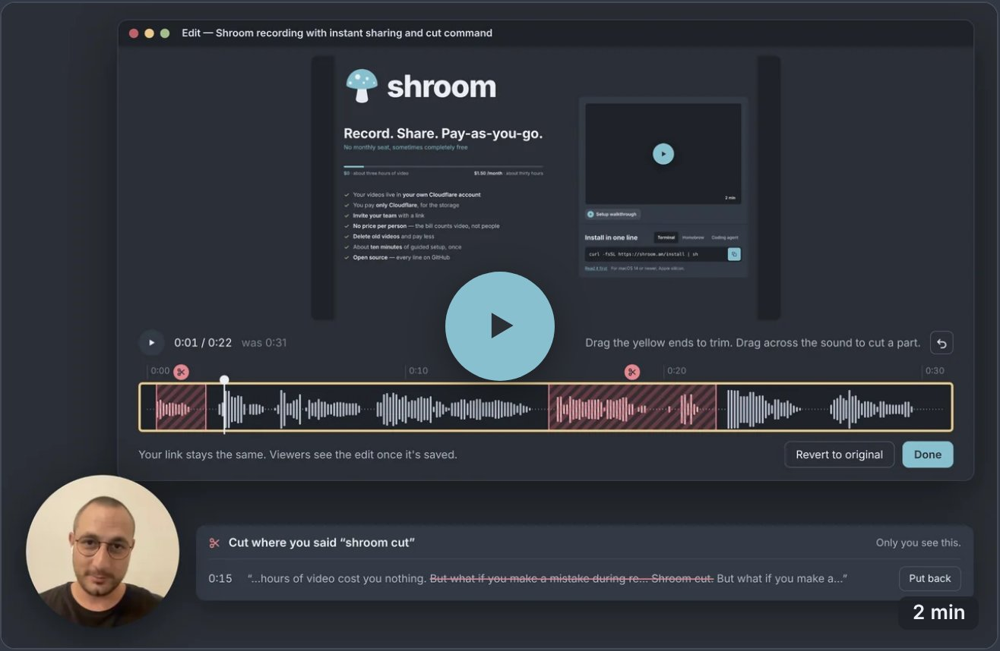

<p align="center">
  <a href="https://shroom.am"></a>
</p>

<h1 align="center">shroom</h1>

<p align="center"><b>Record. Share. Pay-as-you-go.</b></p>

<p align="center">
  Screen recordings that live in your own Cloudflare account.<br>
  No account with us, no subscription.
</p>

<p align="center">
  <a href="https://shroom.am">shroom.am</a> ·
  <a href="https://shroom.am/how-to.mp4">Setup walkthrough</a> ·
  <a href="https://shroom.am/faq">Questions and limits</a>
</p>

<p align="center">
  <a href="https://github.com/sponsors/bagrat"><picture><source media="(prefers-color-scheme: dark)" srcset="docs/readme/sponsor-dark.svg"></picture></a>
</p>

<p align="center">
  <a href="https://shroom.am/hero-2.mp4"></a>
  <br>
  <sub>shroom, recorded with shroom · 2 min</sub>
</p>

## Install in one line

```sh
curl -fsSL https://shroom.am/install | sh
```

[Read it first](https://shroom.am/install). For macOS 14 or newer, Apple silicon.

**Homebrew**

```sh
brew install --cask bagrat/shroom/shroom && open ~/Applications/shroom.app
```

**Coding agent**

```text
Install shroom on my Mac: read https://shroom.am/agent and follow it.
```

[Read it first](https://shroom.am/agent). Your agent asks you before it runs anything.

## What would it cost?

Nothing to us: there's no account with us and no subscription. Your videos live in your own
Cloudflare account, and Cloudflare charges for storage only. At normal quality, about three
hours of video fits in Cloudflare's free tier. Beyond that it's about 5 cents per hour of
video per month. Delete old videos and the bill goes down. Cloudflare doesn't charge for
people watching.

A team of 20, an hour each a month: $0.85 with 30-day cleanup, $11.85 kept a year.
[Try your own numbers](https://shroom.am).

## Why shroom?

-  Your videos live in **your own Cloudflare account**
-  You pay **only Cloudflare**, for the storage
-  **Invite your team** with a link
-  **No price per person** — the bill counts video, not people
-  **Old videos clean themselves up.** Pin the ones you keep.
-  About **ten minutes** of guided setup, once
-  **Open source** — every line on GitHub · [♡ Sponsor it](https://github.com/sponsors/bagrat)

What it needs, and what it doesn't do yet: [Questions and limits](https://shroom.am/faq).
Trouble, questions: [open an issue](https://github.com/bagrat/shroom/issues/new/choose), or
write to [hi@shroom.am](mailto:hi@shroom.am).

---

## For developers

shroom is a Tauri v2 app with a Rust core, plus the small Cloudflare Worker it sets up in
your account. The app builds and records on a Mac with Apple silicon; most tests run
anywhere.

```sh
npm ci
cargo test --workspace      # the Rust core; the recording tests need a Mac
npm test --workspace app    # the app's webviews
npm run test:site           # shroom.am
```

- [`docs/ARCHITECTURE.md`](docs/ARCHITECTURE.md) — how it's built: the crates, the app, the
  Worker and how they fit.
- [`spec/MACHINE.md`](spec/MACHINE.md) — what shroom does and says, state by state
  (generated from [`spec/machine.json`](spec/machine.json), the spec).
- [`docs/`](docs/) — the rest: decisions, testing, releasing.
- [`CONTRIBUTING.md`](CONTRIBUTING.md) — issues and pull requests.
- [`CLAUDE.md`](CLAUDE.md) — how work on shroom is done, and where everything lives.

## Licence

[MIT](LICENSE). Third-party notices: [`THIRD-PARTY-NOTICES.md`](THIRD-PARTY-NOTICES.md).
