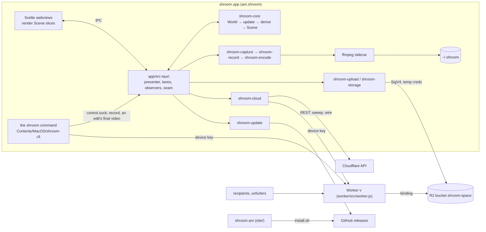

# shroom v1 — architecture

> **Current architecture as built (2026-10-14, tree 0.1.8).** The design record this
> replaced — with its rejected alternatives and probe evidence — is
> [`history/design/ARCHITECTURE.md`](../history/design/ARCHITECTURE.md); decisions are
> [`DECISIONS.md`](DECISIONS.md). The Worker's contract is
> [`WORKER-INTERFACE.md`](WORKER-INTERFACE.md) (WI).
>
> **How to read it.** Each section says what the code does now. The spec
> ([`machine.json`](../spec/machine.json), read as [`MACHINE.md`](../spec/MACHINE.md)) says *what* v1 does and wins every
> disagreement; spec bends are [`DEVIATIONS.md`](DECISIONS.md#deviations-from-the-spec) (DV). Citations: `D:Bxx`,
> `DV #n`, `SM:<line>` (the retired spec text, `history/spec/UX-STATEMACHINE.md`) or `Nxx`, `WI §x`, and `path` or `path:function`. Section numbers are
> stable: code comments cite them.

---

## 1. What v1 is

A macOS menu-bar app (Tauri v2 shell, Rust core) that records the screen, a microphone and
an optional camera bubble, encodes locally to HLS-fMP4 segments plus a single-file MP4, and
uploads straight into **the user's own Cloudflare R2 bucket**. Every link
(`v.<name>.workers.dev/<id>`) is served by **one Worker the app deploys into the user's
account**; the page exists from the moment Stop is pressed. No shroom server, no account, no
OAuth. Setup is one pasted Cloudflare token; afterwards the token does admin work only and
every upload runs on a short-lived per-recording credential. A space is multi-member from
birth: invites and members (N3), and the owner's other Macs (N33, provisional).

### Component map



---

## 2. Repo layout and crate boundaries

One Cargo workspace (resolver 3, edition 2024, Rust 1.88; D:B1, B3): `crates/*`,
`app/src-tauri`, `tests/e2e-live`. One npm workspace: `app`, `worker`, `tests/e2e`. scap
pinned at rev `fb3f2438` with its `workspace-hack` replaced by `vendor/workspace-hack`; cidre
at `bf84b67079a8` (D:B2). Svelte 5, TypeScript 5.9.

| Path | Owns | Tests |
|---|---|---|
| `crates/shroom-core` | `World`, `update`, `derive`, `settle`, `Scene`, events/effects as data, `copy.rs` (every said-line), `trace.rs` (D:B93), `derive/status.rs`. No Tauri, AppKit, network, threads or clock reads | §3.7 |
| `crates/shroom-capture` | SCK capture, device lists, Continuity classifier (D:B48), cpal mic (D:B17), `CameraSource` (D:B33, B120), `CameraPreview`, harness beep/loopback | `devices::tests` |
| `crates/shroom-record` | `Recording`: frame hand-off (D:B16), takes, audio clock (D:B18), finalize, `repair` (D:B23, B70), `stall` | synthetic seam |
| `crates/shroom-encode` | `args::ffmpeg_args` (pure), `clock`, `take`, `playlist::assemble_mapped`, `quality`, `locate` (D:B82), `sound` and `quiet` (a take's sound read in Rust; D:B201) | argv goldens |
| `crates/shroom-edit` | the edit list (`EditList`, `Saved`, `keep()`; D:B195), its operations, the voice-cue planner (`plan`, `land`, and `questions`/`plan_with` for the judgment above it; N65, D:B201, B202) | keep vectors, the POC's takes |
| `crates/shroom-storage` | SigV4 (session tokens); S3 put/get/head/delete/list, `put_if_absent`, `get_with_etag`/`put_if_match` (D:B21), multipart `put_file` | botocore vectors |
| `crates/shroom-upload` | `new_id`, `keys`, `meta`, `master`, `upload` (`claim → go_live → finish`, the beat), `live`, `library` (+ `cleanup`), `voice` (N65) | L1 bucket |
| `crates/shroom-cloud` | REST client behind `Policy`; `sweep`, `wire`, `mint`, `owner`, `member` (client for `/_shroom/api/`), `registry`, `device` | L1 fake; `SHROOM_LIVE=1` |
| `crates/shroom-cloudfake` | L1 Cloudflare + R2 stand-in, fault seam (D:B64) | tests |
| `crates/shroom-update` | manifest, `offer`, verified download, `same_signer`, `SWAP_SH` (D:B31, B125) | `tests/release.rs` |
| `crates/shroom-cli` | the `shroom` command (spec N62; D:B215–B219): `home` (its app's folder, from the bundle it ships in), `space` (the page under the device key: list, rename, delete, an edit's record, members, invites, cleanup suggestions), `app` (asks the running app over `control.sock`), `edit` (`shroom edit`, N72, D:B225), `batch` (many at once), `say` (every line it says), `out` (codes and exit statuses), `log` (its own `logs/cli.log`) | unit; `tests/space.rs` on the real `worker.js` (`worker/dev/serve.mjs`); `tests/edit.rs` on it too; `tests/flavor.rs`, `cleanup.rs`, `voice.rs`, `log.rs`, `version.rs` |
| `crates/shroom-testpattern`, `shroom-spec`, `shroom-devtool` | media-truth strip (D:B59 d); spec fixtures as types; the heartbeat's test space up/down | dev only |
| `tests/e2e-live` | L2 on the dedicated test account | live |
| `app/src-tauri` | `main.rs`, `commands.rs` (IPC), `runtime/` (runner, lanes, presenter, overlays, observers, seam), `harness.rs`/`drives.rs` (only with `dev-harness` in a `.dev` build — D:B5, B55, B62) | drives, `tests/l5/` |
| `app/src-tauri/src/runtime/editor.rs` | the editor's lane (N63, D:B195, B197): the record read over a rename's door, the video found in a take or fetched to `edits/<rec>/`, its peaks, the save (`meta.edits`), the final video on a lane of its own with its progress, the bake, and the upkeep (§3.3) | `editor::tests`; `--drive editor` |
| `app/src-tauri/src/runtime/media.rs` | `shroom-media:`: each editor window's video, as the editor's lane registered it, by byte ranges, and its peaks — to that window's webview alone (N73) | `media::tests` |
| `app/src` | webviews (`Popover`, `Onboarding`, `Library`, `Settings`, `Feedback`, `Editor` with `editor/`, `members/`, `join/`, countdown), `lib/ipc.ts`, `lib/typed.ts`, `lib/theme.css` (D:B122) | galleries; `editor/*.test.ts` (vitest) |
| `worker/` | `src/worker.js` (one dependency-free module), `vendor/hls.min.js`, `page-version.json`, `dev/serve.mjs` | vitest + workerd contract (D:B63) |
| `installer/`, `site/` | `install.sh` (D:B29, B44; links the `shroom` command, D:B217; the app links it once for a Mac installed before it, D:B239); the Homebrew cask and its renderer, `homebrew/` (D:B175); shroom.am Worker, with `/agent` for a coding agent (D:B132), `/cli` its guide to the command (D:B219), and `/report` with its `/feedback` form (D:B180) | their `test/` |
| `tools/`, `.github/workflows/` | release build, packaging, identity, ffmpeg, notices; `ci.yml`, `release.yml`, `site.yml`, `e2e.yml`, `e2e-full.yml`, `mac.yml` | CI |

**Flavors** come from the bundle identifier alone (`runtime::Flavor::of`, D:B97; the
Preview flavor retired, D:B148): Release `am.shroom` (`~/.shroom`); Dev `am.shroom.dev` (`~/.shroom-dev`, quiet
shell, fenced to `shroom-test-…`, the only flavor taking dev flags: `--home`, `--cloud-fake`,
`--space-base`, `--releases`, `--update-target`, `--as-version`, `--live-shell`,
`--e2e` (D:B127; its space is the run's own, `v-<run>` over `shroom-space-<run>`, D:B131)).
The `shroom` command inside a bundle takes that bundle's identifier by the same rule, so a dev
build's command reads `~/.shroom-dev` and opens the dev app (D:B215).

---

## 3. The core's shape: World → derive() → Scene

Law 1 (SM:106-107): state is derived, never a step counter (D:B22). Renderers own no state;
laws are invariants over (World, Scene); edges and rules come from `spec/machine.json`.

### 3.1 Thesis

`crates/shroom-core` is three pure functions and a loop around them in the runner.
- One `World` holds **facts** apart from **what the person asked for**: `Prefs` and `Once`
  (persisted) and `Session` (memory only, ≤ 12 fields; `tests/fitness.rs` counts).
- `update(&mut World, Envelope) -> (Vec<Effect>, Arm)` (`lib.rs`) is the only writer: stamp
  time, `apply::apply`, mark ops inflight, `settle`, mark again.
- `derive(&World) -> Scene` is pure and total: tray, popover (≤ 1 banner, ≤ 1 status line),
  three windows, countdown, bubble, camera preview, `dock`, Return/Esc, `next_wake`.
- `settle(&World) -> Vec<Effect>` is an ordered list of pure `due_*` reactions; it never
  writes.

Law 1 by construction: no persisted type names a state id (`tests/fitness.rs`); screen-
dependent input resolves through `derive` on the current World; every entry carries a
`QuickProbe` and stamps the door's `entered`, so `settle` re-probes anything older.
`Net.online` comes from NWPathMonitor (`runtime/net.rs`).

### 3.2 The types

Abbreviated from `world.rs`, `event.rs`, `effect.rs`, `scene.rs`.

```rust
Mono(u64)  // ms monotonic, stops in sleep: freshness, deadlines.   Wall(i64)  // unix ms: user-visible expiries
Envelope { mono, wall, event }        Fact<T> { Unknown, Known { v, at, probing } }
SecretId(u32)  // stash handle; the core never holds secret text
TakeDir(String) // yyyymmdd-hhmmss-xxxx      RecId(String) // B14 id: prefix from capture start, link once published
World { now, wall, launch, mac, net, space, sweep, take: Option<OpenTake>, saved, queue, removed,
        library, library_ops, update, members, inflight, popover_closed, prefs, once, session }
LaunchKind { User, LoginItem, UpdateRelaunch, PermissionRelaunch, Install{join}, InstallUpdate, UpdateFailed }
SpaceIdentity { account_id, label, subdomain, host, bucket, role: TokenHolder|OwnerClass|Member,
                member_id, owner_name, account_name, foreign_v }          // space.json
Phase { Starting, Recording, Pausing(Cause), Paused(Cause), Resuming, Finalizing(Why) }
Cause { User, DisplayLost, MicLost, CameraLost, Asleep, Locked, MicRevoked }
Why { Stop, GetLink, DiskFull, ScreenRevoked, Discard, CaptureDied }
Inflight { ops: Op → deadline, failures: Op → {at, class, tries} }   FailClass { Transport, Refused, Timeout, Panicked, Unclassified }
Prefs { source, show_yourself, camera, mic, mic_off, quality, bubble_at, setup_chosen, settings_tab }   Once { seen_version }
Session { popover, windows: WindowKind → Door, fork, chapter, fields, confirm, arming, last_stop, page_open, copied }
Door { opened /* law-4 visibility */, entered /* freshness */, asked }
Event { Booted, TrayClicked, Reopened, Act{surface,action,rev}, Key, PopoverDismissed, Field, SecretPasted,
        WindowClosed, WindowFocused, PopoverKeyed, BubbleMoved, QuitRequested, Os(_), Rec(_), Scanned,
        Cloud(_), Upload(_), Library(_), Update(_), Member(_), Failed{op,class}, Tick }
Effect { Recorder, Publish{dir,rec}, Uploader, Cloud, Shell, Persist, Takes, Library, Updater, Member }
Scene { tray, popover, onboarding, library, settings, countdown, bubble, preview, dock, next_wake }
```

`Scene` is `Serialize`, effects are not; webview types are hand-written (`app/src/*/types.ts`). Join links arrive as `MemberNews::Arrived` (D:B39). Helpers:
`World::open_since` (arming's `started`, else the take's `opened` — "take open" includes the
countdown, DV #3) and `row_six_done` (`mac.primed.is_some()`, per Mac).

### 3.3 Flow and threading

**The loop** (`runtime/mod.rs:run`, thread `shroom-core`), no locks around the World, no
async runtime:

```
loop {
  first = rx.recv_timeout(until next_wake)          // timeout → Tick
  for env in once(first).chain(rx.try_iter()) {     // coalesce a burst
      (fx, arm) = update(&mut w, env); log arm + effect kinds; ring::step(..) }
  scene = derive(&w); watch.after(..)               // dev: trace::breach law checks
  presenter.present(&scene); snapshot = scene; wake = scene.next_wake
  status::publish(posture(&w))                      // §11.2, only on change
  dispatch(effects)                                 // lanes; Publish/Persist inline
}
```

**`apply`** arms return `Arm { name, edge }`. Fact arms copy reports (`Os(Woke)` marks
network facts stale). Input arms resolve through `derive(w)`: `TrayClicked`/`Reopened` →
`tray.click`; `Key` → `ret`/`esc`; `Act` is dropped unless `derive(w).offers(surface, action)`
(Dismiss and countdown excepted). Intent arms write only Prefs, Once, Session. `Booted` runs
a user launch as a click; `LoginItem`/`InstallUpdate` open nothing; update and permission
relaunches restore the `restore.json` window if ≤ 2 min old and `why` matches (`RESTORE_MS`).

**The door** (`derive/tray.rs`): countdown → CancelCountdown; Recording → Pause; Paused →
ShowPaused; other phases → Nothing; no space → onboarding (invite window, welcome, `account`
if `setup_chosen`, the plan if a token is saved); row six not done → the plan (DV #5); else
config.

**Law 3's single gate.** `Effect::Publish` comes only from `Rec(Finalized(Ok))` in
`Finalizing(Stop | GetLink)`. Get link on a saved take adopts it in `Finalizing(GetLink)` with
`RecCmd::Confirm`. `dispatch` writes `publish.json` on the core thread with the title
"Untitled — <Mon d>" (`runtime::untitled`). Disk-full and screen-revoked finalize into a saved
take with `last_stop = AutoStopped`.

**Races, first cause wins:** a `Pausing(c)` is never overwritten; disk floor and screen
revoked upgrade to `Finalizing(DiskFull|ScreenRevoked)`; a user Stop/Discard is never
downgraded; `FrameStall` with the source present is `CaptureDied`.

**`settle`** order: validate, save, sweep, gate poll (5 s), wire, prime, reconfirm (25 d),
reach, page, upload, space sweep, self-check, space gate poll, space wire, page refresh,
library, update check, update download, peek, join, probe, roster, keep-awake, cleanup, sleep
ack. Settling right after `update` is empty (the idempotence test). Row 9, the periodic ones:
the token Mac's whole probe pass at launch and every 6 h awake (D:B51); page refresh once a
launch, 1 h retry (D:B50 c, B53 a); update check at launch and every 4 h; cleanup 10 min
after the first sound pass, then 6 h (D:B91). `RequestPermission` comes only from an Act or
the chapter's chained screen step, never with a take or countdown open.

**Liveness.** `Op::deadline_ms`: a recorder's start 5 s, a pause, resume or stop under way 60 s (D:B226); Reach 600 ms; cloud/member/library 60 s;
Wire and Refresh 3 min; Relaunch 10 s; update check 10 s, download 30 min, apply 30 s;
Cleanup 10 min. Every lane job answers once (news or `Failed{op, class}`); a passed deadline
becomes `Timeout` at its Tick. Failures back off 5 s doubling to 2 min
(`Failure::retry_at`, DV #8), not on NWPathMonitor flips. `wizard-offline` shows while the row
is network-bound and `online == false` or the newest failure is Transport and newer than the
newest success (a wizard answer proves the network is back). A recorder failure is
`CaptureDied`: `Recorder(Abandon)`, `take = None`, `Takes(Rescan)` → an interrupted saved
take and an unasked recovered-take banner (DV #6). Restart discards the old take only on the
new `Rec(Started)`.

**Threads** (`rg 'name\("shroom-'`):

| Thread | Runs |
|---|---|
| main | presenter (tray, panels, windows, Dock), `probe::quick`, shell effects |
| `shroom-core` | the loop; `Publish` and `Persist` writes |
| `shroom-recorder` | `Recording`; serial Start/Pause/Resume/Marker/Finalize/Confirm/Discard/Abandon/Prime, and Warm/Cool (the count's mic, D:B173); holds `LOCK`; 1 s watchdog mid-take: disk floor → `DiskFloor`, liveness (`STALL_AFTER` 5 s) → `FrameStall` or the revoked grants, mic lost flag → `MicLost` (D:B47) |
| `shroom-uploader` | mid-take `LiveUpload`, the pass (§9), `cred.json`, owed discards |
| `shroom-cloud` (+ `shroom-wizard`, `shroom-key-ahead`) | Reach (600 ms), `OpenOwnerPage`; the wizard's calls on their own sub-lane; the owner key minted ahead mid-take |
| `shroom-member` | every `MemberCmd`, serial; answers from a left space dropped (`space_gen`) |
| `shroom-library` / `shroom-cleanup` | Library cache, refresh, rename, delete / the cleanup sweep |
| `shroom-takes`, `shroom-updater` | rescan, Save to Movies, delete, set aside / check, download, apply |
| `shroom-observe` | CGDisplayReconfiguration, AVCaptureDevice, NSWorkspace sleep/wake/session, screen lock, mic re-probe 2 s, disk + UTC offset 30 s, grants re-read 2 s mid-take (D:B47) |
| `shroom-power` (+ `-cap`) | IOKit will-sleep → `Os(WillSleep)`; the core pauses a recording take and answers `AllowSleep` once paused or after 2 s; `HOLD_CAP` 2.5 s; idle sleep never vetoed (D:B92) |
| `shroom-seam` | the seam's 2 s grants re-read |
| `shroom-editor` (+ `-open`, `-copy`, `-bake`, `-upkeep`) | the editor's lane (below): Save inline; an open, a bake and an upkeep pass each on a thread of its own; the final videos one at a time on `-copy` |

Keep-awake (`os.rs`) is held while `settle::can_drain` (D:B34).

**The editor's lane** (`runtime/editor.rs`, N63, D:B195, B197). Nothing it runs waits on
anything else it runs: Open, Save and Copy answer while a bake or an upkeep pass is out.
- *Open* (each editor window's on a thread of its own, N73) reads the record, finds the video
  (a take on this Mac when the record still plays its `video.mp4`; else
  `edits/<rec>/source.mp4` when `source.key` names the record's file; else fetched) and its
  peaks, registers them to its window, and posts `Opened` with `keep_until` (Wall ms) only
  while the edit's copy is current. Esc or ✕ mid-fetch stops it. Its failure, and its
  save's, are `Failed { EditorOpen(id) }` and `Failed { EditorSave(id) }`: the window's own.
- *Save* is one record write (`save_edits_over`). It writes nothing and fails as `Refused`
  (logged) when the video moved on since the open — `bakedFrom` grew or `media.mp4` changed:
  it was baked while the window was open. That is judged inside the write, on the record it
  would replace. A `Refused` save (that, or a tombstone) is the core's `editor-save-refused`:
  nothing can be saved, and the window only closes (B199).
- *Copy* (one at a time): `shroom_encode::cut::render_with` (VideoToolbox, then libx264 if that
  fails), the poster and teaser best-effort, three PUTs, then `set_edit_copy` writes `copy` and
  `keep_until` (now + 2 days). `EditorNews::Making { rec, pct }` goes at most every 250 ms and
  only forward: ffmpeg's `-progress` over the kept seconds is 0–80, each file's PUT 95, 97,
  99, and the record 100. It answers `CopyDone { named }` — `named: false` when it dropped
  the copy instead, the record having moved on (a newer save, the edit gone) or the revision
  leaving nothing out, and the window then asks nothing about the original (B199) — or
  `Failed { EditorCopy }`; a closed window doesn't stop it.
- *Bake* (Yes, delete): `shroom_upload::library::bake` over the door, on its own thread. It
  answers nothing (the window has closed), logs what happened, and on success drops
  `edits/<rec>/`. A bake that didn't land is the upkeep's after the two days.
- *Upkeep* (`settle::due_edit_upkeep`: at launch, then every 6 h awake, not over a take, not
  offline, every editor window closed and its lane idle). It reads the space's records now, never
  only `library.json` (which hears of an edit only when the Library refreshes) and without
  writing it (`library::Doorway::listed`). The token Mac lists `meta/` over its pair, reads
  what changed since the cache, then each record that holds an edit. Any other Mac pages the
  Library API (§13; `mine` for a member, `everyone` for the owner's Macs), sending the
  cache's ETags only for rows without an edit, so each record holding one comes back whole.
  Then `upkeep_plan`: it bakes the due ones and makes the missing copies when their video is
  on this Mac, through the same copy code with no `Making` news. Last, it prunes `edits/`
  (§3.4) and answers `UpkeepDone { baked, copies }` or `Failed { EditorUpkeep }`. Transport
  ends the pass; a bake or copy that fails is left for the next. The token Mac's cleanup
  sweep also bakes every record in the space that's due, and finishes a bake cut off after
  its write (`shroom_upload::library::cleanup_sparing`). Neither bakes a video an editor
  window is open on (the Scene's, asked before each bake); a later pass does.

**Trace.** `logs/run.log` (600, rolled at 5 MB) logs each event, arm and effect kinds.
`trace::Ring` keeps the last 512 steps (kinds, arm, edge, state ids on change), names read at
most two variants deep so no value or secret enters; `runtime/ring.rs` writes it into
`run.log` on a dev-build law breach, a rescued take, a panic (after the panic's own line:
its thread, where, and its message cut to 160 characters) and each harness run's end (D:B93). The `shroom` command keeps its own, `logs/cli.log` (600, rolled at 64 KB; D:B215):
one line a run — stamped as `run.log`'s are, the verb and the options' names, `ok` or the
code and exit, what it counted, the space's or the app's refusal, the time it took; never a
word it was given. Report a problem and Copy diagnostics carry its last 30 lines among the
app's by their time (`report::clean_logs`), the whole within the report's 1,000.

### 3.4 Persistence under `~/.shroom`

Per-flavor home (§2): dir 700 owned by the user (`Home::ensure_private`), files 600, atomic
(temp, fsync, rename), `"v": 1`. Unreadable or newer reads as absent and is re-probed; a
take dir as saved; nothing is deleted for being unreadable. The core reads only via `Booted`
and `Scanned` and writes only via effects; `home::FILES` whitelists top-level names.

| File | Written / cleared |
|---|---|
| `token.json` | after Validate, before wiring / exit |
| `device.key` `{host, did, secret}` | join, enroll / exit |
| `space.json` (identity + `device_id`) = provisioned | wired, join 200; re-proved each entry / exit |
| `primed.json` | clean Prime (row six); kept on exit |
| `screen-asked.json` | the first screen-recording ask on this Mac (N43, B146): later asks open System Settings themselves; kept on exit and on Disconnect |
| `prefs.json`, `once.json` | `Persist`; kept on exit (minus `setup_chosen`) |
| `restore.json` | before update apply or permission relaunch; read once, ≤ 2 min |
| `invite`, `join.json` | an invite held; a join asked for (replayed at launch) / removed when behind |
| `library.json`, `posters/` | library lane / exit |
| `edits/<rec>/` | the editor's lane (N63): `source.mp4` (fetched from the space, kept for the next edit) and `source.key` (the file it came from: a baked video is fetched again), `peaks.u8`, a final video while it's cut and sent / its bake; the upkeep's prune (the recording gone from the Library, a fetched video its record no longer plays, or nothing in it written for 7 days; never the open one); exit |
| `status.json` | §11.2 |
| `control.sock` | the `shroom` command's door into the running app (§3.5, D:B216): made at start (600; one a crash left is replaced), never read by anything else |
| `forget/<rec>` | owed remote discards (D:B52 e) |
| `updates/<version>/shroom.app` | a verified staged update |
| `logs/run.log` | §3.3 |
| `logs/cli.log` | the `shroom` command's own (§3.3, D:B215): the one file it writes, and only where shroom's folder exists |
| `takes/<dir>/` | below |

**A take dir is its own truth** (`runtime/takes.rs:classify`, pure). Markers: `LOCK` (flock:
live, skipped); `take.json {v, rec, created}`; take files `stream_<k>.m3u8`, `init.mp4`,
`init_<k>.mp4`, `seg_NNNNN.m4s`, `preview_<k>.mp4`; `finalized.json {v, length_ms, why}`;
`stream.m3u8` (joined); `markers.json`; `publish.json {v, rec, title, stopped}` — **the one
durable intent**; `cred.json`; `claimed`; `live {stream, total}`; `preview.mp4`,
`poster.jpg`, `teaser.mp4`; `uploaded`; `movies.json`; `tombstoned` / `set-aside` (never
re-queued, DV #27). Unlocked without `finalized.json` → interrupted (repaired at boot);
`publish.json` ∧ ¬`uploaded` → the queue; finalized without `publish.json` → saved.

**Never on disk:** the Session, the take's phase, inflight, Library and Members rows.

**Exit** (Disconnect, Leave; `apply.rs:disconnect`): refused while uploads drain or a
recovered take waits; Save to Movies offered first; stranded takes deleted; `Persist(Wipe)`
(`runtime/mod.rs:wipe`) deregisters best-effort (3 s) and removes `space.json`, `token.json`,
`device.key`, `library.json`, `invite`, `join.json`, `restore.json`, `posters/`, `edits/`,
every `cred.json`, the stash. Prefs, `once.json`, `primed.json`, other takes and the login item
stay. A switch keeps the old space's files until the new join's 200 (D:B42, B54 c).

### 3.5 The IPC contract

**Surfaces** (`runtime/presenter.rs`, the only place the Scene becomes AppKit):
- Tray face; a one-item menu only when `right_menu`.
- Activation policy from `Scene.dock`: Regular iff any window is open (law 6 as ratified;
  DV #38 reverted). The bundle is `LSUIElement` (D:B113). Closing the last keyboard surface
  hands the keyboard back to the person's app (D:B105 d).
- Popover and countdown: native `NSPanel`s **born** non-activating (`runtime/overlay.rs`,
  D:B106), made once at start (`overlay::prepare`), on every Space and over full-screen apps
  (DV #40); shown with `orderFrontRegardless`, key only when asked; shroom is never
  activated. Losing the keyboard closes nothing; a click elsewhere closes an asked popover
  (`overlay::click_away`) unless it is a switch (`overlay::switches`, DV #39).
- The agent label (N62, D:B216): the third such panel, made with the others, never key and
  passing every click through (`setIgnoresMouseEvents`). While `Scene.label` is set — a take
  the `shroom` command started, recording — the presenter puts it at the top right of the
  take's display, 8 points under its menu bar (the screen's visible frame), 12 in from its
  edge (`presenter::label_frame`). It is never made late (`overlay::ensure`): wanted only
  once capture runs, a panel made then could miss that take's list of what it leaves out.
  Made at start or not at all; without it, the tray shows the take.
- The marker toast (N78, D:B246): the fourth, made and held as the label is. While
  `Scene.toast` is set — two seconds after ⌥⌘M answered, until a popover or a count comes
  up over it — the presenter puts it where the label goes, or just under the label when
  that shows (`presenter::toast_frame`). Its page (`app/toast.html`) draws the pill inside
  the panel's margin with its own shadow (the panel casts none, so the shadow fades with
  the pill), fades it in and out, and starts again on a new press (`pressed`). Made at
  start or not at all; without it, ⌥⌘M still drops its marker, unanswered on screen.
- Windows: onboarding 600×680 (B189), Library 680×560 (resizable), Settings 600×720 (B247), Send feedback 520×600, the editor 1100×720 (resizable down to 900×640; a resizable window opens no bigger than its screen) — each its frame, macOS's 32 pt title bar inside it. One window each, but the editor's: one per video (N73, D:B227), each labelled `editor-<its number>` (`presenter::label`, the core's `EditorId`), the capability listing them as `editor-*`. A new one opens down and to the right of the newest editor window open (AppKit's cascade). An editor, the Library and Settings are destroyed when they close, not hidden (`presenter::closes_for_good`; D:B229): each comes back only when reached for, so the page made again then brings shroom forward only when asked (B106); the setup window and Send feedback are hidden. An editor's title is its slice's, “Edit — <title>”; its ✕ is posted like any window's, and the core may keep it open to save.
- Camera panels (`runtime/camera.rs`): bubble and Camera-only preview (§4.4).
- Every overlay, the setup window and Send feedback join `Runtime.excluded` when made and
  are left out of capture (`WindowKind::recorded`); the Library, every editor and Settings
  are recorded like any app's windows (N82, D:B256), and so is the bubble. Overlays and camera panels don't hide on ⌘H (D:B112).

**Core → webview.** After every loop turn each showing surface gets its whole slice:
`emit_to(label, "scene", slice)` — no diff, no `rev` (D:B107). On mount, `scene_get`. Slices
carry final copy, actions, enabled flags, styles, notes, `ret`, `esc`, `activates`. Svelte
composes no sentences and decides nothing.

**Webview → core** (`commands.rs`, `app/src/lib/ipc.ts`):

| Command | Contract |
|---|---|
| `act {surface, action, rev}` | dropped unless offered; Start and popover Return post fresh `Os(Grants)` first (`commands::arms`). An editor window names its surface `editor`; which one is its webview's label (`commands::surface`), never what the webview says |
| `key {surface, key}` | Return/Esc via `ret`/`esc` |
| `field {field, value}` | `name`, `library-search`, `title`, `invite-name`; returns nothing; cut to 256 chars; the core guards (name charset/63, composer 80). Scene fields carry edit counts; `lib/typed.ts` takes the Scene's value only once its count catches up |
| `paste_secret {field, text}` | the one path for secret text (`token`, `invite`): classified, stashed (`runtime/stash.rs`), `SecretPasted {id, shape}` posted; the field shows fixed dots while held (D:B104) |
| `scene_get`, `dismiss`, `popover_keyed`, `popover_fit` | snapshot slice (an editor window's own, by its label); `PopoverDismissed`; first key makes an unasked popover asked; panel height |
| `edit {step}` | an editor window (N63): `{"op": "undo" \| "redo"}`, or a `shroom_edit::Op` (`trim`, `cut`, `put-back`, `apply`, `revert`), seconds on the recording; posts `Edit(id, EditStep)` for the window its label names, which the core takes or refuses. A step that doesn't read, or from a webview that isn't an editor window's, is dropped |

Window lifecycle comes from Rust window events.

**Media.** An editor window plays from `shroom-media://localhost/<rec>/video` and draws from
`…/<rec>/peaks` (`runtime/media.rs`): only the recording its lane registered for that window,
only to that window's webview (N73), the video by byte ranges a piece (2 MiB) at a time,
anything else 404. The
policy (`tauri.conf.json`) lets `media-src` and `connect-src` reach the scheme, nothing more.

**The `shroom` command → core** (`runtime/control.rs`, spec N62, D:B216). `control.sock` in
the flavor's home, opened once the core has handled `Booted` (an earlier ask would meet an
empty World): the socket 600 in the 700 folder, each connection's peer uid checked
(`getpeereid`), one JSON line each way, at most 1 KB in: `{"v":1,"op":"record.start"}`
(`.pause`, `.resume`, `.stop`) → `{"ok", "take", "error"?, "link"?}`. The runtime holds the
connection and posts `Event::Cli {id, op}` (a start posts fresh `Os(Grants)` first, as the
popover's does); the core answers each once with `Effect::Cli` — a code, never words:
`not_set_up` for all four on a Mac with no space, then `recording_off` while General's
switch (`Prefs.agent_recording`) is off. Otherwise each ask is its click (the popover's
Start, open or not; the tray's pause; the paused popover's Resume and Stop); a stop answers
with its link and copies nothing. The command words `recording_off` with the settings link,
`shroom://settings/agent`: it reaches the app as any link it's opened with
(`RunEvent::Opened` → `runtime::opened`, held until the core is up) and the core as
`Event::SettingsLink` — Settings on General, the switch's row lit for a moment
(`SettingsFields.lit`); it never flips the switch, and mid-take it opens nothing. The run
log has each ask and its answer by number (`control: ask 4 record.start no-count`,
`control: answer 4 no recording_off (3 ms)`), any connection dropped or ask not read, and
the agent label shown and gone. `shroom edit` (spec N72, D:B225) saves an edit itself,
through the space's page, and adds two asks, answered whatever the switch says:
`{"v":1,"op":"edit.check","id"}` before a change (`editor_open` while that video is open in an
editor window on this Mac) and `{"v":1,"op":"edit.copy","id","rev"}` after one, which owes that revision's
final video (`library_ops.copies`, cut as after the editor's Done). The id is read only in a
recording id's shape and logged short (`control: ask 7 edit.copy AbCd… rev 2`).

**Law 13 by type.** No Scene field can hold a secret; `Secret` is not `Serialize` and `Debug`
redacts. The `?k=` URL exists only inside `OpenOwnerPage`, opened through NSWorkspace. A
canary test checks every Scene and Effect for the test token, join code and `k`.

### 3.6 The six walkthroughs (short form)

Scripted in the core's region tests (`tests/onboarding.rs`, `tests/region3.rs`,
`region5.rs`, `region6.rs`) with law checks at every step: (1) token paste to done, through
`wizard-offline` and a quit mid-wire; (2) click → config → Return → countdown → recording →
pause → Stop → the page; (3) a display unplugged mid-take; (4) a crash → relaunch → the
recovered-take banner; (5) a join link mid-take waiting out law 4; (6) an offline stop.

### 3.7 The test plan against the fixtures

All L0. `tests/common/` holds `support.rs` (fixtures, World builders), `laws.rs`, `entry.rs`.
1. **Inventory**: every Core id has rows across the region tests (id shown, `ret`, verbatim
   ratified lines).
2. **Copy**: `tests/copy.rs`, `tests/copy_lint.rs` over one registry (D:B57).
3. **Oracle and enumeration** (`common/entry.rs`, `tests/enumerate.rs`; D:B56 a, B89):
   odometers over narrow projections (sub-derives still read `&World`); per case one
   classification, deterministic derive, the oracle agrees, static laws.
4. **Map edges** (`tests/edges.rs`, D:B56 b): all 125 edges; core rows by one event with the
   arm naming the edge; `BEATS` for undrawn beats; the converse check with `EXTRA_ARM_EDGES`.
5. **Laws** (`common/laws.rs`) on every step; `trace::breach` too.
6. **Replay**: persisted, rebooted, same probes → same Scene minus the Session.
7. **Races and liveness**: every ordering of {pause, display lost, sleep, disk floor,
   screen revoked}; law 12 — no failed op waits on a passed deadline (D:B57).
8. **Runner**: `tests/runner_contracts.rs`, app unit tests, drives.

### 3.8 Spec bends (to the deviations in `DECISIONS.md` before the core is scaffolded)

Built as DV #1–#10: (1) `setup_chosen` persisted; (2) an arriving invite persisted at once;
(3) "take open" includes the countdown; (4) the id is a storage prefix from capture start, a
link only via `publish.json` and the claim; (5) row six not done opens the plan; (6) capture
death = saved take + unasked banner; (7) not adopted — a tombstoned local take is kept; (8)
the numbers (§15); (9) quit-and-reopen recognized by `restore.json {why: Permission}`; (10)
the popover after a user pause counts as asked.

### 3.9 Rejected alternatives

The design record has them: history/design/ARCHITECTURE.md §3.9.

### 3.10 Left open

- QuickProbe cost: main thread, per entry, target ≤ 5 ms (`probe::quick` times it).
- Lid-close on battery: whether the pause lands inside the 2 s hold is Bagrat's checkpoint
  (D:B92).

---

## 4. Capture → encode → segments

### 4.1 The pipeline

1. **Capture** (`shroom-capture/src/screen.rs:ScreenSource`): SCK via scap/cidre,
   `with_display_excluding_windows`, pixel format forced to `_32_BGRA` (Tahoe's default gives
   NULL base addresses), cursor on, **60 fps at the output size, GPU-scaled** (D:B10).
2. **Hand-off** (`shroom-record/src/handoff.rs`, D:B16, B58 e): the 30 Hz clock samples the
   newest frame each tick (≤ 10 ms grace); a feeder writes ffmpeg's stdin and may block; the
   queue caps at ~256 MiB, then a tick repeats a frame. Length = wall time.
3. **Encode, one ffmpeg per take** (`args.rs:ffmpeg_args`, golden-tested):
   ```
   -hide_banner -loglevel error -y -f rawvideo -pix_fmt bgra -s WxH -framerate 30 -i pipe:0
   [-thread_queue_size 4096 -f f32le -ar <rate> -ac 1 -i <fifo>]
   -c:v h264_videotoolbox -b:v <k>k -pix_fmt yuv420p -r 30 -force_key_frames expr:gte(t,n_forced*6)
   [-c:a aac -b:a 128k [-ar <first take's rate>]] -f tee -map 0:v [-map 1:a]
   [f=hls:hls_segment_type=fmp4:hls_time=6:hls_playlist_type=vod:start_number=N:hls_fmp4_init_filename=init.mp4|init_<k>.mp4:hls_segment_filename=seg_%05d.m4s]stream_<k>.m3u8
   |[f=mp4:movflags=+frag_keyframe+empty_moov+delay_moov+default_base_moof:frag_duration=1000000:flush_packets=1]preview_<k>.mp4
   ```
   Never `-nostdin`: **EOF on stdin is the stop signal**; a take ends by closing input, never
   a kill (D:B23, B58 c). Forced keyframes + constant `-r` keep the HLS muxer from a 0-byte
   init. The MP4 leg is fragmented (1 s) so it survives a crash (D:B23).
4. **Quality** (`quality.rs`): Normal 1920×1080 @ 3500 kbps, 2K 2560×1440 @ 6000, 4K
   3840×2160 @ 12000; fit the box, never upscale, even dimensions.
5. **Which ffmpeg** (`locate.rs`, `runtime/mod.rs:find_encoder`, D:B82): release and preview
   run only `Contents/MacOS/ffmpeg` — FFmpeg 8.1.2, LGPL, no external libs, arm64, built by
   `tools/build-ffmpeg.sh` from the SHA-256-pinned tarball, shipped with notice and licence.
   Dev: `SHROOM_FFMPEG`, a sidecar, then Homebrew's.

### 4.2 Pause = segment boundary

- Pause ends the take: input EOF, encoder awaited, then the mic (D:B58 c).
- Resume starts a take at `take::next_start_number` with its own playlist and preview;
  timestamps restart at zero (D:B11).
- A later take writes `init_<k>.mp4`, never the shared `init.mp4`; `take::settle_init` drops
  it when byte-identical, else it becomes that take's map (D:B58 a).
- `Recording::finalize` joins takes into `stream.m3u8` (`playlist::assemble_mapped`,
  `EXT-X-DISCONTINUITY` per later take). It does not build the MP4 (§4.6).
- A click while recording pauses at once; the popover waits for the confirmation. Drop a
  marker lands at the pause point; ⌥⌘M while recording (N64; held beside ⌥⌘P, only while a
  take is open) at the length so far plus the open take's run. Each is in `markers.json` at
  once. Restart asks first (DV #44); its countdown is its undo. Discard deletes local and
  uploaded bytes, no tombstone.

### 4.3 Mic

- Never ffmpeg's avfoundation audio demuxer (history/POC-LEARNINGS).
- cpal at the device's native rate, mono f32le, through a per-take named pipe (D:B17).
  Device: the pick (`prefs.mic`), else the system default unless Continuity, else built-in;
  "No mic" records silently (`prefs.mic_off`, DV #43).
- It opens with the count, not at its zero (`RecCmd::Warm`/`Cool`, `shroom-record::warm`,
  D:B173): a Bluetooth headset wakes about 2 s after its mic opens. A Bluetooth mic is also
  held open through a pause; any other mic closes at the pause.
- The audio clock (D:B18) writes `elapsed × rate` samples from the first video frame,
  padding silence or dropping beyond ±80 ms. The first take fixes the rate; later takes are
  resampled to it. A/V measured ≤ 40 ms end to end (D:B59).

### 4.4 Camera bubble and camera-as-source

- **Bubble = an un-excluded native panel, zero compositing** (`runtime/camera.rs`, D:B47 g):
  180 pt, round, mirrored, a layer shroom draws the exact camera's frames into (the Scene
  names it; a picture that stops restarts its camera, D:B188); the overlays and the setup and feedback windows are excluded, the bubble is recorded as-is (as are the Library, the editors and Settings, N82). Born at
  `config`, through the countdown and take; follows the chosen display; dragged position in
  `prefs.bubble_at`; goes quietly if its camera leaves. The popover's camera picker is a camera
  pick or Camera off (DV #43); an iPhone is never auto-picked (D:B48). Panels open at once with a
  spinner (D:B119).
- **Camera as the source** (`shroom-capture/src/camera.rs:CameraSource`, D:B33):
  `cap-camera-avfoundation` into the same frame clock and rawvideo path; format via
  `format::choose` among formats holdable at 30 fps (D:B120). Its 400×225 unmirrored preview
  stays through the take (DV #42), never recorded.

### 4.5 Crash → recovered take; disk floor

- **Law 2.** A crash leaves closed segments and a fragmented MP4. At boot the recorder
  repairs each unlocked dir without `finalized.json` (`shroom_record::repair`): playlist
  rebuilt from closed segments, `finalized.json {why: interrupted}`; a rebuilt take re-sends
  everything (D:B70 a). Nothing is auto-published.
- **Disk** (D:B47 a): `disk-low` under 30 min of room; the floor is 1 min + 1 GB + the copy
  still to come, per quality (`derive::bytes_per_minute`, × 2 tee legs); checked every second
  mid-take; at the floor the take stops (`disk-full-stop`), never dying on ENOSPC.

### 4.6 The MP4 off the stop path

Stop → page never waits on the MP4. After the go-live the uploader builds `preview.mp4`
(`take::assemble_preview`: copy or concat with `+faststart`), then the teaser from it.
`take::ensure_preview` makes a copy from whatever is left (remuxing the playlist if needed)
for Save to Movies and recovered takes (D:B54 a).

---

## 5. Storage: the R2 key layout

One private bucket per space, `shroom-space` (D:B24). The Worker reads through its binding;
Macs write over S3 (SigV4, `https://<account>.r2.cloudflarestorage.com`, region `auto`).

### 5.1 Keys

`shroom-upload/src/keys.rs` (D:B13) and the Worker's constants:

| Key | Content / writer |
|---|---|
| `meta/<id>.json` | the record and tombstone; the recording Mac, Library, the Worker's title (D:B21) |
| `rec/<id>/master.m3u8`, `rec/<id>/v0/{init.mp4, init_<k>.mp4, seg_NNNNN.m4s, stream.m3u8}` | the stream (local names kept) |
| `rec/<id>/poster.jpg`, `teaser.mp4`, `video.mp4` | unfurl poster and teaser (D:B27); the single-file copy, title-independent |
| `rec/<id>/edit-<rev>.mp4`, `edit-<rev>-poster.jpg`, `edit-<rev>-teaser.mp4` | an edit's permanent copy, its first frame and teaser, cut by the Mac after a save and named in `meta.edits.copy`; the previous revision's go once a newer copy lands or the edit is reverted (N63, D:B195). After the bake `media` names them and the original's files go (D:B197) |
| `rec/<id>/tx/*` | reserved, never written |
| `.shroom/manifest.json` | `{schema:1, createdAt}`; a bucket is a shroom space iff it holds it; wiring, last, create-only |
| `.shroom/player/hls.min.js`, `.shroom/cookie.key` | the pinned player (D:B30); the cookie's HMAC key (create-only) |
| `.shroom/mark.json`, `.shroom/health.json` | the mark switch; the advisory "space can't take videos" flag |
| `.shroom/registry/roster.json`, `recs/<id>`, `rate/` | members, Macs, invites (CAS); the create-only ownership ledger; device budgets (D:B35, B37) |
| `.shroom/keys/<sha256(k)>` | one-time page-key grants |
| `.shroom/gone/<id>` | deletion seals no recording credential reaches (D:B125 M1) |

No `.shroom/` key is ever served: `/m/` reads only `rec/<id>/…`, `/d/` only `video.mp4` or
an edit's current copy (`edit-<n>.mp4`).

### 5.2 Recording id

`shroom_upload::new_id`: 12 CSPRNG bytes, base64url, 16 chars, 96 bits, no structure (D:B14).
The id is the link's only secret; no HMAC ids — unknown ids render "on its way" (N40).
Registry ids are `d_`/`m_`/`i_` + 16 chars.

### 5.3 `meta/<id>.json` (schema 1)

`shroom-upload/src/meta.rs:Meta`:

```jsonc
{ "schema": 1, "id": "…", "state": "uploading" | "live" | "deleted",
  "createdAt": "iso", "publishedAt": null|"iso", "deletedAt": null|"iso", "title": "Untitled — Aug 21",
  "durationSec": null|0.0,
  "media": null | { "hls": key|null, "mp4": key|null, "poster": key|null, "teaser"?: key, "width", "height" },
  "captions": null, "owner": null|"<member>",   // informational; ownership is the ledger (D:B54 f)
  "progress": null | { "done", "total", "updatedAt" }, "markers"?: [seconds],
  "titled"?: true,                                  // the Worker's title save (N26)
  "thumb"?: { "title": null|"…", "from"?: "poster.jpg"|"edit-<rev>-poster.jpg",    // Copy thumbnail, the Worker's (D:B164, B198):
              "gif"?: "thumb-<16 hex>.gif", "jpg"?: "thumb-<16 hex>.jpg" },        // `from` the first frame drawn from (N63)
  "edits"?: { "version": 1, "source_duration", "in", "out",                    // the editor's (N63, D:B195)
              "cuts": [{ "id"?, "start", "end", "kind", "confidence", "applied", "leads"?, "removed", "resumes"?, "why"?, "adjusted"? }],
              "voice"?: { "planned_at", "cues" },                              // the voice cues' plan (N65)
              "rev", "copy"?: { "rev", "file": "edit-<rev>.mp4", "duration", "poster"?, "teaser"? },
              "keep_until"?: "iso" },                                          // when the original goes (D:B197)
  "bakedFrom"?: [{ "at": "iso", "rev", "keep": [[s, e]] }] }                       // each bake, oldest first (D:B197), never served
```

`media` holds keys. Additive only; unknown fields kept (`extra`). **Every rewrite is
read-modify-write under `If-Match`** (`upload::update_meta`), retried on 412, stopping at
`deleted` (D:B21).

`edits` is `shroom_edit::Saved`: written only by a Mac, the editor lane's save (each bumps
`rev`) and its permanent copy (`copy`, current only while `copy.rev == rev`), over the
rename's door; the Worker's title and thumbnail rewrites keep it as written. The Worker
reads from it only the ranges that play and the current copy's names (`worker.js`
`editsOf`, §10): the cuts' transcript text (`leads`, `removed`, `resumes`, `why`, a later
voice cut's) never reaches a viewer. A cut whose edges were dragged in the editor is marked
`adjusted` (B195 (g)): its words are the ones first transcribed for it, and may no longer
be exactly what it cuts. An edit that leaves everything in is no edit.
**`edits.keep_until`** (RFC 3339, UTC) is when the original goes: the copy's landing sets it
two days on (`library::set_edit_copy`; naming the same copy again keeps the first time), a
save back to the original drops it with the copy, and the editor says by Revert how long is
left only while the copy is current (D:B197 (b), (e)).

**The bake** (D:B197 (c)), on Yes, delete or once `keep_until` has passed, makes the edit
the video: `media` names the copy's own files with `hls: null`, `durationSec` is the copy's
length, `markers` move onto the edited clock (one inside a cut or outside the trim goes),
`edits` goes, and `bakedFrom` gains `{at, rev, keep}`: when, the baked edit's revision, and
the ranges that played on the clock before it. Oldest first, the last 20 kept, so data kept
on an older clock (a transcript) maps through every later bake in order. A later edit
counts on the new clock, and its revision starts past every baked one (`record_rev`: one
past the highest of `edits.rev` and each `bakedFrom` `rev`), so its copy never takes a file
name the video now plays from.

**`thumb.from`** (D:B198) stamps what Copy thumbnail's pictures were drawn from: the
video's first 3 seconds as they played then. After an edit `thumb` is no longer current, so
the status and the page hand out no earlier picture and the owner's page draws a fresh one,
with the edited length. The earlier `thumb-*` files stay served, so a paste already sent
keeps its picture (D:B164), unless an edit removes something in those first 3 seconds: then
only the current picture is served, and the bake deletes the others.

### 5.4 Index, list-on-read, multi-writer safety

No index object: the Library lists `meta/` (≤ 1,000 keys a page with ETags) and reads only
changed records. Concurrent recordings write disjoint keys. The claim is create-only
(`If-None-Match: *`; a second create gets 412, probed); on 412 the uploader reads the record —
its own continues, `deleted` stops, else `Collision`. Writers of one record coexist through
`If-Match`. No KV, no D1.

### 5.5 Tombstones, discard, GC

- **Delete** (`library::delete`): record → `deleted` first, then `rec/<id>/*`, then the seal
  `.shroom/gone/<id>` (Worker `/api/gone` or the token Mac directly). The Worker honors the
  seal before the record; mints on a sealed id but owner-class `manage` are 410 (D:B125 M1).
- **Discard of a never-shared take** (`library::discard`): claim and bytes deleted, no
  tombstone; offline it is owed in `forget/` and retried (1 min, doubling to 30 min) until it
  lands (D:B52 e).
- **Tombstone-before-resume:** every pass reads the record first; `deleted` marks the take
  `tombstoned` ("Removed from the space", Save to Movies, Discard…; DV #7).
- **Cleanup sweep** (`library::cleanup`/`reapable`, D:B91): token Mac, own S3 pair, own
  lane; 10 min after the first sound probe pass, then 6 h awake; never offline or over a
  take. Reaps bytes under tombstones; record-less bytes no Mac can still finish (never a
  local take's id, never under a day old, never without a ledger entry; only this Mac's own
  or a removed Mac's after a credential's life plus a day); page keys spent or an hour past
  `exp`. Bakes what's due and finishes a bake cut off after its write (§3.3, D:B197). Never
  tombstones, the ledger or the roster, nor a record but by a bake.

### 5.6 Renditions

One H.264 variant with AAC, under `v0/`; players and unfurls use the master. A ladder adds
`v1/`, `v2/`.

---

## 6. Credentials

| Secret | Shape / home |
|---|---|
| Cloudflare token | account `cfat_`, exactly Workers Scripts Edit + Workers R2 Storage Edit; `token.json` |
| Derived S3 pair | key id = token id, secret = SHA-256(token) (`Cloud::s3_credentials`); never stored |
| `R2_PARENT` | Worker `secret_text` `{account_id, bucket, key_id, secret}` = the derived pair |
| Recording credential | HS256 JWT minted locally (`shroom_cloud::mint`, D:B32): key id = parent's, secret = SHA-256(JWT), session token = base64("jwt/"+JWT); `rec/<id>/` + `meta/<id>.json`, read-write; `cred.json`, 7 d |
| `manage` credential | same, one recording, 900 s, memory only |
| Device key | `{host, did, secret}` in `device.key`; the Worker stores SHA-256(secret); `Bearer <did>.<secret>` |
| Parent proof | HMAC under the derived secret over `shroom-parent-v1\nMETHOD\nhost\npath\nts\nsha256(body)` |
| Page key `k` | 32 bytes; grant `.shroom/keys/<sha256(k)> = {member, device, exp +10 min}`; token Mac writes over S3, others via `/api/key`; minted ahead mid-take, used ≤ 8 min (D:B36, B59 g) |
| Owner cookie | `shroom_owner` `{m,d,t}` HMAC'd with `.shroom/cookie.key`, 400 days, roster-checked every use; metadata powers only |
| Join code | 12 bytes; Worker stores the hash; member 7 d, own-Mac 1 h; single use by CAS |

**The door follows token presence** (#58, `runtime/uploader.rs:Door`): a token Mac mints
locally, writing its ledger entry create-only first; every other Mac calls `POST /api/mint`
under its device key and the Worker signs the byte-identical JWT. Minted per recording when
its upload starts and minted again as it nears the end of its hour, so removal stops new
mints and a minted one ends within the hour (N32). Instant
cut-off is parent-token rotation, docs only.

**Law 13:** secrets ride files only — never argv, logs, slices or the core. The installer
hands an invite over by file and launches with `--invite` (D:B44). Secret-holding structs
print redacted.

---

## 7. Provisioning: the wizard

REST at `api.cloudflare.com/client/v4`, Bearer token, through `shroom_cloud::Cloud` and its
`Policy`. Every call idempotent; the plan's position is computed from facts
(`derive/onboarding.rs::at`, D:B28).

| # | Step (code) | Outcome |
|---|---|---|
| 0 | shape (`sweep::shape`): 30–200 chars `[A-Za-z0-9_-]`; OAuth prefixes garbled | `token-garbled` |
| 1 | `GET /accounts` | ≥ 2 → `token-pick-account` |
| 2 | `cfat_` → `GET /accounts/{id}/tokens/verify` (never the user endpoint) | rejected → token faces |
| 3 | powers by use (`sweep::powers`) | `token-wrong-powers` |
| 4 | persist `token.json` | — |
| 5 | gates (`sweep::gates`): deploy-and-remove `shroom-probe`; R2 list; polled 5 s | 8000077 → `gate-email`; 10042 / "enable R2" → `gate-card`, button opens the R2 page (DV #47) |
| 6 | survey (`sweep::survey`): subdomain, labels `v`/`shroom`/`shroom-v`… via `worker_fact` (Absent, Ours, KeyGone, Foreign), bucket, manifest | 10007 → `name`; foreign `v` → label `shroom` (N42); manifest → `space-found` |
| 7 | claim on explicit click (`PUT …/workers/subdomain`) | 10031 → `name-taken` |
| 8 | wire (`wire::wire_with`): bucket → `.shroom/player/hls.min.js` → cookie key (create-only) → roster seed (create-only) → read the page; deploy (`worker.js`, compat 2026-09-01, bindings `BUCKET`, `R2_PARENT`) only if absent, silent or older (`may_deploy_over`), else re-place `R2_PARENT` → route (`…/scripts/{label}/subdomain`) → ping every 3 s ≤ 90 s → self-check → manifest last | `done` |
| 9 | enroll (`wire::enroll_here`, parent proof); `stale-parent`/`no-parent` re-places `R2_PARENT` once (D:B50 a, B90) | non-fatal |

A `v` is shroom's iff bound to the space's bucket; wiring never writes one it can't prove
(D:B24). The token Mac re-runs the whole pass at launch and every 6 h awake against
`space.json` (D:B50 d, B51). `space-degraded` routes: token revoked → `token`; card →
`gate-card`; Worker/key gone → wiring; bucket gone → `space-storage-gone`; another account →
`token-other-account`; name changed → `name-changed`. Members see `space-needs-owner`;
token-less owner Macs get [ Reconnect here ]. Unexpected answers → `wizard-unexpected`
(DV #25).

**Policies:** `Unfenced` (release), `TestNamespace` (dev: `shroom-test-…` only, never the
workers.dev name), `Account` (`--e2e`). (`Spare`, the dev build's `--checkpoint`, retired with it, D:B150.)

---

## 8. The Worker

`worker/src/worker.js`: one dependency-free ES module (`@ts-check`), deployed byte for byte
(`runtime/cloud.rs` `include_str!`). Label `v`, or `shroom` (then `shroom-v`…) beside a
foreign `v`. `VERSION` 0.1.9, `IFACE` 2.

### 8.1 Routes

`handle()` dispatches; full contract WI §4.

| Route | Does |
|---|---|
| `GET /<id>` / `?embed=1` | the page by record face (§10) / the embed face, no `X-Frame-Options` |
| `GET /<id>?k=<key>` | spend the grant by CAS → `shroom_owner` cookie → 302 to the clean URL |
| `GET /m/<id>/<file>` | `rec/<id>/…` with Range/HEAD; only `.m3u8 .m4s .mp4 .jpg .vtt`; `nosniff`, `CSP: sandbox`; record read beside: deleted → 404, unreadable → 503; an edit's copy current → only its files and the recording's own poster while the edit keeps its first frame (N63); baked → only what `media` names (D:B197); `thumb-*` whatever else is (D:B164), but only the record's current picture once an edit or a bake took something from the first 3 s |
| `GET /d/<id>` | the recording's own file (`video.mp4`, or a baked `edit-<n>.mp4`) — or an edit's current copy; nothing while an edit waits for one — named from the live title, Range forwarded |
| `GET /oembed?url=` | iframe of the embed face |
| `GET /_shroom/hls.js`, `/_shroom/ping`, `/_shroom/status/<id>` | the player (immutable); `{shroom, iface, version}` without storage; the page's poll (`drained`, `pct`, `stalled`, `cuts`; an edit's `keep` and `copy`) |
| `POST /_shroom/title/<id>`, `/_shroom/mark` | cookie title edit (`etagMatches`); the mark switch (owner-class) |
| `POST`, `GET /_shroom/edits/<id>` | a voice cut on or off (`etagMatches`, the maker or owner-class); the owner page's strip and what plays (N65, D:B200) |
| `GET /favicon.{svg,png,ico}` | the icon carried in the module (D:B109) |
| `GET /join/<code>` | the join page faces; opening never uses the invite |
| `/_shroom/api/` | `POST peek, join, enroll, mint, key, library, invites, mark, health, gone, ai, cue`; `GET me, members`; `DELETE invites/<iid>, members/<mid>, devices/<did\|self>` — JSON with `"shroom":1` |
| `GET /_shroom/cc/<id>`, `/_shroom/named/<id>` | with naming on (N66, N67, WI §4.21): the captions as WebVTT through the saved edit; the owner page's ask for a name on its way, with the chapters and captions it puts in place (B241) |

Every response carries `X-Robots-Tag: noindex`; HEAD and Range never 500. API bodies
≤ 16 KiB (library 128 KiB); a browser Origin is refused on the API.

### 8.2 Bindings and secrets

`BUCKET` (r2) is the only storage path; `R2_PARENT` (`secret_text`) mints and checks parent
proofs. No HMAC id-key. With naming on (N66, D:B206), `AI` (Workers AI, on the owner's own
account) and a Cron Trigger each minute (`scheduled()`, which takes the oldest due mark
under `.shroom/ai/later/` one step); without them the naming routes answer `{"ai":false}`. The registry is R2 under `.shroom/registry/`, consistent by
conditional writes (5 CAS tries); the store is Bagrat's call (§16 #3).

### 8.3 Deploy and versioning

Deploy is the multipart `PUT …/workers/scripts/{label}`, verified by the ping. Only token
Macs deploy — at wiring and once a launch (`wire::refresh_page`) — and only over an older
`VERSION`, never down (D:B50, B53 a); naming's switch (`wire::set_ai`) puts the page up again
with or without the AI binding and its schedule, and a refresh or a re-wiring keeps what the
live page has (the ping says `"ai":true`). Members compare `iface` with `member::IFACE_MIN` (2)
and show needs-update below it (DV #30). A published `VERSION`'s page never changes;
`page-version.json` fingerprints each, and a page change re-stamps an unpublished VERSION's
row or takes the next VERSION once it's out (D:B61, B248).

---

## 9. Upload

### 9.1 Order and atomicity

`runtime/uploader.rs:pass` over `shroom_upload::upload` (D:B15, B49):
1. The id exists from capture start as the prefix (DV #4).
2. **While recording**, `LiveUpload` sends settled segments (1 s, `live::ready_files`) under
   `rec/<id>/v0/`; no record is claimed (law 3).
3. **Per published take, oldest first:** get or mint the credential.
4. `claim`: create-only record (`uploading`, title, markers, `progress.total` = every file
   this pass will send) — the first network act, so the owner page has its title field at
   once; mark `claimed`.
5. Make the poster if missing; `go_live`: missing media in order, the variant playlist
   **last of the stream** (the go-live), the master, the poster, then the record → `live`
   (`publishedAt`, `durationSec`, `media`); mark `live`.
6. Build the MP4 and teaser (§4.6); start the take's voice lane (`runtime/voice.rs`, N65,
   D:B201: its own thread, never waited on); `finish`: teaser, then `video.mp4`, each with a
   record rewrite; then `done = total` (drained); mark `uploaded`.

`go_live` and `finish` read the record before sending anything: over a video whose edit
already became it (D:B197's bake, `media.hls` null) they send none of the original's files
and only mark it live, then drained.

Each S3 call retries in place (`with_retry`: 6 tries, 500 ms doubling to 15 s; 4xx but
408/429 not retried). A failed pass reports `Blocked`/`Idle`; the core owns the pass retry
(5 s → 2 min); a rerun sends only what's missing. A fresh device credential refused on its
first PUT is space-side (`StandingAnswer::SpaceSide`); an older one is re-minted; a token
Mac's refusal is `Blocked::Space`. When the space stops minting for this Mac, takes holding a
credential finish and the rest wait (N32). The queue is the take dirs, so it survives any
relaunch (N9).

### 9.2 The single-PUT wall: the MP4

R2's single PUT tops out at 4.995 GiB; `put_file` sends ≤ `SINGLE_PUT_MAX` (256 MiB) whole and
multipart above in `PART_SIZE` (128 MiB) parts (D:B15, B70 b). R2 aborts stale multiparts
after 7 d. The MP4 never gates "watchable"; Download works once `media.mp4` exists (the owner page draws it greyed until then, D:B250).

### 9.3 Progress truth for the page

The beat (`upload::with_beat`, `Beat{every: 5 s, keepalive: 30 s}`) rewrites
`meta.progress{done, total, updatedAt}` under `If-Match` — ≤ every 5 s while moving, ≥ every
30 s while a long file is in flight; never retried, never over a tombstone (D:B49 c). The
Worker's `status()` derives `drained`, `pct`, `stalled` (no progress for `STALL_SECONDS` =
120 s). "Waiting for your space" reads `.shroom/health.json`, set via `/api/health` by the
maker or owner-class (D:B51 d, B125 L3).

---

## 10. The page

**Rendering** (`worker.js` `page`, `embed`): template strings with og/twitter tags
server-rendered; `htmlEscape` and a JSON island neutralizing `< > &` and U+2028/2029. The
canvas's dark palette (DV #45).

**Player** (D:B43): custom controls (`PLAYER_JS`) — poster, play, time, speed, mute, full
screen. **What it plays** (D:B177): the single-file copy (`/m/<id>/video.mp4`) once
`media.mp4` is set and the stream's playlist names one init segment, read beside the record;
else the stream. A 5-minute view costs ~4–8 of the Worker's requests that way in Chromium
and ~47 in Safari (it reads ~3 MB at a time), against ~56–58 (`worker/dev/view-cost.mjs`). The stream: Safari plays HLS natively; elsewhere hls.js
**1.7.3** (`worker/vendor/hls.min.js`, SHA-256 `a12e7ee1…423e`, D:B30) from
`/_shroom/hls.js`, `backBufferLength: 90`, buffering one 6 s piece until the first play
(`maxBufferLength` 6, then 30). The heartbeat plays in WebKit and Chromium.

| Record | Face |
|---|---|
| absent / unknown | on its way, no title, never 404; *stalled* after 120 s on the tab's clock (session storage) (D:B94) |
| `uploading` | on its way with title, self-refreshing; *stalled* after 120 s without progress |
| `live` | player + og set (og:video = teaser, never HLS) |
| `deleted` or sealed | removed: no title, no player |
| any read failure | *unavailable* (30 s refresh; status `{state:"unavailable"}`; `/d/` 503; code only in `x-shroom-unavailable`) |

A Worker that is gone, deploying or over its cap shows Cloudflare's page.

**Edits** (N63, D:B195): the record's `edits` (§5.3) rides the read the page makes anyway.
`editsOf` ports `EditList::checked` + `keep` (clamped to `durationSec`, every applied cut
read; held with the player's own arithmetic to `crates/shroom-edit/tests/keep-vectors.json`)
and hands the player only the ranges that play — at most the first 500, so past them
playback ends rather than play a cut. Over `video.mp4` and the stream alike the
player starts at the trim's in, skips each cut — every frame while playing, and on
`timeupdate` and `seeking` — and stops at the out, its time, seek bar and keys in edited
time; the page, the unfurl's `og:video:duration`, the status and Copy thumbnail show the
edited length; Download waits for the copy. An edit that leaves nothing to play is still an
edit: every face shows *unavailable*, never the recording as it was. No picture shows a cut
part: until the copy is up the unfurl, oEmbed and the player's poster show the recording's
first frame only while the edit keeps it, and no teaser, and a loaded player waits at its
first kept moment. Once the edit's permanent copy is current the page and the embed play it
as it is, with its own poster and teaser (none when it has none, never the original's), and
`/d/` hands it over. Then (step 3) `/m/` serves only the copy's files and the recording's
own first frame while the edit keeps it (a token-less Mac's Library shows it until the
bake): the original's stream, teaser and `video.mp4` answer 404, and a player still on
the original moves over to the copy at the same edited moment when they do. Until the copy lands the
original stays reachable at its addresses, so the edit holds only for what the page plays.
A baked recording (D:B197) is an ordinary live video of one file: the page, the unfurl,
Download and `/m/` follow `media`'s keys, each only when it is the recording's own file of
its slot's kind. Copy thumbnail's picture (`thumb`) carries the first frame it was drawn
from (`from`); only one drawn from what the video shows now is handed out, so the owner's
page draws a new one from the copy's own pictures, with the edited length. The earlier
pictures stay served (D:B164) unless an edit or a bake took something from the first 3 s
they show; then only the current one is. The voice-cut build's `shroom:keep` event (#59)
hands the player new ranges on the recording's clock, made safe as `editsOf` makes an edit,
in place of the edit.

**Owner faces (cookie):** editable title (placeholder kept if untouched; Enter or click-away
saves; emptied restores), player, Copy link and Download as icons, the upload line; members
edit their own titles only. Recipients get the same minus the editable title.

**The mark** ("made with shroom", space-global): switched off it leaves every video face and
the embed, owner's page and switch included (Settings turns it back; DV #41, D:B108, B110).
The join page always carries it.

**Unfurls** (D:B27): og:image `poster.jpg`, og:video `teaser.mp4`, `twitter:player:stream`,
the oEmbed link; no og:description or og:site_name (U3).

---

## 11. Install and updates

**Install:** `curl -fsSL https://shroom.am/install | sh` (or `sh -s -- --join <link>`).
shroom.am is the `shroom-site` Worker (`site/worker.js`, deployed by `site.yml` on pushes to
`main` touching `site/` or `installer/install.sh`); `/install` serves the script as plain
text, never a redirect; `/agent` is the coding agents' page. `POST /report`
(`site/report.js`, D:B180) is the one address that takes anything in: a report or feedback,
checked (size, shape, rate, Turnstile from `/feedback`), its log cleaned (`site/clean.js`),
emailed through the `send_email` binding to the inbox in the secret `REPORT_TO`, and kept
nowhere. `/feedback` is its form. `/download/v<version>/<file>` (D:B228) is a counted `302`
to that release file on GitHub, `?via=install|update` saying what it was for; the site's
counts leave out what our own runs tag `?ref=ci` or `?ref=test` (`dev/stats/collect.mjs`).

`installer/install.sh` (D:B29, B44, B125), all inside `main()`:
1. Refuse a non-Mac, macOS below `MIN_MACOS` (14) before any fetch, and Intel ("no build").
2. A running shroom with an open take (`recording()`: live `pid`, `take_open` true in the
   flavor's `status.json`) → refuse, nothing touched.
3. `releases/latest/download/manifest.txt` (`version`, `macos`, `<arch> <file> <sha256>`) →
   download, through `shroom.am/download/v<version>/<file>?via=install` (counted, D:B228;
   `SHROOM_REF` tags our own runs) → SHA-256.
4. `ditto` extract; `codesign --verify --deep --strict`; from the public releases also
   `identifier "am.shroom" and certificate leaf = H"<RELEASE_LEAF>"` (= `tools/release-identity.sha1`).
5. Quit via AppleScript (waited for), swap into `~/Applications/shroom.app` (old copy back on
   failure), open with `--relaunched=install|install-update`; a join link goes to
   `~/.shroom/invite` with `--invite`.

No quarantine, so no Gatekeeper; no admin; nothing outside home.

**Releases** (D:B102, B126, `RELEASING.md`): a GitHub release of `bagrat/shroom` with
`manifest.txt`, `update.txt` (the same bytes, the name the app asks for: D:B136) and
`shroom-<version>-arm64.zip`, made by **Actions → Release → Run workflow on
`main`** with Publish: check (on `main`, version untagged, CI green on the commit) → build in
environment `release` with the pinned self-signed `shroom release` certificate
(`tools/release-build.sh`: identifier, URL type, no harness marker, encoder, notices,
`tests/l5/minos-probe.sh`) → publish tags the built commit. `tools/bump-version.sh` moves the
seven version files. Release config: `tauri.release.conf.json` (`am.shroom`,
`Info.release.plist` with `shroom://`, the sidecar, licences). TCC pins identifier +
certificate leaf, so the same certificate keeps every user's grants; user machines trust
nothing. Dev builds: `am.shroom.dev`, signed `shroom-dev` (D:B4).

**Updates** (`shroom-update`, `runtime/updater.rs`; D:B31, B34, N37): check at launch and
every 4 h against the same manifest, asked for as `update.txt` (`manifest.txt` on a 404; D:B136)
(2.5 s budget), only once a space exists; `offer()` is
newest only, never past this Mac's macOS or arch. Preview reads `localhost:4600/releases`;
dev only a loopback `--releases`. Download ≤ 30 min, verified as the installer does, staged
in `updates/<version>/`, then `same_signer` against the installed app's designated
requirement (D:B125 M2). Frost dot + "shroom 1.3.0 is ready." [ Update ] → `restore.json` →
quit → detached `SWAP_SH` swaps and reopens with `--relaunched=update` (or `update-failed`,
old copy back) → window restored → "Updated to 1.3.0 ✓" once. Never mid-take. A token Mac
refreshes the page on its next launch (§8.3).

**TCC.** LaunchServices launches only; SCK and the mic run in-process, ffmpeg reads only
pipes. Permissions are asked from the living app, mic before screen; a screen grant needs a
relaunch (`relaunching`); ~1 s throwaway capture primes the picker consent at setup and at 25
days. No `tccutil` call.

**Launch provenance** (`runtime::launch_kind`, D:B45 a): the `--relaunched=…` and `--invite`
flags, else a login launch read from the launch Apple event, else a user launch.

### 11.1 The status seam and the guided-agent overlay

One file (§11.2), two readers: the installer's mid-take refusal (N9) and the drives. The
BYO-agent skill that narrated setup from it (D:B81) is retired (D:B132, DV #50): a coding
agent installs shroom from shroom.am/agent, and shroom's window does the rest. The file
stays public, for a future doctor (D:B132).

### 11.2 The status seam, as built (v2)

Public (D:B29, B80): anything may read; only the app writes. `status.json` in the flavor's
home, 600, atomic, pretty JSON, no `null`. `runtime/status.rs` rewrites it only on change,
from the core's projection (`shroom_core::derive::status::posture`) and the `shroom-seam`
thread's 2 s grants re-read (`GRANTS_EVERY`; preflight only). Each write is logged
(`seam: {…}`); removed on exit. Stale unless `pid` is a live process named `shroom`
(`kill -0` for the installer).

```json
{ "v": 2, "pid": 4242, "app": "0.1.9", "take_open": false, "take": "none", "setup": "all-set",
  "permission": { "screen": "granted", "mic": "granted", "camera": "not-asked", "chapter": "done" },
  "join": { "role": "token-holder", "invite": "none", "invite_kind": "none", "standing": "fine" } }
```

| Field | Vocabulary |
|---|---|
| `take_open` | countdown through the end of the stop (law 4) |
| `take` | `none` · `countdown` · `recording` · `paused` · `stopping` |
| `setup` | onboarding's state id (`welcome` … `all-set`), or the invite window's (`member-welcome`, `joining`, `join-*`) |
| `permission.screen` | `granted` · `not-granted` · `unknown` |
| `permission.mic` / `camera` | `granted` · `denied` · `restricted` · `not-asked` · `unknown` |
| `permission.chapter` | `done` · `ahead` |
| `join.role` | `none` · `token-holder` · `owner-class` · `member` |
| `join.invite` / `invite_kind` | invite window id or `none` / `member` · `own-mac` · `none` |
| `join.standing` | `fine` · `removed` · `needs-owner` · `gone` · `needs-update` |

Never a host, name, link, code, token, credential or path (law 13). Adding a field keeps
`v`; removing, renaming or changing a meaning bumps it; the installer reads only `pid` and
`take_open` and is tested on v1 and v2. Readers: `install.sh:recording`,
`app/test/onboarding-drive.mjs`, `worker/dev/region6-drive.mjs`, `tests/e2e/kill-relaunch.mjs`,
and the `shroom` command (`crates/shroom-cli/src/home.rs`: `status`, and law 4's wait before
a rename, delete, invite or removal).

---

## 12. Members and the join machine

Built provisionally (N29–N34; D:B37–B42; WI §4–§6) in `runtime/member.rs` over
`shroom_cloud::member::Space`.

- **Invite** (owner-class, `POST /api/invites`): the Mac makes id and code, sends the hash
  and the private label; link `v.<name>.workers.dev/join/<code>`; member 7 d, own-Mac 1 h;
  ≤ 20 pending; shown once; [ New link ] renews.
- **Three doors**, each `MemberNews::Arrived`: the page's Open shroom
  (`shroom://join/<host>/<code>`, claimed only by release and preview bundles; D:B66, B84),
  the installer's `--join`, a paste anywhere in the welcome or Settings → Space (no door shows, DECISIONS B159).
- **The page's Edit in shroom** (N69, D:B221) rides the same scheme: `shroom://edit/<host>/<id>`,
  read by `runtime::opened` (the one door for opened links; anything else is the member lane's)
  into the core's `EditLink`, which opens the video's own editor window by Edit…'s path (or
  brings it forward when it's open, N73) or says in the popover why it can't. It carries
  nothing secret; the log never names it.
- **Peek** on arrival and each entry of the invite window (never mid-take): pending, expired,
  used or space missing, with inviter and kind.
- **Join**: `join.json` first; on 200 `device.key`, `space.json`, then `invite`/`join.json`
  removed; replayed after a crash. Faces `joining`, `join-waiting` (auto-resume),
  `join-expired`, `join-used`, `join-space-missing`, `join-already-here`,
  `join-switch-confirm` (blocked while draining or a recovered take waits). One space per Mac.
- **Standing** (`GET /api/me`) on each entry of a token-less Mac: `member-revoked`,
  `space-needs-owner`, `space-gone`, needs-update; a space-side answer is confirmed by a
  second look ≥ 30 s later (`STRIKE_GAP_MS`); all clear by themselves.
- **Owner-class Macs** (N33): setup Mac, token-recovery Mac, Add another Mac; each records as
  `m1` with its own device key; only token Macs repair; the token Mac's row has no Remove….
  Caps: ≤ 200 members, ≤ 20 owner Macs, ≤ 500 invites; per device-hour 20 mints, 60 page keys.
- **Join page cookie faces** need an existing cookie (DV #31).
- **Save to Movies** (`runtime/takes.rs:save_one`, D:B54 a–b): `ensure_preview` from whatever
  is left; named by title (else "shroom recording — Aug 21"), never overwriting (" 2"…).

---

## 13. Library and Settings data paths

**Library (N35)** — `derive/library.rs`, `runtime/library.rs`, `shroom_upload::library`:
- Opens on `library.json`; refresh behind it on every entry. A token Mac lists `meta/` over
  its derived pair with the ETag delta, and `.shroom/gone/` beside it (a sealed id is deleted, D:B125); other Macs page `POST /api/library` (`mine` /
  `everyone`) with cached ETags, owners from the ledger (D:B37, B42).
- Rows merge local takes (recovered pinned; uploading · waiting · stranded · "Removed from
  the space") with remote records by id, local states first (D:B34, B54 f).
- Posters `/m/<id>/<poster_file>` (or S3 `rec/<id>/<poster_file>`) into `posters/`, ≤ 40 a
  refresh, ≤ 4 MiB, served as `shroom-poster:` (D:B54 g); `<id>.from` beside one names its
  file, so a record that names another (an edit's copy, a bake) fetches it again (D:B197).
- A row whose record holds an edit shows the edit's length (`edited_ms`, from
  `Row.edited_sec`).
- Rename under `If-Match`; Delete… = §5.5; on token-less Macs both under a 15-min `manage`
  credential.
- Local search; offline, Copy link stays and rename/delete grey. Members see their own;
  owner-class gets *Mine · Everyone* once someone else records. Footer: count only.

**Settings (N36):** General (login item read from the system each entry, update row, help);
Space per Mac (token Mac: the re-probed plan; repair: first broken row; token-less
owner-class: [ Add a token here ]; member: the address); row six live everywhere; Members
(owner-class, §12); Disconnect / Leave = §3.4 Exit, greyed mid-take.

---

## 14. Captions, VTT, markers: exactly what v1 ships

- With naming off (the default), no captions or transcription; titles are manual (P10/N26)
  and `meta.captions` stays `null`. With it on (N66, N67, D:B205–B209), the space hears each
  minute as it uploads (the uploader's naming lane asks `POST /_shroom/api/ai` every ten
  pieces and once the take is live), keeps the words at `rec/<id>/ai/transcript.json`, names
  the take and places its chapters, and writes captions per view from the same words
  (`GET /_shroom/cc/<id>`). No transcript search (absent from v1).
- Markers: [ Drop a marker ] (paused popover) at the pause point, and ⌥⌘M while recording
  (N64, D:B196); `markers.json` written per drop as seconds in the joined timeline, sent as
  `meta.markers` at the claim (D:B49 e). The editor shows them as flags on its timeline, and
  a bake moves them onto the edited clock (D:B197 (c)); they never reach viewers.
- v1 doesn't transcribe (D:B168; §16 #29).
- Voice cuts (N65, provisional; D:B200–B202) read the space's own transcript (N66) to cut
  where the speaker said “shroom cut”: the maker's Mac plans them and lands them in
  `meta.edits`; the words show only on the owner page. How far back a line said again in
  other words reaches is weighed by Clef on the space's own account (`POST
  /_shroom/api/cue`, WI §4.23); without it, the code's own plan stands.

---

## 15. Constants

Values live in code; this is the index. Timers, deadlines and cadences are in §3.3; disk thresholds in §4.5.

| What | Value | Where |
|---|---|---|
| Frames | 30 fps out; capture 60 fps GPU-scaled; segments 6 s | `shroom-encode/src/lib.rs:FPS`, `SEGMENT_SECS`; D:B10 |
| Bitrates | 3500k / 6000k / 12000k; AAC 128k | `quality.rs`, `args.rs` |
| Frame queue; audio tolerance | ~256 MiB; 80 ms | `recording.rs`; D:B16, B18 |
| Teaser / poster | 15 s, 640 wide / first frame, 1200 wide | `take.rs:TEASER_SECS`; D:B27 |
| Credential TTLs | upload 604,800 s; `manage` 900 s; page grant 600 s, used ≤ 8 min | `uploader.rs`, `owner::KEY_TTL_SECS`, `cloud.rs:AHEAD_FOR` |
| Invites; cookie | member 7 d, own-Mac 1 h; 400 d | `worker.js:INVITE_SECONDS`, `COOKIE_SECONDS` |
| Multipart | single ≤ 256 MiB, parts 128 MiB | `upload.rs:SINGLE_PUT_MAX`, `PART_SIZE` |
| Retries | S3 call 6× 500 ms→15 s; core 5 s→2 min; owed discards 1→30 min | `with_retry`; `Failure::retry_at`; `FORGET_*` |
| Beat; page stall | 5 s / 30 s; 120 s | `Beat::default`; `STALL_SECONDS` |
| Stop's verdict | NotShroom ×3, 3 s apart (D:B60) | `NOT_SHROOM_HOLD`, `NOT_SHROOM_REPROBE_MS` |
| Min macOS | 14.0 (newest name reached unguarded: 13.0); arm64 only | D:B83, B44 c |
| R2 | single PUT 4.995 GiB; parts 5 MiB–5 GiB, ≤ 10,000; abort 7 d; 1 write/s/key | history/RESEARCH R10–R11 |
| Workers free plan | 100k req/day, then 429 until midnight UTC | history/RESEARCH R6 |
| Cloudflare codes | 1000, 10000 auth, 8000077 email, 10007 no subdomain/script, 10031 taken, 10036 already named, 10042 R2 off, 10004 bucket exists | `shroom-cloud/src/lib.rs`, `sweep.rs` |
| Usage strings | the ratified N20 strings (SM:720) | `Info.plist`, `Info.release.plist` |

---

## 16. Open build calls, contradictions and gaps

Numbers are stable; code cites them.

1. Mint-door parent — decided: D:B32 — derived S3 pair as `R2_PARENT`, JWTs minted locally.
2. Owner self-mint — decided: D:B32, B37, B42 — one signer: token Mac locally, the Worker for others; no REST mint.
3. Registry store — open — Bagrat's: R2 (built, D:B35, B37) or a Durable Object (WI §9 Q1)?
4. Worker API — decided provisionally: D:B37 — `/_shroom/api/` per WI §4 (§8.1).
4b. List/delete for token-less Macs — open — Bagrat's: the Worker's boundary (WI §9 Q2); built as `/api/library` + `manage` creds.
5. HLS keys — decided: D:B13 — `master.m3u8` → `v0/`.
6. MP4 key — decided: D:B13 — `rec/<id>/video.mp4`, named by `/d/<id>`.
7. Teaser — decided: D:B27 — `teaser.mp4`, 15 s, 640 wide.
8. Player asset — decided: D:B30 — `.shroom/player/hls.min.js` at `/_shroom/hls.js`.
9. Mark storage — decided: D:B25, B40 l — `.shroom/mark.json`.
10. Progress / stall — decided: D:B49 c–d — `meta.progress` beat, 120 s.
11. Who claims member records — open — Bagrat's (WI §9 Q3); built: the Mac claims, ownership is the ledger.
12. 412 semantics — decided: probed — a second create never overwrites.
13. `?k=` and cookie — decided: D:B25 amended by B36, B59 g — CAS-spent grant, `{m,d,t}` cookie, key minted ahead.
14. HMAC id-key — decided: D:B14 — none.
15. Stale public-bucket text — superseded: private bucket, proxy reads, N4.
16. `meta.owner` — superseded: D:B36, B54 f — informational only.
17. Shared init — decided: D:B47 e, B58 a — `init_<k>.mp4` when different; resample to the first rate.
18. Mic / A/V — decided: D:B17, B18, B58, B59 — cpal pipe, audio clock, ≤ 40 ms.
19. Encode leg — decided: D:B82 — LGPL FFmpeg 8.1.2 sidecar.
20. MP4 tee vs remux — decided: D:B23, B49 a — fragmented tee; faststart copy after go-live.
21. Overlay homes — decided: D:B19, B47 g, B106 — native panels born non-activating.
22. Camera-as-source — decided: D:B33, B47 f, B48, B120 — same frame clock.
23. Updater — decided: D:B31, B125 M2 — custom swap helper, same-signer check.
24. Page version — decided: D:B37, B50, B53 a, B61 — `iface`/`VERSION`, `IFACE_MIN` 2, never down.
25. tccutil self-reset — decided: not carried.
26. Release identity — decided: D:B66, B102, B125, B126 — `am.shroom`, pinned self-signed certificate; the POC-machine TCC row clash was never probed.
27. Min-OS / Intel — decided: D:B83, B167 — 14.0; Apple silicon only.
28. Usage strings — decided: ratified N20.
29. Transcription — decided: D:B168 — none in v1.
30. Markers — decided: D:B49 e — `markers.json` → `meta.markers`.
31. Card-gate code — decided: D:B26, DV #47 — 10042 seen on a fresh account; button opens the R2 page.
32. Gate-email probe — decided: D:B26 — `shroom-probe` Worker.
33. `objects` grant — decided: probed.
34. `~/.shroom` layout — decided: D:B22 — §3.4.
35. Thresholds — decided: DV #8, D:B47 — §15.
36. Parent-token rotation UI — open — Bagrat's: none in v1, docs only.
37. Local HLS pruning — open — Bagrat's: copies are never pruned now.
38. og content — decided: D:B27 — none; open — Bagrat's: an og:description wording.
39. Linear unfurl — superseded: plain link.
40. Status seam + skill — decided: D:B29, B80, B81, B132 — §11.2; the skill retired, shroom.am/agent is the agent's door; later — Bagrat's: a doctor served like `/install` (D:B132).
41. Recording id vs law 3 — decided: D:B22, DV #4 — prefix at capture start, claim at Stop / Get link.
42. Record write concurrency — decided: D:B21, B125 M1 — `If-Match`; deletes sealed.
43. Pending intents — decided: D:B22 — Prefs / Once / Session.
44. Page faces' data — decided: D:B49, B51 d, B94 — progress clock, `health.json`, tab clock, *unavailable*.
45. Secret lifecycles — decided provisionally: D:B36, B37 — §6, WI §3.
46. Mint-door secret refresh — decided: D:B37, B50 a, B90 — wiring and enroll re-place `R2_PARENT`.
47. Wiring completeness — decided: D:B24, B25, B30, B37, B50 — §7 step 8.
48. Bagrat's POC space — open — Bagrat's: migrate, retire, or let a release land beside it as `shroom`?
49. Index recipes — decided: D:B34, B35, B42, B52 e, B91, B125 — §5.5.
50. Library row model — decided: D:B34, B54 f–g — §13.
51. Interruption sources — decided: D:B47, B48, B92 — §3.3.
52. Test seams — decided: D:B45, B54, B55, B64, B65; open — Bagrat's checkpoint: remaining repair-class REST recordings (D:B63; first fixtures 2026-10-14).
53. Self-check / degraded — decided: D:B50 d, B51, B52, B60 — §7.
54. Join page cookie faces — decided: DV #31 — best-effort; reversal Bagrat's (WI §9 Q5).
55. Install protocol — decided: D:B29, B44, B125 — §11.
56. Update parity — decided: D:B31, B125 M2 — same SHA-256, `ditto`, signer; floor from the manifest.
57. Exit recipe — decided: D:B34, B42, B54 c — §3.4.
58. Mint door by token presence — decided: D:B37, B42 — §6.
59. Join / invite payloads — decided provisionally: D:B37 — WI §4.5, §4.12.
60. Save to Movies — decided: D:B54 a–b — §12.
61. Power, provenance, anchor — decided: D:B34, B45, B46, B92; open — Bagrat's checkpoints: lid-close on battery, a real login launch, the notch.
62. Name claim answering 10036 — open — Bagrat's: read the name back and wire under it (DV #48)? Not built.
