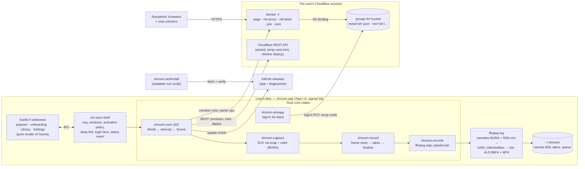

# shroom v1 — architecture

> **Reading it today (2026-10-13):** `build/v1` has been merged into `main` and retired, so
> where this says `build/v1`, read `main`. It is the design record as built: amended in
> place by the DECISIONS rows it names, and every `path:line` citation is as of the commit
> it gives — the named function or line text is the anchor when a line has drifted.
>
> Status: **draft, 2026-10-02**, written on `build/v1` from the research corpus
> (RESEARCH.md R1–R11 and the probe results, the stack decision (2026-07-20), POC-LEARNINGS.md,
> UX-STATEMACHINE.md, TESTING-PLAN.md, DECISIONS.md) and the code as it stood then
> (`crates/*`, `app/`).
>
> **Brought to the tree at `6a623b0` (2026-10-03):** §2's crate table, §3.3's threads,
> §15's constants and §16's dispositions now say what is built and which DECISIONS row
> built it; where a design paragraph below predates the build, an **As built** note under
> it says what changed. The design text itself is kept as the record of what was weighed.
>
> **Brought to `47dfaa3` (2026-10-03)** for the audit's last clusters (D:B82–B84,
> B89–B96): §2's crate table is restated at `47dfaa3`; §3.3's power row and Trace, §3.10,
> §4.1's encode leg, §5.5's GC, §7's re-place and test guards, §8.1's faces line, §10's
> faces, §12's deep link, §15's floor and upkeep rows, and §16 #19, #27, #44, #46, #49,
> #51 and #61 each carry an **At `47dfaa3`** note.
>
> **What this is:** the one place that says how v1 is built, why, and what was rejected.
> The spec ([`UX-STATEMACHINE.md`](../../UX-STATEMACHINE.md)) says *what* v1 does, and it wins
> every disagreement. In-frame calls go to [`DECISIONS.md`](../../DECISIONS.md), and spec
> changes go to `DEVIATIONS.md`. This doc points at both and decides nothing that belongs
> to them.
>
> **Standing tags** on every section and claim:
> - **ratified**: Bagrat decided it (spec ledger or the stack decision (2026-07-20)).
> - **probed**: measured on a real machine or account.
> - **recommended**: research or design with no ratification yet. This covers the spec's
>   N29–N42 rows, which are built as provisional per TESTING-PLAN D1.
> - **build call**: the corpus leaves it open. It is decided by probe and logged in
>   DECISIONS.md.
>
> **Citations:** `file:lines`. *RQ* = the rethink interview (not public), *SM* = UX-STATEMACHINE.md,
> *TP* = TESTING-PLAN.md, *PL* = POC-LEARNINGS.md, *R* = RESEARCH.md, *D* = DECISIONS.md.
> `archived-poc/…` paths are the POC's tree at tag `v0.1.5` (removed from `main` 2026-10-13).
> If the corpus doesn't give a value, the doc says **"not in the corpus — build call"**.
> Nothing here is invented.

---

## 1. What v1 is

*Standing: ratified.*

shroom v1 is a macOS menu-bar app that records the screen, mic and an optional camera
bubble. It encodes locally into HLS segments plus a single-file MP4 and uploads the bytes
straight into **the user's own Cloudflare R2 bucket**. Every recording's link
(`v.<name>.workers.dev/<id>`) is served by **one Worker the app deploys into the user's
own account**. That page exists from the moment Stop is pressed, before any byte has
landed. shroom has no account, no server we operate, and no OAuth. Setup is one pasted
Cloudflare token; after setup the token retires to admin work, and recording runs on
short-lived per-recording credentials. The space is born multi-member: invites and
members (N3, ratified), and the owner's other Macs (N33, *recommended*: it amends U10 and
awaits ratification, built as provisional per TP D1). [RQ:390-394, 401-402, 414-415, 425;
SM:38-52, 81]

### Component map



Rejected at stack level: a sealed Swift capture helper (R1, now a fallback only), an
operated shroom server, OAuth, Pages and r2.dev delivery, and wrangler at runtime.
[RQ:387, 401-402, 413-416, 425; R:27-29, 1542-1544]

---

## 2. Repo layout and crate boundaries

*Standing: B1 recommended (in-frame, logged). The crate split below is what exists on
`build/v1` at `6a623b0` (regenerated from the workspace, `Cargo.toml` members
`crates/*` + `app/src-tauri`).*

**Layout (D:B1):** one Cargo workspace at the root with members `crates/*` and
`app/src-tauri`. `app/` holds the Svelte frontend, and there is one npm workspace at the
root. The core stays a plain Rust library that can be tested without Tauri. Rejected:
Tauri's single-crate default (logic testable only through the app) and separate repos.
[D:9; Cargo.toml]

Toolchain: Rust 1.88, resolver 3, edition 2024 (D:B3). The scap crates are pinned by rev
`fb3f2438`, their hakari `workspace-hack` is replaced by `vendor/workspace-hack`, and cidre
is pinned to fork rev `bf84b67079a8` (D:B2). TypeScript is 5.9 (D:B8).

| Crate | Owns | Test seam (TP §5) | State at `47dfaa3` |
|---|---|---|---|
| `shroom-capture` | SCK display capture via scap + cidre with forced `_32_BGRA`; the liveness probe; device lists (displays, microphones with their transport type, cameras with the three-signal Continuity classifier, D:B48); the microphone (cpal, D:B17); the camera as a source (D:B33) and the native camera preview (D:B47 g); the harness's beep and loopback sources (D:B55 b, B59 e) | the record crate's synthetic seam; `devices::tests` (one runs against this Mac's real device list) | built |
| `shroom-encode` | The ffmpeg argv (pure), the 30 Hz frame clock, the take process, playlist join with per-take inits (`assemble_mapped`, D:B58 a), quality presets, poster and teaser (D:B27), the single-file copy from whatever is left of a take (`ensure_preview`, D:B54 a), which ffmpeg runs (`locate`: a release only its bundled sidecar, D:B82) | `ffmpeg_args()` golden-tested; `tests/real_ffmpeg.rs`, `tests/unfurl.rs` (ffmpeg required — a missing ffmpeg fails, D:B59 c) | built |
| `shroom-record` | The recording mechanism: `FrameSource`, the sampling hand-off (D:B16, B58 e), takes across pauses, the audio clock (D:B18, B58 b), finalize, crash repair (D:B23, B70 a), the stall detector (D:B47 b) | the synthetic seam; `tests/{synthetic,av_sync,interruptions,signature}.rs` | built |
| `shroom-storage` | SigV4 (session tokens), S3 put/head/get/delete/paginated list, create-only `put_if_absent` (also with `x-amz-meta-*`, D:B42), `If-Match` rewrites (`put_if_match`, `get_with_etag`, D:B21), multipart and `put_file` | botocore golden vectors; the L1 fake (`shroom-cloudfake`) | built — the transport-fault seam lives in the fake, not here (D:B64 a) |
| `shroom-testpattern` | The media-truth counter strip (24-bit counter + CRC-8) and its decoder (D:B59 d) | pure encode/decode | built |
| `shroom-core` | `World`, `update` = apply + `settle`, `derive`, `Scene`, events and effects as data, the copy registry (`copy.rs`), the trace ring (`trace.rs`, D:B93) | pure (TP L0): walkthroughs with all 16 laws and the independent entry oracle at every step (`tests/common/laws.rs`, law 13's file-mode half aside; `tests/common/entry.rs`, D:B89), the enumeration with the popover/tray walk (D:B56 a, B89), the edge partition over all 125 map edges (D:B56 b), the inventory rows, laws 12/15 as invariants (D:B57) | built (D:B22, B28, B34, B39–B41, B45–B57, B60, B89, B91–B93) |
| `shroom-cloud` | Cloudflare REST: token classify and verify, accounts, buckets, the Worker deploy with bindings, subdomain, route, the secrets endpoint; `sweep` (the wizard's probes, D:B26; a provisioned space surveyed under its own label, D:B50 d); `wire` (D:B24, B50); `mint` (local HS256, D:B32); `owner` (grants, D:B25/B36); `member` (a client for every `/_shroom/api/` route, D:B37); `registry` (seed, set-aside); `device` (keys, on-disk shapes); the `Policy::TestNamespace` fence, and `Policy::Spare` for the checkpoint (D:B95) | the L1 fake (`wizard_fake.rs`, `registry_fake.rs`, `wire_faults.rs`); fenced live tests behind `SHROOM_LIVE=1` | built |
| `shroom-cloudfake` | The L1 stand-in for Cloudflare's REST API and R2's S3 API (multipart too, D:B70 b), the workers.dev page ping, its knobs, and the transport-fault seam (D:B64 a); in-process and as a binary | tests only | built — its shapes are hand-written from what the live tests see; recorded responses wait on Bagrat (D:B63) |
| `shroom-upload` | Ids (D:B14), keys (D:B13), the master playlist, meta schema 1, the pass `claim → go_live → finish` (D:B49 a) with the progress beat (D:B49 c), the mid-take live upload, the Library's list/rename/delete/tombstone, and the cleanup sweep (`cleanup`, `reapable`; the token Mac's, D:B91 — §16 #49) | the L1 bucket; `tests/{faults,progress,inits,library,init_probe}.rs` | built |
| `shroom-update` | The release check, the offer, the verified download and the swap helper (D:B31) | `tests/release.rs` against a local release stand-in | built |
| `shroom-spec` | The spec fixtures (`spec/r1–r6.json`, `map.json`, `meta.json`) as Rust types | tests only — the product never reads them | built |
| `shroom-devtool` | `up` / `down` / `sweep` of a fenced `shroom-test-…` space for the heartbeat; the crash tests | dev only | built |
| `worker/` | The one-file dependency-free Worker (`worker/src/worker.js`, `VERSION` 0.1.4, `IFACE` 2): the page's faces and custom player (D:B43), `/m/` with Range, `/d/<id>`, oEmbed and the embed face, owner mode (`?k=` redeem, cookie, title, mark), the status poll, ping, the join page, and every `/_shroom/api/` route (D:B37) | vitest over a fake bucket (439) and the workerd contract (14, D:B63, B94); `worker/dev/serve.mjs` runs the real module on loopback for drives | built |
| `app/src-tauri` | The shell and the runner: tray, NSPanels, windows, activation policy, IPC (`commands.rs`), the lanes in `runtime/` (recorder, uploader, cloud, member, library and its cleanup lane, takes, updater, observe, net, launch, presenter, the popover's and the count's panels in `overlay` — D:B106 — camera, posters, stash, home, os, probe, power, ring — D:B91–B93), the login item, the status seam (§11.1), the deep link (`RunEvent::Opened`); the harness's modes only with `dev-harness` and a `.dev` identifier (D:B55 c, B62); `--checkpoint`, dev builds only (D:B95) | runner unit tests (110; 115 with `dev-harness`); the drives and galleries (`app/test`); the L5 lanes that run the drives in a clean VM (`tests/l5/`: Dock, surfaces, take, update, setup — D:B105, B106, B114, B116, B117); the heartbeat | built |
| `app/src` | Svelte 5 webviews (popover, onboarding, Library, Settings, Members) rendering the Scene; no copy of their own (D:B57 c) | the galleries: onboarding 1,829 checks, windows 4,855, and the typed fields key by key, 221 (D:B107) | built |
| `installer/`, `site/` | The readable install script (D:B29, B44) and the landing | `installer/test` (74), `site/test` (the landing, 5), L5 on a clean Tahoe clone | built |

*The counts in the `worker/`, `app/src-tauri`, `app/src` and `installer/` rows are as measured on
2026-10-13, at the close of the from-scratch batch (BUILD-STATUS, “Tests”); the rest of the
table stands as restated at `47dfaa3`.*

**Why the split matters:** the POC's determinism boundary (exact mechanism, judgment
above, seams everywhere) kept it debuggable. [PL:452-504; CLAUDE.md principles] Every
crate that touches the OS or network exposes a trait seam, so L0 and L1 run in seconds.

**Seams the table didn't have (§16 #52):** OS-event injection for N39
interruptions and N41 launch provenance; login-item truth; the shell side effects laws 10
and 11 constrain (open URL, clipboard, Finder reveal, power assertion); an injectable
Worker clock (invite TTL, `k` TTL, stall window); an installer/updater harness; and a
two-core-on-one-S3-fake scenario for tombstone-before-resume before L6.
[TP:52-84, 150-159; SM:1744-1750] **As built:** all of these exist but recorded
repair-class REST responses — see §16 #52.

---

## 3. The core's shape: World → derive() → Scene

*Standing: **designed — build call, logged as B22** (DECISIONS.md). Law 1 and TP §2.1 fix
the principle: state is derived, never a step counter. This section fixes the internals.
It was chosen from three competing designs judged for fidelity, simplicity and robustness
(rejected alternatives at §3.9). Items marked "bend" go to `DEVIATIONS.md` before the core
is scaffolded (§3.8).*

Law 1: "every entry re-probes reality… A face clears by itself when its cause does."
[SM:106-107] TP §2.1 turns that into `derive(world) → State`, with table tests per
inventory row and an exhaustive enumeration over the finite fact space. [TP:52-63]

**What the corpus fixes, and this design keeps:**
- **Scene contents.** The tray has five faces (SM:72-73, 85). There is at most one banner
  and one status line (law 7), with banners ranked saved take → space can't take videos →
  recording-off → update (N38: SM:86, 766-776). The Scene also carries the Return default
  (law 8) and dock iff the setup window (law 6 as built — DEVIATIONS #38; ratified: iff
  a window).
- **Renderers own no state.** The webviews are a "pure render of the derived state".
  [TP:214]
- **Laws are invariants over (World, Scene)** [SM:102-163; TP:68-84].
- **Edges come from `spec/map.json`.** Each is realizable by one world change or one
  event, and the code produces nothing the map doesn't list. [TP:65-72]
- **Persistence.**
  - The token is mode 600, written after validation and before wiring (SM:486-487).
  - A remembered invite is 600 (SM:1496-1497).
  - The member/device key (N30, N33: SM:78, 81).
  - A disk-backed queue that survives an update relaunch (N9, SM:57).
  - The take on disk stays the truth until confirmed up (PL:293-297).
  - Exit wipes the secrets, offers Save to Movies, and keeps the login item
    (SM:1219-1227).
- **Not every needed fact is probeable** (§16 #43): the restore window (SM:1257-1258),
  intents that wait out a take (SM:116-125), the deferred page (SM:967-971), "Updated to
  1.3.0 ✓" (SM:1248), `join-expired` once (SM:1497-1499), and "Saved to Movies ✓"
  (SM:1586). These are the Prefs, Once and Session records and the take markers below,
  never a stored current screen.

### 3.1 Thesis

The core is one plain-Rust crate, `crates/shroom-core`: no Tauri, no AppKit, no network,
no threads, no clock reads. It has three pure functions and one small loop around them.

- The app's whole truth is one `World` value. It holds **facts** (what probes, the OS, the
  recorder and the cloud reported) kept apart from **what the person asked for** (sticky
  prefs, one shown-once record, and at most 12 session intents).
- `update(&mut World, Envelope) -> (Vec<Effect>, Arm)` is the only writer. It records what
  happened ("the screen grant is off", "the recorder confirmed the pause", "the person
  asked the Discard question") and returns effects as data. It never names a screen.
- `derive(&World) -> Scene` is pure and total. Every surface comes from it: the tray face
  and what a click means, the popover with its one banner and one status line, the three
  windows, the countdown, the bubble, the dock flag, Return and Esc per surface, the
  status-seam payload, and `next_wake`.
- `settle(&World) -> Vec<Effect>` is a flat, ordered list of pure "due" reactions: the
  probes a shown surface needs, the wiring and upload kicks, the deferred page. It reads
  the World and never writes it.

A runner (in `app/src-tauri`) executes effects on worker threads and feeds every result
back as an event.

Law 1 holds by construction, in three ways:
1. No type in `World` or on disk can name a state id. A fitness test greps `world.rs` and
   `persist.rs` for `StateId|Scene`, and a file-name whitelist (§3.4) rejects any other file.
2. Input whose meaning depends on the screen (a tray click, a launch you did, Return, Esc,
   a button) is resolved by calling `derive` on the current World. "The click is the door"
   lives in exactly one function.
3. Every entry carries its own local re-probe (`QuickProbe`, gathered by the shell before
   it posts the event) and stamps the surface's `entered` time. `settle` then emits the
   network probes whose answer is older than that. A face clears the moment its fact flips.

Why this shape fits shroom: the mechanism is exact and seam-tested, and judgment is a thin
pure layer above it (CLAUDE.md). It also maps one-to-one onto TP §2. `derive` is the
function the inventory tables call. The World's small projections are what enumeration
walks. A map edge is a (World, one event) pair. Each of the 16 laws is a predicate over
(prev World, prev Scene, event, next World, next Scene, effects).

### 3.2 The types

These are concrete enough to code from. Field lists marked `…` are completed from the
fixtures, not designed further here.

```rust
// ───────── time, facts, handles ─────────
pub struct Mono(pub u64);   // ms, process-monotonic. Does NOT advance in sleep on macOS → freshness only
pub struct Wall(pub i64);   // unix ms → every user-visible expiry (1 h page, invite, restore)
pub struct Envelope { pub mono: Mono, pub wall: Wall, pub event: Event }  // the runner stamps; tests choose

pub enum Fact<T> { Unknown, Known { v: T, at: Mono, probing: bool } }   // Unknown = not probed this process
pub struct SecretId(u32);   // a handle into the runner's stash. The core never holds secret text.
// runner-side only: struct Secret(Zeroizing<String>) — no Serialize, no Clone, Debug = "‹secret›"
pub struct TakeDir(String); // takes/<yyyymmdd-hhmmss>-<4 rand>
pub struct RecId(String);   // B14 id, minted at capture start as the storage prefix only (§16 #41 (a));
                            // it becomes a link only when publish.json exists (law 3)

// ───────── THE WORLD ─────────
pub struct World {
    pub now: Mono, pub wall: Wall,
    // facts
    pub launch: Launch,               // { kind: LaunchKind, version: Version }
    pub mac: Mac,
    pub net: Net,
    pub space: Space,
    pub sweep: Sweep,                 // the one provisioning/repair probe pass (Region 2 backbone)
    pub mint: Fact<MintVerdict>,      // Ok | Removed | SpaceSide | NeedsNewerPage (N34)
    pub take: Option<OpenTake>,       // mirrors the live recorder; never persisted
    pub saved: Vec<SavedTake>,        // from the takes scan, oldest first
    pub queue: Vec<Queued>,           // from the takes scan: publish.json ∧ ¬uploaded
    pub library: Fact<Arc<Vec<LibraryRow>>>, pub members: Fact<Arc<Vec<MemberRow>>>,
    pub update: UpdateFacts,          // { available: Fact<Option<Release>>, staged, applying, failed: bool }
    pub inflight: Inflight,
    pub popover_closed: Option<Mono>, // ages "Fully live ✓" (until the popover closes)
    // what the person asked for, kept apart
    pub prefs: Prefs,                 // persisted sticky choices
    pub once: Once,                   // persisted: { seen_version: Option<Version> } — that is all
    pub session: Session,             // in memory; !Serialize (static assertion); ≤ 12 fields (fitness test)
}

pub enum LaunchKind { User, LoginItem, UpdateRelaunch, PermissionRelaunch, Install { join: bool } }

pub struct Mac {
    pub screen: Fact<bool>, pub mic: Fact<Access>, pub camera: Fact<Access>, // shroom_capture::Access
    pub displays: Fact<Vec<Display>>,          // { id, name, is_main, frame } → "(left)/(right)"
    pub mics: Fact<Vec<Device>>, pub cameras: Fact<Vec<Device>>, // { uid, name, builtin, continuity }
    pub disk_free: Fact<u64>,
    pub os: Fact<OsSession>,                   // { awake, unlocked, on_console }
    pub status_item_visible: bool, pub login_item: Fact<bool>, pub power_asserted: bool,
    pub primed: Option<Wall>,                  // primed.json: last clean warm-up. Some ⇔ row six ticked on this Mac
    pub macos: Version, pub sharing_name: String,
}
pub struct QuickProbe {                        // gathered synchronously by the shell on every entry
    pub screen: bool, pub mic: Access, pub camera: Access,
    pub displays: Vec<Display>, pub mics: Vec<Device>, pub cameras: Vec<Device>,
    pub disk_free: u64, pub online: Option<bool>, pub os: OsSession, pub status_item_visible: bool,
}
pub struct Net { pub online: Fact<bool>, pub reach: Fact<Reach> }       // NWPathMonitor; the capped reach probe
pub enum Reach { Shroom { iface: u32 }, NotShroom, Unreachable }

pub enum Role { TokenHolder, OwnerClass, Member }
pub struct SpaceIdentity {                     // space.json — a cache, re-proved on every entry, never trusted
    pub account_id: String, pub account_name: String,
    pub label: String,                         // "v", or "shroom" when a foreign v exists (N42)
    pub foreign_v: bool,                       // the setup's survey found a foreign v — the name row's note; never read off the label (D:B104)
    pub subdomain: String, pub host: String,   // "myshroom", "v.myshroom.workers.dev"
    pub bucket: String, pub role: Role, pub member_id: String, pub owner_name: String,
}
pub struct Space { pub identity: Option<SpaceIdentity>,   // Some ⇔ provisioned (written only after self-check or join)
                   pub token: bool, pub device_key: bool, pub videos: Fact<u32> }

pub struct Sweep {
    pub paste: Option<Paste>,                  // the last paste and its verdict
    pub token: Fact<TokenVerdict>,             // Valid { accounts } | Revoked | WrongPowers | OtherAccount
    pub gates: Fact<Gates>,                    // { email: bool, card: bool }, true = blocking
    pub subdomain: Fact<Option<String>>,       // None = 10007
    pub foreign_v: Fact<bool>,
    pub bucket: Fact<bool>, pub worker: Fact<WorkerFact>,   // Absent | Ours { iface } | KeyGone | Foreign
    pub found: Fact<Option<u32>>,              // the whole-space marker is present → Some(videos): space-found
    pub self_check: Fact<bool>,
    pub claim: Option<(String, Taken)>,        // name-taken iff .0 == session.fields.name
}
pub enum Paste { Checking(SecretId), Garbled, WrongPowers, OtherAccount,
                 PickAccount { id: SecretId, accounts: Vec<Account> } }

pub struct OpenTake { pub dir: TakeDir, pub rec: RecId, pub opened: Mono, pub source: SourceId,
                      pub phase: Phase, pub since: Mono, pub length_ms: u64, pub markers: u32 }
pub enum Phase { Starting, Recording, Pausing(Cause), Paused(Cause), Resuming, Finalizing(Why) }
pub enum Cause { User, DisplayLost, MicLost, CameraLost, Asleep, Locked, SwitchedOut, MicRevoked }
pub enum Why { Stop, GetLink, DiskFull, ScreenRevoked, Discard, CaptureDied }
pub struct SavedTake { pub dir: TakeDir, pub rec: RecId, pub length_ms: u64, pub cause: SavedCause,
                       pub created: Wall, pub movies: bool }     // SavedCause: Interrupted | DiskFull | ScreenOff
pub struct Queued { pub dir: TakeDir, pub rec: RecId, pub title: String, pub stopped: Wall,
                    pub done: u32, pub total: u32, pub blocked: Option<Blocked>, pub movies: bool } // Blocked: Offline | Space

pub struct Inflight {
    pub ops: BTreeMap<Op, Mono>,               // op → deadline. Every op ends in a result, a Failed, or its deadline.
    pub failures: BTreeMap<OpClass, Failure>,  // { at: Mono, class: FailClass, tries: u8 } → backoff 5 s · 2^tries, cap 2 min
}
pub enum FailClass { Transport, Refused, Timeout, Panicked, Unclassified }   // mechanism classes, never copy

// ───────── what the person asked for ─────────
pub struct Prefs {                              // ~/.shroom/prefs.json
    pub source: Option<SourceId>, pub show_yourself: bool, pub mic: Option<String>, pub quality: Quality,
    pub bubble_at: Option<(i32, i32)>,
    pub settings_tab: Option<Tab>,              // None = never opened → General ("first open ever")
    pub setup_chosen: bool,                     // "Set up my space" pressed (bend 1). Cleared by Later/✕ on
                                                // welcome or the plan, by provisioning, and by exit.
}
pub struct Session {   // ≤ 12 fields. Each field's clear rule is its doc comment and a test.
    pub popover: Option<Door>,                  // clear: dismiss, Esc, Start, Stop, quit
    pub windows: BTreeMap<WindowKind, Door>,    // Onboarding | Library | Settings. clear: ✕ / Close / morph
    pub confirm: Option<Confirm>,               // Discard | DiscardSaved(TakeDir) | Quit | Delete(Vec<RecId>) | Exit | RemoveMember(String)
                                                // clear: Back / Esc / answered / its door closes / its subject vanished
    pub arming: Option<Arming>,                 // { started, deadline: Mono, display: SourceId, restart_of: Option<TakeDir>, fired: bool }
                                                // clear: Rec(Started), cancel, Rec(Failed)
    pub fork: Fork,                             // Virgin | SigningUp | Affirmed (N14's box 1, N19). clear: Later, process end
    pub chapter: bool,                          // "Allow recording" clicked: perm-mic vs done. clear: primed, window closed
    pub fields: Fields,                         // echoes of non-secret field contents: name, library_search, invite_door_open
    pub invite: Option<PendingInvite>,          // { code: SecretId, host, inviter, own_mac, expires: Wall }. Mirrored to
                                                // ~/.shroom/invite on arrival (bend 2). clear: Join ok, Stay / ✕, dead face closed
    pub page_open: Option<PageOpen>,            // { rec, at: Wall }, offline stop, newest only. clear: opened, wall ≥ at + 1 h, quit
    pub last_stop: Option<StopOutcome>,         // Offline(RecId) | Stranded(TakeDir) | AutoStopped(TakeDir). clear: popover closes
    pub copied: Option<(CopyTarget, Mono)>,     // "Copied" for 1.5 s, via next_wake
}
pub struct Door { pub opened: Mono,             // visibility: a window shows mid-take only if opened < open_since(w)
                  pub entered: Mono,            // freshness: moves on WindowFocused; never touches visibility
                  pub asked: bool }             // false = opened unasked → never takes the keyboard

// ───────── EVENTS ─────────
pub enum Event {
    Booted(Box<Disk>),                          // the persisted files + LaunchKind + the first QuickProbe
    // the person
    TrayClicked { right: bool, quick: QuickProbe },
    Reopened(QuickProbe),                       // the reopen AppleEvent / Spotlight / Dock while running ≡ a click
    Act { surface: Surface, action: Action, rev: u64 },
    Key { surface: Surface, key: Key },         // Return | Esc, when no field owns it
    Field { field: Field, value: String },      // non-secret only: Name, LibrarySearch, InviteComposer, Title(RecId)
    SecretPasted { field: SecretField, id: SecretId, shape: Shape },   // shape from shroom_cloud::classify, in the shell
    DeepLink { id: SecretId, host: String, inviter: String, own_mac: bool, expires: Wall },
    WindowClosed(WindowKind), WindowFocused(WindowKind, QuickProbe), PopoverDismissed, PopoverKeyed,
    QuitRequested(QuitVia),                     // CmdQ | Dock | Footer | RightClick | System
    // the OS (observers)
    Os(OsNews),        // Grants | Devices | Disk | Session | Woke | NetPath(bool) | StatusItemVisible
                       // | LoginItem | PowerAsserted(bool) | Terminating { ours: bool }
    // mechanism and cloud — each op ends in exactly one of these, or in Failed
    Rec(RecNews),      // Started { dir, rec } | Paused { length_ms } | Resumed | Finalized(Result<u64, FailClass>)
                       // | Failed(CaptureFail) | FrameStall | DiskFloor | Primed(bool) | Deleted(TakeDir) | SavedToMovies(TakeDir)
    Scanned { saved: Vec<SavedTake>, queue: Vec<Queued> },
    Cloud(CloudNews),  // Validated | TokenSaved | Swept(SweepAnswer) | Claimed | Wired(Result<SpaceIdentity, _>)
                       // | Joined(Result<SpaceIdentity, JoinFail>) | Mint | Reached | LibraryLoaded | MembersLoaded | Exited | PageOpened(RecId)
    Upload(UploadNews),// Progress { dir, done, total } | Live(dir) | Blocked(dir, Blocked) | Tombstoned(dir)
    Update(UpdateNews),
    Failed { op: Op, class: FailClass },        // the runner's catch-all: an error, a caught panic, a timeout
    Tick,                                       // posted at Scene.next_wake
}

// ───────── EFFECTS (not Serialize; they go only to Rust lanes) ─────────
pub enum Effect {
    Recorder(RecCmd),  // Start { source, quality, mic, bubble } (the lane mints dir + rec) | Pause | Resume { mic } | Marker
                       // | Finalize | Recover(TakeDir) | Discard(TakeDir) | Abandon | Prime
    Publish { dir: TakeDir, title: String },   // writes publish.json: law 3's single gate (§3.3)
    Uploader(UpCmd),   // Kick | ForgetRemote(RecId) (discard's clean delete)
    Cloud(CloudCmd),   // Validate(SecretId) | SaveToken(SecretId, AccountId) | Sweep(SweepPart) | Claim(String)
                       // | Wire { label } | Join(SecretId) | Mint | Reach | Library | Members | Delete(Vec<RecId>)
                       // | Rename(RecId, String) | Invite(String) | Remove(String) | Exit(ExitKind) | OpenOwnerPage(RecId)
    Shell(ShellCmd),   // OpenUrl(PublicUrl) | Copy(PublicUrl) | Reveal(TakeDir) | SettingsPane(Pane)
                       // | RequestPermission(Perm) | SetLoginItem(bool) | Relaunch(RelaunchWhy) | Quit | PowerAssertion(bool)
    Persist(PersistOp),// Prefs | Once | Invite(Option<…>) | Restore(Option<…>) | ClearUpdateFailed | Wipe
    Takes(TakeCmd),    // SaveToMovies(Vec<TakeDir>) | Delete(TakeDir) | Rescan
    Updater(UpdCmd),   // Check | Download | Apply
}

// ───────── SCENE (Serialize + ts-rs; never Deserialize) ─────────
pub struct StateId(pub &'static str);           // fixture ids verbatim
pub struct Scene {
    pub rev: u64,
    pub tray: Tray,                             // { face: Plain|Red|PauseBars|Amber|Frost,
                                                //   click: OpenDoor(Target)|Pause|ShowPaused|CancelCountdown|Nothing,
                                                //   right_menu: bool /* "Quit shroom", idle only */ }
    pub popover: Option<Popover>,
    pub onboarding: Option<Window<OnboardingBody>>,
    pub library: Option<Window<LibraryBody>>,
    pub settings: Option<Window<SettingsBody>>,
    pub countdown: Option<Countdown>,           // { display, digit, line, activates: true }
    pub bubble: Option<Bubble>,                 // { display, camera, at, activates: false }
    pub dock: bool,                             // == onboarding is Some (law 6 as built, DEVIATIONS #38)
    pub seam: Seam,                             // status.json payload: setup / permission / join / take_open
    pub next_wake: Option<Mono>,                // min of derive's clocks (digit, Copied, 1 h page), settle's due
                                                // times and inflight deadlines
}
pub struct Popover {
    pub id: StateId, pub faces: Vec<StateId>,   // e.g. id "paused", faces ["display-lost"]
    pub body: PopoverBody, pub banner: Option<Banner>, pub status_line: Option<String>,
    pub ret: Option<Action>, pub esc: Option<Action>, pub activates: bool,
    pub anchor: Anchor,                         // StatusItem | TopRightOfPointerScreen
}
pub enum PopoverBody { Config{…}, Paused{…}, DiscardConfirm{…}, QuitConfirm{…},
                       StoppedOffline{…}, StoppedStranded{…}, AutoStopped{…} }
pub struct Banner { pub id: StateId, pub tone: Tone /* Amber|Frost */, pub line: String, pub buttons: Vec<Button> }
pub struct Button { pub action: Action, pub label: String, pub style: Style, pub enabled: bool, pub note: Option<String> }
                    // Style: Filled | Plain | Quiet | RedText | RedOutline | Link
pub struct Window<B> { pub id: StateId, pub faces: Vec<StateId>, pub body: B, pub sheet: Option<Sheet>,
                       pub ret: Option<Action>, pub esc: Option<Action>, pub activates: bool }
pub enum OnboardingBody { Welcome{…}, MemberWelcome{…}, Plan(PlanView), JoinFace{…} }
pub struct PlanView { pub header: String, pub rows: Vec<PlanRow>, pub nest: Nest }   // shared by Settings · Space
pub enum Nest { Account, SigningUp, Token{…}, PickAccount{…}, Gate{…}, Name{…}, Calm, Offline, Found{…},
                Done{…}, PermMic, PermScreen{…}, Relaunching, Priming, AllSet{…}, Joining, JoinFailure{…}, Checking }
pub enum Action { /* every clickable thing; no secrets, no free text */ … }

pub fn update(w: &mut World, env: Envelope) -> (Vec<Effect>, Arm); // apply, then settle, then mark inflight
pub fn apply(w: &mut World, env: Envelope) -> (Vec<Effect>, Arm); // Arm { name: &'static str, edge: Option<(&str, &str)> }
pub fn settle(w: &World) -> Vec<Effect>;                      // pure; never writes
pub fn derive(w: &World) -> Scene;                            // pure, total
```

Two helper facts appear everywhere:
- `open_since(w)`: the `started` of an arming countdown, else the open take's `opened`.
  "Take open" for law 4 is `open_since(w).is_some()`, so it includes the countdown (bend 3).
- `row_six_done(w)`: `w.mac.primed.is_some()`. The permissions chapter is per Mac.

### 3.3 Flow and threading

**The loop** (`run.rs`). One core thread owns the World. It has no locks and no async
runtime:

```
loop {
    let first = rx.recv()?;                                  // block for one Envelope
    let mut fx = vec![];
    for env in once(first).chain(rx.try_iter()) {            // coalesce a burst (upload progress, device storms)
        let (more, arm) = core::update(&mut w, env);         // each input is gated against the World as of itself
        trace.push(env.kind(), arm, &more);                  // redacted ring (kinds and arm names only)
        fx.extend(more);
    }
    let scene = core::derive(&w);
    presenter.apply(&last, &scene);                          // per-surface diff → emit_to(label) + native show/hide
    snapshot.store(Arc::new(scene.clone()));                 // what scene_get answers from, with no round-trip
    seam.write_if_changed(&scene.seam);
    wake.set(scene.next_wake);                               // the runner posts Tick then
    for e in fx { dispatch(e) }
    last = scene;
}
```

There are no inline probes and no re-entry. Local facts arrive inside the entry event
(`QuickProbe`), and everything else arrives as an event.

**`apply`** is a `match` with three kinds of arm. Each arm returns a static name, and an
arm that realizes a map edge also names that edge (`Arm.edge`), for the trace and the edge
tests:

- **Fact arms** copy a report into the World. Examples: `Os(Grants)` → `mac.screen/mic/camera`;
  `Rec(Paused)` → `phase = Paused(cause of the Pausing)`; `Cloud(Reached)` → `net.reach`.
  `Os(Woke)` marks every network fact stale, because `Mono` skips sleep.
- **Input arms** resolve meaning through the current Scene:
  - `TrayClicked` and `Reopened` apply the QuickProbe, then
    `match derive(w).tray.click { OpenDoor(t) → open door t (asked, opened = entered = now),
    Pause → phase = Pausing(User) + Recorder(Pause), ShowPaused → popover door asked,
    CancelCountdown → arming = None + popover door asked, Nothing → () }`.
  - `Key { surface, Return }` → `derive(w).<surface>.ret`, treated as that Act. Esc → `.esc`.
  - `Act { surface, action, rev }` →
    `if !derive(w).offers(surface, &action) { return ([], Arm::DROPPED) }`. A stale, greyed or
    destructive-by-Return click dies here. The one exception: `WindowClosed` is accepted
    whatever the rev. Then `act(w, action)` records an intent or a fact, plus the one direct
    effect the click asked for (OpenUrl, RequestPermission, Copy).
  - `Booted` runs the same click as a user launch (`User`, and `Install` without join).
    `LoginItem` opens nothing. `UpdateRelaunch` and `PermissionRelaunch` restore the
    `restore.json` window (asked = false for an update, true for a permission relaunch).
    `Install { join: true }` opens member-welcome.
- **Intent arms** write only the Session, Prefs or Once fields in §3.2. None of them is a
  screen.

The chapter has one chained prompt. `Os(Grants)` resolving the mic while
`session.chapter` is set emits the screen step (System Settings). That is the second half
of the prompt chain the Allow recording click started (law 11), and the only permission
effect not emitted by an Act arm.

**The door.** `derive(w).tray.click` decides it in one place:

| Condition | Door |
|---|---|
| a countdown runs | CancelCountdown |
| take Recording | Pause |
| take Paused | ShowPaused |
| take Starting, Pausing, Resuming or Finalizing | Nothing (a beat) |
| no space, live invite | Onboarding → member-welcome |
| no space, dead invite | Onboarding → join-expired (once: closing it deletes `invite`) |
| no space, otherwise | Onboarding → welcome, `account` if `setup_chosen`, the plan if a token is saved |
| a space, `!row_six_done` | Onboarding → the plan at row six (bend 5) |
| a space, row six done | Popover → config |

**Law 3's single gate.** `Publish` (which writes `publish.json`) is emitted in exactly one
arm: `Rec(Finalized(Ok))` while the phase is `Finalizing(Stop | GetLink)`. Only the Stop
and Get link acts enter those phases. Get link on a saved take (recovered, or a disk-full-stop or
screen stop) adopts its dir as `take` in `Finalizing(GetLink)` and asks the recorder to
confirm the finalize, which is a no-op for a repaired dir, so it shares the Stop arm. A
crash before finalize leaves an interrupted take, and a crash between finalize and
publish leaves a finalized saved take. Neither one
has a link. `DiskFull` and `ScreenRevoked` finalize into a saved take and set
`last_stop = AutoStopped`.

**Race rule (first cause wins).** These are pinned as explicit table rows over every
ordering of two or three causes:
- A `Pausing(c)` is never overwritten by a later pause cause.
- `DiskFloor` and screen-revoked upgrade Recording, Pausing or Paused to
  `Finalizing(DiskFull | ScreenRevoked)`.
- A user `Stop` or `Discard` already in `Finalizing` is never downgraded.
- `FrameStall` with the source still present is `CaptureDied` (below). With the source
  gone, it is the matching `*Lost` cause.

**`settle`**: a flat, ordered list in `settle.rs`. Each entry is a named `due_*` predicate
with its spec citation. `update` marks every emitted effect in `inflight` with a deadline,
so `settle(w)` right after `update` returns nothing new. That is the idempotence test.

| # | Reaction | Due when | Spec |
|---|---|---|---|
| 1 | `due_probes` | a shown surface's need (table below) is Unknown, older than its door's `entered`, or past max age; not inflight; past backoff | law 1; SM:425-430 |
| 2 | `due_gate_poll` | a gate face shows ∧ `gates.at + 5 s ≤ now` → Sweep(Gates) | SM:614-617 |
| 3 | `due_wire` | onboarding or Settings·Space shows the Wiring row current ∧ token valid and saved ∧ online ≠ false ∧ past backoff ∧ not inflight | SM:571-580; repair-mood → wiring |
| 4 | `due_join` | the joining face shows ∧ online ≠ false ∧ past backoff ∧ not inflight | Region 6 |
| 5 | `due_page` | `page_open` ∧ online ∧ Reach is Shroom and fresh since the stop ∧ !take open ∧ wall < at + 1 h → Cloud(OpenOwnerPage) | SM:967-971 |
| 6 | `due_upload` | (queue non-empty ∨ a take is open) ∧ online ∧ mint ∉ {Removed} ∧ reach ≠ NotShroom ∧ not inflight → Uploader(Kick) | SM:57, 955 |
| 7 | `due_power` | `(take open ∨ queue non-empty) != mac.power_asserted` | — |
| 8 | `due_prime` | onboarding shows perm-priming, or config is shown asked ∧ !take open ∧ primed older than 25 days | SM:869-871; law 11 |
| 9 | `due_periodic` | Sweep(Health) every 6 h on token Macs, Mint every 6 h on token-less ones, every 60 s while an amber space face shows and online, Updater(Check) at launch and every 4 h | N34, N37 |

`Shell(RequestPermission)` is never emitted by `settle`. It is emitted only by an Act arm,
and never while a take is open. Prime (8) is due only with no take open.

**Probe needs** (`needs.rs`, one table):

| Surface | Needs | Max age |
|---|---|---|
| config | local facts | 0 (QuickProbe) |
| config | Reach, Mint or Sweep(Health) | 10 min |
| onboarding plan | the current row's Sweep parts | 0 since `entered` |
| Settings · Space | the full Sweep | 0 since `entered` (focus moves `entered`: name-changed re-probes on return) |
| Library, Members | Library or Members | 0 since `entered`, then 60 s |

Rendering always uses the last-known value. The one exception is an Unknown fact, which
renders the row's existing spinner (`Nest::Checking`) and disables the actions that
depend on it.

**Liveness: nothing waits forever.** Every effect `update` emits gets an inflight
deadline:
- recorder phases Starting, Pausing, Resuming and Finalizing: 5 s;
- Reach: 600 ms;
- cloud ops: 60 s;
- Wire: 3 min.

The runner wraps every lane job in `catch_unwind` and always posts a result or
`Failed { op, class }`. A deadline passing is applied, at the `Tick` it causes, as
`Failed { class: Timeout }`.
- **Cloud and upload failures** set `inflight.failures`, with a backoff of 5 s, 10 s, 20 s
  and so on, capped at 2 min. Retry comes from the backoff, not from NWPathMonitor flipping.
  So a link that the OS reports online but is broken (captive portal, the LAN MTU black
  hole) retries calmly instead of sticking or spinning. The wizard shows
  `wizard-offline` while the current row is network-bound and either `online == false` or
  the newest failure is Transport and newer than the newest success.
- **A recorder failure is `CaptureDied`.** This covers a phase deadline, `Rec(Failed)`, a
  `FrameStall` with the source present, and `Finalized(Err)`. The core emits
  `Recorder(Abandon)`: kill the ffmpeg process group, drop the lock, and leave the dir. It
  sets `take = None` and posts `Takes(Rescan)`. The dir then reads as an interrupted saved
  take, and the config popover opens unasked with the recovered-take banner, because the
  stop wasn't yours (bend 6). The take is never deleted.
- **Restart.** `Rec(Started)` while `arming.restart_of` is set discards the old take only
  then: `Recorder(Discard(old))` plus `ForgetRemote` (N39). `Rec(Failed)` in the same
  situation clears the arming and returns to `Paused` on the old take, which is intact.

**Threads.**

| Thread | Owns / runs |
|---|---|
| main (Tauri/AppKit) | tray, NSPanels (B19), windows, activation policy; gathers `QuickProbe`; OpenUrl, Copy, Reveal, RequestPermission, SettingsPane, Relaunch, Quit |
| core | the World, `update`, `derive`, `settle`, Persist (small atomic writes: the token is on disk before any wiring) |
| recorder | `shroom_record::Recording` and its FrameSources; serial Start/Pause/Resume/Finalize/Recover/Discard/Abandon/Prime; holds `takes/<dir>/LOCK` (flock) while a take is live; **as built,** a watchdog inside the lane looks every second while a take runs: the take's liveness (`Recording::stall`, 5 s → `FrameStall`, or `permission-lost` when screen recording went off) and the disk floor (`statvfs` → `DiskFloor`, D:B47 a–b) |
| uploader | a serial disk-backed queue over `shroom_upload` (mid-take `LiveUpload`, then `claim → go_live → finish`, D:B49 a); mints a per-recording credential into `cred.json` (7 days; members through `/mint`, token Macs locally with their ledger entry first, D:B42); tombstone check before every resume; progress posted to the core per file, and written to the record by the beat (D:B49 c) |
| cloud | a serial `shroom_cloud` client. Wire runs the idempotent calls and returns one classified result. Runner functions return enums, never copy or surfaces |
| quick | Reach, hard-capped at 600 ms, so a stop never waits behind a long cloud call |
| power | *Planned:* an IOKit `IORegisterForSystemPower` run loop off the main thread. On will-sleep it would post the session change and acknowledge after `Rec(Paused)` or 2 s, whichever comes first. **At `47dfaa3`: built as planned** (`runtime/power.rs`, thread `shroom-power`, D:B92). At `kIOMessageSystemWillSleep` it posts the asleep session and `Os(WillSleep)`; the core pauses a recording take (`mac-away`) and answers `ShellCmd::AllowSleep` once the take is paused or there is none, at the latest `SLEEP_HOLD_MS` (2 s) on; the shell calls `IOAllowPowerChange`, and the hold's own cap (`HOLD_CAP`, 2.5 s) lets macOS go should the core never answer. Idle sleep's question is never vetoed; NSWorkspace still brings did-wake. The keep-awake idle-sleep assertion is `os.rs`'s `IOPMAssertionCreateWithName` (D:B34). A real lid-close on battery is Bagrat's checkpoint (§3.10) |
| cleanup | **At `47dfaa3` (D:B91):** the token Mac's cleanup sweep (§5.5), handed by the Library lane to a lane of its own (`shroom-cleanup`, one sweep at a time), so a cache load, rename or delete never waits behind it |

OS observers post envelopes directly (`runtime/observe.rs`, D:B47): CGDisplayReconfiguration,
AVCaptureDevice connect/disconnect, NSWorkspace sleep/wake and session, the distributed
screen-lock notifications, NWPathMonitor (`runtime/net.rs`), a 2 s microphone re-probe,
a 30 s disk and UTC-offset re-probe, and — while a take is open — the grants re-read on
every observer event and every 2 s (D:B47 c; not the 30 s TCC re-check first planned).

**Time.** `Mono` is used only for freshness, deadlines and "Copied". Every user-visible
expiry is `Wall`: the 1 h deferred page, the invite expiry, and the restore window. `Woke`
resets network freshness.

**Trace.** *Planned:* a ring of the last 512 rows `{mono, event kind, arm, edge, effect kinds, state
ids}`, flushed to `logs/core.jsonl` (rotated at 1 MB) on panic, on quit and on
`--selftest`. It holds kinds and names only, so it can't carry a secret. "Why is this
screen up" is answered by reading it. **As built:** `logs/run.log` (700/600, rolled at
5 MB, recording ids shortened — D:B55 e) records each event, arm and edge; a drive's own
trace of state ids lives in `runtime::Trace`, harness runs only. **At `47dfaa3`: the ring
is built** (D:B93): `shroom_core::trace::Ring`, the last `RING_ROWS` (512) rows — event
kind, arm, edge, effect kinds, and the state ids when they changed — read from each
value's `Debug` shape at most two variant names deep, so no string, number, id or secret
gets in. The runner (`runtime/ring.rs`) writes it, framed, into `run.log` rather than a
second file: when a law breaks in a dev build (laws 1, 4 and 6, checked after every
batch), when a take turns out to have been rescued, on a panic, and at the end of every
harness run. `trace::breach` also holds at every step of every core walkthrough.

### 3.4 Persistence under `~/.shroom`

Directory mode 700. Every file is mode 600 and written atomically (tmp, fsync, rename;
JSON is read-merged), as in `archived-poc/scripts/setup/lib/credentials.mjs:43-56`. Every
JSON file carries `"v": 1`. A missing, unknown or newer version reads as "keep it and
treat it conservatively": a take dir reads as a saved take, and other files read as
absent and get re-probed. Nothing is ever deleted for being unreadable. The core reads
files only through `Booted` and `Scanned`. It writes only through effects. A file-name
whitelist in the test `Home` fails any other write.

| File | Kind | Written | Read / cleared |
|---|---|---|---|
| `token.json` `{v, token, account_id}` | fact, secret | Cloud(SaveToken), after Validate and before any wiring | runner only; presence → `space.token`. Cleared by exit or a repair's replacement paste |
| `device.key` | fact, secret | Join; Wire's enroll | runner only. Cleared by exit |
| `space.json` `{v, identity}` | fact cache | Wired(Ok) / Joined(Ok): its existence means provisioned | re-proved on every entry. Cleared by exit |
| `primed.json` `{v, at}` | fact | Recorder(Prime) clean | row six done; the monthly re-confirm. Per Mac, kept on exit |
| `takes/<dir>/` | the take | see below | the scan |
| `prefs.json` | sticky choices | Persist(Prefs) | kept on exit, minus `setup_chosen` |
| `once.json` `{v, seen_version}` | shown-once | at Booted (first ever: set silently), and when the popover that showed "Updated to X ✓" closes | — |
| `invite` `{v, code, host, inviter, own_mac, expires}` | intent, secret | when an invite arrives (deep link, paste door, `--join`) | cleared by Join ok, Stay / ✕, or closing its join-expired face (which is the "shown once") |
| `restore.json` `{v, why, window, tab, written}` | intent | before Updater(Apply); on Reopen shroom; on `Terminating { ours: false }` while a window shows perm-screen | read once at Booted, then deleted. Honored only if under 2 min old and the provenance matches `why`: update and Reopen relaunches carry `--relaunched=update\|permission`, and macOS's own quit-and-reopen is recognized by the file (bend 9). A user launch ignores it |
| `update/` `{bundle, fingerprint, failed}` | fact | the updater | `failed` is deleted when the popover that said so closes |
| `status.json` | output | the runner, from `Scene.seam`, plus pid and version for crash staleness | never read by the core |
| `logs/core.jsonl` | output | the trace | never read by the core |

**A take dir is its own truth.** The scan classifies each dir with a pure function:

| Marker | Meaning / classification |
|---|---|
| `LOCK` held (flock) | live: skipped, never repaired |
| segments and per-take playlists | the take itself (fact) |
| `take.json` `{v, rec, created, source, quality, mic}` | written at `Rec(Started)` |
| `finalized.json` `{v, length_ms, why}` | finalized |
| `publish.json` `{v, rec, title, stopped}` | **the one durable intent in a take dir**: written only by Publish |
| `cred.json` | the per-recording credential, so an upload resumes after a relaunch within its TTL |
| `confirmed.json` | HEAD-confirmed files |
| `uploaded` | done |
| `movies.json` `{path}` | "Saved to Movies ✓", re-checked against the file |
| `tombstoned` | the take is removed locally (bend 7) and never re-queued |

- Unlocked, no `finalized.json`: interrupted. The recorder lane repairs it at boot (a
  playlist from closed segments, tolerating a truncated one; the MP4 remuxed) and writes
  `finalized.json {why: interrupted}`.
- `publish.json` ∧ ¬`uploaded`: the queue.
- Finalized without `publish.json`: a saved take.

**Never on disk:** the Session (doors, confirm, arming, fork, chapter, fields,
`page_open`, `last_stop`, `copied`), the open take's phase, inflight, and the Library and
Members rows.

**Exit** (Disconnect, Leave, or switching spaces) is `Cloud(Exit)` then `Persist(Wipe)`:
1. Refuse while uploads drain (the button is greyed with its note).
2. The sheet has already offered Save to Movies.
3. Deregister best-effort.
4. Delete `token.json`, `device.key`, `space.json`, `invite`, `restore.json` and the
   stranded take dirs.
5. Keep `prefs.json` (minus `setup_chosen`), `once.json` and `primed.json`. The login item
   stays as it was. [SM:1219-1227]

### 3.5 The IPC contract

**Surfaces.**
- Native, driven straight from the Scene: the tray (face icon set; the one-item menu only
  when `right_menu`), the activation policy (`dock`), and the NSPanel's key or non-key show
  (`activates`, B19) with its `anchor`. The Dock icon is only ever raised by a Scene:
  shroom is born a menu-bar app — the bundle says so (`LSUIElement`), and `main` gives the
  windowing layer the same policy before its loop runs — so no start shows in the Dock or
  comes to the front by itself (B113). When a Scene closes the last window and shows
  nothing else that holds the keyboard, the presenter hands the keyboard back to the app
  the person was in (B105 d).
- Webviews: `popover` (one NSPanel), `onboarding`, `library`, `settings`,
  `countdown-<display>` (borderless and key, so Esc works without an Accessibility grant),
  and `bubble` (a non-key panel, left out of the capture exclusion list so it records).
- **As built (B106):** the popover and the countdown are each one native panel **born**
  non-activating (`runtime/overlay.rs`), on every Space and beside a full-screen window,
  holding the page Tauri made (its host window never shows). Both are made once, as
  shroom starts (`overlay::prepare`) — never when first wanted: making a page late, behind
  another app, either brings shroom forward or costs it the windows it has on screen.
  Shown is `orderFrontRegardless`; with the keyboard is `makeKeyWindow` — shroom is never
  brought forward for either, so the person's app and Space never change. Losing the
  keyboard closes nothing; a click somewhere else closes an asked popover
  (`overlay::click_away`, fed by mouse-down monitors that live only while a popover is
  open) — but not the click that is itself the switch: on the Dock, in Mission Control
  (`overlay::switches`, read from the window server's list of windows). One countdown
  panel, placed over the chosen display. Neither panel hides with shroom's windows (⌘H),
  and neither do the bubble and Camera's preview (`canHide` off, B112): the Scene never
  hears of a hide, so what it shows has to stay on screen.

**Core → webview.** After each loop turn the presenter compares each surface's slice
with the last one sent (`PartialEq`). A changed slice goes out as
`emit_to(label, "scene", { rev, slice })`. The slice is exactly that surface's Scene
sub-struct. On mount a webview calls `scene_get(surface)`, which is answered from the
snapshot. Slices carry final rendered copy: `copy.rs` renders from one strings file
generated from the fixtures' said-lines (TP §2.4), with law 16 applied. They also carry
button actions, enabled flags, styles, notes, `ret`, `esc` and `activates`. TypeScript
types are generated by ts-rs into `app/src/lib/scene.ts`, and a test fails on drift.
Svelte composes no sentences and decides nothing.

**Webview → core: five commands.**

| Command | Contract |
|---|---|
| `act({surface, action, rev})` | A button or link. The core accepts it only if `derive(w).offers(surface, action)` still holds; otherwise it is dropped silently. `WindowClosed` is always accepted. |
| `key({surface, key})` | Return or Esc when no field owns it, resolved through the Scene's `ret` / `esc`. A focused field sends its own action instead (Claim in `name`, Invite in Members: law 8). |
| `field({field, value}) -> String` | Non-secret field contents. The handler runs the core's pure filter (`copy::filter_name`: lowercase, charset, length) right there, returns the filtered value, and posts `Field` asynchronously. It never waits for the core thread. |
| `paste_secret({field, text})` | The one inbound path for secret text. The handler classifies the shape (`shroom_cloud::classify`, or the join-link parser), moves the text into the stash (`Mutex<HashMap<SecretId, Secret>>`, shared by the IPC handler and the runner), and posts `SecretPasted { id, shape }`. The webview's field never holds the text: it shows what the slice says — empty, or a fixed row of dots while the token nest says the paste is `held` (checked, then put away; D:B104). The runner drops a stash entry once the op that used it completes or the paste is replaced. |
| `scene_get({surface})` | The current slice, from the snapshot. |

**As built (D:B107).** The presenter sends every showing window its slice after every
loop turn, changed or not, as the bare slice (no compare, no `rev`). So a Scene arriving
means nothing by itself: a webview that does something when a thing appears hangs it on
that thing, as a value of its own — a window derives `activates` once and hands that down,
and a field that selects its text does it once. `field({field, value})` returns nothing:
the runner cuts the text to 256 characters and posts `Field`, the core's arm applies its
guard (the link name's set and its 63, the composer's 80), and the answer is the Scene
that follows. That Scene arrives after later keys, so each typed field in it carries
`edits` — how many edits of the field the core has taken in — and the one input action
(`app/src/lib/typed.ts`) lets the Scene's value replace what's typed only once that count
has reached the edits it sent.

Window lifecycle comes from Rust window events, not JS: `WindowClosed`, `WindowFocused`
(with a QuickProbe), `PopoverDismissed` (panel resign), and `PopoverKeyed` (the first key
event in a non-key panel, which makes the door asked).

**Law 13 by type.**
- No Scene field can hold a secret. `Secret` is not `Serialize` and lives only in the
  runner. The World holds `SecretId` handles and the presence of the token and device key.
- Links in slices are public URLs. The owner-keyed `?k=` URL exists only inside the
  `OpenOwnerPage` handler, which mints `k` from the Worker and opens it.
- A canary test serializes every derived Scene from every test and formats every Effect,
  and asserts that the test token, join code and `k` never appear.

### 3.6 The six walkthroughs (short form)

Each one is a script in `tests/walkthroughs.rs`, and the law checks run at every step.

**1. The wizard: token paste to done, with wizard-offline and a quit mid-wire.**
1. Start: `setup_chosen`, fork `Affirmed`, Onboarding door open. derive gives the plan with
   row 1 done, row 2 current, nest Token, and ret CreateToken.
2. The paste reaches the stash as `SecretId(7)` with shape Ok. `paste = Checking(7)` and
   `Cloud(Validate(7))`. `Validated(one account)` triggers `SaveToken`, which writes
   `token.json` before any wiring. From the paste until the row ticks the token nest says
   `held`, and the field shows its dots (D:B104). A garbled shape gives `paste = Garbled`
   instead (token-garbled, the field empty again), and two accounts give PickAccount.
3. `due_probes` sweeps the gates. `email` blocking gives gate-email; `due_gate_poll`
   re-sweeps every 5 s until the row ticks.
4. `subdomain = None` makes Name the current row. `field` filters "MyShroom!" to
   "myshroom", and Claim follows. A Taken claim gives name-taken while the draft still
   equals the tried name.
5. A successful claim makes Wiring current, and `due_wire` emits `Wire { label: "v" }`.
6. Wi-Fi drops: `Failed { Wire, Transport }` plus `NetPath(false)` give the Offline nest,
   with no button. NetPath(true), or simply the backoff passing, emits Wire again. Every
   call is idempotent.
7. ⌘Q mid-wire quits at once (no take is open). The user relaunches from Spotlight:
   `Booted { User }` runs the click. There is no space but a token is saved, so the door
   opens the plan. Nothing is known yet, so a full sweep runs. Rows tick from the answers
   and Wiring resumes. No stored step was read.
8. If the sweep finds the whole-space marker (14 videos), the nest is Found and
   `Wired(Ok)` writes `space.json`. Either way the result is row 6 current, nest Done,
   ret AllowRecording, and nothing fires on entry.

**2. Tray click → config → Return → countdown → recording → click → paused → Stop → the page.**
1. `TrayClicked { quick }`: the space is provisioned and row six is done, so the door is
   config (asked). The QuickProbe already holds fresh grants, devices and disk, so the
   first paint can't show a stale grant. If the monthly re-confirm is due, `due_prime`
   runs now, before Start (law 11).
2. Return resolves to `ret` = Start. Start sets `arming` (deadline +3 s), closes the
   popover door and persists Prefs. derive gives the countdown (digit from `now`), and
   `next_wake` is the next whole second. At the deadline, `Tick` fires the arming:
   `Recorder(Start)`.
3. `Rec(Started { dir, rec })` makes the take Recording. The countdown lifts the instant
   capture starts, the tray turns Red, and the click becomes Pause. `due_upload` kicks
   mid-take segment upload under `rec/` with no meta claim.
4. A tray click gives `Pausing(User)`: still Red, no popover (POC §8, by construction).
   `Rec(Paused { 272000 })` gives `Paused(User)` and the popover door, asked. The paused
   popover shows "Paused — 4:32" with ret Resume.
5. Act Stop gives `Finalizing(Stop)`, `Recorder(Finalize)` and `Cloud(Reach)`.
   `Finalized(Ok)` emits `Publish`, which writes `publish.json`, and `take = None`.
   `Reached(Shroom)` with no take open fires `due_page`: `OpenOwnerPage(rec)`, `k` minted
   inside the runner. The uploader finishes the order. The clipboard is untouched, and the
   status line reads "Uploading — 40%. Your link already works."

**3. A display unplugged mid-take.**
1. `Os(Devices)` arrives without D2 while recording on D2. The result is
   `Pausing(DisplayLost)` and `Recorder(Pause)`.
2. `Rec(Paused)` opens the popover door unasked (`asked = false`). derive gives `paused`
   with face `display-lost`, the context line, Resume disabled, `ret = None` (from the
   fixture, whatever Resume's enabled flag says), `activates = false`, and the anchor
   fallback if the status item is hidden. A Return typed in another app stays there.
3. Re-plugging enables Resume by derivation. mac-away is the same chain, except derive
   shows the popover only once the Mac is awake, unlocked and on the console.

**4. A crash mid-take → relaunch → the recovered-take banner.**
1. The process dies, so the flock dies with it. `Booted { LoginItem }` opens nothing
   (law 5).
2. The boot scan finds an unlocked dir with no `finalized.json`. The recorder repairs it,
   and `Scanned { saved: [Interrupted, 4:32] }` turns the tray Amber.
3. The next click opens config with the banner "We saved your interrupted recording
   (4:32)." and the buttons [Get link] and Discard…. `ret` stays Start (law 8).
4. Get link sets `Finalizing(GetLink)` over the saved dir, so the same Publish arm and the
   stop sequence follow. Discard… sets `confirm = DiscardSaved(dir)`, which shows "4:32
   was saved. There's no undo." with ret None and Esc = Back. ConfirmDiscard runs
   `Takes(Delete)` (plus `ForgetRemote` if segments went up). The banner and the amber dot
   go by derivation.

**5. A join deep link mid-take (the quiet-take law).**
1. The take has been Recording since t3. The Library window has been open since t1 (< t3).
   A `DeepLink` arrives: `invite` is set, `Persist(Invite)` runs, and the Onboarding door
   opens with `opened = t5`.
2. derive: a window shows only if `door.opened < open_since`. Onboarding stays hidden, and
   Library stays shown, with its exit-class controls greyed and the note. Focusing Library
   moves only `entered`, so it can't vanish. The law-4 check confirms nothing became
   newly visible.
3. When the take ends, the onboarding window derives join-switch-confirm (this Mac is in
   a space). With uploads draining, Join is greyed with the draining note and enables
   itself when the queue empties.

**6. An offline stop.**
1. `NetPath(false)` while Paused, then Act Stop: `Finalizing(Stop)` and Finalize. No reach
   probe is sent, because `online == false` is already known.
2. `Finalized(Ok)` runs Publish. Offline, so `last_stop = Offline(rec)` with the door kept
   (asked), and `page_open = { rec, at: wall }`.
3. derive gives stopped-offline: "Your link is ready.", the link, and ret CopyLink. Act
   CopyLink is the only clipboard write: `Shell(Copy)` and `copied`, which reverts at
   `next_wake`.
4. Click-away clears `last_stop`, and `page_open` stays.
5. On reconnect, `due_probes` sends Reach. `Shroom` makes `due_page` open the page once,
   and the uploader kicks. If a take is open at that moment, it waits for the take to end.
   After an hour of wall time, or after a quit, nothing opens and the Library row carries
   the link.

### 3.7 The test plan against the fixtures

All core tests are L0: pure Rust, run in seconds, with no doubles beyond World builders.

**Fixtures.** `tests/support/fixtures.rs` deserializes `spec/r1–r6.json`, `meta.json` and
`map.json`. `OWNERS` assigns every fixture id to Core, Worker or Installer, and a test
asserts the assignment covers the fixture ids exactly.
- Worker: the web pages.
- Installer: the Terminal states.
- The guided-agent overlay is a seam test.

**Builders.** A fluent `W` builder uses the spec's example values (Bagrat,
`v.myshroom.workers.dev`, 4:32, 14 videos, 1.3.0), so ratified lines match verbatim.

1. **Inventory** (`inventory.rs`). `ROWS: &[(&str, fn() -> World)]` has at least one row
   per Core id, faces included. For each row:
   - `derive(w).state_ids()` contains the id. Faces with a parent appear in the parent
     surface's `faces`, per N18.
   - `ret` equals the fixture's return default exactly, independent of enabled flags.
     Examples: display-lost, camera-lost and mac-away give None; mic-lost and
     permission-lost (microphone) give Resume; disk-full-stop and permission-lost give
     Get link; disk-low gives Start; stopped-offline gives Copy link; stopped-stranded gives
     Save to Movies.
   - Ratified said-lines appear verbatim in the serialized slice. Provisional lines are
     checked for presence only.
   - The surface kind matches the fixture's surface.
   - Specific rows cover the chapter: perm-mic, perm-screen, relaunching and perm-priming,
     starting from a `Booted { PermissionRelaunch }` world.
2. **Independent oracle** (`entry.rs`). Each Core state's `entry_conditions` is
   transcribed as a predicate, written from the fixture text and not from derive. Per
   surface, at most one predicate holds for a world, and it equals derive's choice. This
   is the real "two faces claim one world" check.
3. **Enumeration** (`enumerate.rs`). Each sub-derive takes a narrow view struct, never
   `&World`. A hand-written odometer walks small per-surface dimension structs:
   - popover and tray: about 1.3 M cases, about 10 s in release;
   - onboarding: about 310 k;
   - Settings and Library: about 20 k;
   - a coupling projection (take state × window doors × banner class × invite), a few
     thousand cases, for the cross-surface rules: law 4 visibility, dock and tray face.

   `concretize` destructures `World` exhaustively, so a new field that no projection
   covers fails to compile. Per case, it asserts:
   - no unclassified surface;
   - at most one candidate per banner rank and per plan row;
   - `derive` is deterministic;
   - the static law checks.

   After the walk, every Core id must have been reached. Everything runs per commit.
   There is no joint 60 M sweep and no random walk (§3.9).
4. **Map edges** (`edges.rs`). There are 125 rows, matched to `map.json` as a
   (from, to, label) multiset in both directions. `ALIAS` maps map names to fixture ids,
   and `PORTS` resolves ports.
   - Core rows realize the edge by one `Event` or one `WorldChange`. The run asserts
     `from` before and `to` after, and that `Arm.edge` names the edge.
   - "One event" is literal: with the QuickProbe there are no inline replies to drain.
     Beats the map doesn't draw (Checking, Pausing, Resuming, Finalizing) are listed in
     `BEATS`, each with a spec citation. Their edges start from the beat's world: for
     example, recording→paused is a Pausing world plus `Rec(Paused)`.
   - Note rows assert a render property instead.
   - Worker and installer rows are found by name in those suites.
   - Converse check: over the enumeration worlds × an event alphabet, every changed
     (from, to) pair must be in map edges ∪ fixture transitions ∪ `EXTRA`, where each EXTRA
     entry cites a spec line.
5. **Laws** (`laws.rs`). `check(prev, ps, ev, next, ns, fx)` runs on every enumeration
   transition, edge and walkthrough step.
   - L1: no StateId in persisted types; derive deterministic; any amber face clears with
     no Act once its cause flips.
   - L2: no `Takes(Delete)` or `Recorder(Discard)` except ConfirmDiscard, ConfirmExit on
     stranded takes, a confirmed tombstone, or Restart's `Rec(Started)`. No network event
     changes `take.phase`.
   - L3: `Publish` only in the Finalized arm of Stop or Get link. The quiet line appears
     only in the Paused body.
   - L4: with a take open before and after, nothing new is visible; no OpenUrl or
     OpenOwnerPage except from an Act; exit-class controls are greyed with the note;
     `QuitRequested` while recording leaves `fx` empty and `ns == ps`; while paused it
     yields the paused popover. One explicit case: focusing a pre-take window mid-take
     keeps it shown.
   - L5: `Booted { User }` and `Reopened` give the same doors as `TrayClicked`, even with a
     fresh `restore.json { why: Update }` present. An unasked door never activates.
   - L6: `dock` equals "the onboarding window is Some" (as built since DEVIATIONS #38;
     the ratified law says any window).
   - L7: one banner and one status line at most, ordered by an independent N38 list.
   - L8 and L9: at most one ret per surface; no ret on destructive questions; Esc = Back;
     RedText and RedOutline styles.
   - L10: `Shell(Copy)` only from a Copy Act.
   - L11: `RequestPermission` only from an Act, or the chapter's chained screen step
     (`session.chapter` set), and never while a take or countdown is open, including
     `TrayClicked` and `Booted` mid-take.
   - L13: the canary test.
   - L15 and L16: the copy lint.
6. **Walkthroughs and replay.** The six walkthroughs above are scripts. After every step,
   the World is persisted to a temp `Home`, booted again, and fed the same probe answers.
   The resulting Scene must equal the original on every surface with the Session emptied.
   That is law 1's "kill + relaunch". Two literal cases: a relaunch mid
   account-signing-up derives `account`, and a relaunch after Later derives `welcome`.
7. **Races and liveness.** There are explicit table rows for every ordering of
   {user pause, display lost, sleep, DiskFloor, screen revoked}, and for a lost result on
   each `Op`, which must end as a stated face and never as a stall. `settle(w)` after
   `update` is empty, and `settle` takes `&World`.
8. **Runner (L1)** sits behind traits: `Os`, `CloudApi` (recorded REST bodies for
   8000077 / 10007 / 10031 / card), `Recorder` (fake, and real over `shroom-testpattern`),
   `Store` (the S3 fake), `Shell`, `Clock`, and `Home` (a tempdir with the file whitelist
   and a mode-600 check on every write). It also has a lane-panic test: a panicking job
   still posts `Failed`.

### 3.8 Spec bends (to `DEVIATIONS.md` before the core is scaffolded)

| # | Bend | Why |
|---|---|---|
| 1 | `prefs.setup_chosen` is persisted | It is what makes "relaunch mid-signup re-enters at the virgin fork" (`account`, N19) reachable across a process; it records a choice, not a position |
| 2 | An arriving invite is persisted at once, not only on Later | A crash mid-take must not lose an invite that is waiting out law 4 |
| 3 | "Take open" includes the countdown | Stricter law 4: nothing pops over the scrim |
| 4 | §16 #41 (a): the recording id is minted at capture start as a storage prefix; it becomes a link only through `publish.json` and the meta claim (Stop / Get link) | Upload-while-recording (`e3c70a8`) needs the prefix; TP's "link id minted only by Stop or Get link" is reworded to "a recording becomes a link only by Stop or Get link" |
| 5 | A space with row six not yet done: the click opens the plan at row six, not config | The chapter is per Mac, and the plan is where it lives |
| 6 | Capture death (a recorder deadline, a frame stall with the source present, a finalize failure) is a stop you didn't make: a saved take plus an unasked config popover with the recovered-take banner | Law 2, and no tray stuck Red with Stop unreachable |
| 7 | ~~A confirmed tombstone removes the local copy~~ — **not adopted** (DEVIATIONS #7): the spec's §5.5/N35 keeps the local take with Save to Movies and Discard… | Law 2 as written |
| 8 | New numbers | reach cap 600 ms; restore 2 min; re-confirm 25 days; backoff 5 s → 2 min; deadlines 5 s / 60 s / 3 min; Copied 1.5 s |
| 9 | macOS's quit-and-reopen is recognized by `restore.json { why: Permission }` under 2 min | A Dock quit at perm-screen relaunched within 2 min also resumes the chapter |
| 10 | The popover after a user pause counts as asked, though the click came before the confirmation | — |

### 3.9 Rejected alternatives

- **The fact board** (independent single-writer facts, level-triggered effects): one-shot
  effects need once-sets to avoid re-firing, and the take protocol hides inside a
  recorder service the enumeration can't see. It also loses the virgin fork and the
  chapter across a relaunch.
- **The mirrored statechart** (an explicit in-memory take/popover chart, plus derive):
  three transition styles and two effect styles. Its `restore.json` turns a user
  relaunch into a restore (law 5). It bends law 1 with an in-memory configuration that
  derive reads.
- **A stored step counter or "current screen"**: forbidden by law 1.
- **State in Svelte stores**: the webviews render slices and hold only field contents.
- **An async runtime (tokio) for the core**: plain threads and one channel are enough,
  and they are easier to read.
- **A 60 M joint sweep and a proptest random walk**: per-surface enumeration plus the
  coupling projection and explicit race tables cover the same ground at a size one
  maintainer keeps alive. Add them back only if a real bug calls for them.
- **Inline probes on the core thread**: replaced by `QuickProbe` on entry events, so the
  loop never re-enters and never blocks on TCC.

### 3.10 Left open

- **QuickProbe cost.** Measure the gather time on the first scaffold day (target
  ≤ 5 ms). If it is slower, make it asynchronous, with Start disabled until the answer
  arrives.
- **Launch provenance** (scaffold flag). Does macOS's quit-and-reopen pass anything the
  app can see? Bend 9 is the stand-in until that is probed. Update and Reopen relaunches
  carry `--relaunched=update|permission`.
- **The whole-space marker** (`.shroom/manifest.json` in the bucket, written by wiring's
  last step) is tied to §16 #9.
- **Not designed here:** the Library/Members merge rules (§13) and the Worker API they
  call (§16 #4, #4b).
- **The IOKit sleep hold** needs a probe on a real lid-close. **At `47dfaa3`:** built
  (§3.3's power row, D:B92), tested by injecting at the callback — this Mac was never put
  to sleep. Whether macOS on battery delivers will-sleep early enough for the pause to land
  inside the hold is Bagrat's checkpoint.

---

## 4. Capture → encode → segments

*Standing: core pipeline probed (scap probe, R:2867-2902) and partly built (commits
f16f1d4, 034a020, 217f794). Mic plumbing in the rawvideo topology is **unprobed**.*
*At `47dfaa3`: built and measured — cpal into ffmpeg through a per-take pipe on an audio clock (D:B17, B18, B58); A/V measured end to end through a real input device (B59 e).*

### 4.1 The pipeline as built

1. **Capture (SCK via scap/cidre).** Displays come from `sc::ShareableContent::current()`
   → `sc::ContentFilter::with_display_excluding_windows`; `scap-targets` isn't needed
   (R:2860-2862). The pixel format is **forced** with
   `cfg.set_pixel_format(cv::PixelFormat::_32_BGRA)`. On Tahoe the default delivers full
   frame rate but `CVPixelBufferGetBaseAddress` returns NULL, so extraction silently
   yields zero bytes (R:2867-2875). This is a startup assertion (TP:110).
2. **Capture rate and size (D:B10, probed 2026-10-02).** SCK delivers up to **60 fps at
   the output size, GPU-scaled**, into the 30 fps clock. At 30 fps capture, 7–9 % of
   frames repeat; at 60 fps it is ≤ 1 %, pace 1.003. Rejected: 30 fps capture (stutter)
   and scaling in ffmpeg via `-vf scale` (the probe's way, which pays for the row copies).
   *This supersedes the scap probe's `-vf scale` step (R:2885-2893).*
3. **Frame clock** (`shroom-encode/src/clock.rs`). It writes exactly `elapsed × 30`
   frames, repeating the latest frame when SCK sent nothing and skipping extras. That
   makes video duration equal wall-clock duration (probe: 30.000000 s for a 30 s run,
   26 duplicated ticks; R:2885-2893). *Inference:* the same repeat would silently pad a
   take with a frozen frame if SCK stalls (screen lock, a revoked grant) until something
   else notices. N39's auto-pauses need an OS signal per trigger, and a frame-liveness
   watchdog would turn a stall into an interruption. Neither is in the corpus (§16 #51).
   [SM:849-856]
4. **Encode, one ffmpeg per take** (`shroom-encode/src/args.rs`):
   ```
   -hide_banner -loglevel error -y -f rawvideo -pix_fmt bgra -s <W>x<H> -framerate 30 -i pipe:0
   [-thread_queue_size 4096 -f f32le -ar <device rate> -ac 1 -i <fifo>]
   -c:v h264_videotoolbox -b:v <kbps>k -pix_fmt yuv420p -r 30 -force_key_frames expr:gte(t,n_forced*6)
   [-c:a aac -b:a 128k]
   -f tee -map 0:v [-map 1:a]
   [f=hls:hls_segment_type=fmp4:hls_time=6:hls_playlist_type=vod:start_number=<N>:hls_fmp4_init_filename=init.mp4:hls_segment_filename=seg_%05d.m4s]stream_<k>.m3u8|[f=mp4:movflags=+faststart]preview_<k>.mp4
   ```
   Never pass `-nostdin`: stdin carries the frames, and **EOF on stdin is the stop
   signal**. The POC's `q\n` applied only to device inputs. [R:2901-2902; args.rs]
   Forced keyframes plus constant `-r` are what keep the HLS muxer from wedging with a
   0-byte init.mp4. [PL:86-93]
5. **Artifacts (probed):** `EXT-X-VERSION:7`, `EXT-X-MAP init.mp4` (804 B, never 0-byte),
   6.000000 s `.m4s` segments of about 2.3 MB at roughly 3.2 Mbps, VOD + ENDLIST, and an
   MP4 with moov before mdat. Finalize took 102 ms. [R:2894-2896, 2890]

**Quality presets** (`quality.rs`): Normal 1920×1080 @ 3500 kbps, 2K 2560×1440 @ 6000,
4K 3840×2160 @ 12000. The output fits the box, never upscales, and has even dimensions.
[archived-poc/scripts/recorder/lib/quality.mjs:10-21; SM:761 picker ratified]

**Encode leg form: build call, logged as B12 for dev only.** Dev builds use Homebrew
ffmpeg (`SHROOM_FFMPEG` overrides). Sidecar vs libav-in-Rust is decided before the first
release. If it's a sidecar, M6 pre-approves a minimal from-source ffmpeg. [D:B12;
TP:216, 237] *Lean (corpus):* sidecar, because the recipe stays a literal, golden-tested
argv and is the thing the probe ran. libav-in-Rust would be a second implementation of
the recipe. **At `47dfaa3`: a sidecar** (D:B82, amending B12).
`tools/build-ffmpeg.sh` builds FFmpeg 8.1.2 from the official tarball, pinned by SHA-256
(this Mac has no gpg, so the `.asc` isn't checked), into the git-ignored `build/ffmpeg/`
(M6), with only what the argv names: LGPL v2.1+, no external library, arm64, built for the
bundle's floor, 5.2 MB. The release bundle carries it as `Contents/MacOS/ffmpeg` with its
notice and licence and runs only it; a dev build keeps B12's road (`SHROOM_FFMPEG`, a
sidecar beside its binary, then Homebrew's). L5 records with it in a VM with no ffmpeg
anywhere, and the signature golden matches unchanged. Rejected: libav in Rust (a second
implementation of a golden-tested argv, linked into the app), a Homebrew-style full build
(GPL parts, ~80 MB), Homebrew as a release fallback.

### 4.2 Pause = segment boundary

*Standing: probed (POC), ratified UX.*

- Pause ends the current take cleanly: EOF, then await exit. The POC escalated `q` →
  SIGTERM at 5 s → SIGKILL at 10 s (`record.mjs:330-332`). The encoder stops **first**,
  then the mic, or the tail is video-only (PL:161-174).
- Resume spawns a new take with `start_number = max(seg index on disk) + 1`, its own
  `stream_<k>.m3u8` and `preview_<k>.mp4`, and the shared `init.mp4`. [PL:111-120;
  `take.rs::next_start_number`]
- Finalize joins the takes into `stream.m3u8` with one `EXT-X-MAP` and
  `#EXT-X-DISCONTINUITY` before each later take (`playlist.rs::assemble`). The preview is
  copied byte for byte for one take, or concat-copied with `+faststart` for several
  (`take.rs::assemble_preview`).
- **D:B11:** each take's timestamps restart at zero. `-output_ts_offset` was tried and
  **rejected**, because ffmpeg writes the offset into `init.mp4`, so it can't be shared.
- Rejected: SIGSTOP-pause (timestamp glitches, dead air, A/V drift; PL:111-120).

UX rules the mechanism serves:
- a click while recording means an instant pause, and the popover opens only after the
  pause is confirmed (SM:801-806);
- markers land at the pause point and are metadata only (SM:72, 821);
- Restart's undo is the countdown: the old take dies at the instant the new capture
  begins (SM:822-825);
- Discard deletes the local take and any uploaded bytes, with no tombstone (SM:71,
  837-839). Segments upload during the take (§4.5), so this can touch the bucket before
  Stop; see §16 #41 for how that squares with law 3.

**Open risk (inference, verify by probe):** the shared init holds only if every take has
the same tracks and sample rate. N39's `mic-lost` resumes on the built-in mic, which may
have a different native rate; the POC passes the device rate to `-ar` with no resampling.
"Resume continues without sound" produces a take with no audio track. Either case would
make `init.mp4` differ. The fixes are a fixed output rate or a per-take `EXT-X-MAP` after
the discontinuity. [PL:115-117, 151-155; SM:850, 853]

### 4.3 Mic

*Standing: ratified "native capture", plumbing unprobed.* *At `47dfaa3`: built and measured (D:B17, B18, B58).*

- **Never** use ffmpeg's avfoundation audio demuxer. It splices 12k–17k-sample jumps
  about once a second on every version, and no flags fix it. [PL:124-145]
- Capture natively (cpal, or AVAudioEngine per the POC; RQ:425) as mono f32le at
  the **device's probed true rate**, with no `aresample`. Measured drift was +0.013 s over
  120 s. [PL:147-158]
- Feed it into a fifo through a large in-memory buffer. The POC used 16 MiB; the OS pipe
  that deadlocked was 64 KB. Open the write end only after ffmpeg spawns. A watchdog kills
  everything if no `init.mp4` appears within 12 s. [PL:161-174; record.mjs:90, 279]
- Choose devices by name, built-in preferred, and **never auto-pick Continuity**
  (`/\b(iphone|ipad|continuity)\b/i`). A missing or denied mic never blocks recording.
  [devices.mjs:26-27; SM:728-730, 760, 858]
- Unsolved in the POC: CoreAudio gaps on a device switch, such as AirPods connecting.
  The answer is to detect PTS discontinuities and insert silence. [R:223-226]

**Bar:** A/V offset ≤ 40 ms with no drift (TP:135). Probe this before building pause on
top of it.

### 4.4 Camera bubble and camera-as-source

*Standing: ratified UX. Mechanism recommended; window home is a build call.*

- **Bubble = the un-excluded preview window, with zero compositing.** An
  always-on-top camera preview window is left *out* of the SCK exclusion list, so display
  capture records it. Every other shroom window is excluded. [SM:759]
  *The current `liveness.rs` filter excludes nothing, so this is to do.*
- Lifecycle: the bubble is born at `config`, lives through the countdown and the take, is
  draggable but not resizable, follows the chosen display, and goes away quietly if its
  camera disappears. The first-ever default is off; flipping it on is the inline camera
  prompt. [SM:70, 759, 851, 858]
- Camera-as-source: recommendation is to feed camera frames into the same frame clock →
  rawvideo path, so encode, pause and upload stay one path. Check the MIT `cap-camera*` crates
  before writing bindings. *Build call.*
- Rejected: GPU compositing (v2 editor) and SCK `captureMicrophone` (macOS 15+; superseded
  by native mic). [R:330-345, 355-358]
- Presenter Overlay comes free on macOS 14+ when the user turns it on. While it is active,
  the app's own camera feed stops delivering normal frames. [R:315-329]

### 4.5 Crash → recovered take; disk floor

- **The recording is sacred (law 2).** Closed segments plus a rebuildable playlist make a
  valid-but-truncated take. A crashed MP4 leg has no moov, so regenerate it with
  `ffmpeg -i stream.m3u8 -c copy -movflags +faststart`. Get link runs the normal stop
  sequence from the saved files, and nothing is ever auto-published. [SM:107-115, 73;
  R:198-206, 231-233]
- Per-take playlists can be crash-truncated, so finalize must tolerate them (port note
  for `finalize.mjs`).
- Disk (N39, recommended): `disk-low` at arm shows "About 20 minutes of room left on this
  Mac." at the chosen quality, and Start greys under about one minute. `disk-full-stop`
  finalizes at the floor and never dies on ENOSPC. [SM:855-856] **Thresholds: not in the
  corpus — build call** (scaffold flag SM:1747-1749). They must count **both** tee legs
  plus the transient faststart copy. R11's envelope for 2 h of 4K is about 33 GB peak
  (R:2725-2728).
- A segment is safe to upload only once the **next** one exists. Finalize sweeps the
  last. [record.mjs:195-235]

### 4.6 The MP4 off the stop path

The tee's faststart rewrite copies the whole file at each take's exit: about 11 GB for
2 h of 4K. The 102 ms finalize was measured on 30 s. [R:2724-2728] **Rule:** stop → page
must never wait on the MP4 (bar: Stop → page 200 ≤ 1 s, TP:137-138). *Build call:* keep
the live tee, or remux from segments after stop. Remux is needed for recovered takes
anyway (§4.5).

---

## 5. Storage: the R2 key layout

*Standing: R10.2 layout recommended, and named by the ratified N4 credential design
(SM:1295-1297). The exact HLS key strings are a **build call**.*

### 5.1 Keys

| Key | Content | Source |
|---|---|---|
| `meta/<id>.json` | Per-recording record: small, mutable, authoritative; also the tombstone | R:2204-2205 |
| `rec/<id>/…` | Everything media for one recording (one prefix, so per-recording creds and prefix delete work) | R:2206-2213; SM:1295-1297 |
| `rec/<id>/poster.jpg` | Best-effort poster (Library rows, og:image) | R:2211 |
| `rec/<id>/tx/captions.vtt`, `rec/<id>/tx/transcript.json` | **Reserved.** v1 never writes them; any v1 transcription would be local (P3) and stay off the bucket (whether v1 transcribes at all is §16 #29) | R:2212-2213 |
| `.shroom/manifest.json` | `{"schema":1,"createdAt":…}`, written once by setup as the idempotence marker; **secrets-free forever** | R:2215-2217 |

**HLS naming: the contradiction and the proposed resolution (build call, log in
DECISIONS.md before the first real upload, because keys are permanent once links exist).**
- R10.2: `rec/<id>/hls/index.m3u8`, `rec/<id>/hls/seg-00001.m4s` (R:2207-2209).
- R9: `master.m3u8` → `r1080/stream.m3u8`, `r1080/{init.mp4, seg_00001.m4s}`, with a
  master from day one so a second rung is additive (R:549-553). §4 says to fold R9 into
  R10 "mechanically" (RQ:404) but names no strings.
- Local files: `stream.m3u8`, `init.mp4`, `seg_%05d.m4s` (`shroom-encode/src/lib.rs:18-24`).
- *Proposal:* `rec/<id>/master.m3u8` plus `rec/<id>/<rendition>/{init.mp4, stream.m3u8,
  seg_NNNNN.m4s}`, keeping local names so file → key mapping is 1:1. The rendition
  directory must name the **real** preset: v1 ships Normal / 2K / 4K, so `r1080` is wrong
  for 2K and 4K, and the master's `BANDWIDTH`/`RESOLUTION`/`CODECS` must match.
  [R:546-552; SM:761] **Decided since (D:B13):** the variant is named by position,
  `rec/<id>/v0/{init.mp4, seg_NNNNN.m4s, stream.m3u8}`, and the MP4 is
  `rec/<id>/video.mp4` (title-independent). `crates/shroom-upload/src/keys.rs`.
- Rejected: `<id>/<file>` (POC; no meta prefix), per-user prefixes `rec/<user>/<id>/`
  (break key stability, leak team structure), and co-located `rec/<id>/meta.json` (loses
  one-list sync). [R:2301-2312]

**MP4 key: build call.** R10.2 writes `rec/<id>/<title-slug>.mp4` (R:2210) so browsers
name the file. That rested on the POC's cross-origin `download=` trap (PL:309-317), which
the ratified same-origin proxy removes. **Recommended:** a title-independent key, with the
Worker adding `Content-Disposition: attachment; filename="<current title>.mp4"` from live
meta, so renames fix download names retroactively. [R:1346, 1516-1520]

**Teaser MP4 (unfurl): build call.** The spec commits to "the small teaser MP4" for
iMessage and Discord (SM:1021-1024). R5 wrote `<id>/unfurl.mp4`: low-res, about 10–20 s,
generated at finalize, with an omit-above-duration fallback (R:1672-1682). R10's key list
has no slot for it. It needs a stable, title-independent key under `rec/<id>/`.

### 5.2 Recording id

`crypto.randomBytes(12).toString('base64url')`: 16 characters, 96 bits, **no structure**.
In Rust that is 12 CSPRNG bytes, base64 URL_SAFE_NO_PAD. Collision odds at 10k recordings
are about 10⁻²¹. The id is the security model (P1). [R:2220-2223, 2312;
archived-poc/scripts/recorder/preflight.mjs:165] Rejected: ULID or timestamped ids (time
in a credential-URL gives structure). **HMAC-verifiable ids are superseded**: unknown ids
render *on its way* (N40, SM:1027-1030), so nothing consumes an HMAC.

### 5.3 `meta/<id>.json` (schema 1)

*Standing: recommended (R10.2), with v1 amendments.*

```jsonc
{
  "schema": 1,
  "id": "…",
  "state": "uploading" | "live" | "deleted",
  "createdAt": "iso", "publishedAt": null | "iso", "deletedAt": null | "iso",
  "title": "…",                 // N26: untouched placeholder "Untitled — Aug 21" becomes the title
  "durationSec": null | 0.0,
  "media": null | { "hls": "<key>", "mp4": "<key>"|null, "poster": "<key>"|null, "width": 0, "height": 0 },
  "captions": null,             // null throughout v1 (§14)
  "owner": "<member id>",       // v1 amendment, see below
  "sender": null,               // reserved, U3 keeps senders anonymous
  "origin": { "device": "…", "app": "…" }   // optional, debugging only
}
```
[R:2225-2248]

- `media` holds **keys, not URLs** (R:2238).
- **`owner` is no longer always null.** R10 reserved it for v2 (R:2244), but N3/N40 put
  members in v1, and the Worker checks the video's maker against the cookie's member
  (SM:941-944, 1742-1743). Fill the reserved field. It is additive, so no schema bump.
- **Additive fields the spec needs and R10 lacks (build call):** markers (N24, as seconds
  in the *joined* timeline, summing EXTINFs, never k×6), the teaser key, and an upload
  progress / last-progress signal for "Uploading — 40%" and the stalled face (§9.3).
- Evolution: additive only, readers ignore unknown fields, and `schema` bumps only on a
  break. **Every rewrite is read-modify-write**, because the POC regressed to "Untitled"
  twice from partial rebuilds (PL:338-340). View counters are never in meta. [R:2250-2254]
- **Single-writer rule:** one writer *class*, the owner's client or the Worker acting for
  the owner, which is what makes last-writer-wins safe (R:2252-2254). Under members, the
  maker's Mac writes its own meta during upload (claim, `live`, progress; §9.1, §9.3) and
  the Worker writes the title from the page cookie. **As §9 is written, that is two
  writer classes on one key**, and every rewrite is read-modify-write without `If-Match`,
  so a progress rewrite can clobber a title written seconds earlier on the page. The same
  race lets a Mac holding a valid cred overwrite a tombstone (§5.5). Ways out (§16 #11,
  #42): the Worker claims and owns member metas (members' creds then drop the
  `meta/<id>.json` grant, and progress/state go through a Worker call); conditional
  rewrites with `If-Match` (R2 support unprobed — since probed live, D:B21); progress moved to its own key; or say
  plainly that single-writer is given up for member recordings.

### 5.4 Index, list-on-read, multi-writer safety

*Standing: recommended.*

- **No index object ever.** A fixed-key index loses updates under last-writer-wins,
  allows only 1 write/sec/key, and enumerates every unguessable id. [R:2159-2163, 2306]
- Library = `ListObjectsV2 prefix=meta/`, up to 1,000 keys per page with ETags. GET only
  the metas whose ETag changed. A cold refresh at 1,000 videos costs about $0.00036. R2
  lists are strongly consistent. [R:2273-2285]
- Concurrent recordings write disjoint keys. The create-only claim (`If-None-Match: *` →
  412) makes even a collision harmless. **Probed live (`eafb234`, settles R10.4 #1):** a
  second create returns 412 and never overwrites (`shroom-cloud/tests/live.rs`).
  [R:107-110, 2193, 2430-2432] `If-Match` on rewrites is still unprobed (§16 #42). *At `47dfaa3`: probed live — R2 writes on a matching ETag and refuses a stale one with 412 (D:B21).*
- KV only as a derived cache: its 60 s+ eventual consistency and cached negative lookups
  would break the on-its-way → live flip and tombstone freshness. D1 was rejected as a
  second stateful service. [R:1384-1390, 2297-2299]

### 5.5 Tombstones, discard, GC

- **Delete (Library only):** rewrite `meta/<id>.json` to `{schema, id, state:"deleted",
  deletedAt, title?}` **first**, then list-and-delete `rec/<id>/*`. The tombstone (about
  100 B) answers forever. [R:2267-2271; SM:1133-1136]
- **Discard of a never-shared take:** clean delete of local and bucket bytes, **no
  tombstone**. "Bucket bytes" includes `meta/<id>.json` if a claim was written, as well as
  `rec/<id>/*`: the spec deletes "any bytes the opportunistic upload already placed in the
  bucket". [SM:71, 73, 837-839, 1139-1140] Discarding offline or after the cred expired
  has no recipe yet (§16 #49).
- **GC sweep** for interrupted deletes compares `rec/` prefixes against metas. *Inference:*
  it must also reap `rec/<id>/` under a `deleted` meta, because another Mac's in-flight
  segments can recreate objects after the delete. [R:2267-2270]
- **Tombstone-before-resume:** every Mac checks meta before every upload resume and stops
  on `deleted`. Its row turns "Removed from the space" with Save to Movies and Discard….
  [SM:1133-1138, 1758-1759]
- *Inference:* a member Mac holding a still-valid cred scoped to `objects:["meta/<id>.json"]`
  could overwrite the owner's tombstone until the TTL ends. The resume check closes the
  ordinary case; the race needs one of §16 #42's fixes.
- Unspecified (§16 #49): whether the tombstone keeps `owner`, that Library and the
  "N videos" counts must skip `deleted` metas (a GET per changed meta), listing and
  prefix-delete under a temp cred (unprobed), who runs the GC sweep and with which cred
  (only a token Mac can list `rec/`), re-minting for an existing id when a member renames
  or deletes an old video, and batching multi-select delete.
- **At `47dfaa3` — the GC sweep** (D:B91; an offline discard is owed and retried until it
  lands, D:B52 e): the token Mac sweeps over its own S3 pair, 10 minutes after the
  launch's first sound probe pass and then every 6 h awake (fail-soft), never offline,
  over an open take or on a broken space, on a lane of its own (§3.3). It reaps bytes
  under a tombstone; record-less bytes no Mac can still finish (never an id a take folder
  here names, never under a day old, never without a ledger entry — and only this Mac's
  own, or a removed or departed Mac's once a credential's life plus a day has passed); and
  page keys spent or an hour past `exp`. Records, tombstones, the ledger and the roster
  are never touched, and a record still `uploading` is never discarded.

### 5.6 Renditions

*Standing: single rendition ratified (pre-answered, RQ:394); master playlist
recommended.*

v1 ships one variant with audio muxed in. Players and unfurl targets reference the
master only. v2 adds a sibling rendition prefix plus one playlist line, at about +40 %
upload. H.264 everywhere. Rejected: HEVC/AV1 ladders and rungs below 720p.
[R:439-456, 544-576]

---

## 6. Credentials

*Standing: N3/N4 ratified; the mint mechanics are probed; the parent for the member mint
door is **unresolved** (§16).*

| Secret | What it is | Where it lives | Who holds it | Source |
|---|---|---|---|---|
| Pasted token | Account-owned `cfat_` token, exactly **Workers Scripts Edit + Workers R2 Storage Edit**, account-scoped, from a pre-filled dashboard deep link | `~/.shroom/`, mode 600, written after validation and before wiring | the setup Mac, or a token-recovery Mac | R:1860-1866, 1915-1927; SM:486-487 |
| Derived S3 key | Access Key ID = token `id`; Secret = SHA-256(token value) | derived on demand (no need to store it) | token Macs | R:1854-1859, 2002-2004 |
| Per-recording temp cred | `accessKeyId` (echoes the parent), 64-hex secret, ~600-char `sessionToken`; scope `prefixes:["rec/<id>/"]` + `objects:["meta/<id>.json"]`, `object-read-write`, TTL ≤ 7 d | memory / the upload queue's state (on-disk form is a build call) | every recording Mac, every role | R:2084-2090, 2351-2353; SM:1295-1298 |
| Worker parent secret | "a narrow R2-scoped parent token", placed as a Worker secret at wiring (the member mint door) | Worker `secret_text` binding | the Worker | SM:566-568, 1292-1293 |
| Device key | Each owner Mac's own key (N33); a member's identity (N30) | `~/.shroom`, 600 | each joined Mac | SM:81, 1496-1499 |
| Owner cookie | Long-lived, space-scoped, likely HttpOnly; **metadata powers only** (rename, mark). *Recommended (N40, provisional):* it names a member, and owner-mode follows that member's role | the browser | each browser that went through `?k=` | SM:43, 88, 985-1002 |
| One-time `?k=` key | Single-use page key at stop / Open page | URL, consumed by a 302 | — | SM:43 |
| Join code | One-time; member: 7 days, own-Mac: 1 hour | URL / install argv (the only argv exception) | invitee | SM:50, 76, 81 |

**Lifecycles are not in the corpus (§16 #45).** For the device key, the owner cookie, `k`
and the join code, the corpus gives behavior, not mechanism: who mints each, its format,
where the Worker side stores it, TTL, revocation, and the check on use. Specific holes:
the setup Mac's device key signs nothing at wiring; Disconnect doesn't say it deregisters;
every owner Mac's cookie names member #1, so removing one owner Mac can't revoke cookies
issued through it; `k` needs a one-time-use record; join consume needs an atomic
single-use step.

**N3:** the space is born multi-member. The token retires after the wizard to admin ops
(member management, re-wiring, a future custom domain). **Recording always runs on member
creds**, and the owner is silently member #1. [SM:50, 1286-1288]

**N4: one credential shape for every role:**
- Owner door: self-mint locally from the resting admin token.
  `POST /accounts/{id}/r2/temp-access-credentials` with body `{bucket,
  parentAccessKeyId: <derived key id>, permission:"object-read-write", ttlSeconds,
  prefixes, objects}`.
- Probed results: 7 d accepted; inside the prefix PUT/GET/DELETE returned 200/200/204,
  outside PUT returned 403; an empty parent gives 401/10002. [R:2080-2095] Re-probed
  from Rust (`eafb234`): a cred scoped to `rec/abc/` + `meta/abc.json` writes inside and
  gets 403 outside, including `rec/abcd/`, so the `objects` grant is exercised too.
- Member door: one authenticated Worker endpoint (path: **not in the corpus — build
  call**).
- *Inference:* the door follows token presence, not role. Owner-class Macs without the
  token (Add another Mac, N33) have nothing to self-mint from, so they use the Worker door
  with their device key, and a token Mac that loses its token silently changes doors. The
  Worker then needs a per-device role to grant see-all, delete-anything and member
  management. Not in the corpus (§16 #58). [SM:1303-1308, 1394-1399]
- **Minted per recording, at the moment its upload begins.** N32's removal copy ("a video
  already on its way can still finish") is true only under per-recording minting.
  [SM:1295-1298, 1372-1375, 1740-1741]
- SigV4 adds `x-amz-security-token` as a fourth signed header. That is already in
  `shroom-storage/src/sigv4.rs` (`Credentials.session_token`).

**Superseded:**
- R7's "durable derived key as the everyday upload credential" (R:2098-2105) → N4.
- R7.1's "no storage credentials in the Worker, ever" (R:1892) → N4 puts the parent
  secret in the Worker.
- R10's "two dashboard tokens, one per Mac" (R:2415-2417) → N3/N33 device keys.
- The POC's long-lived S3 keys in `credentials.json` → derived keys plus temp creds.

**Revocation:** removing a member stops new mints. Creds already minted can finish within
≤ 7 days. An instant cut-off means rotating the parent token, a re-wire-class operation
with no v1 UI (scaffold flag). Token changes propagate in up to about 1 minute. A
token-holding Mac self-mints, so a device key can't stop it: no Remove… on its row.
[SM:1299-1302, 1395-1399; R:2184]

**Law 13:** secrets ride files only: never argv, chat, logs, or IPC to the webview. The
only argv exception is a join link once in an install command, which is safe because a
used link is dead. [SM:153-155; TP:79] `Credentials`' `Debug` already redacts.

**Rejected:**
- OAuth: S3 derivation is structurally impossible (no token id), and token-management
  calls return 403/9109 even with `account-settings.write`. Reopen only if Cloudflare adds
  a token-management scope. [R:2011-2078; RQ:413, 416]
- Global API Key; dashboard-created S3 keys; paste-broad-then-mint-narrow (needs API
  Tokens Edit, a wider ask). [R:2115-2133]
- Presigned PUT per object (too chatty for hundreds of segments).
- Per-user permanent R2 tokens (bucket-scoped only, so a member could clobber any video).
  [R:2318-2335, 2361-2379]
- Worker as a write proxy (ruled out; RQ:414).

---

## 7. Provisioning: the wizard

*Standing: R7 ratified + probed (P3, composed loop live in ~10 min); Region 2 states
ratified; N42 states recommended.*

All calls go to `api.cloudflare.com/client/v4` with `Authorization: Bearer <token>`.
Every call is **idempotent**; closing the window mid-wire is safe. [R:1884-1885;
SM:563-581]

| # | Step | Call | Outcomes → state |
|---|---|---|---|
| 0 | Shape check (no network) | classify by prefix: `cfat_` account token · other = user token · `cfoat`/`cfort` = OAuth (no verify endpoint) | bad shape → `token-garbled` |
| 1 | Account | `GET /accounts` (works under the two permissions) | ≥ 2 accounts → `token-pick-account` (N42) |
| 2 | Verify | `cfat_` → `GET /accounts/{id}/tokens/verify` (expect `active`); user token → `GET /user/tokens/verify`. **Never** send `cfat_` to the user endpoint: it returns 1000 for a healthy token | — |
| 3 | Probe by use | one harmless call per permission | failure → `token-wrong-powers` |
| 4 | Persist | token → `~/.shroom`, 600 | — |
| 5 | Probe pass (gates under the card row, auto-poll) | write-class probe; R2-enabled probe; `GET /accounts/{id}/workers/subdomain`; detect a foreign `v` Worker | 403 **8000077** → `gate-email`; needs-payment → `gate-card`; **10007** → `name` step; foreign `v` → label becomes `shroom` (N42) |
| 6 | Bucket | `POST /accounts/{id}/r2/buckets {name}`; `already_exists` = success; **no `locationHint`** (auto EEUR) | — |
| 7 | Worker | `PUT /accounts/{id}/workers/scripts/{name}`, multipart: metadata `{main_module, compatibility_date, bindings}` + one ESM part; bindings `{type:"r2_bucket", bucket_name}` + `{type:"secret_text"}` (the mint-door parent) | **don't trust the echoed `"bindings": []`**, probe the Worker |
| 8 | Name (only after 10007, on explicit [ Claim this name ]) | `PUT /accounts/{id}/workers/subdomain {"subdomain": …}` | **10031** → `name-taken` |
| 9 | Route | `POST /accounts/{id}/workers/scripts/{name}/subdomain {enabled:true, previews_enabled:false}` | ~40 s propagation on a fresh subdomain rides the calm line, not a timeout |
| 10 | Enroll | owner silently becomes member #1 (N3); **as built:** `POST /_shroom/api/enroll` with a parent proof after wiring answers, non-fatal (D:B37, B42) | — |
| 11 | Self-check | derive S3 keys; HeadBucket + tiny Put/Delete via SigV4 at `https://<accountId>.r2.cloudflarestorage.com`, region `auto` | → `done` |

[R:1884-1895, 1984-2004; SM:476-487, 500-561, 563-581, 611-628, 683-693]

**Missing from the table at design time (§16 #47, since decided):** the `.shroom/manifest.json` write that §5.1
calls setup's idempotence marker (R:2215-2217); uploading the player assets (pinned
hls.js, fonts, poster fallbacks) that §8 serves from the bucket (R:1906-1911); the bucket's
name and how a pre-existing bucket of that name that isn't ours is told apart (the
analogue of the foreign-`v` rule); and step 7's full binding list (the account id for the
mint, the registry binding, any `k`/cookie signing secret), which depends on §16 #1 and
#3. Bagrat's account already holds the POC's `v` Worker and `shroom` bucket, which D3
fences off from tests (TP:215); how v1's wizard treats them is §16 #48. **As built
(D:B24, B25, B30, B37, B50):** bucket `shroom-space` (a bucket is a shroom space iff it
holds `.shroom/manifest.json`); the player at `.shroom/player/hls.min.js`; the cookie key
create-only; the roster seeded create-only; the page PUT with `BUCKET` and `R2_PARENT`
(or, over a page already at this version or newer, `R2_PARENT` re-placed alone); the
route; a ≤ 90 s wait for the page to answer; the self-check; the manifest last. The
foreign rule: a `v` is shroom's iff it is bound to the space's bucket, and wiring never
writes one it can't prove is (§16 #47).

**Failure states (N18):** `token-garbled`, `token-wrong-powers`, `gate-email`,
`gate-card`, `name-taken`, `wizard-offline` (resumes on reconnect, no retry button).
N42 adds `token-pick-account`, `token-other-account`, `space-storage-gone`,
`name-changed`. [SM:611-628] **The card gate has no recorded numeric REST code.** The POC
matched wrangler text. A faithful L1 fake needs Bagrat's checkpoint on a fresh account.
[archived-poc/scripts/setup/lib/wrangler-errors.mjs:63-67; TP:215]

**Classifier:** port `wrangler-errors.mjs`'s structure (ordered matchers, first hit wins,
specific before generic, `already_exists` = success, unknown = surface and stop) onto REST
`errors[].code`. [wrangler-errors.mjs:17-109] **Gate-email probe:** the POC used a
throwaway Pages project create. Pages is gone, so the write target is a **build call**.
[archived-poc/scripts/setup/setup.mjs:358-409] **As built (D:B26):** a throwaway Worker
(`shroom-probe`) is deployed and removed; the card gate is R2's list call answering 10042
or “enable R2 / payment method” wording — 10042 is unobserved on a fresh account (§16 #31).

**Re-entry and repair:** there is no step counter. Every entry re-probes in the order
token verify → gates → bucket → Worker → subdomain and ticks the plan from the answers.
Box 1 (has an account) is the one self-report. [SM:429-435] `space-degraded` (N42) routes
by what broke:

| What broke | Route |
|---|---|
| token revoked or expired | `token` |
| card removed | `gate-card` |
| Worker or its key gone | `wiring` again |
| bucket gone | `space-storage-gone` |
| token for another account | `token-other-account` (never builds a second space) |
| name changed | `name-changed` |

Members see `space-needs-owner`, and owner-class Macs without the token get
[ Reconnect here ]. [SM:634-663] `space-found` is U10's recovery door: "Found your space —
`v.myshroom.workers.dev`, 14 videos. This Mac is joined." [SM:588]

**The mint-door secret after a fresh paste (§16 #46, since decided).** Under every §16 #1 option the
Worker's mint-door secret is the token or derived from it, so after `token` repair the
Worker secret is stale and members stay in `space-needs-owner` until it is re-placed. The
spec's "Nothing else needs redoing" (SM:649) holds only if wiring re-places the secret on
every token change. Neither that step nor a probe for "the Worker's key gone" is in the
corpus. **As built (D:B37, B50 a):** every wiring re-places `R2_PARENT` (`place_parent`
through the secrets endpoint when the page stays), and an enroll answering
`stale-parent`/`no-parent` re-places it once (`enroll_here`); proven live (P9). **At
`47dfaa3`: driven end to end in the app** (D:B90): `region6-drive.mjs stale` launches a
token Mac against the local page stand-in holding another token's parent, the L1 fake
relaying placed secrets to it; on its own, the app re-places `R2_PARENT` once
(`wire::place_parent` through `enroll`'s loop, `runtime/cloud.rs`) and enrolls, the fake
sees exactly one secrets write, and the next credential the token mints is taken by the
space — no `space-degraded`, ever.

**The periodic self-check (§16 #53, since decided).** The spec raises `space-degraded` from "the
periodic self-check" (SM:637-638) but gives no interval, no owning Macs and no probe set;
token-less owner Macs can't run token probes. Only 8000077, 10007 and 10031 are recorded,
so card-removed, bucket-gone, Worker-gone and secret-gone have no response map.
`token-other-account` and `name-changed` need the space's identity (account id, bucket,
Worker label, subdomain) kept locally to compare against. The stop-time split between
`stopped-offline` ("anything that can't reach it", SM:960-961) and `stopped-stranded`
(SM:975-976) has no rule. **As built:** the token Mac runs the whole probe pass at launch
and every 6 h of awake time (D:B51 a), under the space's own label (D:B50 d), against the
identity kept in `space.json`; at stop, an unreachable page is `stopped-offline` and a
page that answers as no space three times running is `stopped-stranded` (D:B52 a–b, B60).

**Test guards (D3), implemented in `shroom-cloud`'s `Policy::TestNamespace`**
(`crates/shroom-cloud/src/lib.rs:40-51`, fence at `:178-193`, subdomain refusal at
`:345-355`):
- only `shroom-test-…` Workers and buckets are created or deleted (every resource call is
  fenced by prefix);
- the workers.dev subdomain is **never written** (a write would rename `myshroom`);
- so the `v` Worker and the `shroom` bucket are never touched;
- `name` / `name-taken` / `space-found` run only against L1 fakes.

[TP:215, 222] **At `47dfaa3`:** a third policy, `Policy::Spare`, serves Bagrat's
checkpoint on his own account (`--checkpoint`, dev builds only, its own home
`~/.shroom-checkpoint` — D:B95): the product's reach, except that the POC's `v` Worker and
`shroom` bucket are never written or minted for (the survey passes `v` by without a look
— `WorkerFact::Spared`, which says nothing about what's there — so the wizard lands beside
it and the name row never says “v” was taken; D:B104) and the workers.dev name is claimed
only where the account has none.

Rejected: wrangler (embedded or driven), a BYO-agent second implementation (the agent
narrates the same sequence through the status seam, §11.1), and Pages.
[R:1849-1853, 2115-2133; SM:1636-1650]

---

## 8. The Worker

*Standing: R4/R6/R7 ratified for shape (one dependency-free ESM module, private bucket,
proxy reads). Member-side routes recommended (N29–N40). Paths marked "build call" are not
in the corpus.*

**Name and host:** label `v` → `v.<name>.workers.dev`. On a clash it is `shroom` (N42),
then the next free of `shroom-v`, … (scaffold flag). Bagrat's name is `myshroom`. The
name is permanent once links exist. [SM:14, 41, 555-561, 1757]

**One ESM module, no bundler.** Player assets (pinned hls.js, fonts, poster fallbacks)
live **in the bucket** and are served through `/m/`. Rejected: Workers static assets (the
upload-session dance buys nothing). [R:1906-1911, 2134-2136] **Where those assets live in
the bucket: build call.** R10 says its key list is exhaustive, and `/m/<id>/<file>` is
per recording. A reserved non-recording prefix that the proxy serves explicitly is the
likely answer. **As built (D:B30):** `.shroom/player/hls.min.js`, served immutable at
`/_shroom/hls.js`; there are no fonts or poster fallbacks (the page uses system fonts and
the recording's own `rec/<id>/poster.jpg`). The one asset carried in the module itself is
the tab icon — 13 KB of the landing's art, there the moment the page is (D:B109).

### 8.1 Routes

| Route | Does | Standing | Source |
|---|---|---|---|
| `GET /<id>` | Read `meta/<id>.json` via the binding; render by face (§10); owner-mode from the cookie | ratified | R:2288-2299; SM:1011-1036 |
| `GET /<id>?embed=1` | Embed face: player plus small mark; **no `X-Frame-Options`**, permissive or absent `frame-ancestors` | recommended | R:1642-1644; SM:1031-1033 |
| `GET /<id>?k=<key>` | Validate the one-time key → set the long-lived owner cookie (naming the member is N40, recommended) → **302** to the clean URL | ratified (mechanism of `k` and cookie format: build call) | SM:43, 985-1002 |
| `GET /m/<id>/<file>` | Media proxy from the private bucket: forward `Range` → `get(key, {range})` → **206**; honor HEAD; same origin, so no CORS. *Inference:* serve only `rec/<id>/…` keys, never `meta/`, `.shroom/`, or registry data | ratified (proxy); recommended (Range) | R:1345, 1521-1535 |
| `GET /oembed?url=…` | JSON `type:"video"`, `html` = iframe of `…/<id>?embed=1`; each page carries the discovery `<link>` | recommended | R:1627-1641 |
| Download | Stream the MP4 with `Content-Disposition` from the live title, forwarding Range; only when `media.mp4` exists | recommended; **path: build call** (R4.1's `/v/<id>/download` died with U8) | R:1346, 1516-1520; SM:938 |
| Title write (owner page) | Owner cookie → rename (meta read-modify-write) | ratified behavior; **path: build call** | SM:1004-1009 |
| Mark toggle | Space-global, "one metadata write, the Worker reads it at render" | ratified behavior; **storage key and path: build call** | SM:1038-1045 |
| `GET /join/<code>` | Join faces: `join-landing` (+ owner view), `-elsewhere`, `-expired` (+ nameless), `-used` (+ "You're in"); opening never uses the invite; noindex; `<title>` = hero line | recommended (N29) | SM:1411-1461 |
| Join consume | The app (not the page) validates and confirms the member, and its identity lands locally | recommended (N30); **path: build call** | SM:1496-1499 |
| Member mint | Authenticated; refusal classes drive N34 banners (removed → `member-revoked`; space-side → `space-needs-owner`) | ratified (N4); **path and auth: build call** | SM:51, 1290-1298, 1567-1590 |
| Members / invites (owner-class) | Invite, cancel ("stops working right away"), remove; owner-class Macs manage members "through the Worker" | ratified (N28) / recommended (N32, N33); **paths: build call** | SM:1303-1308, 1317-1375 |
| Tombstone / delete for owner Macs without the token | Not specified; per-recording creds can't delete others' recordings | **Bagrat** (widens the read-side Worker, RQ:414; §13) | SM:1303-1308 |
| Library list for Macs without the token | Not specified; per-recording creds can't list `meta/` | **Bagrat** (as above; §13) | R:2273-2285 |
| Page status / poll | The self-refreshing on-its-way → live flip and live owner progress need something to poll | **built:** `GET /_shroom/status/<id>`, cookie-free, no title in it (D:B25, B43, B49 d) | SM:946-949, 1016 |
| Space identity and version | Tell a shroom Worker from a foreign `v`; drive `join-space-missing`, `space-gone`, page-downgrade refusal, "your space needs an update" | **built:** `GET /_shroom/ping` → `{shroom:true, iface, version}`, no storage read (D:B37, B50; §16 #24) | SM:1266-1270, 1541, 1580 |
| `?k=` issuance | Stop, Get link, Library Open page and the deferred offline-stop open all need a valid `k` before the browser arrives | **built:** `POST /_shroom/api/key {kHash}` under the device key, create-only grant; minted ahead while recording (D:B36, B59 g; §16 #13) | SM:43, 967-971, 985-1002 |
| Device deregistration | Leave, Disconnect and join-switch: "the row simply goes" | **built:** `DELETE /_shroom/api/devices/<did\|self>`, idempotent (D:B37, B38; §16 #57) | SM:1564-1565 |
| Member-label lookup | *Everyone* rows show labels, which live Worker-side | **built:** `GET /_shroom/api/members` and `POST /_shroom/api/library` (`owners`) (D:B37, B54 f) | SM:1100-1101 |
| Enroll | Member #1 at wiring step 10, at `space-found`, at [ Reconnect here ] | **built:** `POST /_shroom/api/enroll` with a parent proof (D:B37) | SM:50, 588 |
| Token-holder flag | Members shows "keeps your Cloudflare token" and hides Remove… on that row | **built:** a parent proof within 30 days (`proofAt`, D:B37; WORKER-INTERFACE §9 Q9) | SM:1394-1399 |
| Tab icon | Every face of the watch page and of the join page names an icon, as the landing does; without one a browser's tab is blank | **built:** `GET`/`HEAD` `/favicon.svg`, `/favicon.png`, `/favicon.ico` — the landing's art carried in the module, no storage read, no cookie, answered ahead of `/<id>` (WORKER-INTERFACE §4.19). Always there, whatever the mark's switch says: **Bagrat's to rule** (D:B109) | not in the corpus (Bagrat's hands-on run, 2026-10-13) |

**Faces without a data path (§16 #44, since decided):** "Waiting for connection" means the Mac went
offline after the page opened, but an offline Mac can't tell the page; "Waiting for your
space" is for a space that rejects uploads, where the Mac can't write meta either; the
stalled face needs a time base, and unknown or mistyped ids have no meta at all;
*unavailable* needs the Worker to classify R2-binding errors whose shape is unrecorded.
If the Worker itself is gone, mid-deploy or over the free cap (429), no face renders.
[SM:946-949, 1016-1018, 1027-1030] **As built:** the time base is `progress.updatedAt`
against `STALL_SECONDS` (120 s, D:B49 c); “Waiting for your space” reads
`.shroom/health.json` (WORKER-INTERFACE §4.18, D:B51 d). Left open at `6a623b0`, **closed
at `47dfaa3`** (D:B94): unknown ids reach “…stalled” on the tab's own 120 s clock, and
every failure of the record's read shows *unavailable* (§10).

**Every response:** `X-Robots-Tag: noindex`. **Never** add a `Disallow` in robots.txt for
page, poster or MP4 paths: Discordbot and Twitterbot honor it at fetch time and Google
needs the fetch to honor noindex. Answer HEAD and Range without a 500 (Slack fetches with
Range). Keep `<head>` small with og tags first. [R:1398-1426, 1668-1670]

### 8.2 Bindings and secrets

- `{type:"r2_bucket", bucket_name}`: the only read path. [R:1892]
- `{type:"secret_text"}`: the N4 parent for minting (SM:566-568). R7.1 also lists one
  "for R4's HMAC id-key" (R:1892). **Drop the HMAC id scheme.** Unknown ids render on its
  way, so nothing validates ids. Any secret used to validate `?k=` or join codes is a
  Worker design call to record explicitly.
- **Member registry** (members, device-key hashes, invites with use/expiry/cancel and
  their admin-private labels, `k` keys). R10's rule is that it "must live Worker-side
  (KV/DO/secrets), never in the public bucket" (R:2403-2404). That was written for a
  public bucket; under R6 the bucket is private and only the Worker's `/m/` proxy reads
  it. It must also be strongly consistent, because Cancel invite "stops working right
  away", which rules out KV as truth. Options: a Durable Object (R10's rule as written),
  or R2 under a key the proxy never serves, which **reopens R10's rule** now that the
  bucket is private. **Bagrat's call.** [R:2402-2404, 2413; RQ:401; SM:1366] **As built,
  provisionally:** R2, `.shroom/registry/roster.json` + the ledger, after P1 showed one
  conditional write wins (D:B35, B37); the store stays his call (WORKER-INTERFACE §9 Q1).

### 8.3 Deploy and versioning

- Deploy = the multipart `PUT …/workers/scripts/{name}` from §7, step 7. Verify by
  probing, not by the echo. [R:1996-1998]
- **Only token-holding Macs** update the page code, as part of applying an app update
  (the token's Workers Scripts Edit). The page interface stays **backwards-compatible** so
  members ahead of or behind the owner keep working, and the page **refuses a downgrade**:
  an older app never replaces newer page code. [SM:85, 1263-1270, 1754-1756]
  **Mechanism (how the Worker reports its version, how the app compares, which app
  version needs which page interface): not in the corpus — build call (§16 #24).**
  **As built:** §16 #24.
- The LAN MTU black hole still threatens large Cloudflare uploads; only Worker deploys
  remain exposed. Suspect it first if a deploy hangs. [R:1473; TP:122-123]

**Free-tier math (recommended):** fully proxied, about 200 req/day for personal use
(0.2 %), about 1,600 heavy (1.6 %), about 24,000 for a team of 10 (24 %). Over 100k/day
the free plan fails closed with 429 until midnight UTC; $5/mo removes the cap. The Cache
API is a no-op on workers.dev (community-reported, graded a/c; verify under L1/L2), so
every segment is an R2 Class B read. [R:1476-1500, 1523-1527]

---

## 9. Upload

*Standing: POC semantics probed; v1 extensions recommended; multipart mandatory.*

### 9.1 Order and atomicity

R10.2's choreography, with N4 creds:

1. Mint the id locally. The link is valid immediately, even offline. **When** it is
   minted (take start, first segment, or Stop) and whether Restart mints a new one is not
   in the corpus, and it collides with law 3 (§16 #41). *Settled:* at capture start, as the
   upload prefix only; it becomes a link only by Stop or Get link (D:B22, DEVIATIONS #4).
2. At upload start, mint the per-recording cred.
3. If online, `PUT meta/<id>.json` with `If-None-Match: *` and `state:"uploading"`
   (create-only claim, never overwrite). If offline, skip; the link still works. On 412,
   read the existing meta: one this recording wrote (a resume) continues; `deleted`
   stops (tombstone); anything else is a collision. R10's "re-mint the id" is safe only
   before the link has been surfaced. Once `stopped-offline` has shown it (SM:955-958) or
   a page has opened, re-minting would break a link the user may have shared, so a
   collision then is a logged anomaly (~10⁻²¹ at 96 bits) that never re-mints and never
   overwrites. How "this recording wrote it" is recognized is §16 #41.
   [R:2256-2265; `shroom-upload/src/upload.rs` reads the existing meta on 412]
   *Which writer does steps 3, 6, 7 and the progress rewrites for member recordings
   depends on §16 #11/#42* (§5.3). If the Worker owns member metas, the Mac's part of
   these steps becomes a Worker call.
4. Upload segments opportunistically: serial, idempotent PUTs, exponential backoff
   (6 attempts, 500 ms base, 15 s max), never throwing into the record path. *As built:*
   a failed pass is reported to the core, which owns every retry — the backoff 5 s
   doubling to 2 min (`world.rs`, DEVIATIONS #8); the pass itself resends only what's
   missing.
5. **Playlist PUT last.** It is the media go-live, only after `init.mp4` and every
   segment are confirmed (PUT ok or HEAD 200). A segment that keeps failing blocks the
   playlist, so no viewer ever sees a playlist pointing at missing bytes.
6. Rewrite meta: `state:"live"`, `publishedAt`, `durationSec`, `media`.
7. Enrichments (MP4, poster, teaser) land later, each followed by a meta rewrite.

[R:2256-2265; PL:282-297; archived-poc/scripts/uploader/lib/uploader.mjs:24-137]

**Resumability:** local disk is the source of truth until each file is confirmed. A
restart HEAD-diffs local against the bucket and uploads only the gap (`syncDir`). The
queue is **disk-backed and rides through an update relaunch** (N9). An expired cred is
re-minted transparently (network needed). For members, a refusal routes to
`member-revoked` and the takes wait, with Save to Movies. [uploader.mjs:139-161; SM:57,
1578; R:2102-2105]

**Tombstone check before every resume** (§5.5). [SM:1758-1759]

**Concurrency:** the POC is strictly serial. Parallelize only if the media-truth harness
shows backlog lag. [uploader.mjs:53-64; R:2775-2777]

**The uploader must stream-hash files.** The POC read whole files into memory, which is
fine for 6 s segments and impossible for multi-GB MP4s.

### 9.2 The single-PUT wall: the MP4

R2's single PUT maxes out at 4.995 GiB. The MP4 crosses it at about 197 min (Normal),
about 117 min (2K), and about 59 min (4K). Recording length is unbounded (P6), so
**multipart is mandatory from day one**: below about 4 GiB use a single PUT, above it
`CreateMultipartUpload` → `UploadPart` × N at a fixed 128 MiB → `CompleteMultipartUpload`
(*as built,* the line is 256 MiB, not ~4 GiB: `SINGLE_PUT_MAX`, `shroom-upload/src/upload.rs`,
D:B15 — so every long take's copy exercises the parts path; the 2-hour soak sent a 1.6 GB
copy in parts, D:B70 b).
Parts are 5 MiB–5 GiB, at most 10,000, all but the last equal in size. R2 auto-aborts
incomplete uploads after 7 days, which is the crash backstop. Add botocore golden vectors,
including the Complete XML body. [R:2673-2677, 2695-2722, 2816-2819] The MP4 is
second-class: it is sequenced after HLS drains, never gates "watchable", and Download
appears only once it exists. [R:2690-2693; SM:938] Rejected: uploading the MP4
progressively during recording (worse in browsers, doubles live upload). [R:2827-2830]

### 9.3 Progress truth for the page

The owner page shows "Uploading — 40%. Your link already works." / "Waiting for
connection — …" / "Waiting for your space — …" / "Fully live ✓". The recipient sees a
thin bar, then *stalled* after no progress for a while. [SM:946-949, 1016-1017] **R10's
schema has no progress field, and the stall window is a scaffold flag (SM:1749-1750).
Mechanism: build call.** Constraint: keep meta single-writer. *Recommendation:* an
additive `progress` field the uploading Mac writes on meta rewrites, rate-limited well
under R2's 1 write/sec/key; `shroom-upload` (`e25d941`) already carries
`progress {done, total, updatedAt}` in meta. This is the second writer class §5.3 flags:
it holds only if the owner's Mac is the sole writer, and for member recordings it depends
on §16 #11/#42 (a separate progress key is one way out). The stall threshold gets pinned
at scaffold. How the page derives "Waiting for connection" and "Waiting for your space"
is §16 #44. **As built (D:B49 c–d):** the uploading Mac's beat rewrites
`progress {done,total,updatedAt}` by `If-Match` (D:B21) at most every 5 s while the count
moves and at least every 30 s while a long file is in flight; `total` counts every file
the pass sends, so “Fully live ✓” means drained; the Worker's `status()` adds `drained`,
`pct` and `stalled` (120 s).

**Bars:** finalize ≤ 200 ms; Stop → page answers 200 ≤ 1 s (TP:137-138). The reachability
probe at stop is "capped well under a second" (scaffold flag, SM:1745).

---

## 10. The page

*Standing: faces N27 ratified, N40 recommended; template approach ratified (D2).*

**Rendering:** a hand-rendered template string plus hls.js, with og/twitter tags
server-rendered in the raw HTML because crawlers don't run JS. Port `render.mjs`
(`htmlEscape`, `jsonForScript` neutralizing `< > &` and U+2028/2029 in the JSON island)
and its `</script>`-injection tests. Rejected: Next/Remix/Astro, and a static shell with
a client-side meta fetch (breaks unfurls). [R:1571-1577; TP:214;
archived-poc/scripts/page/lib/render.mjs:7-30]

**Player:**
- Safari plays HLS natively; elsewhere lazy-load pinned hls.js 1.5.20 (SHA-256
  `d016c123…be49`, verify-on-fetch per `fetch-hls.mjs`), served from the bucket via `/m/`.
- Config: `backBufferLength: 90`, because the default of Infinity kills multi-hour tabs.
- Test playback in non-Safari browsers too: the POC's missing CORS likely broke hls.js
  playback silently.
- **As built (D:B30, B43):** hls.js **1.7.3** (`a12e7ee1…423e`), vendored with the Worker,
  uploaded by wiring to `.shroom/player/hls.min.js` and served immutable at
  `/_shroom/hls.js` (not through `/m/`); custom controls in the one-file Worker; the
  heartbeat plays every run in WebKit (native) and Chromium (hls.js).

[archived-poc/templates/player.html:221-239; R:2745-2753, 1334-1337]

**Faces (by meta):**

| Meta | Face | Copy (ratified unless noted) |
|---|---|---|
| absent / unknown id | on its way, **no title**: bogus ids leak nothing, **never 404** | "This video is on its way. The page refreshes itself — nothing to do." |
| `uploading` | on its way, with title; self-refreshing | same |
| `uploading`, no progress for the stall window | *stalled* (N40) | "This video isn't here yet — the page keeps checking and will play it the moment it arrives." |
| `live` | player + full R5.3 og set | — |
| `deleted` | removed: no title, no player, the mark stays | "This video was removed by its owner." |
| storage off / mid-repair | *unavailable* (N40) | "This video can't play right now — try again a little later." |
| `?embed=1` | player alone, mark small; same on-its-way / unavailable / removed faces | — |

[SM:1013-1033]

**At `47dfaa3` — the last two faces** (D:B94, page `VERSION` 0.1.3): an id with no record
has no progress to age, so its page and embed carry a stall clock — the tab's first look
at the address, kept in session storage across the page's own refreshes — and past
`STALL_SECONDS` (120 s) read *stalled*; without storage the page stays on its way. **Every**
failure of the record's read, coded or not, shows *unavailable* (30 s refresh; the status
poll `{state:"unavailable"}`, `/d/` a 503) — never Cloudflare's error page, never on its
way — with the R2 code alone in an `x-shroom-unavailable: storage-<code>` header. The
Worker gone, deploying or over its cap still shows Cloudflare's own page (§16 #44).

**Owner faces (cookie):**
- The title field is the only chrome. Its placeholder "Untitled — Aug 21" becomes the
  title if left untouched; Enter or click-away saves; emptied, it restores the previous
  title.
- Then the player (`0:00 / 4:32`, scrub, fullscreen), [ Copy link ] ("Copied", the page's
  one copy door, never a keyed URL), the upload line, and bottom-right the mark plus its
  switch (owner-class only).
- Members get the editable title on their own videos only (N40).
- Recipient `live` = the owner page minus the editable title and the switch.

[SM:924-949, 941-944, 996]

**The mark:** a small shroom icon with "made with shroom", linking home. It is
space-global and read at render. [SM:1038-1045] Switched off, it is gone from every
face of a video page and from the embed — the owner's own page too, at once on the flip,
where the switch stays, alone, to bring it back (D:B108, DEVIATIONS #41). The join page
carries it whatever the switch says (U6).

**Unfurls:** the R5.3 minimum tag set with `og:video` → **the teaser MP4, never HLS**,
plus `twitter:player:stream` and the oEmbed `<link>`. Honest claims:
- iMessage and Discord play inline;
- Notion embeds via `?embed=1`;
- Slack, Teams and X get a rich card;
- **Linear shows a plain link** (corrected 2026-09-30).

Renamed titles persist in already-posted cards until the platform's cache expires. Do
not chase that. [R:1646-1682; SM:1021-1026, 1008-1009] Test protocol: curl with each bot
UA (`Slackbot-LinkExpanding 1.0`, `Discordbot/2.0`, `Twitterbot`, `facebookexternalhit`)
and assert the tags; manual checks per platform with `?v=N` cache-busting. [R:1683-1695]

**Gone from the POC page:** the header (N26: "no header, no wordmark, no name"). *Inferred*
from N26's chrome list ("first frame, play, scrub, time, fullscreen", "the page's one copy
door") and P10 (manual titles; chapters left as a later door): the chapters, TL;DR and Copy embed. The keyboard handler is not
mentioned anywhere in the spec: keeping the POC's handler is a build call, fine if it adds
no chrome. [SM:74; RQ:377]

**Not in the corpus — build call:** `og:site_name` / `og:description` content. It must
respect U3's anonymity and product voice.

---

## 11. Install and updates

*Standing: curl-only (P17), installer copy (N10/N11) and N9 ratified; 5b probed; N37
recommended.*

**Install:** `curl -fsSL https://shroom.am/install | sh`, optionally
`sh -s -- --join <link>`. [SM:210, 1434]

The script runs in this order:
1. Arch dispatch, inside the script. `/install` serves one file and never redirects.
   Per-arch assets exist only if B7 ships Intel; if v1 ships arm64-only, the script needs
   an `install-unsupported-os`-style refusal on Intel, and the ratified "Apple silicon and
   Intel" line (SM:212, 1435-1436) gets its facts filled accordingly (§16 #27). *(Built
   arm64-only: the installer refuses Intel (D:B44 c), and the landing and the join page
   both say “For macOS 14 or newer, Apple silicon.”, each held by a test to the installer's
   floor and the packager's arches.)*
2. Probe the OS version **before** the fetch → `install-unsupported-os`.
3. If the app is installed, read the app's **machine-readable status seam**: recording or
   paused → `install-refused-midtake`, nothing touched. Never sniff processes.
4. Download (temp under `~`, curl's progress bar) → `install-net-drop`.
5. Verify against the published fingerprint → `install-checksum-fail`, never install.
6. Place in `~/Applications` (no admin, nothing outside home).
7. Fresh install: launch. Update: **quit → swap → relaunch**, silent and tray-only; with
   `--join`, the relaunched app opens the invite.

The ratified header comment block is verbatim copy (N11). [SM:233-291]

**Not in the corpus (§16 #55):** the release manifest's location and format, how the
script finds "latest" (the unauthenticated GitHub API allows 60 req/h), asset naming for
arch dispatch, the archive format and a signature-preserving extract, how the app is quit
and relaunched (with `--join`), and how `/install` is served from shroom.am's `docs/` so
it never redirects and reads as source in the browser. **As built (D:B29, B44):** GitHub
releases of `bagrat/shroom`, `releases/latest/download/manifest.txt` (`key=value`: the
version, the macOS floor, per kind of Mac `<file> <sha256>`), `ditto` zips, the quit
through AppleScript and a wait for it, a swap that puts the old copy back, launches as
`--relaunched=install` / `--relaunched=install-update`, and an invite handed over by file
with `--invite` (never on the app's command line). Arm64 only: an Intel Mac is told it has
no build (§16 #27). Serving the landing and `/install` from shroom.am, and the first
release itself, wait on Bagrat's go (a push of `main`, CLAUDE.md).

No quarantine means no Gatekeeper: curl doesn't set `com.apple.quarantine`. [R:943-948,
1060-1082]

**Absent from v1, post-v1 (P17):**
- the personal-tap brew formula and the browser .dmg;
- `--from-source` with per-machine signing (5a), which E2 keeps alive for exactly that
  path.

P17 narrowed R3's channel ratification ("script + personal-tap formula primary …, browser
.dmg documented secondary") to curl-only for v1; it deferred these, it didn't reject
them. [SM:38; RQ:400, 412; R:1212-1213]

**Rejected:**
- Homebrew casks (unsigned casks evicted 2026-09-01);
- the POC's on-device compile as the mainline.

[R:949-952, 1078-1099, 1201-1215]

**Signing (5b, probed E1+E2):** Bagrat signs releases with a developer-side self-signed
cert. TCC's csreq pins `identifier + certificate leaf`. Rebuild + re-sign with the same
cert + replace + relaunch gives full-rate capture with zero user action. User machines
create, import and trust nothing, and capture survives the cert being untrusted or
deleted. [R:2915-2968; RQ:411-412]
- Release key custody and the release bundle id are **open** (D:B4 defers them).
- Dev: `am.shroom.dev`, signed by `shroom-dev` (D:B4).
- Floor: never ship unsigned arm64 code ("App is damaged", no Open Anyway). [R:1023-1031]
- *Inference:* if the release reuses `am.shroom`, machines that ran the POC hold a
  cdhash-pinned row (R:2978-2979) that a 5b-signed app won't match, which is the
  documented phantom-state mechanism (toggle reads ON, capture denied; R:1110-1113,
  PL:228-232). Verify by probe before deciding release bundle-id reuse (§16 #26).
- **E1 is a standing regression**, re-run per major macOS. [TP:114-117; R:2980-2981]

**Updates (U7 ratified; N37 recommended):**
- Notify, then apply. Check at launch and every few hours against public releases (no
  shroom server), fail-soft (the POC's 2,500 ms timeout).
- Download in the background without opting into quarantine; verify **exactly as the
  installer does**. A mismatch is discarded silently and never installed.
- The Frost dot plus a config banner: "shroom 1.3.0 is ready." [ Update ] · What's new.
- Update → "Updating — back in a few seconds." → quit → swap → relaunch → restore any
  open window → "Updated to 1.3.0 ✓" once.
- **Never mid-take**, never before a space exists, never past this Mac's macOS.
- A failed swap keeps the running version.
- A token-holding Mac also refreshes the page code (§8.3).

[SM:47, 85, 1233-1270; archived-poc/scripts/version/check.mjs:12-21]

**Never swap under a running process** (scaffold flag: "signature-mismatch kill on next
load", verify). [SM:57, 1762]

**Updater wrapper: build call.** Tauri's minisign updater (Apple-cert-free trust chain;
mixed community reports on unsigned macOS, R:766-773, 1106) vs a custom ~200-line swap.
*Lean:* custom, because N9/N37 already demand the orchestration (status-seam refusal
shared with the installer, quit-swap-relaunch with window restore, the installer's
fingerprint law, page-code refresh). *Conflict:* this doc's earlier lean toward a real
signature check (ed25519/minisign) beyond a same-origin checksum contradicts N37's "verify
exactly as the installer does", unless the installer (a readable POSIX `sh` script on
stock macOS) also verifies a signature with a named tool. Either both paths verify the same
way, or the difference goes through DEVIATIONS. Also unspecified: who performs the swap
once the app quits itself, the release-check endpoint, and where a new version's macOS
floor comes from (§16 #56). [SM:1248-1262]

**TCC handling:**
- Launch only through LaunchServices; the app is its own responsible process, so the
  POC's disclaim re-exec is not ported. PL warns "Do not re-attempt 'just drop disclaim +
  open'" (PL:221-227), but that failure was grant inheritance to a *child* ffmpeg that
  captured. In v1 no child process captures: SCK and the mic run in-process, and ffmpeg
  only reads stdin and a fifo, so inheritance is moot. Keep it as a regression check (TP
  §3, L2): ffmpeg must never open a capture device.
- Request permissions only from the living app process (a process that exits leaves a
  silent deny row).
- Resolve the mic prompt before the screen prompt.
- A screen grant is live only in a fresh process (relaunch).
- Prime the ~30-day bypass-picker consent with about 1 s of throwaway capture through the
  recorder's own SCK path at setup and when the re-confirm is due at `config`.

[R:644-666, 2928-2977; PL:206-244; SM:716-742] *Build call:* carry the POC's scoped
`tccutil reset ScreenCapture <own id>` self-reset (own bundle, ScreenCapture only, only
when unauthorized). It still cures the silent-deny row and the POC leftovers. It must be
logged as the one exception to "never silently mutate the machine".
[archived-poc/scripts/shim/macos/Sources/main.swift:119-161]

**Shell behaviors with no mechanism yet (N41; §16 #61):** "uploads hold off idle sleep,
never lid sleep" (a power assertion while the queue is non-empty is the obvious shape),
launch provenance (login item vs update relaunch vs a launch the user did), and the
popover's anchor fallback when the status item is occluded. The last two are scaffold
flags. [SM:89, 1744-1746]

### 11.1 The status seam and the guided-agent overlay

*Standing: ratified (Region 6 overlay, N9's seam); mechanism a build call.*

The app exposes setup, permission and join state as machine-readable status (the POC's
`--prep`-style JSON, reborn). One seam, three readers:
- the installer's mid-take refusal (`install-refused-midtake`, N9: "never process
  sniffing");
- the guided-agent overlay. A BYO-agent skill narrates the *same* machine (R7.7's
  one-implementation rule): it proposes the install command and runs it on approval, never
  sees the token (the human pastes it into the app), resumes off the app's reported state
  rather than screenshots, and leaves the stage at recording. It is also entry arrow 3
  into `landing`;
- *proposed:* the `--selftest` harness (D:B5), so tests read the same truth.

The skill is out of the app's code path: the app only publishes state. *Recommended:*
treat the seam as a public, versioned interface, since an external agent reads it. **Not in the corpus (§16 #40):** its location, format,
versioning, staleness after a crash, and where the BYO-agent skill lives.
[SM:57, 177, 251, 263, 1636-1655]

*As built:* all four are settled in §11.2 (D:B29, B80, B81).

### 11.2 The status seam, as built (v2)

*Standing: built (D:B29 v1, D:B80 v2); the BYO-agent skill D:B81. A public interface:
anything outside the app may read it; nothing outside the app writes it.*

**Where.** `status.json` in the app's own home — `~/.shroom/status.json` (a developer
build: `~/.shroom-dev/status.json`, B4) — mode 600, written atomically (temp file +
rename), pretty-printed JSON with **no `null`** (stock `plutil` reads every value).

**When.** The runner (`app/src-tauri/src/runtime/status.rs`) rewrites it only when what
it says changes, from two sources under one lock: the core's projection after every batch
of events (`shroom_core::derive::status::posture`, pure, no behaviour), and a quiet
thread that re-reads the grants from macOS every 2 s (preflight reads — never a prompt).
Whichever read the grants last wins: an entry event's fresh probe, or the re-read. Every
write is logged as written (`seam: {…}` in `logs/run.log` — it holds no secret), which is
how the drives check the sequence. On exit (ours or macOS's) the file is removed and the
re-read thread stops writing.

**Staleness.** A crash leaves the file. A reader trusts it only while `pid` is a live
process named `shroom` (`kill -0` is the installer's floor; the skill's
`scripts/status.sh` also checks the process name, against pid reuse). No timestamp: a
live app's file is current by construction — it changes when the state does.

**Shape (v = 2).**

```json
{ "v": 2, "pid": 4242, "app": "0.1.1",
  "take_open": false, "take": "none",
  "setup": "all-set",
  "permission": { "screen": "granted", "mic": "granted", "camera": "not-asked", "chapter": "done" },
  "join": { "role": "token-holder", "invite": "none", "invite_kind": "none", "standing": "fine" } }
```

| Field | Vocabulary | From |
|---|---|---|
| `v` | `2` (v1 was `{v, pid, take_open, setup}`; v2 keeps those four where and as they were) | the runner |
| `pid` · `app` | this process; the running version | the runner |
| `take_open` | a take is open, countdown to the end of the stop (law 4) — the installer's refusal | core |
| `take` | `none` · `countdown` · `recording` · `paused` (any pause, the auto-pauses too) · `stopping` | core |
| `setup` | onboarding's state id (`onboarding::At::id`): `welcome` · `account` · `account-signing-up` · `token` · `token-garbled` · `token-wrong-powers` · `token-pick-account` · `card` · `gate-email` · `gate-card` · `name` · `name-taken` · `wiring` · `space-found` · `done` · `perm-mic` · `perm-screen` · `relaunching` · `perm-priming` · `all-set`; while an invite is held, the invite window's: `member-welcome` · `joining` · `join-waiting` · `join-expired` · `join-used` · `join-space-missing` · `join-already-here` · `join-switch-confirm`. Computed each time (law 1) — whether a window shows is not in it | core |
| `permission.screen` | `granted` · `not-granted` · `unknown` (not read yet) | the re-read / the core's last report |
| `permission.mic` · `.camera` | `granted` · `denied` · `restricted` · `not-asked` · `unknown` | the re-read / the core's last report |
| `permission.chapter` | `done` (row six: the warm-up ran clean) · `ahead` | core |
| `join.role` | `none` · `token-holder` · `owner-class` · `member` | core (`space.json`'s role) |
| `join.invite` | the invite window's state id while an invite is held, else `none` | core |
| `join.invite_kind` | `member` · `own-mac` once the invite's space said, else `none` | core |
| `join.standing` | `fine` · `removed` · `needs-owner` · `gone` · `needs-update` (N34, member and owner-class Macs; the token's Mac is always `fine` — it repairs, N42) | core |

**Never in it** (law 13, by construction — every field is a fixed word or a bool): a
host, a name, a link or join code, an invite, a token, a credential, a path.

**Versioning.** Adding a field keeps `v`; a reader ignores fields it doesn't know.
Removing or renaming a field, or changing a word's meaning, bumps `v` — and the installer
(which reads only `pid` and `take_open`) must keep working on every version it can meet
(its tests read v1 and v2 files).

**Readers.** The installer's mid-take refusal (`recording()` in `installer/install.sh`);
the drives (`app/test/onboarding-drive.mjs`, `worker/dev/region6-drive.mjs`) and
`tests/e2e/kill-relaunch.mjs`; the BYO-agent skill (`agent-skill/`, D:B81), which
narrates from it and never from screenshots.

---

## 12. Members and the join machine

*Standing: N3/N4/N28 ratified; N29–N34 recommended (provisional).*

- **Invite (owner-class):** "Who's this for?" sets the admin-private label → the Worker
  records the invite → `v.<name>.workers.dev/join/<code>`, member one-time 7 days, own-Mac
  one-time 1 hour. Row facts: "invited just now" → "invited Aug 21 · 5 days left" →
  expired [ New link ]. The label lives in the member registry (§8.2), never in a path
  the proxy serves; whether that registry may be R2 is §16 #3. The invite record must
  also carry the inviter's short name, taken silently from the Mac account at invite
  time, for the join page (SM:1351-1353). [SM:1317-1366; R:2402-2404]
- **One link, three doors:** the page, `--join <link>` in the install command, and the
  in-app paste door (welcome's "Have an invite link?" and Settings → Space). Bare and
  `https://` forms both work. The link carries the Worker's origin. Opening the page never
  uses the invite; only Join in the app does. [SM:1411-1446]
- **Deep link `shroom://join/…`**, registered at first launch. The browser's "open
  shroom?" prompt is the only step it adds; the paste door is the fallback. [SM:1442,
  1751-1752] **At `47dfaa3`:** only the release bundle claims the scheme (a dev build never
  does, D:B42); LaunchServices maps it to the installed app alone (D:B66); and in the clean
  VM macOS hands a `shroom://join/…` link to the running app and launches the cold one with
  it, each arriving as the invite window's face (L5 §5, D:B84). The browser's prompt is
  Bagrat's checkpoint (CHECKPOINT §7).
- **Joining (N30):** `member-welcome` (Later stores the invite in `~/.shroom`, 600) →
  `joining` → the Worker validates and confirms → the member identity / device key lands
  locally → creds mint later, per recording. [SM:1496-1516]
- **Failures (N31):** `join-waiting` (transport or transient; auto-resume),
  `join-expired`, `join-used`, `join-space-missing` (no shroom Worker at the address),
  `join-already-here`, `join-switch-confirm` (blocked while uploads drain or a recovered
  take waits). One space per Mac. [SM:1530-1563]
- **`join-used`'s "You're in" variant** needs "the joiner's own cookie riding along"
  (SM:1455), but joining happens in the app and the cookie is set only by a `?k=` visit
  (SM:985-991). A fresh joiner has no cookie, so the face is unreachable in the common
  case; the owner-view note on the join page has the same dependency (§16 #54).
- **Owner-class Macs (N33):** setup Mac, token-recovery Mac, and Macs added via Add
  another Mac. Each records as member #1 with its own device key, so *Mine* and the
  cookie span them all. Only token Macs repair or re-wire, and the token Mac's row has no
  Remove…. A member's second Mac is a separate invite. [SM:81, 1377-1407]
- **Member life (N34):** `member-revoked` (Start greyed) and `space-needs-owner` (Start
  live, takes drain later) derive from the mint door's refusal class (removed /
  space-side). `space-gone` (Start greyed) derives from space reachability: "the space's
  address answers as no space at all". All clear by themselves. [SM:1578-1580]
- **Save to Movies** copies the take's single-file copy to `~/Movies` under its title (or
  "shroom recording — Aug 21"), and Finder shows it. That file may not exist yet (MP4 leg
  still open per §4.6, or crashed with no moov), in which case it must be regenerated from
  the local segments (§4.5's remux). The collision rule and whether local segments are
  ever pruned while a take is unconfirmed are not in the corpus (§16 #37, #60).
  [SM:1582-1587]

**Not in the corpus — build calls (design as one Worker interface doc before Region 6
code):** endpoint paths, the auth scheme (device-key signature vs bearer), registry
storage (§8.2), how the member's identity is represented on disk, and the join consume /
invite-create payloads. Member-side copy needs facts only join consume can deliver: the
inviter's short name ("Waiting for Bagrat's space"), the space's address (the row fact),
the role (own-Mac vs member variants), and the member/device ids (§16 #59).
[SM:948, 1351-1353, 1514-1518, 1579]

---

## 13. Library and Settings data paths

*Standing: N35/N36 recommended.*

**Library (N35):**
- Opens on the **local cache** at once; the refresh runs behind it via
  `ListObjectsV2 prefix=meta/` plus an ETag delta, and rows slide in.
- Search is local over known titles.
- Rename is a meta rewrite. Delete… is a tombstone first.
- Open page opens the owner-keyed `?k=` URL, which is also how a new browser gets the
  cookie.
- Offline: Copy link stays live; rename and delete grey out.
- Scope: members see their own; owner-class gets *Mine · Everyone*.
- The footer is the count only (no sizes or costs, P13).

[SM:1086-1157; R:2273-2285]

**The gap, as designed (inference from N3/N4):** only a token Mac holds a credential that can list
`meta/` or delete others' recordings. Per-recording creds can do neither. Members and
token-less owner Macs need a **Worker list/delete endpoint** authorized by device key,
which also enforces N5 scoping server-side. Alternatives are a read-scoped temp cred over
`meta/` (owner-class only) or a per-member listing. **Bagrat's call:** a Worker that lists
and deletes (and, per §16 #11, claims metas) widens the RQ:414 boundary ("Worker stays
read-side … presign/proxy patterns remain v2-teams material"). Bytes still never pass
through the Worker, but it gains delete and claim powers. Rejected: a web library on the
Worker (an enumerable index behind a cookie). [SM:1155-1157; RQ:414] **As built,
provisionally (D:B37, B42):** `POST /_shroom/api/library` lists for Macs without the
token; rename and delete run on the Mac under a 15-minute `manage` credential the Worker
mints for one recording; the boundary stays Bagrat's (WORKER-INTERFACE §9 Q2).

**Row model (§16 #50, decided by D:B34 and B54 f–g):** rows merge local takes with no meta yet (offline stops,
stranded and recovered takes), remote metas (which members and token-less owner Macs
can't list), and Worker-side member labels. Not specified: precedence between local
state words and remote state, when *Everyone* appears ("once someone else has a video
here"), the poster fetch path for rows made on other Macs, and when "Removed from the
space" shows for a tombstoned local take. [SM:1092, 1098-1109, 1135-1138]

*Inference:* for token Macs, use a self-minted broader temp cred rather than the derived
durable key, to keep "one cred shape".

**Local cache contents and location: build call.** The posters for rows come from
`rec/<id>/poster.jpg` (POC: `-ss min(2, d/2) -frames:v 1 -q:v 3 -vf scale=1280:-2`;
archived-poc/scripts/page/lib/poster.mjs). **As built:** `library.json` in the home (one
space's rows, ETags and learned owners, D:B34, B54 f) and `posters/<id>.jpg` (≤ 40 fetched
per refresh, served to the webview through `shroom-poster://`, D:B54 g); the poster is
the first frame, 1200 wide (D:B27).

**Settings (N36):**
- **General:** the login-item box reads the system's truth; the update row; the help
  line with the issue doors.
- **Space:** a mood per Mac. Token Mac → inspection, the re-probed plan (§7). Repair →
  the first broken row current. Owner-class without the token → [ Add a token here ] →
  `token`. Member → the space's address.
- **Members:** owner-class only.
- Row six (permissions) is live on every Mac.
- Disconnect / Leave wipe the `~/.shroom` secrets and return to `idle-unprovisioned`;
  the login item stays as it was. They are blocked while uploads drain or a recovered
  take waits (N31's rule). Stranded takes don't block: the sheet offers [ Save them to
  Movies first ], and leaving deletes them from this Mac. Both exits grey mid-take. The
  rest of the exit (queue, Library cache, remembered invite, the space's identity file,
  deregistering the device on the Worker) and the same recipe before a join-switch are
  not in the corpus (§16 #57). **As built:** §16 #57.

[SM:1159-1231]

---

## 14. Captions, VTT, markers: exactly what v1 ships

*Standing: P8/P10/P11 ratified; engine choice **not ratified** (R8 recommended only).*

**v1 ships:**
- **No captions surface and no transcript search.** Titles are manual (P10/N26).
  [SM:1034-1036, 1722-1728; RQ:377, 380]
- **Markers:** [ Drop a marker ] in the paused popover lands at the pause point,
  metadata only, with no state transition and nothing surfacing it. Store them as seconds
  in the joined published timeline, persisted at drop time so a crash keeps them.
  **Storage: build call** (recommended: an additive meta field, logged in DEVIATIONS.md
  as a schema addition). [SM:72, 808-822, 886-894]
- **Reserved, not written:** `rec/<id>/tx/*`; `meta.captions` stays `null` in v1.
  [R:2212-2213, 2243]

**Contradiction to resolve (ask Bagrat):**
- P8 says v1 transcription "must emit VTT-grade timestamps", and the spec says the
  "VTT-grade foundation stays background machinery".
- TP's media-truth table has a bar "Captions file — present, timestamps monotonic"
  (TP:140).
- The engine (R8: Apple SpeechAnalyzer on macOS 26+, fail-soft below; whisper.cpp as an
  opt-in fallback; Workers AI deferred) was never ratified (RQ:360; R:2626-2634).
- SpeechAnalyzer is a Swift API, and the ratified core is "zero Swift in the baseline".
  No Rust/objc2 path is shown in the corpus.

**If it runs:**
- local only (P3);
- after stop, over the finalized joined audio, never on the stop path;
- fail-soft (unsupported locale, below macOS 26, empty result → no transcript, no
  error);
- output: `transcript.json` = `{engine, language, segments:[{start,end,text,
  words?:[{w,start,end}]}]}` plus a derived `captions.vtt`, deleted with the take.

[R:2621-2624; PL:492-494] The test pattern's beep isn't speech, so the captions bar would
need a spoken fixture.

Rejected by R8: bundling whisper models (0.6–1.6 GB of opaque weights), the Python
whisper CLI, Workers AI as the default (moves words off the Mac, adds chunk/stitch
states; deferred, not killed), Deepgram, and SFSpeechRecognizer as the fallback.
[R:2636-2658]

Absent from v1: head-transcript auto-titles (P10 manual title; N26's dated placeholder).
P10 says head-transcription is "no longer load-bearing for v1", which is not a rejection.
[SM:74; RQ:377]

---

## 15. Constants

| Constant | Value | Source |
|---|---|---|
| Output frame rate | 30 fps (clock + `-r 30`) | `shroom-encode/src/lib.rs:50`; R:2885 |
| Capture rate | up to 60 fps into the 30 fps clock, GPU-scaled to output size | D:B10 |
| Segment length | 6 s; keyframes `expr:gte(t,n_forced*6)` | `lib.rs:53`; PL:86-93 |
| Video codec | `h264_videotoolbox`, `yuv420p` | `args.rs` |
| Bitrates | Normal 3500k · 2K 6000k · 4K 12000k (boxes 1920×1080 / 2560×1440 / 3840×2160) | `quality.rs`; quality.mjs:10-21 |
| Audio | AAC 128k; input mono f32le at the device's native rate; `thread_queue_size 4096` | `args.rs`; PL:147-158 |
| Data rates | Normal ≈ 27.2 MB/min (1.63 GB/h); 2K ≈ 46.0 MB/min; 4K ≈ 91.0 MB/min | R:2708-2712 |
| Mic buffer / watchdog (POC) | 16 MiB in-memory; 12 s for init.mp4 — **v1:** the frame queue capped at ~256 MiB (a tick past it repeats a frame, D:B16); the watchdog's stall after 5 s (D:B47 b) | record.mjs:90, 279; `shroom-record/src/recording.rs` |
| Take stop escalation (POC) | SIGTERM at 5 s, SIGKILL at 10 s — **v1:** a take ends by closing ffmpeg's input, never a kill (D:B23, B58 c); each recorder step has a 5 s deadline (DEVIATIONS #8) | record.mjs:330-332; `world.rs` op deadlines |
| Media-truth bars | ≤ 0.5 % dropped/dup over 10 min; A/V ≤ 40 ms; seam ≤ 1 frame; finalize ≤ 200 ms; Stop → 200 ≤ 1 s; ≤ ~1 core | TP:132-140 |
| Probe numbers | first frame 26–46 ms; finalize 102 ms; ~0.7 core at 4K→1080p; init.mp4 804 B | R:2878-2898 |
| Recording id | 12 bytes → base64url, 16 chars, 96 bits | R:2220-2223 |
| Meta schema | `1`; states `uploading`/`live`/`deleted` | R:2225-2248 |
| Tombstone | ~100 B, forever | R:2271 |
| Temp cred TTL | upload **604,800 s (7 d)**; Discard's `manage` **900 s**; shroom caps at 7 d itself — R2 set no ceiling (a 30-day credential was accepted) | `app/src-tauri/src/runtime/uploader.rs` (`TTL_SECONDS`, `MANAGE_SECONDS`); D:B35 P6, B37 |
| Token propagation | up to ~1 min | R:2184 |
| Cloudflare REST limit | 1,200 req / 5 min | R:2185 |
| Invite TTLs | member one-time 7 d; own-Mac one-time 1 h; the owner grant `k` 10 min, minted ahead and used for 8 of them (D:B59 g) | SM:50, 81; D:B36 |
| R2 limits | single PUT 4.995 GiB; parts 5 MiB–5 GiB, ≤ 10,000; multipart auto-abort 7 d; 1 write/s/key; key ≤ 1,024 B | R:2185, 2697-2702 |
| Multipart | 128 MiB parts (`PART_SIZE`); single PUT up to **256 MiB** (`SINGLE_PUT_MAX`), parts above | `shroom-upload/src/upload.rs:20-21`; D:B15 |
| Upload retry | **v1:** the core's backoff — 5 s doubling to 2 min (`world.rs`), the pass resending only what's missing; owed discards retried from a minute after launch, doubling to 30 min (D:B52 e). *POC was:* 6 attempts, 500 ms base, 15 s cap | DEVIATIONS #8; uploader.mjs:24, 101 |
| List page | ≤ 1,000 keys with ETags | R:2273-2274 |
| workers.dev propagation | ~40 s on a fresh subdomain | R:1999-2000 |
| Workers free plan | 100k req/day, 10 ms CPU; 429 until midnight UTC over the cap; Paid $5/mo, 10M req | R:1481-1499 |
| R2 free / pricing | 10 GB, 1M Class A, 10M Class B per month; $0.015/GB-mo; Class B $0.36/M; egress $0 | R:2194 |
| Cloudflare codes | 1000 (wrong verify endpoint), 10000 auth, 8000077 email, 10007 no subdomain, 10031 name taken, 401/10002 empty parent, 403/9109 OAuth token-mgmt | R:1964-1988, 2073-2094; PL:386-388 |
| hls.js | **1.7.3**, SHA-256 `a12e7ee1…423e`, vendored at `worker/vendor/hls.min.js` with its license, guarded by `vendor.test.js` and the page's VERSION fingerprint (D:B61). *Superseded:* the POC's 1.5.20 (`d016c123…be49`) | D:B30 |
| og:image | 1200×630, HTTPS, < 5 MB | R:1654 |
| Teaser MP4 | `rec/<id>/teaser.mp4`: the first 15 s, 640 wide, ~700 kb/s, mono AAC, faststart; poster `rec/<id>/poster.jpg`, 1200 wide | D:B27 |
| Priming | ~1 s (POC 1.2 s) | SM:722; main.swift:206 |
| Update check | the request's own budget 2,500 ms (`CHECK_TIMEOUT`), the op's deadline 10 s, every 4 h of awake time; download 30 min; the quit before the swap 30 s | `shroom-update/src/lib.rs:16`; D:B31, B34 |
| Min macOS | 14.0, measured (At `47dfaa3`: the newest name the release bundle reaches unguarded is macOS 13.0 — `tests/l5/minos-probe.sh`, run by every release build); arm64 only — the packager refuses anything else, the installer tells an Intel Mac it has no build; Intel is Bagrat's (§16 #27) | D:B6-B7, B44 c, B83; `tools/package-release.sh` |
| Upkeep | the cleanup sweep 10 min after the launch's first sound probe pass, then every 6 h awake (`CLEANUP_FIRST_MS`, `CLEANUP_MS`); page keys reaped an hour past `exp` (`KEY_SLACK_MS`); the will-sleep hold ≤ 2 s (`SLEEP_HOLD_MS`), capped at 2.5 s in the shell (`HOLD_CAP`); the trace ring 512 rows (`RING_ROWS`) | D:B91–B93; `derive/mod.rs`, `shroom-upload/src/library.rs`, `runtime/power.rs`, `trace.rs` |
| Self-check / page refresh | the token Mac's whole probe pass at launch + every 6 h awake; the page refresh once a launch, an hour on after a failure | D:B51 a, B50 c, B53 a |
| Stop's verdict | NotShroom believed after three answers in a row, 3 s apart | D:B60 |
| Members | ≤ 20 pending invites, ≤ 500 invites in the roster (evicting before refusing), ≤ 200 active members, ≤ 20 owner Macs; 20 first mints per device per hour | WORKER-INTERFACE §2.3, §3.4; D:B37, B38 |
| Stall window, disk-low / floor per quality, upload no-progress window | **Pinned in the build** (scaffold flags the corpus left open): a stall after **5 s** (B47 b); disk-low under **30 min**, the floor at **1 min** + a **1 GB** margin + the single-file copy still to come, per quality through `derive::bytes_per_minute` (video 3.5 / 6 / 12 Mbps + 128 kbps audio, × 2 tee legs), looked at every **1 s** mid-take (B47 a); grants re-read every **2 s** mid-take (B47 c); the page's upload no-progress window **120 s** (`STALL_SECONDS`, worker.js); the stop's reachability probe capped at **600 ms** — recorded in DEVIATIONS #8 | SM:1747-1749; DEVIATIONS #8; B47 |
| Mic usage string (ratified) | "shroom records your voice with your video." | SM:720 |
| Camera usage string (ratified) | "shroom shows and records your camera only when you choose it." | SM:720 |

---

## 16. Open build calls, contradictions and gaps

*Dispositions brought to the tree at `6a623b0` (2026-10-03): the Kind column says where each item stands now, and **At `6a623b0`** in the recommendation says what was built and which DECISIONS row built it. #40 is the status seam's row, kept by its own work. Rows #19, #27, #44, #46, #49, #51 and #61 add an **At `47dfaa3`** note for the audit's last clusters (D:B82–B84, B89–B96).*

| # | Item | Kind | Options / conflict | Recommendation | Sources |
|---|---|---|---|---|---|
| 1 | **Worker mint-door parent**: how the wizard gets a "narrow R2-scoped parent" from a 2-permission paste | **decided (D:B32)** | (a) derived S3 pair as secret + local HS256 JWT mint (unprobed R10.4 #3); (b) the admin token itself (proven, not narrow); (c) second paste; (d) API Tokens Edit (rejected) | Probe (a) in the test space; fall back to (b) with the spec's "narrow" wording corrected via DEVIATIONS **At `6a623b0`:** Option (a), probed live: recording credentials are minted locally under the token's derived S3 pair, which the Worker holds as the `R2_PARENT` secret — R2-only, no API token in the Worker (D:B32, B37). | SM:566-568, 1292-1293; R:2126-2130, 2343-2346 |
| 2 | Owner self-mint: REST vs local JWT | **decided (D:B32, B37, B42)** | REST probed; JWT avoids the rate limit, unprobed | REST for v1; switch if #1's JWT probe passes, so one signer serves both doors **At `6a623b0`:** One signer for both doors: the token Mac signs the HS256 JWT locally (`shroom-cloud::mint`), the Worker signs the byte-identical JWT for every other Mac (the golden vector); no REST mint, no rate limit. | R:2084-2090, 2190 |
| 3 | Member registry store | **built provisionally on R2 — Bagrat's (WORKER-INTERFACE §9 Q1)** | DO (R10's "Worker-side, never in the public bucket" as written); R2 under a never-proxied key (reopens that rule now the bucket is private, R6); KV (too laggy for "stops right away") | A strongly consistent store; §8.2 and §12 follow whichever is picked **At `6a623b0`:** R2 under `.shroom/registry/` after P1 showed exactly one conditional write wins (D:B35, B37); the Durable Object stays his alternative (WORKER-INTERFACE §2.5). | R:2402-2404, 2413; RQ:401; SM:1366 |
| 4 | Worker API: mint, join consume, members, title write, mark, download, plus the routes §8.1 lists as gaps (page status/poll, space identity and version, `?k=` issuance, device deregistration, member labels, enroll, token-holder flag); list/delete for token-less Macs is #4b | **built provisionally (WORKER-INTERFACE.md, D:B37)** | paths and auth not in the corpus | One interface doc before Region 6 code, each route with method, path, auth (cookie / device key / admin token / none), request and response JSON, and error classes; backwards-compatible (N37). The identity route needs a stable shape the app can recognize **At `6a623b0`:** Every route under `/_shroom/api/` per WORKER-INTERFACE §4, the shape rule `{"shroom":1,…}`, the ping's `iface`/`version`; open to WORKER-INTERFACE §9's answers. | SM:51, 81, 88, 1290-1308, 1016, 1541, 1564-1565, 1580 |
| 4b | Worker list/delete (and meta claim, #11) for Macs without the token | **built provisionally — Bagrat's (WORKER-INTERFACE §9 Q2)** | widens RQ:414's read-side Worker; alternatives: read-scoped temp cred over `meta/` (owner-class), per-member listing | Decide with Bagrat before §13 code **At `6a623b0`:** `POST /_shroom/api/library` lists for Macs without the token; rename and delete run on the Mac under a 15-minute `manage` credential the Worker mints for one recording (D:B37, B42). | RQ:414; SM:1155-1157, 1303-1308 |
| 5 | HLS key strings + rendition dir naming | **decided (D:B13)** | was R10 `hls/index.m3u8` vs R9 `master.m3u8` + `r1080/` | `rec/<id>/master.m3u8` → `rec/<id>/v0/…` | D:B13; R:549-553, 2207-2209; RQ:404 |
| 6 | MP4 key: slug-in-key vs Content-Disposition | **decided (D:B13)** | was R10.2 slug vs R4 Content-Disposition | `rec/<id>/video.mp4`; the Worker names downloads from the live title (`/d/<id>`, `8deefee`) | D:B13; R:1346, 1516-1520, 2210 |
| 7 | Teaser MP4 key and parameters | **decided (D:B27)** | R5 `<id>/unfurl.mp4`; R10 has no slot | Stable key under `rec/<id>/`; omit above a duration threshold **At `6a623b0`:** `rec/<id>/teaser.mp4`: the first 15 s, 640 wide, faststart, sent after the go-live; recorded in `media.teaser`. | R:1672-1682; SM:1023 |
| 8 | Player-asset location in the bucket | **decided (D:B30)** | R7 "in the bucket via `/m/`" vs R10's "exhaustive" key list | Reserved non-recording prefix, served explicitly **At `6a623b0`:** `.shroom/player/hls.min.js`, uploaded by wiring and served immutable at `/_shroom/hls.js`. | R:1906-1911, 2201-2218 |
| 9 | Mark setting storage | **decided (D:B25, B40 l)** | `.shroom/manifest.json`, a Worker-side store, another object | Keep it out of per-recording metas; secrets-free if in the bucket **At `6a623b0`:** `.shroom/mark.json`, written by the owner page's `POST /_shroom/mark` and by Settings through `POST /_shroom/api/mark`; owner-class only. | SM:1043-1044; R:2215-2217 |
| 10 | Upload progress / stall signal | **decided (D:B49 c–d)** | no meta field; threshold is a scaffold flag | Additive `progress`, single-writer, rate-limited **At `6a623b0`:** `meta.progress {done,total,updatedAt}` rewritten by the uploader's beat (If-Match, B21): ≤ every 5 s while the count moves, ≥ every 30 s while a long file is in flight; `total` counts every file, so “Fully live ✓” means drained; `status()` adds `drained`/`pct`/`stalled`. | SM:946-949, 1749; R:2250-2254 |
| 11 | Who claims member metas | **built provisionally — Bagrat's (WORKER-INTERFACE §9 Q3)** | Worker claims with `owner` set (R10 v2 flow) vs the client | Worker: trustworthy `owner`, keeps single-writer; then members' creds drop the meta grant and §9.1/§9.3's Mac-side meta writes become Worker calls **At `6a623b0`:** The create-only ownership ledger `.shroom/registry/recs/<id>` (`x-amz-meta-m`), written by the Worker's `/mint` and by token Macs before their own mints (D:B37, B42); `meta.owner` is never trusted (D:B54 f). | R:2350-2352; RQ:414 |
| 12 | Conditional PUT 412 semantics | **probed** (`eafb234`) | second create → 412, never overwrites | Settled; `If-Match` is #42 | R:107-110, 2430-2432; `shroom-cloud/tests/live.rs` |
| 13 | `?k=` minting/validation, cookie format | **decided (D:B25, amended by B36)** | behavior fixed, mechanism not | Design with #4; metadata powers only; key never on a copyable URL **At `6a623b0`:** A one-time grant at `.shroom/keys/<sha256(k)>` written through `POST /_shroom/api/key` under the device key; the cookie `{m,d,t}` under HMAC, checked against the roster on every use; the app opens `?k=` through NSWorkspace, never `open` argv (D:B42), with a key minted ahead while recording (D:B59 g). | SM:43, 985-1002 |
| 14 | R7's HMAC id-key `secret_text` | **decided (D:B14)** | R7.1 lists it; N40/R10 make it unused | Drop the HMAC scheme **At `6a623b0`:** No HMAC id scheme; unknown ids render on its way. | R:1366-1371, 1892; SM:1027-1030 |
| 15 | Stale R10 public-bucket / no-proxy text; R7 "no creds in Worker" | superseded | R:2201, 2294-2295, 1892 vs R6/N4 | Follow R6 (private bucket, proxy) and N4 | RQ:401; SM:565-568 |
| 16 | `meta.owner` null in v1 | **superseded (D:B36, B54 f)** | R10 vs N3/N40 | Fill it with the maker's member id **At `6a623b0`:** Ownership is the ledger's; `meta.owner` is informational only. | R:2244; SM:941-944 |
| 17 | Shared `init.mp4` under mic change / no-audio resume | **probed and built (D:B47 e, B58 a)** | N39 behaviors vs B11 | Probe; fixed output rate or per-take `EXT-X-MAP` **At `6a623b0`:** The first take fixes the recording's audio; a later take writes `init_<n>.mp4`, dropped when byte-identical to the shared one, else named after its discontinuity. | PL:115-117; SM:850, 853; D:B11 |
| 18 | Mic plumbing in the rawvideo topology; two-pipe stop; A/V sync | **probed (D:B17, B18, B58 b–d)** | fifo + buffer (POC) vs a single-process libav | Probe against the 40 ms bar before pause logic **At `6a623b0`:** cpal through a per-take named pipe; the picture ends before the sound is awaited; A/V measured end to end ≤ 40 ms (D:B59). | R:2910-2911; TP:135 |
| 19 | Encode leg: sidecar vs libav | **decided (D:B82, amends B12)** | — | Sidecar (literal argv, probed) **At `6a623b0`:** Dev builds use the Homebrew ffmpeg (`SHROOM_FFMPEG` overrides); no release bundle carries one yet — the first release can't record without this call. **At `47dfaa3`:** A minimal LGPL FFmpeg 8.1.2 sidecar, built here by `tools/build-ffmpeg.sh` (pinned SHA-256; the `.asc` waits on gpg, Bagrat's yes), carried as `Contents/MacOS/ffmpeg` with its notice and licence, signed with the bundle; a release runs only it, a dev build keeps B12's road (§4.1). Packaging refuses a release without it. Open (Bagrat): the notice's wording (DECISIONS' copy table). | D:B12, B82; RQ:425 |
| 20 | MP4: live tee vs post-stop remux | **decided (D:B23, B49 a)** | tee costs a faststart rewrite per take | Never on the stop path; remux exists anyway for recovered takes **At `6a623b0`:** A fragmented single-file leg tee'd live (crash-safe); the faststart copy is assembled after the go-live, never on the stop path. | R:2724-2728 |
| 21 | Bubble window home; overlay/countdown home; popover (tauri-nspanel?) | **decided (D:B19, B47 g)** | objc2 in-shell vs a helper | In-shell objc2; countdown takes key focus, bubble never; non-activating popovers (law 5) **At `6a623b0`:** Popovers are tauri-nspanel NSPanels (asked = key, unasked = not); the bubble and Camera's preview are native non-activating panels. **Since B106:** the popover and the countdown are native panels born non-activating too (`runtime/overlay.rs`) — a panel converted after creation can't take the keyboard beside another app; both are made as shroom starts; every overlay sits on any Space (DEVIATIONS #39, #40). | RQ:425; SM:1720, 1760 |
| 22 | Camera-as-source path | **decided (D:B33, B47 f, B48)** | cidre AVCaptureSession vs MIT `cap-camera*` | Same frame-clock path **At `6a623b0`:** the MIT `cap-camera-avfoundation` crate into the same frame clock; the core names the camera. | D:B33 |
| 23 | Updater wrapper | **decided (D:B31)** | Tauri minisign vs custom swap | Custom, with a real signature **At `6a623b0`:** A custom readable swap helper, verified exactly as the installer verifies (SHA-256 + `ditto`). | R:766-773, 1101-1108 |
| 24 | Page-code version/downgrade mechanism; "needs a newer page" detection | **decided (D:B37, B41 n, B50, B53 a, B61)** | no interface version, compatibility rule, or detection in the corpus | Worker reports its version on the identity route (#4); app compares before deploy. *Critic's option:* an integer `iface` the Worker reports, with `minIface`/`maxIface` compiled into the app; members derive "needs an update" from `iface < minIface`; L1 tests for older/newer pairs **At `6a623b0`:** The ping reports `iface` (2) and `VERSION`; the app compiles `IFACE_MIN` (2) and shows the needs-update lines below it, the invite window included (DEVIATIONS #30); the token Mac deploys only over an older `VERSION`, never down — at wiring and once a launch (`wire::refresh_page`, which seeds the roster first); a refresh that couldn't run is retried, never counted as checked; `VERSION` moves with every page change (`page-version.test.js`). | SM:1263-1270, 1754-1756 |
| 25 | tccutil self-reset carried? | **not carried** | carry vs drop | Carry with identical scope; log it **At `6a623b0`:** No `tccutil` call anywhere in the tree: the POC's one exception wasn't brought over. | main.swift:119-161; CLAUDE.md |
| 26 | Release identity: key custody, bundle id reuse | Bagrat | `am.shroom` reuse *likely* means one phantom state on POC machines (inference, §11) | Probe the reuse on a POC machine, then decide before the first release **At `6a623b0`:** Still his: `tauri.release.conf.json` carries placeholders (`am.shroom`, no signing identity) and nothing ships from it until he decides (D:B66). | D:B4; R:1110-1113, 2978-2979; PL:228-232 |
| 27 | Min-OS floor and Intel | **Bagrat** (Intel); the floor **decided (D:B83)** | 14 provisional; arm64-only; the ratified sentence's draft facts say "Apple silicon and Intel" | Probe what the code calls; Intel before release. Install's arch dispatch follows the outcome: arm64-only needs an Intel refusal and the sys-req fact filled in **At `6a623b0`:** Built arm64-only: `tools/package-release.sh` refuses anything else and the installer tells an Intel Mac it has no build (D:B7, B44 c). The landing fills the facts in as the ratified shape allows — “For macOS 14 or newer, Apple silicon.” (DECISIONS' copy table); the join page (`worker.js` `COPY.macos`) says the same since page `VERSION` 0.1.2 (D:B61's note), and `worker/test/sysreq.js` holds both pages' line to `install.sh`'s `MIN_MACOS` and `package-release.sh`'s arch arms, so shipping Intel can't leave either page behind. The 14.0 floor is B6's, provisional and unprobed. **At `47dfaa3`:** The floor is measured: `tests/l5/minos-probe.sh` (run by every release build) checks every name the bundle's binaries reach — linked symbols, and the class and selector names looked up at run time — against the SDK headers' availability; the newest reached unguarded is macOS 13.0, so 14.0 stands (D:B83). 13.0 would need a Ventura VM to test on (Bagrat's machine change). Intel is still his. | D:B6-B7, B83; SM:212, 1435-1436 |
| 28 | Info.plist usage strings | **decided** | build copy (D, "awaiting ratification") vs ratified N20 | **Use the ratified N20 strings**; drop the D entries **At `6a623b0`:** `Info.plist` carries the ratified N20 strings, checked by `shroom-core`'s copy test. | SM:720; D:26-34 |
| 29 | Does v1 run transcription at all? | contradiction — **Bagrat** (nothing transcribes; no VTT is written) | P8 "must emit VTT-grade" + TP captions bar vs P10, the non-goals, an unratified engine, and SpeechAnalyzer being Swift | Ask Bagrat; if yes, local, post-stop, fail-soft | RQ:377, 380; TP:140; R:2626-2634 |
| 30 | Marker storage | **decided (D:B49 e)** | additive meta field vs local only | Meta field, logged in DEVIATIONS **At `6a623b0`:** `markers.json` written at each drop, sent as `meta.markers` (additive, never surfaced in v1). | SM:821; R:2250-2251 |
| 31 | Card-gate error code | gap — **Bagrat's checkpoint** | no REST code recorded | Capture at Bagrat's checkpoint before writing the L1 fake **At `6a623b0`:** B26 reads 10042 or “enable R2 / payment method” wording; 10042 is unobserved on a fresh account, and the token template's permission keys are unverified. | wrangler-errors.mjs:63-67; TP:215 |
| 32 | Gate-email write probe target | **decided (D:B26)** | POC used a Pages create (gone) | Pick a harmless write **At `6a623b0`:** A throwaway Worker (`shroom-probe`) deployed and removed. | setup.mjs:358-409 |
| 33 | Temp-cred `objects:[…]` grant | **probed** (`eafb234`) | `rec/abc/` + `meta/abc.json` write inside, 403 outside incl. `rec/abcd/` | Settled; keep it in L2 | R:2084-2090, 2351-2352; `shroom-cloud/tests/live.rs` |
| 34 | `~/.shroom` file layout, take location, queue persistence, Library cache | gap → designed (§3.4, B22) | — | Derivable state; dir 700 / files 600, atomic writes | §3 |
| 35 | Thresholds: stall window, disk-low / floor, upload no-progress, reachability cap | scaffold flags → **pinned** | — | Pinned: stall 5 s; disk-low 30 min, floor 1 min + 1 GB + the single-file copy, per quality; upload no-progress 120 s; reachability cap 600 ms (§15's row; DEVIATIONS #8, B47 a–c) | SM:1745-1749; DEVIATIONS #8; B47 |
| 36 | Parent-token rotation UI | scaffold flag | non-goal in v1 | Leave docs-only | SM:1301-1302, 1732 |
| 37 | Local HLS pruning after confirmed upload | Bagrat | POC pruned after HEAD confirmation | Only behind that gate, always keeping the single-file copy; ask Bagrat (law 2) **At `6a623b0`:** Not built: local copies are never pruned. | cleanup.mjs:257-281 |
| 38 | `og:site_name` / `og:description` content | **decided (D:B27)**; og:description **Bagrat's** | — | Respect U3 anonymity and product voice **At `6a623b0`:** No og:description or og:site_name — the spec has no line and the sender stays anonymous (U3); R5.1's Teams card wants og:description, whose wording is his (DECISIONS' copy table). | R:1651-1653 |
| 39 | Linear unfurl | superseded | R5.1 grouped it with cards | Plain link; test for no regression | SM:1024-1025 |
| 40 | Status seam + BYO-agent skill | **built (D:B29, B80, B81)** — publishing the skill is Bagrat's | ratified as a seam (N9, Region 6); was: mechanism absent | **As built:** `status.json` **v2** in the app's home (§11.2) — `{v, pid, app, take_open, take, setup, permission {screen, mic, camera, chapter}, join {role, invite, invite_kind, standing}}`, a fixed vocabulary with no host, name, link or secret; written by the runner only on a change, from the core's projection (`derive::status::posture`) plus its own two-second re-read of the grants (so a grant switched off after `all-set` reads as off); removed on exit, and a file whose pid isn't a live `shroom` is stale. Read by the installer (`pid`, `take_open` — unchanged from v1), the drives and `tests/e2e/kill-relaunch.mjs`, and the BYO-agent skill, which lives in `agent-skill/` outside the app's code path (D:B81). **Open (Bagrat):** wiring the skill into the plugin marketplace and/or shroom.am — entry arrow 3 (SM:177) has a skill behind it, not yet a published door | SM:57, 177, 251, 1636-1655 |
| 41 | Recording id lifecycle vs law 3 | contradiction → (a) adopted by §3 (B22); TP wording → DEVIATIONS (§3.8 bend 4) | TP: "A link id is minted only by Stop or Get link"; spec: segments upload mid-take and Discard deletes their bucket bytes; §9.1 claims meta (`uploading`) at upload start, so an unstopped take is visible to `prefix=meta/` listings (Copy link always visible) and renders on-its-way with a title | (a) a storage id at take start used only as the upload prefix, the meta claim deferred to Stop / Get link (GC then tolerates `rec/` without meta); or (b) a `recording` meta state Library and the Worker skip. Also decide whether Restart mints a new id and how a 412 is recognized as this recording's own claim. Record in DECISIONS (or DEVIATIONS if TP's wording changes) | TP:76; SM:113-115, 837-839, 955-958, 1102-1104; R:2256-2265 |
| 42 | Meta write concurrency | **decided (D:B21)** | single-writer rule vs Mac claim / progress / state rewrites, Worker title writes, Library renames, all read-modify-write without `If-Match` | Options: `If-Match` conditional rewrites with retry on 412 (probe R2's `If-Match`); progress on its own key; all title writes through the Worker; Mac state rewrites refuse when the current state is `deleted`. Or state plainly that single-writer is given up for member recordings **At `6a623b0`:** `If-Match` read-modify-write on every record rewrite, retried from a fresh read on 412, stopping at `deleted` (probed live). | R:2250-2254; SM:1004-1009 |
| 43 | Pending intents and once-flags | gap → designed (§3.2 Prefs/Once/Session, §3.4, B22) | the World holds only probed facts, but N37/N41/N40/N30/N34 need stored intents | A store separate from probed facts, each entry with its expiry (in memory or `~/.shroom` as the case needs: restore-window, deferred page-open, last-seen version, join-expired-shown, saved-to-Movies per take); add enumeration cases to TP §2.1 | SM:116-125, 967-971, 1248, 1257-1258, 1497-1499, 1586 |
| 44 | Page faces' data paths | **decided (D:B25, B37, B43, B49, B53 c, B94; WORKER-INTERFACE §4.18)** | how the page knows "Waiting for connection" / "Waiting for your space", the stall time base, unknown ids, and which R2-binding errors mean *unavailable* | e.g. a progress timestamp the page ages (possibly merging the two waiting lines, via DEVIATIONS), a client-side timer from page load for unknown ids, a probed list of binding errors; Worker-absent / deploying / 429 shows Cloudflare's own page, out of scope **At `6a623b0`:** Built: the stall time base (`progress.updatedAt` against `STALL_SECONDS`, 120 s), “Waiting for your space” from `.shroom/health.json`, the owner's chrome over a record still to come. Open: unknown ids never reach “…stalled” (they read on its way); which R2 binding errors mean *unavailable* is unrecorded; the Worker gone, deploying or over its cap shows Cloudflare's page. **At `47dfaa3`:** Both closed (D:B94, page `VERSION` 0.1.3): an unknown id reaches “…stalled” after 120 s on the tab's own clock (session storage; without it, on its way); every failure of the record's read — R2's codes probed under workerd, coded or not — shows *unavailable* (`/d/` a 503, the code alone in `x-shroom-unavailable`) (§10). The Worker gone, deploying or over its cap still shows Cloudflare's page, out of scope. | SM:946-949, 1016-1018, 1027-1030, 1749-1750 |
| 45 | Secret lifecycles: device key, owner cookie, `k`, join code | **designed and built provisionally (WORKER-INTERFACE §3; D:B36, B37)** | mint, format, storage, TTL, revocation, check on use all absent | Design with #4/#13; one lifecycle row per secret. Constraints: cookie revocable per device (not only per member #1); `k` one-time-use in the strongly consistent registry; join consume atomic **At `6a623b0`:** One lifecycle per secret: device key (join/enroll, revoked by Remove, wiped by exit), owner cookie (`{m,d,t}`, roster-checked), `k` (one-time, spent by CAS), join code (single use, one CAS). | SM:43, 81, 985-1002, 1394-1395; R:2402-2417 |
| 46 | Mint-door secret refresh | **decided (D:B37, B50 a); driven (D:B90)** | after a fresh paste the Worker's secret is stale under every #1 option; no probe for "the Worker's key gone" | A wiring sub-step that re-places the secret on every token change and repair pass, plus a probe for it in the repair-mood order **At `6a623b0`:** Every wiring re-places `R2_PARENT` (`place_parent` when the page stays); enroll answering `stale-parent`/`no-parent` re-places it once (`enroll_here`) — proven live (P9), not yet driven end to end in the app (D:B42). **At `47dfaa3`:** Driven end to end in the app (`region6-drive.mjs stale`, D:B90): a token Mac meeting a stale parent re-places it once on its own, enrolls, and the next credential it mints is taken (§7). | D:B90; SM:566-568, 591-598, 649 |
| 47 | Wiring completeness | **decided (D:B24, B25, B30, B37, B50)** | manifest write, player-asset upload, enroll call, bucket name and foreign-bucket rule, full binding list | Extend §7's table once #1, #3, #8 settle; a foreign bucket could be one without `.shroom/manifest.json` **At `6a623b0`:** As built: bucket `shroom-space` → player → cookie key (create-only) → roster (create-only) → page with `BUCKET` + `R2_PARENT` → route → a ≤ 90 s wait for the page → self-check → manifest last; enroll after, non-fatal (D:B42). A bucket is a shroom space iff it holds `.shroom/manifest.json`; a `v` is shroom's iff bound to it. | R:1906-1911, 2215-2217; SM:563-568 |
| 48 | Bagrat's existing POC space (`v` Worker, `shroom` bucket, `<id>/<file>` layout) | Bagrat | v1's wizard would treat `v` as foreign and land on `shroom.myshroom.workers.dev` (vs the ratified landing demo `v.myshroom.workers.dev/b4kq9d`), or overwrite it and break POC links | Migrate (re-key under `meta/` + `rec/`, or a legacy-layout fallback in the Worker), retire it, or accept the `shroom` label; define how a foreign `v` is told apart from a POC or v1 shroom Worker | TP:215; SM:220, 563 |
| 49 | Index operation recipes | **decided (D:B34, B35, B42, B52 e, B91)** | tombstone drops `owner`; deleted metas in counts; list and prefix-delete under a temp cred (unprobed); Discard offline / after the cred expired; GC owner, trigger and cred; re-mint for an existing id; multi-select batching | Write exact recipes; add an L2 probe of List and DeleteObjects under a temp cred **At `6a623b0`:** Built: tombstone-first delete (D:B34), the listing with ETags, List/Delete under a minted credential (D:B35 P4), owed discards retried until they land (D:B52 e). Open (build): the cleanup sweep (`shroom_upload::library::sweep`) is built but nothing triggers it, and spent or expired `k` grants aren't reaped (D:B59 g) — its owner, trigger and credential are still to choose. **At `47dfaa3`:** Chosen (D:B91): the token Mac, over its own S3 pair, on the self-check's cadence (10 min after the launch's sound pass, then every 6 h awake, fail-soft), on its own lane; `shroom_upload::library::cleanup` reaps tombstoned bytes, record-less bytes no Mac can still finish (`reapable`), and page keys spent or an hour past `exp` — never a record, the ledger or the roster (§5.5). | R:2267-2285; SM:588, 1114, 1133-1140 |
| 50 | Library row model | **decided (D:B34, B54 f–g)** | local takes ∪ remote metas ∪ Worker labels, no merge rule | Rows keyed by id with stated precedence; poster path that works for every role (e.g. the Worker's `/m/`); decide with #4b **At `6a623b0`:** Rows keyed by id: recovered takes pinned, local states over remote, ownership from the ledger; posters through `/m/<id>/poster.jpg` (or S3 on a token Mac) into `posters/`. | SM:1092, 1098-1109, 1135-1138 |
| 51 | Interruption sources (N39) and frame liveness | **decided (D:B47, B48, B92)** | no OS signal named for display-, mic-, camera-lost, mac-away, permission-lost, disk poll; the frame clock pads stalls | Map each state to an OS signal behind an injectable seam; a frame-liveness watchdog that treats a stall as an interruption **At `6a623b0`:** Wired in `runtime/observe.rs` and the recorder's watchdog: displays (CGDisplayRegisterReconfigurationCallback → `display-lost`), cameras (AVCaptureDevice connect/disconnect → `camera-lost`), microphones (a 2 s re-probe and cpal's lost flag → `mic-lost`), sleep/wake, lock and user switch (NSWorkspace, `com.apple.screenIsLocked` → `mac-away`), grants re-read every 2 s mid-take (→ `permission-lost`), the disk (30 s idle; every second mid-take → `disk-low`, `disk-full-stop`), frame liveness (5 s → a saved take, DEVIATIONS #6). Not built: a sleep hold — macOS isn't asked to wait at will-sleep (§3.3's power row). **At `47dfaa3`:** Built (D:B92): IOKit's will-sleep pauses a recording take into `mac-away` and is held until the pause lands, 2 s at most (§3.3's power row); a real lid-close on battery is Bagrat's checkpoint. | SM:849-856 |
| 52 | Missing test seams | **partly decided** | OS events, launch reason, login item, open URL / clipboard / reveal / power assertion, Worker clock, installer/updater harness, repair-class REST recordings (D3 forbids live subdomain writes), two-core L1 scenario | Add the seams before the regions that need them; record repair-class responses at Bagrat's checkpoint **At `6a623b0`:** Built: OS events entering at the observer's own layer in drives, launch provenance (D:B45 a), the login item re-read (D:B54 i), the shell's effects fenced in harness runs (D:B34, B55), installer and updater harnesses (`installer/test`, the update drive), two instances on one space (L6, D:B65), the transport fault seam (D:B64). Open: repair-class REST responses recorded from a real account (D:B63 — Bagrat's checkpoint). | TP:52-84, 150-159, 215; SM:1744-1750 |
| 53 | Self-check and degraded classification | **decided (D:B50 d, B51, B52, B60)** | no schedule, owning Macs, probe set or response map; no persisted space identity; no stop-time offline-vs-stranded rule | Schedule and probe set per Mac class (token vs token-less); persist the space's identity locally; classify transport failure vs an answer that isn't shroom **At `6a623b0`:** The token Mac's whole probe pass at launch and every 6 h awake, under its own label; the identity persisted in `space.json`; at stop, unreachable → `stopped-offline`, three NotShroom answers → `stopped-stranded`; space-class publish failures classified (D:B51 b). | SM:637-663, 960-961, 975-976 |
| 54 | Join page's cookie-dependent faces | **best-effort — DEVIATIONS #31** (Bagrat, WORKER-INTERFACE §9 Q5) | "You're in" and the owner view need a cookie a fresh joiner never got | Join consume returns a one-time `k` so the app can open a keyed page, or accept the variant as best-effort (DEVIATIONS); say what join routes read from the cookie **At `6a623b0`:** Built as recommended: “You're in” and the owner view show only to a browser that already holds a cookie; a fresh joiner sees the landing face. The reversal (join returns a one-time `k`) is in the entry. | SM:985-991, 1455 |
| 55 | Install protocol mechanics | **decided (D:B29, B44)** | manifest URL and schema, "latest" lookup (GitHub API 60 req/h unauthenticated), asset names, extract that keeps the signature, quit/relaunch commands, `/install` hosting headers | An install-protocol subsection once B7 and #40 settle | SM:210-291; R:943-952 |
| 56 | Update verification parity and swap mechanics | **decided (D:B31)** | N37 "verify exactly as the installer does" vs this doc's signature lean; no swap helper, release-check endpoint, or macOS-floor source | Pick one verification for both paths (or DEVIATIONS); a detached helper does quit → swap → relaunch; put the macOS floor in the release manifest **At `6a623b0`:** One verification for both paths (SHA-256 + `ditto`); the macOS floor rides the release manifest. | SM:1248-1262; R:766-773, 1101-1108 |
| 57 | Exit recipe (Disconnect / Leave / join-switch) | **decided (D:B34, B42, B54 c)** | spec fixes secrets wiped, stranded takes deleted after the save offer, login item kept, the Members row goes | Ordered recipe: refuse while draining; offer Save to Movies; deregister on the Worker (best-effort offline); wipe secrets, space identity, cache, stranded takes, remembered invite; same before join-switch **At `6a623b0`:** Refuse while draining or a recovered take waits; Save to Movies first (the exits wait for the copy); deregister (best-effort, 3 s); wipe `token.json`, `device.key`, `space.json`, `library.json`, `posters/`, an `invite`, the stash and the stranded takes; keep prefs, `once.json`, `primed.json` and the login item. A switch keeps the old space's files until the new join's 200. | SM:1217-1227, 1564-1565 |
| 58 | Mint door by token presence; role in the registry | **decided (D:B37, B42)** | the corpus names two doors by role, but token-less owner Macs can only use the Worker door | Choose the door by `token_present`; store a per-device role; list which routes need owner role **At `6a623b0`:** The door by token presence: token Macs mint locally, every other Mac through `/mint`; roles live in the roster. | SM:1303-1308, 1394-1399 |
| 59 | Join consume and invite-create payloads | **decided provisionally (WORKER-INTERFACE §4.5, §4.12; D:B37)** | member copy needs the inviter's short name, the space address, the role, member/device ids | Define both payloads with #4 and persist the result locally | SM:948, 1351-1353, 1514-1518, 1579 |
| 60 | Save to Movies file | **decided (D:B54 a–b)** | the MP4 may not exist; no collision rule | Regenerate from local segments when absent or invalid; numeric suffix on collision; tie to #37 (never prune while unconfirmed) **At `6a623b0`:** The copy is made from whatever is left of the take; named by its title (else “shroom recording — Aug 21”), never overwriting (“ 2”, “ 3”…). | SM:1582-1587 |
| 61 | Power, launch provenance, anchor fallback (N41) | **decided (D:B34, B45, B46, B92)** — Bagrat's checkpoints remain | no mechanism in the corpus | Idle-sleep assertion while the queue is non-empty; launch reason from an update marker plus the login-item launch context; anchor fallback by status-item visibility **At `6a623b0`:** Keep-awake: an idle-sleep assertion while a take is moving (D:B34); launch provenance from the launch event (D:B45 a); the anchor read live, a just-made mushroom waited for, the fallback corner (D:B45 c, B46). His checkpoints: a real login launch carries the `lgit` mark; the behind-the-notch reading. **At `47dfaa3`:** Will-sleep is held for a take's pause, ≤ 2 s (D:B92), never vetoing idle sleep; the checkpoints are scripted in `CHECKPOINT.md` §6 (the boot log names a login launch, D:B95), and a real lid-close on battery joins them. | SM:89, 1744-1746 |
