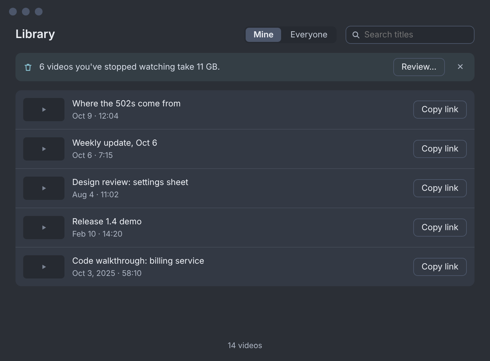
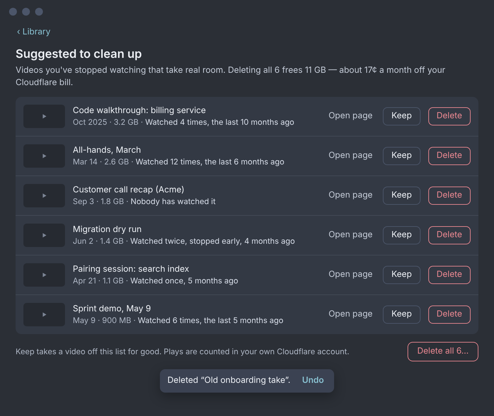
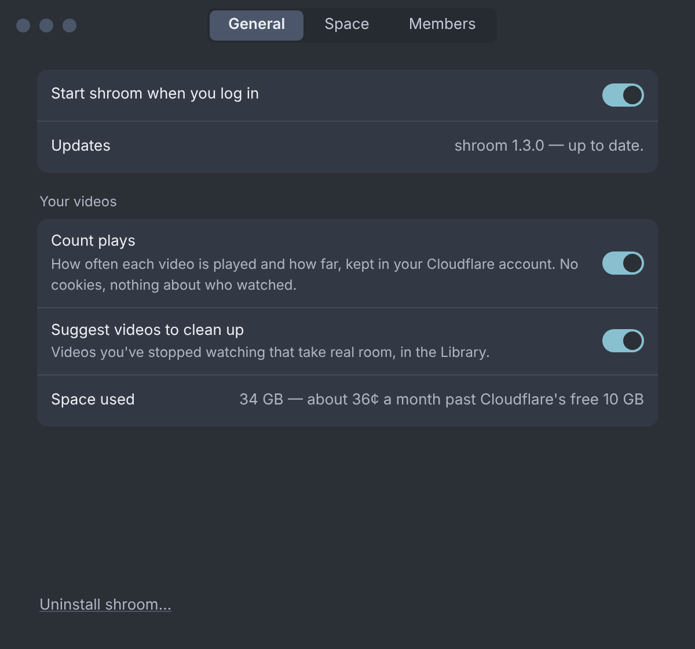
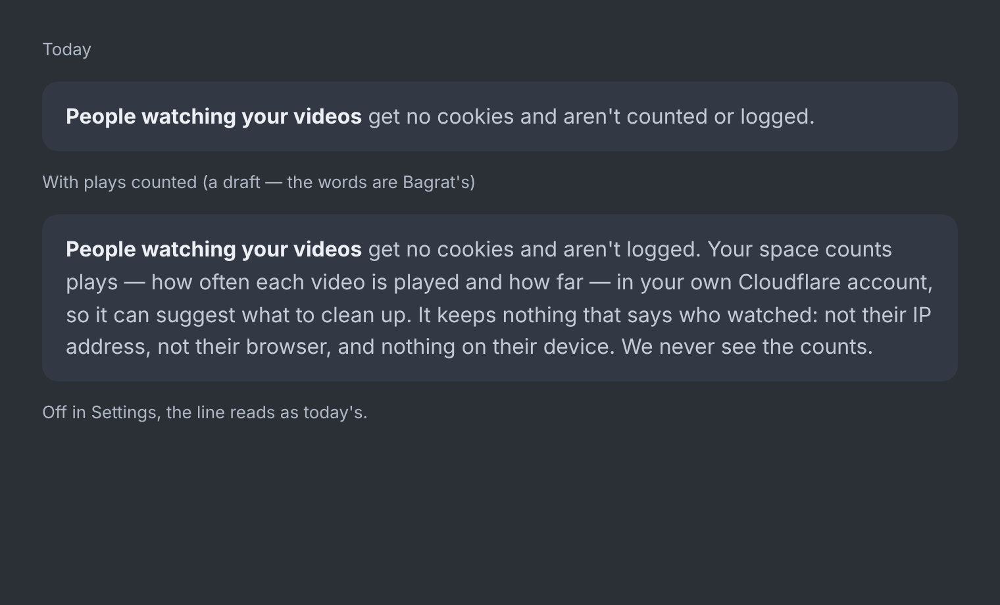

# Suggesting videos to clean up: counting plays, and four ways to score them

> **Built, 2026-10-18** — spec N68, DECISIONS B210–B214, WORKER-INTERFACE §4.21. This is the
> proposal and its POC as they stood, kept for the why; where they differ, the decisions and
> the code win (the score is `fading-cost`, the line's ✕ became Not now, the Undo is 5 s).

*Proposal and POC, 2026-10-18. Counting plays changes what the privacy page promises, and
the new rows, words and setting were Bagrat's call. The words on the boards and in the
reasons were drafts.*

> **Bagrat's answers (2026-10-18), relayed by the orchestrator:**
> 1. **Count plays: on by default**, with the switch in Settings.
> 2. **Count plays and unique-ish viewers** (the daily-salted hash).
> 3. **The formula: fading and cost together** (B + C). Built as `fading-cost`, now the
>    route's default; see §3.
> 4. **Delete: one tap, with Undo.**
>
> The same day he left the rest to the sessions' judgment for these POCs. §7 records each
> remaining call as "decided X because Y". The privacy wording in §5 is this proposal's draft,
> **for his review**.

Bagrat asked (2026-10-18) for shroom to work out which videos are worth deleting. Storage is
what costs money, so shroom should be able to say *these ones, and why*. He suggested
a formula built from when a video was added, how often it's been watched, how much of it
people watch and when it was last watched, and asked for several versions.

## In one screen

- **The page counts its own plays** in the owner's bucket. It uses two tiny beacons per page
  load, keeps no cookie, and stores nothing that says who watched. It runs on the Worker and
  the one bucket binding it already has: no new Cloudflare service, no new token permission,
  no change to wiring. Built and tested (§2), and checked in real Chromium and WebKit.
- **`POST /_shroom/api/cleanup`** gives a page of the space's videos, each with its plays and
  a verdict: a candidate or not, a score to rank by, and a reason code with the facts its line
  needs. The app's Library and the agent CLI (`shroom cleanup-candidates --json`) both read
  it.
- **Five formulas**, run over the same invented Library in §3. **Bagrat picked fading and cost
  together**, built as `fading-cost`: a video is suggested when its plays have faded (a
  30-day half-life, weighted by how far people watched) *and* it takes at least a cent a
  month to keep (≈ 0.67 GB). The dearest per remaining play goes first. Its reason line is
  checkable: "Takes 3.2 GB; watched 4 times, the last 10 months ago."
- **The money is small, so say so.** At Cloudflare's $0.015 per GB a month, with the first
  10 GB free, a 12 GB space saves about 4¢ a month by deleting 8.6 GB. The suggestion has to
  earn its place on tidiness and on staying inside the free tier, not on the saving. Every
  saving line uses the real marginal number, and that number is zero inside the free 10 GB.
- **The privacy page changes.** Today it says people watching "aren't counted or logged". §5
  has the draft line, and a switch in Settings turns counting off.
- **Boards**, on the canvas under *Library and Settings* at the bottom: "Library — videos
  suggested to clean up, the quiet line", "Library — Suggested to clean up", "Settings —
  General: Count plays, Suggest videos to clean up, Space used" and "shroom.am/privacy — the
  viewers' line once plays are counted".

| The Library's quiet line | The suggestions |
|---|---|
|  |  |
| **Settings → General** | **The privacy line** |
|  |  |

## 1. What to count, and where to keep it

### What a play is

The player sends a beacon on its **first play** of a page load. It sends another **each time
the tab hides** (switching away, closing, navigating). That one carries how much of the video
has been watched: the union of `video.played`'s ranges over the duration, so seeking back and
rewatching doesn't count twice. A random token, held only in that page's memory, ties the two
beacons together. Several ends from one page load replace each other; they don't add up.

- **Opened but never played** (a bounce, an unfurler, a crawler) is not a play. Bots don't run
  the player, so there's nothing to filter.
- **The maker's own page never carries the beacon.** The owner page is a different page
  already (the title field, the upload line), so watching your own video never counts. A
  teammate watching it does.
- **Unique-ish viewers:** the first 8 hex characters of SHA-256 of the day's salt, the address,
  the browser's user-agent string and the video's id. The hashes are kept for that day only.
  The salt is random and replaced each day, so yesterday's hashes can't be recomputed. This is
  Plausible's recipe, made narrower: the hash is per video and per day, and it's dropped
  rather than kept as a visitor id.
- **Why not count the media pieces fetched?** The player now plays the single-file copy
  (B177), in byte ranges a browser chooses (Chromium a few large ones, Safari about 3 MB at a
  time). That says little about how far someone watched. It would also put a write on every
  media request. Rejected.

### What's stored: `.shroom/views/<id>.json`

```jsonc
{ "v": 1, "plays": 41, "viewers": 23, "ends": 39,
  "watch": [2, 1, 0, 0, 1, 3, 2, 4, 9, 17],   // ends by tenths watched
  "watchedSec": 30112, "firstAt": "iso", "lastAt": "iso",
  "days": { "2026-10-17": 3, ... },          // plays per UTC day, the last 400 days
  "today": { "d": "2026-10-18", "h": ["9f2c41ab", ...], "t": { "<token>": 8 } } }
```

It's written by compare-and-swap, like the roster (≤ 5 tries). Alongside it:
`.shroom/views/salt.json` holds the day's salt, `.shroom/views/since.json` records when
counting began (so a video made before then isn't called "never watched"), and
`.shroom/views.off` turns counting off. Nothing under `.shroom/` is ever served, and no
recording credential reaches it, so a member's Mac can't forge plays either. A beacon for a
video that isn't live writes nothing, so a guessed id can't fill the bucket.

### D1, KV, Analytics Engine or a Durable Object?

| Store | Free allowance (Cloudflare, 2026-10) | Fit | Verdict |
|---|---|---|---|
| **R2, the bucket the space already has** | 1M writes and 10M reads a month free; then $4.50 / $0.36 per million | Each beacon is about 5 reads and 1 write (a play's two beacons, 2 writes), so the free tier covers roughly 500,000 plays a month. Contention is per video. | **Chosen.** No new binding, no new permission, the counts live next to the videos and go when the space goes. |
| Durable Object (SQLite) | Free plan: 100k requests and 100k rows written a day, 5 GB | Exact and atomic, cheap, no CAS. The deploy token's Workers Scripts Edit covers it. | **The upgrade path** if a space ever has a hot video. It needs a migration in wiring's script PUT, a second class of state to reason about, and a Rust change. |
| D1 | 5M reads and 100k writes a day | Fine for counts | Needs a new token permission (D1 Edit) and a database to create in wiring. Rejected. |
| Workers KV | 1,000 writes a day, eventually consistent | Too few writes, and read-modify-write races | Rejected. |
| Analytics Engine | 100k points a day, but **kept three months** and sampled | It forgets a video's last play after 90 days, which is exactly the signal cleanup needs. Reading it needs a token with Account Analytics Read. | Rejected. |

**What it costs the owner:** nothing extra inside Cloudflare's free tiers. Each beacon is one
Worker request out of the 100k/day free; a 5-minute view already costs 4–58 of those
(`worker/dev/view-cost.mjs`), so two more is a few percent. The records are about 1–3 KB
each, so even a thousand of them is far under a cent of storage.

## 2. The POC: what's built, and how to run it

| Piece | Where |
|---|---|
| The beacon (`VIEW_JS`), on the viewer page and the embed, never the owner page | `worker/src/worker.js` |
| `POST /_shroom/view/<id>`: same-site only (`Origin` itself, `Origin: null` from WebKit's unload beacons, never `Sec-Fetch-Site: cross-site`), at most 512 bytes, always 204 | `viewBeacon`, `daySalt`, `viewerHash`, `countView`, `applyView` |
| The scores and the saving | `cleanupFacts`, `cleanupScore`, `monthlySaving`, `FORMULAS` |
| `POST /_shroom/api/cleanup` `{scope: "mine"\|"everyone", formula?, after?}` → `{countingSince, formula, items, next}`: device key; a member sees their own; paged like the Library (40 records a call) | `cleanup` |
| 24 unit tests: counting, dedupe, the day's salt, CAS races, refusals, the owner page, the formulas, the route's scopes and paging | `worker/test/views.test.js` |
| Real browsers: a bounce, a half watch, a full watch, the owner's own watch, in headless Chromium and WebKit | `worker/dev/views-drive.mjs` |
| The four formulas over an invented Library | `worker/dev/cleanup-sample.mjs` |
| **Live on Cloudflare**: this branch's `worker.js` deployed to the dedicated test account as its own Worker over its own bucket (`shroom-poc-views`), a recording played through in Chromium and WebKit over the real workers.dev link, then torn down | `worker/dev/views-live.mjs` |

```sh
cd worker
npx vitest run test/views.test.js        # 24/24
node dev/views-drive.mjs                 # Chromium and WebKit: 12/12 checks
node dev/cleanup-sample.mjs              # §3's tables
SHROOM_E2E_TOKEN=… SHROOM_E2E_ACCOUNT_ID=… node dev/views-live.mjs   # live, test account only
```

**The live run (2026-10-18, test account):** two viewers, one in each engine, played the
video through. The real R2 record read back `plays: 2, viewers: 2, ends: 2`, with both ends
in the last tenth. The owner's page carried no beacon. `POST /_shroom/api/cleanup` on the
live Worker answered `plays 2, viewers 2, medianWatched 0.95, watched-lately`. One thing
turned up: a bucket recreated straight after deleting one of the same name answers 10073
for a few seconds; the script waits it out. Everything it made was deleted afterwards;
nothing else on the account was touched.

The whole Worker suite is green, apart from one test. The page-version guard fails on
purpose: a changed `worker.js` needs a new VERSION, and VERSION is tied to the app's version
(tauri.conf, Cargo, package.json), so the bump is a release step. It goes in when this is
built for real, not into a draft.

**Not built:** the app's side (the Library view, the Keep flag, the Settings switches), the
switch's write (`.shroom/views.off` is honoured, but nothing writes it yet), and removing a
video's record when it's deleted (the token Mac's sweep would; a stale record is harmless
because `cleanup` lists only live videos).

## 3. Five formulas, worked

Every formula shares the same guards. **Never suggest:** a video marked **Keep** (a new
`keep: true` on its record); one under 14 days old; one played in the last 14 days; one still
uploading; or any video before counting has watched it for long enough. Counting that began
after a video was made counts from the day counting began. A year-old video is not "never
watched" on the third day of counting.

Every verdict carries a reason code, `never-played`, `stopped-early` (median watched under a
quarter) or `not-lately`, plus `big-and-quiet` under `cost`. It also carries the facts the
line needs: plays, last played, quiet days, age, bytes, median watched. **Size**
is the record's `bytes` when the Mac writes it (a new, additive field), else duration × the
FAQ's own rate (about 3 hours in the free 10 GB, ≈ 0.93 MB/s for the stream and the
single-file copy together).

| | Rule | Ranks by | Good at | Weak at |
|---|---|---|---|---|
| **B + C. `fading-cost`** (Bagrat's pick, the default) | B's heat under 0.25 **and** at least 1¢ a month at list price (≈ 0.67 GB); at least 30 days old and quiet | $/month ÷ (heat + 0.05) | Suggests only what has faded *and* takes real room; protects past hits; the line reads "Takes 3.2 GB; watched 4 times, the last 10 months ago" | Conservative: small clutter (drafts, test takes) is never suggested at 1¢ |
| **A. `idle`** | Nobody has played it in 60 days, or 30 if nobody ever has | quiet days × GB | Easy to explain: "Last watched 4 months ago." Anyone can check it. | Ignores how popular it once was |
| **B. `fading`** | Plays fade with a 30-day half-life, each weighted by how far it was watched (0.3 + 0.7 × median); suggested once below 0.25, which is one full watch two months ago | GB ÷ heat | Respects a past hit: 30 plays five months ago aren't suggested yet | Hard to say in a line; the knobs are arbitrary |
| **C. `cost`** | Costs at least 1¢ a month and drew under one play a month over 90 days | $/month ÷ plays per month | Goes straight for the money, big files only | Never suggests the small clutter (test takes, drafts) |
| **D. `gravity`** | Hacker News's gravity turned round: (plays × (0.5 + median) + 1) ÷ (age + 2)^1.5, below 0.004 | GB ÷ pull | One number, well known | Opaque, and age keeps penalising a video that's still in use |

### Worked over an invented Library (`node dev/cleanup-sample.mjs`)

Twelve made-up videos, 12.4 GB in all; counting began six months ago; today is 2026-10-18.

| Video | Age | Size | Plays | Median watched | Last played |
|---|---|---|---|---|---|
| Q3 roadmap walkthrough | 160 d | 1.33 GB | 41 | 85% | 120 d ago |
| Bug repro: login loop on Safari | 210 d | 0.17 GB | 2 | 95% | 205 d ago |
| Onboarding: setting up your laptop | 300 d | 1.00 GB | 52 | 75% | 9 d ago |
| Draft — ignore | 95 d | 0.33 GB | 0 | — | never |
| Design review: settings sheet | 75 d | 0.61 GB | 3 | 15% | 70 d ago |
| Weekly update, July 4 | 106 d | 0.39 GB | 9 | 95% | 100 d ago |
| Customer call recap (Acme) | 45 d | 1.78 GB | 0 | — | never |
| How the deploy pipeline works | 400 d | 2.28 GB | 19 | 65% | 25 d ago |
| Test take | 20 d | 0.06 GB | 0 | — | never |
| Release 1.4 demo | 250 d | 0.78 GB | 120 | 85% | 160 d ago |
| Code walkthrough: billing service | 380 d | 3.22 GB | 4 | 45% | 300 d ago |
| Hiring: interview loop explained | 60 d | 0.50 GB | 5 | 95% | 31 d ago |

| Formula | Suggests | Frees | Saves a month (past the free 10 GB) | At list price |
|---|---|---|---|---|
| **B + C. fading-cost** | 2: billing walkthrough ("Takes 3.22 GB; watched 4 times, the last 10 months ago"), Acme recap ("Takes 1.78 GB; nobody has watched it in 45 days") | 5.00 GB | **4¢** | 8¢ |
| A. idle | 8: billing walkthrough, Q3 roadmap, Release 1.4 demo, Acme recap, design review, weekly update, bug repro, draft | 8.61 GB | 4¢ | 13¢ |
| B. fading | 5: billing walkthrough, Acme recap, draft, bug repro, design review | 6.11 GB | 4¢ | 9¢ |
| C. cost | 4: billing walkthrough, Acme recap, Q3 roadmap, Release 1.4 demo | 7.11 GB | 4¢ | 11¢ |
| D. gravity | 4: billing walkthrough, Acme recap, draft, bug repro | 5.50 GB | 4¢ | 8¢ |

All four agree on the billing walkthrough (3.2 GB, last watched 10 months ago) and the
Acme recap (1.8 GB, never watched). None of them suggests the onboarding video (watched 9
days ago), the test take (20 days old, still in its grace) or the interview loop. They differ
on the past hits: `idle` and `cost` suggest the Q3 roadmap and the Release 1.4 demo; `fading`
and `gravity` keep them. In this Library the saving is the same 4¢ whatever the formula,
because only 2.4 GB sits past the free 10 GB. **That's the real finding**:

- **The saving is small at R2's prices.** A heavy space of 100 GB costs $1.35 a month in all;
  clearing 30 GB saves 45¢. Suggestions should name the number honestly. Inside the free
  10 GB they should say it frees space and saves nothing yet, not pretend otherwise.
- **`fading-cost` is strict on purpose.** It suggests two of twelve here: the two that
  faded and take real room. Q3 roadmap and Release 1.4 demo were big hits a few months ago
  and their plays haven't faded below the line yet. The draft and the design review are under
  a cent a month. With the gate at half a cent (≈ 0.33 GB, about 6 minutes) it would add the
  draft and the design review: 4 videos, 5.9 GB. The gate is one constant
  (`FADING_COST.usdAtLeast`); §7, call 8.
- **Inside the free 10 GB** (the same Library less the deploy and onboarding videos, 9.2 GB),
  `fading-cost` still suggests the same two. Its cost gate reads the *list price* (the room a
  video takes), not the bill. So inside the free tier it still names what takes the room,
  and the saving line says honestly that it saves nothing yet. Gating on the bill instead
  would suggest nothing until a space passed 10 GB, and then everything at once.
- **The pull is staying inside the free tier.** The FAQ says about three hours of video fit in
  the free 10 GB. "Delete these 8 and you're back inside Cloudflare's free space" is a line
  that saves the whole bill. Proposed: when the suggestions would bring a space under 10 GB,
  say that instead of the cents.

## 4. Where it shows

The boards, under *Library and Settings*, at the bottom of the column. They show a bigger
invented space than §3's (34 GB, six suggestions under `fading-cost`), so the view has
rows to show:

1. **The Library's quiet line**: "6 videos you've stopped watching take 11 GB.
   Review…", with ✕ for not now. It shows above the rows when there's at least one candidate
   and the switch is on. ✕ hides it until the list changes.
2. **Suggested to clean up**: a view of its own (‹ Library to go back). A line on the total
   and the saving, then each video with when it was made, its size and **the reason in
   words**, plus **Keep**, **Delete** and Open page. **Delete is one tap, with Undo**: the
   video leaves the list, a line says "Deleted “…”. Undo" for a few seconds, and only then is
   the delete sent. Undo after the seal isn't possible (B125), so the delay *is* the undo.
   **Delete all 6…** asks once, with the delete sheet's own words.
3. **Settings → General**, a group called *Your videos* with three rows. **Count plays**
   (on by default; the line under it says what's kept and that no cookie is used), **Suggest
   videos to clean up** (on), and **Space used** with the honest cost line.
4. **The privacy page**: the line now and the draft (§5).

Not drawn yet, worth a look: a play count on the owner's own page ("41 plays · most watch to
the end"). The data is there, and makers like seeing it. It's a different feature, so it's
left out.

## 5. Privacy: what changes

Today `shroom.am/privacy` says: "People watching your videos get no cookies and aren't
counted or logged." With this, that sentence is false. **The proposed line, for Bagrat's
review** (drawn on the board "shroom.am/privacy — the viewers' line once plays are
counted"):

> **People watching your videos** get no cookies and aren't logged. Your space counts plays
> (how often each video is played and how far) in your own Cloudflare account, so it can
> suggest what to clean up. It keeps nothing that says who watched: not their IP address,
> not their browser, and nothing on their device. We never see the counts.

Points behind it:

- **Nothing stored on the viewer's device.** No cookie, no localStorage. The token lives in
  the page's memory and dies with it. The EDPB (Guidelines 2/2023) treats localStorage like a
  cookie, so avoiding both keeps the consent question away from the viewer's device.
- **The address and the browser string are read for one hash per day**, then dropped. The
  salt that could link them is replaced daily, and the hash is cut to 32 bits. The same
  guidelines note that collecting an IP and user agent to track someone can itself need
  consent. Here they're never stored and never linkable across days or videos, so the honest
  claim is "nothing that says who watched". A stricter option, plays only, drops
  unique-ish viewers and hashes nothing at all.
- **The owner holds the data, not shroom.** It sits in their bucket; shroom (the project)
  never receives it. That's the line between this and every hosted video analytics product.

## 6. Spec sketch (provisional; ids to assign when built)

- **N-cleanup-a. The page counts plays.** A viewer's page and the embed count a play at the
  first play and how far it was watched when the tab hides, in the space's own account, with
  no cookie and nothing that names a viewer. The maker's own page never counts. Settings →
  General → **Count plays** (on by default) turns it off space-wide. *Law check: law 4 (no
  mid-take surprises) is untouched; the "never silently" principle is kept by the privacy
  page and the Settings line.*
- **N-cleanup-b. The Library suggests videos to clean up.** When counting has seen a video
  long enough, its plays have faded (a 30-day half-life, weighted by how far they watched,
  below a quarter of one fresh full watch) and it takes at least a cent a month to keep,
  it's suggested. Never
  within 14 days of its making or a play, and never one marked Keep. New Library state:
  `library-cleanup` (the view), reached from the quiet line's **Review…**. Edges: **Keep** →
  the row leaves, for good. **Delete** → the row leaves, the Undo line shows, then the existing
  delete. **Delete all** → `delete-confirm` with the count. Said-lines: the quiet line, the
  view's heading and total, one reason line per code, the saving line, and its free-tier
  variant ("…and you're back inside Cloudflare's free space").
- **The record gains `keep: true` and `bytes`** (additive; the Mac writes them under
  If-Match).
- **For agents:** `POST /_shroom/api/cleanup` is the CLI's source. `shroom
  cleanup-candidates --json [--formula fading-cost|idle|fading|cost|gravity] [--everyone]` pages it with
  the device key until `next` is null, then prints the candidates with their reason codes,
  facts and `usdPerMonth`. The reason codes are stable; the words aren't, so an agent writes
  its own. Deleting stays the existing delete path (an agent proposes, the person confirms).

## 7. The calls, decided

Bagrat answered 1–4 (2026-10-18), and the same day left the rest to judgment for these POCs.
Each call below can be reversed in one place.

1. **Count plays: on by default**, with **Count plays** in Settings → General (Bagrat). A
   space with counting off writes `.shroom/views.off`; the beacon then writes nothing.
2. **Plays and unique-ish viewers** (Bagrat). The viewer hash is the daily-salted one of §1.
3. **The formula: `fading-cost`** (Bagrat: fading and cost together). *Decided how to
   combine them:* both must hold, faded plays (heat < 0.25) **and** at least 1¢ a month at
   list price, ranked by cost ÷ heat. *Because* "AND" is the only combination whose reason
   reads as one checkable line ("Takes 3.2 GB; watched 4 times, the last 10 months ago").
   A weighted sum would need its own explanation. The other formulas stay in the code for
   comparison.
4. **Delete: one tap, with Undo** (Bagrat). The delete is sent only after the Undo line
   goes, because a sealed delete can't be undone (B125).
5. **Decided: GB always, cents only past the free tier, and the free-tier line when it
   applies.** *Because* cents inside the free tier would be a false "0¢" or a misleading list
   price. "Back inside Cloudflare's free space" is the one line that saves a whole bill.
6. **Decided: owner-class sees everyone's suggestions under Everyone; members see only their
   own; no nudge about a member's videos.** *Because* it follows the Library's Mine ·
   Everyone exactly, and deleting another person's video stays a deliberate act from
   Everyone.
7. **Decided: the Mac writes `bytes` into the record** when it publishes (and once for old
   videos, summing `rec/<id>/`); until then, the duration estimate. *Because* the estimate is
   off by up to about 20% at Normal, and more at other qualities, and the saving line should
   be exact.
8. **Decided: fading-cost's size gate is 1¢ a month (≈ 0.67 GB, about 12 minutes).**
   *Because* fewer, surer suggestions build trust in a list that leads to deleting things;
   half a cent doubles the list here but adds 6-minute drafts that cost almost nothing.
   It's one constant (`FADING_COST.usdAtLeast`), to revisit with real counts.
9. **Decided: suggestions show inside the free 10 GB too**, with the honest "saves nothing
   yet" line. *Because* hiding them until the bill starts would make the first suggestion
   arrive as a pile, and tidiness is worth having on its own.
10. **For Bagrat's review: the privacy line** (§5). It's the one user-facing promise this
    changes, and the page carries his approved copy word for word.
