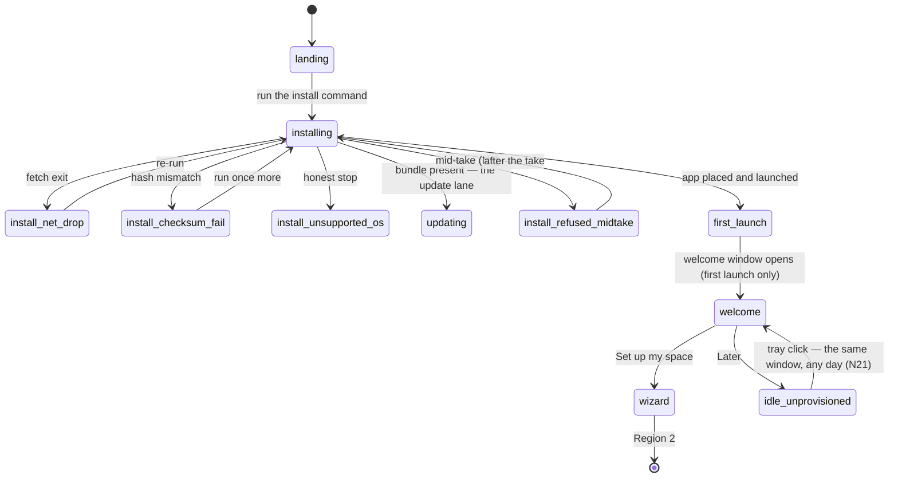
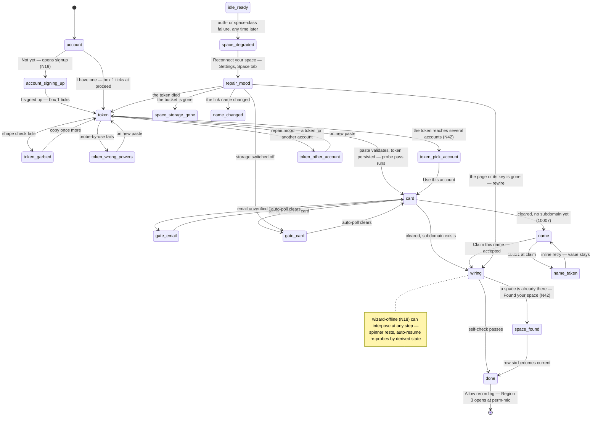
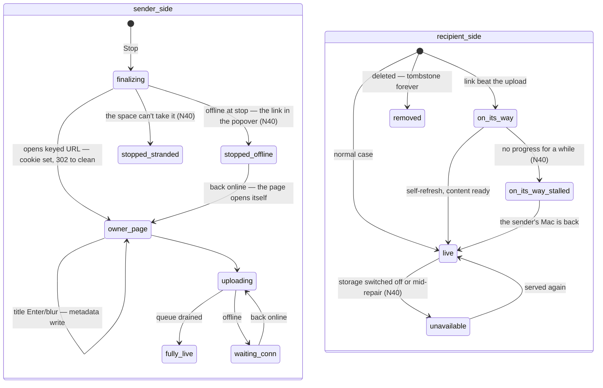
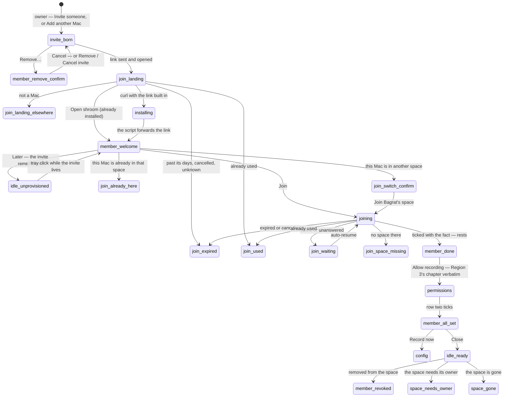

# shroom — v2 UX state machine

> Status: **the decided spec, built live with Bagrat** (session started 2026-07-20), leg by
> leg over the walkthrough. Where [`UX-WALKTHROUGH.md`](../history/UX-WALKTHROUGH.md) (the derived
> narrative) and this doc disagree, **this doc wins**; the walkthrough gets one
> reconciliation pass when the session ends. Said-lines here are drafts under the voice
> rules (UX-WALKTHROUGH §0) — the *moment structure* is binding, the wording is not,
> **except** in sections marked *copy ratified*: the fat-marker session (started
> 2026-07-25) graduates wording to binding, screen by screen.
>
> **Fat-marker protocol** (so any session can resume it): one screen per leg, in machine
> order — render a low-fi inline mock (macOS-shaped chrome, **Nord palette**, the POC
> logo from `archived-poc/docs/logo.svg` — itself Nord: Frost cap, Snow Storm spots —
> **real copy**, links read `v.myshroom.workers.dev/<id>`) → Bagrat corrects → on
> “ratified,” the copy graduates here and the ledger updates; corrections that change the
> machine are discussed before advancing; a commit is proposed at each region boundary
> (never push main). Screens still holding open flags carry a *Fat-marker status* note
> inline. *(Mocks were grayscale + 🍄 stand-in through the first three screens; Nord +
> real logo since 2026-07-25 — Bagrat's call, mock dress only, not a ratified product
> style; check glyphs draw as minimal straight strokes since leg 6.)*
>
> **The autonomous sitting (2026-09-30).** Bagrat, stepping away: *finish designing the UX
> to the end — every state and edge — without stopping to ask.* Claude ran the remaining
> legs alone, from `join-landing` to the last edge. Everything that sitting decided is
> **designed, not ratified**: ledger rows N29 onward carry *autonomous — awaiting
> ratification* in the When column, and their sections say *designed 2026-09-30*. Where a
> design amends something Bagrat ratified, the row says **amends** and names it — those
> are the first things to read. Ratifying works as before: Bagrat reads, corrects, and the
> row's When column gains the date.
>
> Evidence keys as in the walkthrough: (POC §n) · (Rn) · (probe) · (§4 = the
> stack decision (2026-07-20)) · (§5.n = the rethink's requirements, not public).

## Decisions ledger

| ID | Question | Decision | When |
|---|---|---|---|
| P17 | Landing page in v1's definition of done? | **Yes — full page, curl-only.** One install path at launch: the readable script at `shroom.am/install`. brew formula + .dmg are post-v1 additions, absent from the v1 machine. | 2026-07-20 |
| U1 | Record before cloud setup? | **No — setup-first gate.** `Later` parks the app in `idle-unprovisioned`; Record routes to the wizard. No local-recording or local-library states exist in v1. | 2026-07-20 |
| U4 | Start at login? | **Pre-checked visible checkbox in the welcome panel.** Applied on panel dismissal (either button), changeable in settings, never registered silently. | 2026-07-20 |
| U8 | First hostname label (the Worker's name, visible in every link) | **`v`** — every link reads `v.<name>.workers.dev/<id>`; a custom domain (upgrade tier) hides the label entirely. Permanent once links exist. *Amended by N42 for one case: a clashing “v” becomes the label `shroom`.* | 2026-07-20 |
| U5 | Permission timing | **End of onboarding, same window** — mic inline → Settings switch → guided relaunch → priming warm-up. First Record is pure. Arm-time re-probe survives as a guard, not a step. (Reversed the walkthrough's first-arm rec — that rec was premised on the value-first U1 shape, which U1's decision rejected.) | 2026-07-20 |
| U2 | The title moment at stop | **On-page focused title, owner-cookie auth.** Stop opens `…/<id>?k=<one-time-key>` → the Worker validates, sets a long-lived owner cookie (space-scoped, likely HttpOnly), 302s to the clean URL — the address bar never holds the key. Owner-mode persists per-browser: opening your own link from Slack months later still edits. Shared links are always clean. *Amended by N40: the cookie names a member, and owner-mode is by role.* | 2026-07-20 |
| N1 | Clipboard at stop *(new question, leg 4)* | **Never auto-copied.** Copying is explicit — [ Copy link ] on the page, Copy last link in the tray. *Tray door removed by N21 — the page and the Library row are the two doors.* | 2026-07-20 |
| U9 | Where "fully live" lands | **The page itself is the signal.** The self-refreshing page carries live upload progress while the queue drains; the tray mirrors it. **No macOS notifications in v1** — zero notification-permission surface. *Since N21 the tray's mirror is the config popover's status line.* | 2026-07-20 |
| U3 | Sender identity on the page | **Anonymous.** Schema carries a sender-name field from day one; no name UI in v1. The mark: a small shroom icon bottom-right, tooltip “made with shroom”, linking home — and in owner-mode it's toggleable **right on the page**, the setting applying space-globally. | 2026-07-20 |
| U7 | Update posture | **Notify-then-apply.** A tray badge announces the update; the user applies with one click. (Bagrat, against the auto-apply recommendation — consent over convenience.) *The apply row lives in the config popover since N21.* | 2026-07-20 |
| N2 | Custom-domain timing *(new question, leg 5)* | **Post-v1.0.** v1 is workers.dev-only; the Worker design keeps the attach door open; docs state the upgrade honestly. | 2026-07-20 |
| U10 | Second-Mac join flow | **Dissolved into the member model (N3):** the second Mac is a member you invite from the first — 30 s, no dashboard. Admin re-paste survives as the recovery door (“Found your space — 14 videos. This Mac is joined.”). *Amended by N33: the second Mac joins through Add another Mac, owner-class — not as a plain member.* | 2026-07-20 |
| N3 | Member model *(Bagrat reframe, leg 5)* | **Ratified for v1.** The space is born multi-member: the pasted token is infra/admin setup and retires after it; recording always runs on member creds; the owner is silently member #1. Members join with zero Cloudflare anything — the C persona lands in v1. Join code may embed in the install command (zero-paste join; conscious argv/history exception — one-time-use, 7-day TTL). | 2026-07-20 |
| N4 | Member write path | **Worker-minted temp creds.** One cred shape for all: prefix-scoped ≤7-day S3 temp creds (probed); owner self-mints locally from the admin token, members mint via one authenticated Worker endpoint. **Minting is automatic and invisible for every role** (Bagrat's ratification condition). Bytes always direct to R2 — never proxied. | 2026-07-20 |
| N5 | In-space authority | **Own videos + admin sees all.** Members see/manage only their own; the admin (whose bucket and bill) sees the whole library, deletes anything, manages members. | 2026-07-20 |
| U6 | Is the guided persona claimed publicly? | **Claim it, second billing.** Landing leads with the dev story; a “Record together” section states the member story honestly — true without asterisks now (the card cliff exists only for the admin). *Placement amended by N6: the section dissolved into hero point six — the claim stands, promoted.* | 2026-07-20 |
| N6 | Landing message architecture *(fat-marker leg 1)* | **The hero carries the whole message:** a punchline in shroom's own words (“Screen recordings without the monthly seat. / Pay as you go — sometimes completely free.” — re-ratified 2026-10-13: no competitor's name on the page) + six-point explanation with eyeball-number tiles. Install block above the demo (the command is small and hides below a full-width player; recipient-loop visitors already saw the demo half work). Trust strip = open source · your-storage-your-bill · built-to-outlive-us (telemetry line cut). | 2026-07-25 |
| N7 | Demo video shape *(fat-marker leg 1)* | **Self-recorded, record-only, single take, no editing.** The controls can't appear in their own take (config/countdown precede capture; the tray click *is* pause; the page opens post-take) — so the demo narrates its own start, shows the being-recorded life + one real task, and ends “I click stop — the page you're watching is what opened.” Setup never appears in the demo; the VM full-loop variant rejected as a stunt. | 2026-07-25 |
| N8 | Issue-reporting second door *(fat-marker leg 2)* | **Two doors in failure copy: the new-issue deep link + `issues@shroom.am`.** The alias is one Cloudflare Email Routing rule on the domain — zero operated service, works for members without GitHub accounts. The tiny opt-in proxy (telemetry, [PRINCIPLES](../../docs/PRINCIPLES.md)) stays parked with the post-v1 telemetry track. Scaffold nicety: the issue URL may prefill title/body via query params — everything visible in the URL. | 2026-07-25 |
| N9 | Update-while-running semantics *(fat-marker leg 2)* | **Quit → swap → relaunch; mid-take refuses.** Running but not mid-take: the script quits shroom, replaces the bundle, relaunches — tray-only, silent per the dock rule; the disk-backed upload queue rides through. Mid-take — recording **or paused** (a paused take is live) — polite refusal, nothing touched: the sacred-recording law reaches into the installer. Never swap under a running process (signature-mismatch kill on next load — verify exact behavior at scaffold). Classification via the app's machine-readable status seam, not process-sniffing. *Refined by N41: a fresh install onto a Mac that remembers its space opens the door; this update lane stays silent.* | 2026-07-25 |
| N10 | Install progress posture *(fat-marker leg 2)* | **curl's native bar for the app fetch.** The pasted one-liner keeps `-fsSL` — it fetches only the tiny script. The in-script app download shows curl's own progress bar: native terminal idiom, zero custom code in the readable source. Stillness rejected (indistinguishable from a hang on slow links); hand-rolled ticker rejected (cursor-control code in read-it-first source). | 2026-07-25 |
| N11 | Installer source comments as copy *(fat-marker leg 2)* | **A said-line surface.** “Read it first” makes the source a first-class audience page — the one page a skeptic reads slowly. The header comment block is ratifiable copy (plain-speech what-it-does); inline comments stay technical but honest. One screenful mocked and ratified with this screen. | 2026-07-25 |
| N12 | Welcome dismissal semantics *(fat-marker leg 3)* | **✕-close ≡ Later, exactly — no special case.** Any dismissal (either button or the close control) registers the login item iff the visible box is still checked; U4 refined. Copy correction: “**set up** your Cloudflare” (was “connect”). “Storage” here vs the landing's “account”, and numerals vs words, stand as deliberate two-register choices. | 2026-07-25 |
| N13 | Wizard plan panel + `account` screen *(fat-marker leg 4)* | **Plan glyphs, not checkboxes:** → current · ✓ done · • still ahead — checkboxes read as something the user must click. Box 1 reworded: the Google sign-in alternative named in-panel (promoted from docs-only), “Adding it costs nothing”, and the free ceiling made concrete (“up to about six hours of video” — the welcome register). Box 3 gains the example `v.yourname.workers.dev`. **I have one** = filled rightmost default; after “Not yet” opens signup the screen deliberately doesn't morph — self-report by proceeding stands. *Box-1 wording amended by N14 — the card content moved to its own row. The no-morph is reversed by N19 (`account-signing-up`).* | 2026-07-25 |
| N14 | The card step + token-screen posture *(fat-marker leg 5)* | **The plan grows a fifth row and the gates move into it.** Box 1 ticks at proceed — the plan's one self-reported tick (nothing is probeable pre-token; the paste proves it moments later). New row: “A credit card for storage (their rule, not a charge — free up to about six hours of video)”; box 1 slims to the sign-in gate — the visible card row *is* the pre-warn now. Card step: email check first (`gate-email`), then card presence (`gate-card`, button **Add credit card**); auto-poll spinner (polling dots rejected — read as a carousel); both clear → row ticks. Token screen never auto-opens the browser: read → **[ Create token in Cloudflare ]** (the only trigger, serves every retry) → paste; the wrong-powers line points back at it. | 2026-07-25 |
| N15 | The `name` step surface *(fat-marker leg 6)* | **The row is the ask; the URL is the field.** No instruction line — typing happens inside `https://v.___.workers.dev/…`; the current row's parenthetical sheds only its example (the live URL replaces it). Explicit **[ Claim this name ]**, Enter-equivalent — permanent names never auto-claim; disabled until the charset check passes; no availability pre-check (taken discovered at claim: `10031` → red field edges, value stays, inline retry). The charset guard filters, never scolds: stray characters never land, a quiet fading line explains; uppercase lowercases silently. **Both endings tick the row with the fact** (“✓ Your link name — v.*name*.workers.dev”) — the plan's only outcome-bearing tick. Action buttons inside nested step content sit flush-left, wizard-wide. | 2026-07-25 |
| N16 | The `wiring` surface *(fat-marker leg 7)* | **Zero affordances — a spinner and one calm line.** No cancel, no button, no stage narration (the ~6 calls, secret placement, member-#1 enrollment, and propagation all hide behind the line); closing the window mid-wire is safe by the backbone. Offline: the spinner rests, “Everything so far is saved — I'll pick up right here when you're back online.”, auto-resume on reconnect — no retry affordance. The name row shows its N15 outcome throughout. *Offline generalized wizard-wide by N18 (`wizard-offline`).* | 2026-07-25 |
| N18 | Non-happy paths are states *(fat-marker, map session)* | **Every blocking failure is a first-class state with a scaffold-grade name** — a distinct render plus a distinct set of enabled transitions; easier to build and reason about (Bagrat's call). Roster: `install-net-drop` · `install-checksum-fail` · `install-unsupported-os` · `install-refused-midtake` · `updating` (the not-a-failure lane) · `token-garbled` · `token-wrong-powers` · `gate-email` / `gate-card` (already states) · `name-taken` · `wizard-offline`. **`wizard-offline` generalizes N16's wiring-only offline** — one state for the whole wizard, rendered under whichever row is current, auto-resume on reconnect (re-probe routes by derived state). Nuance: as-you-type guards (the N15 charset filter) stay stateless — no transition happens. | 2026-07-25 |
| N19 | `account-signing-up` *(fat-marker, map session)* | **The return from the browser is acknowledged, never a dead screen** — reverses N13's deliberate no-morph. After “Not yet” the nest becomes: “Cloudflare's signup is open in your browser — finish there, I'll wait.” + [ Take me there again ] · [ **I signed up** ] (filled). Signup stays self-reported — box 1 ticks at proceed; “Take me there again” reopens the tab, no transition; a relaunch mid-trip re-enters at the virgin fork (nothing probeable before a token exists). | 2026-07-25 |
| N17 | The `done` screen + the sixth row *(fat-marker legs 8–9; ratified after two Bagrat corrections)* | **The plan grows a SIXTH row and spans the whole onboarding:** “Letting macOS allow recording (microphone and screen — a one-time yes each)” — visible from the wizard's first screen; per-Mac where rows 1–5 are per-space. **`done` = the resting beat** (never auto-fires a permission dialog): five ticks, row six current, its nest **previews the permissions choreography** — “macOS will ask twice…” / “Flip the switch next to shroom there… say yes — I'll be right where you left off.” + [ **Allow recording** ]. “Updates never ask again.” removed (Bagrat); the payoff line retired — the name row already states the link fact. **`perm-preamble` fuses into `done`**; Region 3 opens at `perm-mic`. | 2026-07-25 |
| N20 | The permissions chapter + `all-set` *(fat-marker leg 10)* | **Chapter copy ratified as drafted** (the mic usage string · perm-screen's flip-the-switch line · priming's double-check line); `relaunching` named as a beat (N18 spirit). **`all-set` = the window's final face — a resting state with three doors** (replaces the passive handoff): all six rows green, closing block below the plan — “You're all set — ready to record.” · “shroom lives in your menu bar now — look for the little mushroom.” · [ Close ] [ Invite someone ] [ **Record now** ] (filled). Record now closes the window and opens `config` at the tray (teaching by gesture, not sentence); Invite someone morphs into the members surface (Region 6 `invite-born`); Close — and ✕, ≡ Close exactly per N12 — is the retreat to tray-only life. “Invite someone”, not “someone else”. | 2026-07-25 |
| N21 | The tray surface *(fat-marker leg 11 — the tray quartet's idle pair, merged with `config`)* | **Loom-style custom popover, never a native menu — and the tray click is the door itself.** `idle-unprovisioned`: click → the `welcome` window, immediately (the same ratified window, any day later). `idle-ready`: click → `config`, directly — a same-themed popover, pre-filled, one click from Start, footer of three icons with hover tooltips: **Library · Settings** (the gear — the door to the Region-5 inventory) **· Quit shroom**. Both native menus die with their rows: **Copy last link removed** (N1 amended — the page and the Library row are the doors); the wizard's Record-routed context line retires (welcome already says it); quit before setup = right-click → a one-item native menu, Quit shroom (both states). Orphaned tray rows get popover homes at their own legs: U9's upload mirror → a status line above the footer; U7's update row → a banner row; `space-degraded`'s Reconnect your space → the popover's degraded face. Config's Record row is **one source picker** — displays by human name first, Camera below (Camera greys Show yourself). Recording-life click semantics untouched (click = pause); the paused surface follows the same direction at its leg. *The slots “at their own legs” were settled by N24 (paused), N37 (updates) and N38 (the grammar).* | 2026-08-21 |
| N22 | `countdown` + the bubble's birth *(fat-marker leg 12)* | **Countdown ratified as rendered; cancel by any of three — a click anywhere, Esc, or the quiet line itself.** Bagrat kept click-anywhere (the click-through variant rejected: a cancelled count is one click from retry). The overlay: a light scrim on the chosen display only, a large 3 · 2 · 1, one quiet line beneath — “Click anywhere to cancel.” (the config line, repeated where the decision is made); silent; other displays untouched; the scrim lifts the instant capture starts, so the count is never in the take (N7); no recording flash of ours — macOS's own indicator marks the capture. **The bubble is born at `config`, not at the count** (Bagrat): with Show yourself on, the camera preview appears the moment the popover opens — you see and place yourself before Start; it stays through the count into the take, and the switch hides it live. Consequence: the first-ever Show yourself defaults **off**, and flipping it on is the camera-permission moment — the inline-at-first-pick rule now has two first picks (the switch, or Camera as the source); last-used thereafter. | 2026-08-21 |
| N23 | `discard-confirm` *(fat-marker leg 13)* | **Ratified as rendered — the paused popover morphs into the question; no window, no dock icon.** “Toss this recording?” · “4:32 recorded so far. There's no undo.” (new second line — the length gives the decision its weight, the no-undo is the truth) · [ Back ] ··· [ Restart instead ] [ Discard ] (red outline, rightmost, never filled). Click-away or Esc ≡ Back; **no Enter default** — a stray Return can never destroy. Restart instead re-arms with the count already running; Discard → `idle-ready`, the bubble goes with it. **What Discard deletes:** the local take *and* any bytes the opportunistic upload already placed in the bucket — a clean delete with no tombstone, since the link was never handed out (the page never opened, nothing copied). Ordering: the `paused` popover — promoted to its own leg by N21 — comes next. | 2026-08-21 |
| N24 | `paused` + the tray faces *(fat-marker leg 14)* | **Ratified as rendered.** The take's popover (opens only after the click's pause is confirmed — POC §8): header “Paused — 4:32” · [ **Resume** ] (the one filled action) · [ Drop a marker ] [ Restart ] · [ Stop ] with one quiet line beneath, “Your link opens right away.” — the single place stop = published (§5.3) gets said · “Discard…” as red text at the bottom, never a button a stray click finds · a grey “no Quit while a take is open” note (kept). **Three tray faces:** plain (idle) · red dot (recording — no popover, the click *is* the pause) · pause bars (paused). **No timer in the menu bar** — the length lives in the popover header. `display-lost` ratified by reference: the same popover with the context line “Your display disconnected — recording paused.” and Resume greyed until the display is back. Drop a marker lands at the pause point, metadata-only in v1. *Extended by N37/N38: five tray faces (amber, Frost).* | 2026-08-21 |
| N25 | `recovered-take` *(fat-marker leg 15)* | **Ratified as rendered — a banner at the top of `config`, greeted by the next tray click; launch stays silent.** A **fourth tray face, the amber dot** — something waits for you (no window, no notification: U9 and the dock rule hold). The banner: “We saved your interrupted recording (4:32).” · [ **Get link** ] · “Discard…”; config stays usable beneath it. Get link runs the normal stop sequence from the saved file — the page opens exactly as a deliberate stop would (Region 4). Discard… confirms with N23's question, one word changed — “4:32 was saved. There's no undo.” — and the same clean delete. The banner persists until resolved, across launches; a new take can start meanwhile; two interrupted takes surface oldest first. Named tradeoff: someone who never clicks the mushroom won't learn of it — the take is safe meanwhile. The update badge (U7) and the degraded face may share the amber dot — decided at their legs. *Settled by N37/N38: amber = something needs you (saved take, space, recording off); the update has its own Frost dot.* | 2026-08-21 |
| N26 | The owner page at stop *(fat-marker leg 16)* | **Ratified as rendered.** The title field is the page's only chrome — focused on arrival, Enter or click-away saves, an untouched placeholder “Untitled — Aug 21” (the day's date) becomes the title so a shared link is never blank; no header, no wordmark, no name (U3). Player: first frame, play, scrub, time, fullscreen. [ **Copy link** ] reads “Copied” for a moment — the page's one copy door (N1); beside it the upload truth, “Uploading — 40%. Your link already works.” with a thin bar → “Fully live ✓”. Download appears only when the single-file MP4 exists (R11). Bottom-right: the owner switch beside the mark, its label “made with shroom” doubling as the tooltip recipients get — flipping it is the space-global setting (U3). Offline line kept by reference. The address bar shows the clean link — the key died at the 302. | 2026-08-21 |
| N27 | The recipient page, three faces *(fat-marker leg 17)* | **Ratified as rendered, copy verbatim from Region 4.** `live` = the owner page minus the owner's two controls: the title as plain text, the player, Download quiet and second-class once the MP4 exists, the mark with its hover label — no comments, no sign-in, no name. `on-its-way` keeps the title (the untouched placeholder if never typed) and puts the line where the player will be, over a thin bar — the owner's upload seen from the other side; self-refresh. `removed` = the tombstone line alone — no title, no player — the mark stays, the address lives forever. `noindex` on every face; unfurl honesty per R5 unchanged. Closes Region 4. *Extended by N40: a stalled face, an unavailable face, the embed face.* | 2026-08-21 |
| N28 | `invite-born` — the Members face *(fat-marker leg 18)* | **Ratified as rendered.** The Members face of the window — the gear → Settings → Members, or `all-set`'s Invite someone morphing the same window, the field focused. Head “Members” + one line of N5 truth: “Everyone here records to your space — their videos live in your storage, and you can see and delete any of them.” The list: You (no fact — member #1 shows, silently) · joined members with their date · pending invites. **The composer is the ask** — a name field (“Who's this for?”) + [ Invite ], always present, no Invite-someone button on this face; beneath it “You'll get a link to send them — over any chat.” The typed name is the admin-private label for the member, forever — members never type a name (U3 holds). **The born state appears under the new row:** the link pill `v.<name>.workers.dev/join/<code>` · [ **Copy link** ] (filled — the moment's one action; reads “Copied” briefly per N26; Invite drops to outline meanwhile) · “Send Ani this link — it's good for one person, for seven days.” Row facts: “invited just now” → “invited Aug 21 · 5 days left” → expired: [ New link ] (a row face, not a state — nothing is blocked). “Remove…” = red text on every row but You (N24's pattern), confirming at its own beat, `member-remove-confirm`, with the ≤7-day honesty. Flags resolved with the ratification: the inviter's name on the join page = the Mac account's full name, used silently, no field; small numbers as words; the face has no back-chrome (✕ ≡ Close) — how Members sits beside the Space panel is the settings leg's call. *Settled by N36: Members is the Settings window's third tab. Amended by N29 (the name's short form) and N33 (the You row).* | 2026-08-21 |
| N29 | `join-landing` *(leg 19)* | **The leg-19 proposal, adopted with all three flags as recommended.** The join link *is* the code — one artifact, three doors (the page, `--join <link>` in the install command, the in-app paste door); both the bare and the `https://` forms accepted. The Terminal hand-hold line stays. Page faces: `join-landing` · an owner-view note when the owner's cookie rides along (“This is the page Ani will see — opening it here doesn't use it up.”) · `join-landing-elsewhere` for phones and non-Macs (“shroom runs on a Mac — open this link on yours to get started.” + Copy link) · `join-expired` (expired, cancelled, or an unknown code — the nameless wording) · `join-used` (with a “You're in” variant for the joiner's own cookie). Opening the page never uses the invite; only Join in the app does. **The inviter's name renders in macOS's short form of the account name** (“Bagrat” for “Bagrat Aznauryan”, locale-aware) — **amends** N28's “full name”, which its own copy never showed. | 2026-09-30 · autonomous — awaiting ratification |
| N30 | `member-welcome` → `joining` → member `all-set` | **The welcome's twin, already knowing it's an invite.** “Bagrat invited you to record with shroom.” + the N5 truth mirrored for the invitee, once, before anything exists (“…where Bagrat can see them too — nothing to sign up for, nothing to pay.”) + the U4 box + [ **Join** ] [ Later ] (twin's button order). Later remembers the invite (mode 600); the tray click reopens it while it lives. Join morphs into a **two-row plan** — “Joining Bagrat's space (shroom does this part)” → ticked with the fact, then row six verbatim — resting at `done`'s nest (N17). Member `all-set` has two doors, Close · Record now (members don't invite). Own-Mac variants throughout (N33). **Amends** the ratified welcome: one quiet line under its buttons, “Have an invite link?”, opens the classified paste door (a join link → here; a token → the wizard at `token`). | 2026-09-30 · autonomous — awaiting ratification |
| N31 | Join failures as states | **Replaces the merged expired/used row** (N18): `join-waiting` (offline or unanswered — auto-resume, no button) · `join-expired` · `join-used` (both with a paste door for a new link) · `join-space-missing` · `join-already-here` (the link stays unused — pass it on) · `join-switch-confirm` (one space per Mac: an explicit move, blocked while uploads drain or a recovered take waits, with a way-back line for a space's only token-holder). The join failures read the same in-app as on the page. | 2026-09-30 · autonomous — awaiting ratification |
| N32 | `member-remove-confirm` | **A sheet with three faces, no Return default:** “Remove Mher?” / “Mher won't be able to record to your space anymore — a video already on its way can still finish. Mher's videos stay; you'll find them in your Library.” · “Cancel Ani's invite?” / “The link stops working right away.” [ Keep it ] [ Cancel invite ] · “Remove MacBook Air?” / “That Mac stops recording to your space. Its videos stay.” Removal and deletion are never bundled. The ≤7-day honesty rides “already on its way” — **bound to per-recording minting**; per-member creds would force “for up to a week”. | 2026-09-30 · autonomous — awaiting ratification |
| N33 | The owner's other Macs *(**amends** U10 and N28's You row)* | **Add another Mac — a quiet action on the You row, owner-class, one Mac, one hour.** A plain member invite would have shown the second Mac only its own videos — a silent P12 regression. Own-Mac links carry owner powers, so they die young (one hour, one-time). The joined Mac is labeled by its own name, silently, as a sub-row under You. Owner-class Macs see all and manage members through the Worker; only a token-holding Mac repairs or re-wires. Every surface of the join machine has an own-Mac variant. **Extends N3's argv exception to own-Mac links, deliberately** — owner powers, but one hour and one-time: a link in shell history is dead long before anyone reads it, and a stolen live one shows up as an unexpected Mac under You. Every owner Mac records as member #1 (Mine spans all your Macs) with its own device key — Remove revokes the device; the You row itself is never removable, and neither is a Mac that keeps the Cloudflare token (a device key can't stop it — Disconnect on that Mac, or delete the token in Cloudflare). | 2026-09-30 · autonomous — awaiting ratification |
| N34 | Member life + the stranded-take rescue | **Three member-only banners under the amber dot, all derived (they clear by themselves):** `member-revoked` (Start greyed) · `space-needs-owner` (Start live — videos drain later) · `space-gone` (Start greyed). **Save to Movies** is the rescue for any take the space can't take: the single-file copy lands in `~/Movies` and Finder shows it; the take keeps waiting until discarded. The sacred-recording law, carried to its end — no take is ever lost to a space that went away. | 2026-09-30 · autonomous — awaiting ratification |
| N35 | The Library window | **A list, newest first, tuned to its two jobs — re-share and clean up.** Rows: small poster · title · date · length (· the member's label in *Everyone*); **Copy link always visible**, Open page · Delete… on hover; state words only when not live (silence = live); a recovered take pins to the top under the amber dot. The whole macOS idiom (click-title rename, double-click opens, ⌘C, Delete key, multi-select delete). *Mine · Everyone* for owner-class Macs once others record. Search over titles, local and instant. Delete is a sheet under N23's law carrying the tombstone truth; opens on the cache, refreshes behind. Footer = the count only — P13 stays parked. | 2026-09-30 · autonomous — awaiting ratification |
| N36 | The Settings window *(resolves N28's open placement)* | **One window, toolbar tabs General · Space · Members** (Members owner-class only). General: the login box (reading the system's truth), the update row, N8's help doors. Space: one tab, a mood per kind of Mac — inspection (the six ticked rows with facts), repair (N42), owner-class-without-token, member — plus the mark switch (owner-class only), the invite paste door, and the exits: **Disconnect this Mac…** / **Leave this space…**, sheets under N23's law, blocked while uploads drain. Row six is live everywhere, with [ Turn it back on ]. | 2026-09-30 · autonomous — awaiting ratification |
| N37 | Updates *(settles N25's badge question)* | **The Frost dot — its own, lowest tray face; amber stays “something needs you”.** A slim `config` banner, “shroom 1.3.0 is ready.” [ Update ] · What's new → “Updating — back in a few seconds.” → quit/swap/relaunch (N9) → “Updated to 1.3.0 ✓” once. Never mid-take; a failed swap leaves the running version; a bad fingerprint is never installed; too-old macOS gets a line in General, no dot; versions roll up, no nag. The page (Worker) follows the app on token-holding Macs only; its interface stays backwards-compatible. | 2026-09-30 · autonomous — awaiting ratification |
| N38 | The popover's grammar + the tray faces, final *(settles N21's slots and N25's badge question with N37)* | **Two slots, never more: a banner at the top is an ask, the status line above the footer is a fact.** One banner at a time, highest first — a saved take · the space can't take videos · `recording-off` · an update. Status line: the upload truth, then one-shot lines. Disk-low sits under Start (it's about this take). **Five tray faces:** plain · red dot · pause bars · amber (something needs you) · Frost (update). The arm-time guard made visible — `recording-off` banner before Start; Apple's monthly re-confirm pulled forward to `config`. Return = the filled action (Start, Resume); destructive questions keep no Return default. | 2026-09-30 · autonomous — awaiting ratification |
| N39 | The auto-pause family, Restart's undo, disk, devices | **Every pause or stop the user didn't make opens its popover by itself once they're back — without taking the keyboard** (the only unasked popovers): `display-lost` (ratified) + `mic-lost` (Resume switches to the built-in mic) + `camera-lost` (camera as source only — a lost bubble never interrupts) + `mac-away` (sleep, lid, lock, user switch) + `permission-lost` (the mic pauses; a lost *screen* grant can't come back mid-take, so it finalizes and asks like a full disk). **The count is Restart's undo** — the old take dies only when the new capture begins. `disk-low` under Start; `disk-full-stop` finalizes and asks, never auto-publishes. Never auto-pick an iPhone, mic or camera; a lost display falls back to the menu-bar one; Camera-as-source previews at `config`. | 2026-09-30 · autonomous — awaiting ratification |
| N40 | The stop's edges *(**amends** Region 4 beat 6)* | **An offline Mac can't load the page — so `stopped-offline` puts the link in the popover** (“Your link is ready.” + Copy link) and the page opens by itself on reconnect (after any running take). **`stopped-stranded`** when the space can't take the video — no page, Save to Movies. A space that serves but can't take uploads still opens the page, its upload line saying so (“Waiting for your space — your link already works.”). Owner-mode by role: the cookie names a member; members' pages give the title only, owner-class gets the switch everywhere. Recipients get an *on its way, stalled* face when the upload has made no progress for a while. | 2026-09-30 · autonomous — awaiting ratification |
| N41 | Launch & presence laws *(**amends** Region 1's “every launch is silent”)* | **The quiet-take law** — nothing new on screen while a take is open (invites, deep links, windows, deferred pages, banners all wait). **A launch you did is a tray click** (Spotlight, Finder, Dock, a fresh install onto a Mac that still remembers its space — the `updating` lane stays silent per N9, except that an install command carrying `--join` opens the invite, because the user asked); launches shroom does itself stay silent — though an update relaunch restores whatever window was open — also the rescue for a mushroom hidden behind the notch; the popover falls back to the top-right when the mushroom can't be seen. **`quit-confirm`** when uploads are draining (no red, no Return default); shutdown never asks. Uploads hold off idle sleep, never lid sleep. | 2026-09-30 · autonomous — awaiting ratification |
| N42 | Wizard edges + the repair mood | **`token-pick-account`** when a token reaches several accounts · the **“v” clash** falls back to the label `shroom`, said once in the name row (**amends** U8 for that case) · **Reopen shroom** under `perm-screen` for a declined relaunch · row six ticks with “microphone off for now” · **`space-found`** gives U10's recovery line its place · **`space-degraded` = one banner → the Settings Space tab in the repair mood**, the first broken row current with Region 2's own state (`token` · `gate-card` · re-`wiring` · `space-storage-gone` · `name-changed`); the token line redrafted (“Cloudflare stopped accepting shroom's token…”). Start stays live while degraded. | 2026-09-30 · autonomous — awaiting ratification |

## Notation

- **States** are kebab-case and stable — scaffold-grade names.
- **Events** in bold · [guards] in brackets · said-lines quoted.
- Every region carries its failure classification and resume semantics — the POC's wizard
  discipline generalized: *attempt → classify → route to the fix → auto-poll → resume*
  (POC §6). State is **derived from probes, never stored as a step counter**.

---

## Standing laws — true in every region *(collected 2026-09-30; each cites where it was decided)*

The rules every screen below obeys. A new screen that breaks one is a design question,
not an implementation detail.

1. **State is derived, never a step counter** — every entry re-probes reality (POC §6/§8,
   Region 2's backbone). A face clears by itself when its cause does (N34).
2. **The recording is sacred** — capture is local whatever the network or the space does;
   a crash leaves a saved take (N25); a full disk finalizes (N39); a space that went away
   leaves Save to Movies (N34). Nothing shroom does ever loses a take the user didn't
   discard.
3. **Only you make a link** — a link comes into being by Stop or Get link, never by a
   crash, a full disk, or an auto-pause (N25, N39). Stop = published (§5.3) — the one
   place that's said is the paused popover's quiet line.
4. **The quiet-take law** *(N41)* — while a take is open (recording *or* paused), shroom
   puts nothing new on screen: invites, deep links, windows, the deferred page of an
   offline stop, update banners — all wait for the take to end. Only the bubble and
   macOS's own indicator can ever appear in a take; the paused popover exists only after
   the pause is confirmed (POC §8). **And nothing that would end, move or replace the app
   runs mid-take** — Update, Disconnect, Leave, joining another space, Quit (⌘Q or the
   Dock, reachable when a window was already open) — their buttons grey with “You can do
   this once your recording is finished.”; a Quit request is declined silently while
   recording and opens the paused popover (its “no Quit while a take is open” note) while
   paused.
5. **The click is the door** (N21) — no menus; the mushroom opens the one surface the
   moment needs. **A launch you did yourself is a click** (N41); launches shroom does
   itself (login, update) stay silent — an update relaunch only restores the window that
   was open before it. When the mushroom can't be seen, the popover drops
   from the top-right of the screen with the pointer. A popover opens unasked only for a
   pause or stop you didn't make (N39) — and **an unasked popover never takes the
   keyboard**: a Return typed into another app stays there.
6. **Dock iff a window is open** (Region 1). Popovers never bring the dock icon.
7. **Asks are banners, facts are the status line** (N38) — one of each at most; the amber
   dot means *something needs you*, the Frost dot *something new from us*.
8. **One default per surface, and Return triggers it** (N38) — Start in `config`, Resume
   in `paused`; *click the mushroom, press Return* is the whole path to a recording. A
   banner's own filled button is never the Return default, and a focused field's Return
   belongs to its field (Invite in Members, Claim in `name`). Button order follows macOS —
   the default rightmost — except the ratified welcome pair, whose filled action comes
   first; its twins (`member-welcome`, `join-switch-confirm`) follow it, and so do the
   single-action faces (`stopped-stranded`, the saved-take banners), whose one filled
   button leads. *(A deliberate local exception — check it at ratification.)*
9. **Destruction is never one stray keystroke away** (N23, N24) — destructive entry points
   are red text, never buttons; destructive questions are red-outlined, rightmost, never
   filled, with **no Return default**; Esc always means *back*.
10. **Nothing auto-copies** (N1) — copying is always a visible button that reads “Copied”.
11. **No dialog to an empty chair** (N17) — a macOS prompt appears only right after a click
    that asked for it; the monthly re-confirm is pulled forward to `config` so it never
    lands inside a take (N38).
12. **Failures are states** (N18) with scaffold-grade names and their own renders; guards
    that act as you type filter and never scold (N15).
13. **Secrets ride files** under `~/.shroom`, mode 600 — never argv, chat, or logs. One
    scoped exception: a join link — a member's or an own-Mac one — once, in an install
    command (N3, N29, N33).
14. **One space per Mac** (N31); **every Mac of the owner is owner-class** (N33); members
    own their videos, the owner sees all (N5).
15. **Product voice** — *your space · an invite · members · your link*; internals never
    surface (no error codes, no bucket, no Worker, no creds).
16. **Numbers** — in the app's sentences, one to nine are words (“seven days”, “two videos
    are still uploading”, N28); compact facts keep figures (row facts like “5 days left”,
    counts like “14 videos”, lengths like “4:32”). The price facts are the deliberate
    two-register pair: numerals in the welcome, words on the landing's tiles (N12).

---

## Region 1 — acquisition → first launch *(ratified 2026-07-20)*

Personas: the dev walks it alone; the guided persona's agent overlays narration on the same
machine (Region 6 defines the overlay, not a second machine).

### Entry arrows into `landing`

1. **Direct** — HN, README, word of mouth. Cold visitor; needs the pitch.
2. **The recipient loop** — watched a shroom video, clicked the player page's mark (whether
   the mark exists = U3, Region 4). Warm visitor; already saw the product work.
3. **An agent** fetching the BYO-agent skill (Region 6's overlay).

### `landing` — shroom.am *(copy ratified 2026-07-25)*

Static page, one job: curious → command pasted, no false notes. Blocks top to bottom —
install rides **above** the demo (N6):

| Block | Content | Ground |
|---|---|---|
| Hero | the punchline + six-point explanation + eyeball-number tiles — the whole message | N6; figures POC §2/§6 |
| Install | **one command** + [ Copy ] + **"Read it first"** (opens the *same URL* as commented source — one URL, two audiences) + system-requirements line | R3 §2; P17 curl-only |
| Demo | **a real shroom recording on the real player page** — self-recorded, record-only | N7; the rethink's dogfood commitment |
| Trust strip | open source · your storage, your bill · built to outlive us | [PRINCIPLES](../../docs/PRINCIPLES.md) |

Page chrome: 🍄 shroom wordmark left · GitHub link right.

Hero, ratified:

> “**Screen recordings without the monthly seat.**
> Pay as you go — sometimes completely free.
> — Your videos live in **your own Cloudflare account** — we never hold them.
> — You set Cloudflare up **once**, in a guided setup — about five minutes.
> — You only ever pay Cloudflare. **No account with us, no subscription.**
>   [ **$0** /month — about six hours of video ] [ **$2.40** /month — about a hundred hours ]
> — **Delete old videos and pay less** — storage is the whole bill.
> — Your team just **accepts an invite** and records — no Cloudflare setup for them.”

(The numbers render as two glanceable tiles between points three and four. The former
“Record together” section is dissolved into point six — N6, amending U6's placement.)

Install block, ratified:

> “**Install in one line**
> `curl -fsSL https://shroom.am/install | sh` [ Copy ]
> Read it first — the same address opens as readable source.
> For macOS 14 or newer, Apple silicon and Intel.”

- Sys-req sentence **shape** is ratified; the floor and Intel stance are scaffold-time
  facts (SCK matrix) — fill the facts in, don't reword.

Demo block, ratified (video shape = N7):

> “Recorded with shroom itself. It ends at the click of Stop — this page is what opened.”
> `v.myshroom.workers.dev/b4kq9d` *(real space; id illustrative)*

Trust strip, ratified:

> “**Open source** — Every line on GitHub — the app, the installer, the player.
> **Your storage, your bill** — The prices above are Cloudflare's, not ours.
> **Built to outlive us** — Links play from your own account — if shroom vanished
> tomorrow, they'd keep working.”

- **Exits:** **run command** → `installing` · **watch demo** → Region 4's player, live
  *(cross-ref fixed 2026-07-25; the recipient page lives in Region 4)* · **read script**
  → text view of `/install`, back.

### `installing` — the script *(copy ratified 2026-07-25 — stream + source header)*

Internally fetch → checksum verify → place in `~/Applications` → **launch** → handoff;
experienced as one ~5 s stream. The script always ends by opening the app (no quarantine
⇒ no prompt), so the user never hunts for anything — the menu-bar handoff happens later,
at `all-set`, where it's earned (N20). No Gatekeeper, no admin password, nothing
signing-shaped ever happens on-machine (R3 §2; probe gotcha 3; 5b per E1/E2).

The pasted one-liner keeps `-fsSL` — it fetches only the tiny script. The app download
runs inside the script under **curl's native progress bar** (N10), so a slow link shows
motion instead of a freeze.

> “Getting shroom… verified ✓
> Installed — opening shroom now.”

**The update path (N9):** running-but-not-mid-take → quit → swap → relaunch, tray-only
and silent (dock rule); the upload queue is disk-backed and rides through. Mid-take —
recording *or paused* — the script refuses and touches nothing; it reads the app's
machine-readable status seam (the agent overlay's seam, same door), never process
sniffing:

> “shroom is in the middle of a recording — finish that take, then run this again.
> Nothing was changed.”

| State (N18) | Classified by | Said-line draft | Resume |
|---|---|---|---|
| `install-net-drop` | fetch exit | “Couldn't finish the download — check your connection and run the same command again.” | re-run (idempotent) |
| `install-checksum-fail` | hash ≠ manifest | “The download didn't check out, so nothing was installed. Run it once more — if it repeats, tell us: `https://github.com/bagrat/shroom/issues/new` — no GitHub? issues@shroom.am works too.” (N8) | re-run; never install on mismatch |
| `install-unsupported-os` | version probe **before** fetch | “shroom needs macOS N or newer — this Mac is on M.” | honest stop |
| `updating` | bundle present | **not a failure** — quit → swap → relaunch (N9): “Updated shroom to 1.2.0 — opening it now.” | the script is the manual update path, forever |
| `install-refused-midtake` | app status seam: recording or paused | “shroom is in the middle of a recording — finish that take, then run this again. Nothing was changed.” | re-run after the take (N9) |

**The source view (N11, ratified)** — “Read it first” opens this same URL as plain text.
The header block below is ratified copy; inline comments stay technical but honest. Two
constraints the copy binds at scaffold: `/install` never redirects — arch dispatch lives
*inside* the script (“this address serves one file, and this is it”) — and the temp
download lands under `~` (“nothing outside your home folder”).

```sh
#!/bin/sh
# shroom installer
#
# You're reading exactly what will run — this address serves one file,
# and this is it. Four things, in order:
#
#   1. Download the shroom app for your Mac.
#   2. Check it against its published fingerprint — if anything is off,
#      nothing gets installed.
#   3. Place it in ~/Applications — no admin password, nothing outside
#      your home folder.
#   4. Open it.
#
# Run it again anytime — that's also the update: same four steps, newer
# shroom. If shroom is in the middle of a recording, the script stops
# and changes nothing.
#
# Trouble, questions: https://github.com/bagrat/shroom/issues/new
# No GitHub? issues@shroom.am works too.
```

### `first-launch` → `welcome` *(copy ratified 2026-07-25)*

First launch presents as a **normal macOS app: dock icon + a centered welcome window**,
opened by the installer's launch — no menu-bar hunting on day one. The standing rule
(Bagrat, 2026-07-20): **dock presence iff a shroom window is open.** When the last window
closes, the app retreats to tray-only and the dock icon goes away; every post-onboarding
launch (login item included) is silent and tray-only. The tray mushroom appears from the
first launch onward regardless. *(**Amended** 2026-09-30 — N41: silence is for launches
shroom does itself — the login item, the update relaunch. **A launch you do yourself
opens the door** — Spotlight, Finder, the Dock, or a *fresh* install onto a Mac that
still remembers its space (the app was trashed, `~/.shroom` kept): it acts exactly as a
tray click. The `updating` lane stays silent, as N9 ratified — unless the command
carries `--join`, which opens the invite, because that is what the user asked for. That is
also the rescue when a crowded menu bar hides the mushroom behind a notch.)*

- Closing the welcome window ≡ **Later** — no trap.
- **Set up my space** morphs this same window into the wizard (one continuous onboarding
  surface, never a second window).
- Member variant of this window (`member-welcome`) + the **classified paste door**
  (a join link → the member path · a Cloudflare token → the admin wizard): Region 6 and
  the invite door below.

The welcome window (final structure per U1 + U4):

> “**shroom** records your screen and hands you a link to share — no account with us, no
> subscription. Your videos live in *your own* Cloudflare storage: free for about six
> hours of video, and pennies after that — about 100 hours for $2.40 a month.
>
> Two steps before your first video: set up your Cloudflare, and let macOS allow
> recording. About five minutes, once.
>
> ☑ Start shroom when you log in
>
> [ **Set up my space** ]        [ Later ]”

- **U4 mechanics:** checkbox visible and default-checked; the login item is registered at
  panel dismissal — either button **or ✕-close** (N12: close ≡ Later exactly, no special
  case) — iff still checked; changeable in settings; never silent.
- **Deliberate two-register choices** (ratified as-is): “your own Cloudflare *storage*”
  here vs the landing's “account” — two frames on purpose; numerals here (“100 hours”)
  vs the landing tile's spelled-out words. Don't “fix” either into uniformity.
- **The invite door** *(designed 2026-09-30 — N30; **amends** the ratified welcome)*: one
  quiet line beneath the buttons — “Have an invite link?” — click → it becomes a paste
  field, “Paste your invite link”, validating the moment the paste lands (the token
  field's posture — no Continue). A join link → `member-welcome`; a Cloudflare token →
  the wizard, opening at `token` with the paste already landed (the recovery door,
  reached early); anything else → a quiet line that fades, “That doesn't look like an
  invite link.” (N15's filter-not-scold). The join page's **Open shroom** deep link is the
  main road; this is its fallback — and the agent persona's.
- **Set up my space** → Region 2 (`wizard`).
- **Later** → `idle-unprovisioned`.

### `idle-unprovisioned` — the only pre-setup state (U1) *(ratified 2026-08-21 — N21)*

**No menu exists.** The tray click opens the `welcome` window — the same ratified window
as first launch, any day later — and the dock icon shows while it's open (dock rule).
Right-click → a one-item native menu, **Quit shroom** — the only quit door before a space
exists. No capture capability, no library, no local recordings exist before a space does.

The former Record-routed context line (“Your first video is one setup away — about five
minutes, once.”) retired with the menu — the welcome's own copy already carries the promise.

### Diagram



### Deliberately absent from Region 1

- brew + .dmg lanes (post-v1; the R3 channel research stands, unshipped).
- Any local-recording capability pre-setup (U1).
- Min-OS floor / Intel stance — scaffold-time facts, stated plainly on the page when known.

---

## Region 2 — the cloud setup wizard *(ratified 2026-07-20)*

The POC's classified-error machine (POC §6) in-app over pure REST (R7 ratified; the
composed loop ran live in ~10 min including both signup-grade gates, R7.6). **U8: the
Worker is named `v`** — every link is `v.<name>.workers.dev/<id>`.

### Entry arrows

1. `welcome` → **Set up my space** — the welcome window morphs into the wizard.
2. `idle-unprovisioned` → tray click → `welcome` → **Set up my space** (any day later —
   N21 retired the tray menu, and with it the Record-routed context line).
3. Re-entry after success (the settings mood — below), through the gear in the config
   popover's footer (N21).
4. `space-degraded` → **Reconnect your space** — the repair mood: the plan re-probed, the
   first broken row current (N42; was “opens at `token` only”).

### Surface: a window, never a popover

The wizard's spine is a browser round-trip (dashboard → create token → copy → return →
paste). Tray popovers dismiss on focus loss — the user would come back holding a token
with nowhere to paste it. The onboarding window survives the round-trip; Region 1's dock
rule applies (dock icon iff a window is open).

### The frame: a plan panel over derived state *(copy ratified 2026-07-25; six rows per N14 + N17)*

> “Your space — set up once, yours forever:
> → A Cloudflare account (free — they'll want a verified email or a Google sign-in)
> • One access token for shroom (a pre-filled page — review, create, paste)
> • A credit card for storage (their rule, not a charge — free up to about six hours
>   of video)
> • Your link name (part of every link you share — v.*yourname*.workers.dev)
> • Wiring it up (shroom does this part)
> • Letting macOS allow recording (microphone and screen — a one-time yes each)”

Plan glyphs (N13): **→ the current step (Frost) · ✓ done (green) · • still ahead** —
checkboxes rejected as a false click-affordance; nothing in the plan looks clickable.
Parentheticals drop off rows that are behind you (a pre-warn's moment passes); the card
row's six-hours figure matches the welcome window's register. The card row sits in the
plan from the first screen — **the gate pre-warn is the plan itself** (N14, amending
N13's box-1 wording; POC §6 honored structurally). Action buttons inside nested step
content sit flush-left, wizard-wide (N15). The plan spans the whole onboarding (N17):
row six *is* the permissions chapter — the welcome's “two steps” as one list; per-Mac
where rows 1–5 are per-space (a second Mac redoes only row six).

Backbone: **no step counter exists.** Every entry — first run, post-crash, a week later —
re-probes reality (token verify → gates → bucket → Worker → subdomain) and marks the plan
from the answers (POC §8: never reprint a blank plan). All wiring calls are idempotent.
One deliberate exception (N14): **box 1 ticks at proceed** — self-reported, since nothing
is probeable before a token exists; the paste proves it moments later, and on any
re-entry a valid stored token re-proves it. The gates live in the card row — probed,
never assumed.

### States

**`account`** *(copy ratified 2026-07-25)*

> “Do you already have a Cloudflare account?
> [ Not yet — take me there ]   [ **I have one** ]”

**I have one** is the filled default, rightmost per macOS — the dev-majority path, and
both misclicks recover (Cloudflare's signup and login pages link to each other). Both
dashboard gates pre-warned **together, before** any browser trip (POC §6: email
verification + the R2 card requirement are separate late failures if you let them be) —
since N14 the pre-warn is the plan itself: box 1 names the sign-in gate, the visible
card row names the other; the question row stays a clean fork.
“Not yet” opens signup and the wizard enters **`account-signing-up`** (N19, reversing
the earlier no-morph) — the nest acknowledges the trip:

> “Cloudflare's signup is open in your browser — finish there, I'll wait.”
> [ Take me there again ]   [ **I signed up** ]

“I signed up” is the filled continue — box 1 still ticks at proceed, since the wizard
cannot observe the dashboard session; account creation stays self-reported. “Take me
there again” reopens the tab, no transition. A relaunch mid-trip re-enters at the
virgin fork — nothing is probeable before a token exists. The Google sign-in
alternative is named in box 1 itself (N13; was docs-only — docs keep the fuller
arrives-pre-verified tip).

**`token`** *(copy ratified 2026-07-25)*

**Never auto-opens the browser** — the user reads first, then acts (N14). In-app, top to
bottom: the instruction line, the filled **[ Create token in Cloudflare ]** button — the
only browser trigger, serving first visit and every retry — then the paste field. The
button opens the **pre-filled** token page (probe P4: deep link genuinely pre-fills name
+ both permissions; the form reads “Workers Scripts Write, Workers R2 Storage Write” on
a plain `dash.cloudflare.com` URL — the OSS-trust moment).

> “Your space runs on one access token. The page comes pre-filled — review what it
> grants, two narrow permissions and nothing more, create the token, and paste it here.”
> [ **Create token in Cloudflare** ] · paste field placeholder: “Paste your token”

Paste validates the moment it lands — no Continue button exists (the shape check is
instant and pre-network).

Paste pipeline, in order:
1. **Shape/prefix check** — catches garbled/truncated copies before any network call
   (verify-endpoint routing by prefix, R7.6 gotcha).
2. **Verify endpoint** — live token at all?
3. **Probe by use** — one harmless call per permission; catches real-token-wrong-powers
   *by use*, never by echo.

On pass: token → `~/.shroom/`, mode 600, **before** wiring begins (secrets ride files —
never argv, chat, or logs).

**`token-pick-account`** *(designed 2026-09-30 — N42)* — the pre-filled page lets a
person with several Cloudflare accounts (work and personal, say) include more than one.
When the verified token reaches two or more, the nest asks before anything is created:

> “This token works for more than one Cloudflare account — which one should hold your
> videos?”
> ◉ Bagrat's Account · ○ Acme Engineering — [ **Use this account** ]

The choice is the space's, for good; row one gains the account's name as its fact
(“✓ A Cloudflare account — Bagrat's Account”). One account → no question, ever.

**`card` — the visible gate step** *(N14, copy ratified 2026-07-25; supersedes the
invisible post-paste-sweep surfacing — Bagrat's 2026-07-20 sweep survives as the
mechanism underneath)*: one probe pass still runs at paste-validate, *while the user is
still warm in the dashboard* — a write-class probe (→ email gate, `403 8000077`), an
R2-enabled probe (→ card gate), the subdomain GET (→ `10007` = naming needed) — but its
gates surface under the plan's own card row, arrow on the row, email first then card:

- `gate-email` [auto-poll, spinner]: “Cloudflare wants your email verified before it
  opens storage. Check your inbox for their message — I'll notice the moment it's done
  and carry on.” (Google sign-ins usually arrive verified — this mostly greets fresh
  email signups.)
- `gate-card` [ **Add credit card** ] [auto-poll, spinner]: the card is entered on
  **Cloudflare's own billing page** (their form, card or PayPal) — shroom never sees
  payment data; the button opens the page, the spinner marks the watch. “One step left
  on Cloudflare's side: adding a card switches storage on. The free tier stays free —
  the card is their rule, not a charge.”

Both clear → the card row ticks and the wizard moves on. Fresh signups hit both gates
back-to-back in the same visit; existing-Cloudflare-no-R2 users hit the card only;
existing-R2 accounts tick the row silently, seeing neither gate. The spinner is the only
progress surface — no refresh affordance exists (polling dots rejected: they read as a
carousel). `wiring` keeps the same classifications as a fallback — state is derived, so
a gate closing between the card step and wiring routes identically there.

**`name`** [guard: account has no workers.dev subdomain — `10007`] *(copy ratified
2026-07-25; surface = N15)*

**The row is the ask — the URL is the field** (N15). No instruction line exists: the
current row plus a blank sitting in a URL do all the asking (the row's parenthetical
sheds only its example, `v.yourname.workers.dev` — the live URL below replaces it).
Nested under the row, top to bottom:

> `https://v.` **[ myshroom ]** `.workers.dev/…` — typed in place, the future link
> assembling as you watch
> “This one's a keeper: choose a name you'll be glad to see in a year.”
> [ **Claim this name** ]

- **Explicit claim, never automatic:** a permanent name (U8) must not claim on a typing
  debounce — the filled button (Enter equivalent) is the only trigger, disabled until
  the local charset check passes. No availability pre-check; taken is discovered at
  claim.
- **The charset guard filters, never scolds:** uppercase lowercases silently as typed; a
  character outside the set never lands, and a quiet line appears, then fades —
  “Lowercase letters, numbers, and dashes.” (Exact charset/length edges are
  scaffold-time facts; filter-plus-fading-hint is the ratified behavior.)
- **Taken** (`10031`, probe P2): field edges red, the value stays put for editing —
  “That name's taken — try another.”
- **Both endings tick the row with the fact:** claimed or pre-existing, the row becomes
  “✓ Your link name — `v.myshroom.workers.dev`” — the plan's only outcome-bearing tick
  (the wizard's one permanent, user-chosen artifact; the skip path needs the fact
  stated somewhere anyway). **Skip path:** account already has a subdomain → the row
  ticks itself and the wizard never stops here. (Account-wide, already spent.)

Created by PUT under the same minimal token — no dashboard trip (probe).

**When “v” is already someone else's** *(designed 2026-09-30 — N42; **amends** U8 for this
case only)*: if the account already holds a Worker named `v` that isn't shroom's, wiring
never touches it — the space's pages take the label `shroom` instead. Detected in the
probe pass, before the name is claimed, so the URL field shows the right label from the
start, and the row's fact says it once: “✓ Your link name — `shroom.myname.workers.dev`
(“v” was already taken in your Cloudflare)”. Not a state — nothing blocks; the label is
derived.

**`wiring`** *(copy ratified 2026-07-25; surface = N16)*

~6 REST calls (R7.1), auto-placement confirmed, **bucket private from birth — r2.dev is
never enabled; the `v` Worker is the only read path** (R6 ratified). Wiring also places
the Worker's narrow R2-scoped parent token as a Worker secret (the member mint door, N4)
and silently enrolls the owner as **member #1** (N3). **Surface: zero affordances**
(N16) — no cancel, no button; the card-gate spinner plus one calm line carry the whole
step, internals never narrated. Closing the window mid-wire is safe by the backbone
(derived state, idempotent calls — re-entry re-probes and resumes). The measured ~40 s
subdomain-propagation wait rides the calm line, not a stuck spinner:

> “Setting up your space… switching your name on takes about a minute, one time only.”

Offline mid-wire → **`wizard-offline`** (N18: one offline state for the whole wizard,
rendered under whichever row is current): the spinner rests, one amber line —
“Everything so far is saved — I'll pick up right here when you're back online.” — and
the wizard resumes by itself on reconnect; no retry affordance exists. Ends with the
silent self-check: derive the S3 keys, write/read/delete one tiny object through the
real path (R7.1 call 6).

**`space-found`** *(designed 2026-09-30 — N42; U10's recovery line, given its place)* —
when a pasted token's probes find a space already there (a Mac replaced, or the owner
adding a token-holding Mac), rows three to five tick in order and the wiring row's nest
says, instead of the calm line:

> “Found your space — `v.myshroom.workers.dev`, 14 videos. This Mac is joined.”

Then row six becomes current — permissions are per-Mac, always.

**`done`** *(copy ratified 2026-07-25; N17 — `perm-preamble` is fused in)*

The fifth tick lands and the window **rests** — row six becomes current and its nest
previews the permissions choreography; nothing auto-fires (a macOS permission dialog
must never appear to an empty chair). The payoff line was retired — the name row's
green fact already states what you own. Nested under the now-current row six:

> “macOS will ask twice: your microphone first — one click — then screen recording,
> which opens System Settings.
> Flip the switch next to shroom there. When macOS offers to quit and reopen the app,
> say yes — I'll be right where you left off.”
> [ **Allow recording** ]

**[ Allow recording ]** starts Region 3's chapter in the same window (U5), opening at
`perm-mic` — `perm-preamble` no longer exists as a separate beat. The preview
deliberately rhymes with `perm-screen`'s in-the-moment line: pre-warn, then guide (the
plan's own POC-§6 pattern). Row six ticks at the *end* of permissions; the menu-bar
handoff and the tray retreat live at `all-set` (N20), not here.

### Failure classification

| State | Classified by | Route | Resume |
|---|---|---|---|
| `token-garbled` — garbled paste | prefix/shape, pre-network | “Tokens sometimes lose characters in the copy — copy it once more.” | immediate |
| `token-wrong-powers` — real token, wrong powers | probe-by-use failure | “This token can't manage your video space — create a fresh one and paste that.” (the create button is already on screen) | on new paste |
| `gate-email` — email unverified | `403 8000077`, numeric match (POC §6) | inbox line | **auto-poll** |
| `gate-card` — the card gate | needs-payment class on R2 probe (POC §6) | card line + [ Add credit card ] | **auto-poll** |
| `name-taken` | `10031` (probe P2) | “That name's taken — try another.” | inline retry |
| `wizard-offline` — network drop, any step | transport-level failure | “Everything so far is saved — I'll pick up right here when you're back online.” | auto-resume on reconnect — re-probe routes by derived state |
| `token-pick-account` — not a failure: the token reaches several accounts | verify lists more than one account | “This token works for more than one Cloudflare account — which one should hold your videos?” | on choice (N42) |
| `token-other-account` — repair mood only | the pasted token's account isn't the space's | “This token is for a different Cloudflare account than your space — create it in the account that holds `v.myshroom.workers.dev`.” | on new paste (N42) |
| `space-storage-gone` — repair mood only | the bucket is missing | “Your space's storage is gone from Cloudflare — the videos that were in it can't come back. Set up fresh storage?” [ Set it up fresh ] · Disconnect this Mac… | on choice (N42) |
| `name-changed` — repair mood only | the account's workers.dev name differs from the space's | “Your link name changed in Cloudflare, so links you've shared stopped opening. Changing it back brings them back.” | re-probe on return |
| Re-entry after success | all probes pass | all ✅ + “Your space is ready — nothing to redo.” | — |

Every failure row above is a **first-class state** (N18) — a distinct render with its
own transitions, named scaffold-grade, rendered under the plan's current row.

Wizard internals the copy never names (product-voice discipline): `10007`,
verify-by-prefix, empty-bindings echo (validate by probing, not echo), the propagation
poll, key derivation. (R7.6.)

### `space-degraded` — the wizard's afterlife *(state 2026-07-20; surface designed 2026-09-30 — N42)*

Tokens get revoked — dashboard cleanup sprees, credential rotation, months later; cards
expire; someone deletes a Worker. Any auth- or space-class failure on a publish or the
periodic self-check → classify → the config popover's banner, under the amber dot (N38):

> “Your space needs you — new videos wait safely on this Mac.” [ **Reconnect your space** ]

**Reconnect your space** opens the Settings window on Space, in the **repair mood**: the
plan, re-probed from scratch (the backbone — no stored step), whatever broke un-ticked,
the first broken row current with Region 2's *own* state beneath it. No second repair UI
exists:

| What broke | The row that un-ticks | What the nest says |
|---|---|---|
| the token revoked or expired | One access token for shroom → `token` | “Cloudflare stopped accepting shroom's token — create a fresh one and paste it here. Nothing else needs redoing.” *(replaces the draft “…changed its mind about our token…”)* + [ Create token in Cloudflare ] + the paste field |
| the card removed, storage switched off | A credit card for storage → `gate-card` | the ratified gate line, auto-poll |
| the page (Worker) or its key gone | Wiring it up → `wiring` runs again — the click was the consent; every call is idempotent | the ratified calm line |
| the storage (bucket) gone | Wiring it up → `space-storage-gone` | “Your space's storage is gone from Cloudflare — the videos that were in it can't come back. Set up fresh storage?” [ **Set it up fresh** ] · Disconnect this Mac… |
| a fresh token pasted for a *different* Cloudflare account | One access token for shroom → `token-other-account` | “This token is for a different Cloudflare account than your space — create it in the account that holds `v.myshroom.workers.dev`.” (never builds a second space by accident) |
| the workers.dev name changed | Your link name → `name-changed` | “Your link name changed in Cloudflare, so links you've shared stopped opening. Changing it back brings them back.” (re-probed when the window regains focus) |

- **Start recording stays live while degraded** — capture is local (the sacred-recording
  law); takes wait and drain after the repair. The stop sequence opens the page when the
  page still answers (N40).
- **An owner-class Mac without the token** reads a different banner — “Your space needs a
  fix — open shroom on the Mac you set it up on, or reconnect here with a fresh token.”
  [ Reconnect here ] → the wizard at `token`, making this Mac a token-holder too.
- **Members never see repair tooling** — their side of the same break is
  `space-needs-owner` (N34).

### Re-entry-as-settings

The all-✅ panel **is** the space's settings surface — since N36 it lives as the Settings
window's **Space** tab: inspection mood (the six ticked rows with their facts), repair
mood (above), and Disconnect this Mac… at its foot.

### Diagram



## Region 3 — permissions + the first recording *(structure ratified 2026-07-20; permissions chapter copy ratified 2026-07-25 — N17/N20; tray + `config` ratified 2026-08-21 — N21; `countdown` — N22; `discard-confirm` — N23; `paused` + tray faces — N24; `recovered-take` — N25)*

### The permissions chapter (U5: end of onboarding, same window) *(copy ratified 2026-07-25; `perm-preamble` fused into `done` per N17 — the chapter opens at `perm-mic`)*

| State | What happens | Said-line |
|---|---|---|
| `perm-mic` | the system prompt, answerable inline; mic resolves **fully before anything else** — dialogs never stack (POC §4) | Info.plist usage strings are said-lines: mic “shroom records your voice with your video.” · camera “shroom shows and records your camera only when you choose it.” |
| `perm-screen` | opens the exact Settings pane; the switch takes effect on next launch → `relaunching` (macOS's own quit-and-reopen offer, a named beat per N18); onboarding **resumes at this chapter** (derived state, no stored counter) | “macOS handles screen recording in System Settings — it's open. Flip the switch next to shroom, and when macOS offers to quit and reopen it, say yes. I'll be right where you left me.” · beneath it, quiet *(N42)*: “Flipped it already?” [ Reopen shroom ] — for when macOS's offer was declined or never came; shroom relaunches itself into `relaunching` |
| `perm-priming` | ~1 s invisible warm-up the moment the grant is live → Apple's second (~30-day) consent fires **now, at setup**, never mid-recording (POC §4; probe: dialog real on Tahoe, non-fatal) | “If macOS double-checks about recording, approve it — that's the last one for a good while.” |
| `all-set` | **the window's final face — a resting state with three doors** (N20, replacing the passive handoff): all six rows green, closing block below the plan. **Record now** closes the window and opens `config` as a tray popover — the eye lands on the menu bar (teaching by gesture; since N21 this is exactly the everyday tray click). **Invite someone** morphs this same window into the members surface (Region 6 `invite-born`). **Close** — and ✕, ≡ Close exactly (N12's precedent) — is the retreat: window closes, dock icon goes away, tray-only life. | “You're all set — ready to record.” · “shroom lives in your menu bar now — look for the little mushroom.” · [ Close ] [ Invite someone ] [ **Record now** ] |

- **Camera is never asked at onboarding** — it prompts inline at the first camera pick:
  flipping Show yourself on, or choosing Camera as the source (N22; no relaunch involved;
  don't ask for hardware the user may never use).
- **A denied mic never blocks** — silent screencasts are legitimate; `config` shows the
  mic off with a quiet “allowed in System Settings” hint. Row six still ticks, with the
  fact *(N42)*: “✓ Letting macOS allow recording — microphone off for now”.
- **Arm-time guard, not a step:** every record arm re-probes grants and replays exactly
  the missing beat (revocations and Settings cleanups happen). Docs/FAQ carry Apple's
  ~monthly re-confirm honestly — their policy, and paid certs wouldn't remove it (R3 §5).
  *Made visible (N38):* the probe runs when `config` opens, so a missing screen grant is
  a banner **before** Start, never a surprise after it — `recording-off`: “macOS has
  screen recording switched off for shroom.” [ **Turn it back on** ] → the Settings
  window, Space tab, row six current at `perm-screen`. Display sources grey out; Camera
  still records.
- **The monthly re-confirm, moved out of the take** *(N38)*: when Apple's periodic
  re-confirm is due, opening `config` runs `perm-priming`'s ~1 s warm-up — macOS asks
  then, over the popover, never inside a take. (The popover may close as the dialog takes
  focus; the next click finds it again.)

### The recording machine (POC §8 semantics carried; edges below)

**`idle-ready`** *(ratified 2026-08-21 — N21)* — tray-only life. **No menu exists: the
tray click opens `config` directly.** Right-click → the one-item native menu, Quit shroom.
The icon is the plain mushroom, identical to `idle-unprovisioned`'s — unless something
needs you (the amber dot) or an update waits (the Frost dot): the five faces are N38's.

**`config`** *(copy ratified 2026-08-21 — N21)* — a **same-themed custom popover**
(Loom-style; never a native menu, never a window — no browser round-trip ⇒ dock stays
clear; click-away or Esc dismisses it, nothing lost). Pre-filled with last-used, never
skipped — a confirm, not a form (§5.1). Label left, control right, top to bottom:

| Field | Semantics |
|---|---|
| Record | **One source picker**, by human name: your displays first (“LG UltraFine”, “Built-in Display” — hard requirement §5.2), Camera below them. Default: last-used, else the display with the menu bar. |
| Show yourself | corner-bubble switch, screen sources only — greys when Camera is the source (v1 per ledger — the un-excluded preview-window trick, zero compositing). **When on, the bubble is live from the moment the popover opens** — you see and place yourself before Start, and it simply stays through the count and the take (N22). First-ever default off; flipping it on is the camera-permission moment (inline); last-used thereafter. Draggable, not resizable. |
| Microphone | by name; prefers built-in; **never auto-picks an iPhone** (Continuity mic is poison, POC §2). |
| Quality | segmented **Normal** (1080p) / 2K / 4K (POC §2 presets). |
| [ **Start recording** ] | filled, full width; beneath it, quiet: “Starts after 3-2-1 — click anywhere to cancel.” |
| Footer | three icons, tooltips on hover: **Library** · **Settings** (the gear — the door to the Region-5 inventory) · **Quit shroom**. Above the footer a status line appears only when there's something to say — *slots settled by N38 (below): asks are a banner at the top (the update row, the degraded face, a saved take), facts are the status line (the upload mirror).* |

**The popover's grammar — banners and the status line** *(designed 2026-09-30 — N38;
settles the N21 slot question)*. Two slots, never more:

- **The banner, at the top — an ask** (something to decide or do). **One at a time,
  highest first;** resolving one reveals the next:
  1. a saved take — `recovered-take` (N25), or `disk-full-stop` left unanswered (N39) — amber
  2. the space can't take videos — `space-degraded` (owner, Region 2) · `member-revoked` ·
     `space-gone` · `space-needs-owner` (members, N34) — amber
  3. `recording-off` — macOS has screen recording switched off (above) — amber
  4. `update-ready` (N37) — Frost, the slimmest
- **The status line, above the footer — an ambient fact** (nothing to do), one at a time:
  the upload truth — “Uploading — 40%. Your link already works.” · several: “Uploading
  two videos — 40%.” · “Waiting for connection — your links already work.” · “Fully live ✓”
  (once, after the queue drains, until the popover closes) — then the one-shot lines
  “Updated to 1.3.0 ✓” and “The update didn't finish — shroom will try again later.”
- **Disk-low is neither** — it sits under Start, because it is about *this* take (N39).
- **Tray faces, final** (N24 · N25 · N37): plain · red dot (recording) · pause bars
  (paused) · **amber dot** (a banner of kinds 1–3 waits — *something needs you*) · **Frost
  dot** (an update — *something new from us*). Priority: the recording faces, then amber,
  then Frost, then plain.
- **Keyboard:** the popover opens with its filled action as the default — Return = Start
  recording in `config`, Resume in `paused` — so *click the mushroom, press Return* is the
  whole path to a recording. Esc dismisses. Every destructive question keeps N23's law:
  no Return default.

**`countdown`** *(copy ratified 2026-08-21 — N22)* — a light scrim on the *chosen*
display only, a large 3 · 2 · 1, one quiet line beneath:

> “Click anywhere to cancel.”

Cancel = any click, Esc, or the line itself → back to `config`, still armed, one click
from retry (Bagrat kept click-anywhere; a click-through variant was rejected). Silent;
other displays untouched; the scrim lifts the instant capture starts, so the count is
never in the take (N7); no recording flash of ours — macOS's own indicator marks the
capture. The bubble, if on, is already on screen from `config` and simply stays.

**`recording`** *(ratified 2026-08-21 — N24)* — the tray is the whole surface and has
**no popover**: the icon wears the red dot, and **click = instant pause; the popover opens
only after the pause is confirmed** (never catch a menu in the last frame — POC §8). No
timer in the menu bar — the length lives in the paused popover. Network is never the
recording's problem: capture writes locally regardless; upload is opportunistic
background (“the recording is sacred,” POC §5).

**`paused`** *(copy ratified 2026-08-21 — N24)* — the same custom popover, the icon
wearing the pause bars. Top to bottom:

> “Paused — 4:32”
> [ **Resume** ]
> [ Drop a marker ] [ Restart ]
> [ Stop ]
> “Your link opens right away.”
> Discard… · *no Quit while a take is open*

Resume is the one filled action. Stop is deliberate but visible, its quiet line the
single place stop = published (§5.3) gets said. Discard… is red text at the bottom —
never a button a stray click finds; Quit is absent by law, the grey note says so once.
Markers land at the pause point, metadata-only in v1 (surfacing deferred with the v2
editor). Restart re-arms with the countdown already running — and **the count is
Restart's undo** *(N39)*: the old take is discarded only the instant the new capture
begins; cancelling the count (any click, Esc) returns to this popover with the take
intact. **Tray faces** (N24, N25): plain · red dot · pause bars · amber dot (something needs
you) — and, since N37, the Frost dot for an update; the full grammar is N38's, above.

**`discard-confirm`** *(copy ratified 2026-08-21 — N23)* — the paused popover morphs into
the question; no window, no dock icon:

> “**Toss this recording?**
> 4:32 recorded so far. There's no undo.”
> [ Back ] · · · [ Restart instead ] [ Discard ]

Discard is red-outlined and rightmost, never filled; **no Enter default** exists, so a
stray Return can never destroy. Click-away or Esc ≡ Back. Restart instead re-arms with the
count already running; Discard → `idle-ready`, the bubble goes with it. Discard deletes the
local take **and** any bytes the opportunistic upload already placed in the bucket — a
clean delete, no tombstone: the link was never handed out (the page never opened, nothing
copied). *POC delta (2026-07-20):* the POC's four-way panel had **Keep** (“keep locally
without publishing”) — an option only a local library could honor. U1 removed local-keeps
from the product; the panel is three-way.

**Edges** *(first four 2026-07-20; the auto-pause family, disk, devices and quit rows
2026-09-30 — N39, N41)*:

| Edge | Behavior |
|---|---|
| `display-lost` | recorded display unplugged → auto-pause; the paused popover with one context line above the actions: “Your display disconnected — recording paused.” Resume greyed until the display is back · Stop · Discard… (ratified by reference, N24). Take up to the unplug is intact (sacred law). |
| `mic-lost` *(N39)* | the microphone disappears mid-take (AirPods out of range, a USB mic pulled) → auto-pause; the context line “Your microphone disconnected — recording paused.” + quiet “Resume uses MacBook Pro Microphone.” — Resume stays live. A Mac with no other microphone: “Resume continues without sound.” |
| `camera-lost` *(N39)* | Camera is the source and it disappears → auto-pause, “Your camera disconnected — recording paused.”, Resume greyed until it's back. The *bubble's* camera disappearing never interrupts a take — the bubble simply goes. |
| `mac-away` *(N39)* | sleep, lid closed, screen locked, another user switched in → auto-pause at that instant: “Your Mac went to sleep — recording paused.” / “Your screen locked — recording paused.” |
| `permission-lost` *(N39)* | macOS switches off screen recording or the microphone mid-take (System Settings, a cleanup tool) · **screen** — a screen grant only returns after a relaunch, and nothing relaunches mid-take (law 4), so this is a stop you didn't make, not a pause: the take finalizes and asks, like `disk-full-stop` — “macOS switched off screen recording, so the recording stopped at 7:15 — everything so far is saved.” [ **Get link** ] Discard… — then `recording-off` greets the next `config` · **microphone** → auto-pause: “macOS switched off the microphone — recording paused.” (Resume continues without sound). |
| **the auto-pause rule** *(N39)* | every auto-pause (the rows above) and `disk-full-stop` (below) **opens its popover by itself** once you're back — at once for a device or a permission, at unlock or wake for `mac-away` — with its context line. The only times shroom opens a popover unasked: the pause or stop wasn't yours. **An unasked popover never takes key focus**, so a Return typed into another app can't Resume or Get link. Pauses you made stay click-only. |
| `disk-low` — at arm *(N39)* | the line under Start, amber: “About 20 minutes of room left on this Mac.” (at the chosen quality). Under about a minute: Start greys — “This Mac is out of room for recording — free up some space first.” |
| `disk-full-stop` — mid-take *(N39)* | at the floor the take finalizes itself — it never dies by a surprise ENOSPC — but is **never auto-published** (N25's principle: you didn't choose to stop). The popover opens by itself: “This Mac ran out of room, so the recording stopped at 12:04 — everything so far is saved.” [ **Get link** ] Discard… — dismissed unanswered, it becomes a recovered take under the amber dot. |
| right-click mid-take *(N39)* | the same as a left click — the pause while recording, the paused popover while paused; the one-item Quit menu exists only in the idle states. |
| devices at `config` *(N39)* | never auto-pick an iPhone — for the microphone **or** the camera (Continuity devices come and go); a last-used display that's gone falls back silently to the one with the menu bar; a Mac with no microphone reads “No microphone — your video will be silent.”; Camera as the source shows its own preview at `config`, like the bubble, and the count then plays on the display holding that preview; with Show yourself on, picking another display moves the bubble there. Two displays with the same name get their place: “LG UltraFine (left)”, “LG UltraFine (right)” — numbered only when position can't tell them apart. **Camera denied** (the first-pick prompt answered no, or switched off later): Show yourself flips back off, and Camera as the source greys Start — both with one quiet line, “Camera is off for shroom —” [ Open System Settings ]. |
| `recovered-take` | crash / forced shutdown mid-take → §5.5's valid-but-truncated survives; next launch is silent, the tray wears the **amber dot**, and the next click opens `config` with a banner on top (N25): “We saved your interrupted recording (4:32).” [ **Get link** ] Discard… — **never auto-published** (the user never chose to stop). Get link = the normal stop sequence from the saved file; Discard… confirms (“4:32 was saved. There's no undo.”), clean delete. Persists until resolved; oldest first. |
| Quit while recording | Quit is simply absent from the paused popover; ⌘Q and the Dock's Quit are declined per law 4; system-initiated termination lands in `recovered-take`. |
| `quit-confirm` — Quit with uploads draining *(N41)* | the popover morphs: “**Quit with two videos still uploading?** They'll finish the next time shroom opens — until then, their links say “on its way.”” [ Back ] ··· [ Quit anyway ] — no Return default; nothing is destroyed, so nothing is red. The right-click Quit asks the same way. Nothing draining → quits at once. A system shutdown never asks: the queue is on disk and resumes at the next launch. |

**`stopping`** — finalize (measured 102 ms) → Region 4, the link moment.

### Diagram



```mermaid
stateDiagram-v2
    state onboarding {
        [*] --> perm_mic: done — Allow recording (N17)
        perm_mic --> perm_screen: mic resolved — allow or deny
        perm_screen --> relaunching: switch flipped — quit and reopen
        relaunching --> perm_screen: resumes right here — derived state
        perm_screen --> perm_priming: grant live
        perm_priming --> all_set: warm-up clean — row six ticks
        all_set --> [*]
    }
    all_set --> config: Record now — popover opens at the tray
    all_set --> invite_born: Invite someone (Region 6)
    all_set --> idle_ready: Close — dock retreats, tray-only life
    idle_ready --> config: tray click (N21)
    config --> idle_ready: click away or Esc — nothing lost
    config --> countdown: Start recording
    countdown --> config: click or Esc — cancel
    countdown --> recording: 3-2-1 elapsed
    recording --> paused: tray click (pause confirmed first)
    paused --> recording: Resume
    paused --> countdown: Restart
    paused --> discard_confirm: Discard…
    discard_confirm --> paused: Back — or click away, Esc
    discard_confirm --> countdown: Restart instead
    discard_confirm --> idle_ready: Discard
    paused --> stopping: Stop
    recording --> paused: auto-pause — display, mic, camera, sleep, lock, mic permission (N39); the popover opens itself
    recording --> disk_full_stop: screen permission switched off — finalized and asked, like a full disk (N39)
    recording --> disk_full_stop: out of room — finalized, never published (N39)
    disk_full_stop --> stopping: Get link
    disk_full_stop --> recovered_take: dismissed unanswered
    config --> quit_confirm: Quit shroom while uploads drain (N41)
    quit_confirm --> config: Back
    idle_ready --> recovered_take: launch finds an interrupted take — amber dot (N25)
    recovered_take --> stopping: Get link — the normal stop sequence
    recovered_take --> discard_confirm: Discard…
    stopping --> [*]: Region 4 — the link moment
```

## Region 4 — stop → the link → the recipient *(ratified 2026-07-20; copy ratified 2026-08-21 — owner page N26, recipient faces N27)*

Laws in force: **stop = published, no publish prompt** (§5.3) · **the page exists the
moment the id is minted** (P9) · **the recording is sacred** (POC §5).

### The stop sequence

| Beat | What happens |
|---|---|
| 1 | **Stop** (from the paused popover, deliberate) → finalize, measured 102 ms. |
| 2 | **The real sharable page opens in the browser** at the one-time keyed URL (below) — never a preview or processing screen. |
| 3 | **Title moment** (U2): the field arrives focused, placeholder “Untitled — Aug 21” (the day's date); Enter or click-away saves; left untouched, the placeholder becomes the title — a shared link is never blank (N26). |
| 4 | **Clipboard untouched** (N1) — sharing is explicit: [ Copy link ] on the page (reads “Copied” for a moment after the click), and the Library row's Copy link (the tray door went with the menus — N21). |
| 5 | **Upload truth, twice**: the page carries live progress (U9); the config popover's status line mirrors (N21) — “Uploading — 40%. Your link already works.” → “Fully live ✓”. |
| 6 | **Offline stop** *(**amended** 2026-09-30 — N40)*: a browser can't load the page while the Mac is offline, so the page can't be what opens. The paused popover becomes **`stopped-offline`** (below) — the link, a Copy link, and the promise that the page opens by itself when the connection returns. Recipients meanwhile get *on its way*. *(The ratified line “You're offline — your link is ready and safe to share. The video follows the moment you're back online.” keeps its meaning, now said in the popover.)* |
| 7 | **A space that can't take the video** *(N40)*: the page opens only if it can ever fill. Revoked, a space that's gone → **`stopped-stranded`** (below). A space that still serves pages but can't take uploads yet (a dead token, storage switched off) → the page opens as usual, its upload line saying so. |

### The owner page *(copy ratified 2026-08-21 — N26)*

What opens at stop, top to bottom — the title field is the page's only chrome (no header,
no wordmark, no name — U3):

> **[ Untitled — Aug 21 ]** — focused on arrival; Enter or click-away saves; untouched,
> the placeholder (the day's date) becomes the title, so a shared link is never blank
> the player — first frame, play, scrub bar, `0:00 / 4:32`, fullscreen
> [ **Copy link** ] · “Uploading — 40%. Your link already works.” + a thin bar → “Fully live ✓”
> bottom-right: the owner switch · “made with shroom” · the mark

Copy link reads “Copied” for a moment after the click — the page's one copy door (N1).
Clearing the title and leaving the field brings the previous title back — a shared link
is never blank (the Library's rule too, N35).
Download appears only when the single-file MP4 exists (second-class, R11). Owner-only
elements: the editable title and the switch; everything else is what recipients see.

**Owner-mode by role** *(N40)*: the cookie names a *member*, not the space — the Worker
checks the video's maker against it. A member's own pages give them the title only (the
switch is space-global, U3 — it belongs to owner-class Macs); owner-class browsers get
owner-mode on every page of the space (N5: the owner sees and manages all).

**The upload line, every face** *(N40)*: “Uploading — 40%. Your link already works.” ·
“Waiting for connection — your link already works.” (the Mac dropped offline after the
page opened) · “Waiting for your space — your link already works.” (members: “Waiting for Bagrat's
space — your link already works.”) · “Fully live ✓”.

### When the stop can't open the page *(designed 2026-09-30 — N40)*

**`stopped-offline`** — the paused popover morphs; no window, no dock icon:

> “**Your link is ready.**
> You're offline — it's already safe to share. The page opens by itself the moment
> you're back.”
> `v.myshroom.workers.dev/b4kq9d` [ **Copy link** ]

- Detected during finalize: a short reachability probe of the space's page (capped well
  under a second); anything that can't reach it takes this face.
- Copy link here is explicit — N1 holds (nothing auto-copies).
- On reconnect, the owner page opens, keyed, exactly as a live stop would — the stop
  finishing its own sentence. If a take is running by then, it waits for that take to end
  (the quiet-take law, N41). Click-away dismisses the popover; the page still opens later,
  and the Library row carries the link meanwhile.
- **Once, only the latest, and only while it's still “now”:** several offline stops open
  one page — the newest; the others wait in the Library. The page opens by itself only
  if you're back within the hour and shroom is still running; later than that (or after
  a quit or restart) the moment has passed, and the Library row carries the link — a
  browser tab never springs open days later, and a login launch stays silent (law 5).
- **Get link while offline** (a saved take's banner, `disk-full-stop`) takes this same
  face.

**`stopped-stranded`** — the space can't take this video (`member-revoked`, `space-gone`,
or an owner's space whose page is gone):

> “**Your recording is safe on this Mac.**”
> + the matching banner's reason line (N34 / Region 2)
> [ **Save to Movies** ] · owners: [ Reconnect your space ]

The page never opens (it could never fill); the take waits in the Library as “Waiting
for your space” until it drains, is saved, or is discarded.

### Owner-ness: the cookie mechanism (U2, Bagrat-refined)

- At stop the app opens `v.<name>.workers.dev/<id>?k=<one-time-key>`. The Worker
  validates `k`, sets a **long-lived owner cookie** (naming the member — N40; likely
  HttpOnly),
  and **302-redirects to the clean URL** — the key never rests in the address bar, so an
  address-bar copy can't leak it.
- **Owner-mode persists per-browser.** The owner opening their *own* shared link later —
  from Slack, months on — gets the owner variant, because the cookie rides along and the
  **Worker renders owner-mode server-side** (editable title, plus the mark toggle for
  owner-class — N40's owner-mode by role). No client-side key juggling.
- The shared link is always clean; no copy affordance ever emits a keyed URL.
- Blast radius honesty: the cookie bears **metadata powers only** (rename, mark toggle) —
  never storage credentials.
- Another browser or Mac: re-key by opening the page from that machine's Library — Open
  page is the owner-keyed door (N35); a new Mac joins through Add another Mac (N33).
- Transit honesty: `k` rides a query param once, touching only the user's *own* Worker,
  then dies at the redirect.

### Rename, any time later

Owner opens the page (owner-mode) or the library's rename — either way a metadata write,
live worldwide on the next load (R4: strongly consistent; no redeploy concept exists).
Docs carry the one honest cache note: chat apps keep their unfurl cards for a while —
already-posted cards keep the old title, new shares pick up the new one (R4.2).

### The recipient

| Page state | What they see *(copy ratified 2026-08-21 — N27)* |
|---|---|
| **Live** (normal) | the owner page minus the owner's two controls: the title as plain text, the minimal player (first frame well under 1 s — R6.2, custom controls), **Download** quiet and second-class once the single-file MP4 exists (R11), the mark with its hover label — and nothing else: no comments, no sign-in, no name, no shroom account anywhere. |
| **On its way** | the title stays (the untouched placeholder if the owner never typed); where the player will be: “This video is on its way. The page refreshes itself — nothing to do.” over a thin bar — the owner's upload seen from the other side (U9); self-refresh, nothing to do. |
| **On its way, stalled** *(N40)* | the upload has made no progress for a while (the sender's Mac asleep or offline): the line becomes “This video isn't here yet — the page keeps checking and will play it the moment it arrives.” The bar rests. It promises nothing it can't know: a mistyped link lands here too, by design. |
| **Unavailable** *(N40)* | the space can't serve the bytes right now (its storage switched off, its page mid-repair): “This video can't play right now — try again a little later.” The title stays if known; nothing about why (it isn't the viewer's business). |
| **Removed** | the P2 tombstone alone — no title, no player: “This video was removed by its owner.” The mark stays; the address lives forever. |

- **Unfurl honesty** (R5): Slack, Teams, X render a rich card (title, poster, duration)
  and play on click-through — inline playback there is provider-allowlisted and the copy
  never oversells. iMessage and Discord genuinely play inline via the small teaser MP4
  carried for exactly this. Linear keeps an unknown domain a plain link (R5.1 — corrected
  2026-09-30; this line used to list it with the card platforms). Notion embeds the page
  as a real player through the embed face (below).
- **Unknown ids and not-yet-described videos** (N40): an id the space has never heard of
  renders *on its way* without a title — indistinguishable by design (R10: a bogus id
  leaks nothing), which is also exactly what an offline stop's link shows before its
  details arrive. The dated placeholder appears once the details land.
- **The embed face** (§5.4, R4/R5): `…/<id>?embed=1` is the player alone — no title, the
  mark small in its corner — with the same *on its way*, *unavailable* and *removed*
  faces; it is what Notion's embed and any iframe get.
- Every page is `noindex` (P1). No passwords, no expiry in v1 (P1). No captions surface
  in v1 (P8 deferred; VTT-grade foundation stays background machinery so old videos gain
  captions later without re-transcription).

### The mark (U3)

Small shroom icon, bottom-right; hover: “made with shroom”; links home. The product's
only acquisition loop — every recipient just watched it work. In owner-mode the switch
sits **on the page itself**, beside the icon, its label the same three words — “made
with shroom” — so the label doubles as the tooltip recipients get (N26); the setting is
space-global (one metadata write, the Worker reads it at render). Sender identity: anonymous — the schema carries a sender-name field
from day one (v2 teams), no name UI in v1.

### Diagram



## Region 5 — the tail: library, settings, updates, custom domain *(structure ratified 2026-07-20; designed 2026-09-30 in the autonomous sitting — N35–N37, awaiting Bagrat's ratification)*

### Surfaces: the popover is the door, two windows behind it

The config popover is the everyday surface; its footer opens the two windows — **Library**
(the folder icon) and **Settings** (the gear). Both are ordinary windows under Region 1's
dock rule (dock icon iff a window is open), one instance each — clicking the icon again
brings the open one forward. Neither is reachable mid-take, because `config` isn't; a
window the user opened before starting stays where it is (their screen, their choice —
N41's quiet-take law covers only what shroom would *newly* show).

### `library` — thin by design, §5.6 *(designed 2026-09-30 — N35)*

Two jobs: **re-share an old video** and **clean up** (the bill is storage). The window,
top to bottom:

> **Library**
> [ Search titles ]                                    *Mine · Everyone* (owner-class, once someone else has a video here)
> ▢ **Where the 502s come from** — Aug 21 · 4:32 ………………… [ Copy link ]  *Open page · Delete…*
> ▢ **Untitled — Aug 19** — Aug 19 · 0:48 · Uploading — 40% …… [ Copy link ]
> ▢ **Onboarding flow, take 2** — Aug 3 · 12:10 · Mher ……………… [ Copy link ]
> “14 videos”

- **Rows, newest first:** a small poster (titles alone can't tell “Untitled — Aug 19”
  from “Untitled — Aug 20”; the first frame can), the title, then date · length. In
  *Everyone*, other members' rows add their label (the admin-private name, N28 —
  removed members keep it). *Mine* is the default: re-sharing your own is the common job.
- **Copy link** is always visible (outline; reads “Copied” for a moment — N26's pattern):
  the library's first job gets a permanent button. **Open page** and **Delete…** (red text)
  appear on hover or selection.
- **State words — silence means live:** “Uploading — 40%” (a thin bar under the row) ·
  “Waiting for connection” · “Waiting for your space” (amber — the degraded and member
  faces, N34 — with [ Save to Movies ] while the take can't go anywhere). A **recovered
  take** pins to the top under the amber dot, mirroring N25's banner: “Interrupted
  recording — 4:32 saved” · [ **Get link** ] · Discard…
- **The macOS idiom, whole:** click a title → rename in place (Enter or click-away saves,
  Esc cancels; emptied → the previous title comes back — never blank; a metadata write,
  live on the next load — Region 4's *Rename*) · double-click a row → Open page · ⌘C →
  Copy link · Delete key → Delete… · right-click → Copy link · Open page · Rename ·
  Delete… · ⌘/⇧-click → several rows, then Delete… once (the cleanup job).
- **Open page** opens the owner-keyed URL (U2's mechanism): the page arrives in
  owner-mode and the default browser gets the cookie — this is also the door for a new
  browser or a new Mac (Region 4's *Owner-ness*).
- **Search** filters as you type over the titles this Mac knows — local and instant.
- **Freshness without a spinner screen:** the window opens on the local cache at once;
  the bucket refresh (R10's list-with-ETags delta sync) runs behind it and new rows
  slide in — including videos made on your other Macs.

**Delete — a sheet** (N23's law: no Return default, Esc ≡ Cancel, the destructive button
red-outlined and rightmost, never filled):

> “**Delete “Where the 502s come from”?**
> It's removed everywhere. The link stays, and says the video is gone.”
> [ Cancel ] ··· [ Delete ]

- Another member's video (owner-class): one more line — “This is Mher's video.”
- Several: “**Delete six videos?** They're removed everywhere. Their links stay, and say the
  videos are gone.”
- A video still uploading: the same sheet; its upload stops. Behind the sheet: the P2
  tombstone first, then the bytes (R10's crash-safe order). When the upload runs on
  *another* Mac (a member's, or your other Mac), that Mac checks for the tombstone before
  every resume and stops; its Library row turns to “Removed from the space” with
  [ Save to Movies ] · Discard… — the space's owner decided about the space (N5), but the
  take on that Mac is still its maker's to keep or toss (law 2).
- A recovered take's Discard… is N25's confirm, not this one — no link was ever handed
  out, so no tombstone.

**Faces of the window:**

| Face | Renders |
|---|---|
| empty | “No videos yet — click the mushroom in your menu bar to record your first.” |
| no match | “No titles match “502”.” |
| offline | one quiet line on top — “You're offline — showing what this Mac remembers. Renaming and deleting wait until you're back.” Copy link stays live (an address never changes); rename and Delete… grey out. |
| the space can't be reached (member-revoked · space-gone, N34) | the list this Mac remembers; only Copy link and Save to Movies stay live |

- **Scope (N5, N33):** members see their own; owner-class Macs see the whole space, with
  *Mine · Everyone* once anyone else records there.
- **Footer: the count only.** P13 (a storage or cost figure) stays parked — no sizes, no
  prices in v1.
- Rejected: a web library on the Worker (a second library to keep honest, and an
  enumerable index behind a cookie); a thumbnail grid (a list with small posters scans
  faster, and titles are the anchor); per-row sizes (P13 territory).

### `settings` — one window, three tabs *(designed 2026-09-30 — N36; resolves N28's open placement)*

A standard macOS settings window with a toolbar: **General · Space · Members** — Members
only on owner-class Macs (N5, N33). It opens on the last tab used (General the first
time); `all-set`'s **Invite someone** morphs the onboarding window into this window on
Members (N28's morph, now with a home). ✕ ≡ Close (N12).

**General**

> ☑ Start shroom when you log in
> Updates — “shroom 1.2.0 — up to date.” · or: “shroom 1.3.0 is ready.” [ **Update** ] What's new
> “Something off? Tell us on GitHub — or write to issues@shroom.am.”

- The box is U4's checkbox, home at last — and it reads the system's truth: remove the
  login item in System Settings and the box shows unchecked.
- The help line carries N8's two doors (the new-issue link, prefilled with the version).

**Space — one tab, a mood per kind of Mac**

- **The setup Mac (holds the token) — the inspection mood** (Region 2's *re-entry as
  settings*, made concrete): the plan, all six rows ticked, facts on the rows that have
  them — “✓ A Cloudflare account — Bagrat's Account” · “✓ One access token for shroom —
  on this Mac” · “✓ A credit card for storage” · “✓ Your link name —
  `v.myshroom.workers.dev`” · “✓ Wiring it up” · “✓ Letting macOS allow recording — on
  this Mac” — then “Your space is ready — nothing to redo.”
- **The repair mood** (N42): a re-probe that un-ticks a row makes the first broken row
  current, with Region 2's own state beneath it (`token`, `gate-card`, `wiring`…) — the
  same machine, no second repair UI.
- **An owner-class Mac without the token** (joined through *Add another Mac*): “✓ Your
  space — `v.myshroom.workers.dev`” · “✓ Letting macOS allow recording — on this Mac” ·
  a quiet line, “Repairs happen where your Cloudflare token lives — on the Mac you set
  your space up on, or here if you add a fresh one.” + [ Add a token here ] → the wizard
  at `token` (the degraded banner's own door, N42).
- **A member's Mac:** “✓ Bagrat's space — `v.myshroom.workers.dev`” · “✓ Letting macOS
  allow recording — on this Mac” · “Your videos live there, where Bagrat can see them
  too.”

Beneath the rows, by role:

> “made with shroom” on your pages [ switch ] — “The small mark on every video page. You
> can flip it right on a page, too.” *(owner-class only — it is a space setting, U3)*
> “Have an invite link? Paste it here.” *(the paste door, N29 — any Mac)*
> Disconnect this Mac… *(owners)* · Leave this space… *(members)* — quiet text

- **Row six is live on every Mac:** a revoked grant un-ticks it — “→ Letting macOS allow
  recording — screen recording is off” + [ **Turn it back on** ] → the permissions chapter
  at exactly the missing beat, in this window. A denied microphone ticks the row with the
  fact, “— microphone off for now”, and a quiet [ Turn on the microphone ] that opens System
  Settings' Microphone pane (a denied mic never blocks — Region 3).

**The two exits — sheets** (N23's law):

| Mac | Question | Line | Buttons |
|---|---|---|---|
| owner, holds the token | “**Disconnect this Mac?**” | “Your space and every video in it stay exactly as they are. This Mac forgets your space and goes back to the start.” — its space's only token-holder adds: “To manage your space again, set it up with a fresh token — everything will be there.” | [ Cancel ] ··· [ Disconnect ] |
| owner-class, no token | “**Disconnect this Mac?**” | “Your space and every video stay as they are — add this Mac again anytime from Members.” | [ Cancel ] ··· [ Disconnect ] |
| member | “**Leave Bagrat's space?**” | “Your videos stay there, where Bagrat can still see them — delete any you want gone first. This Mac goes back to the start.” | [ Cancel ] ··· [ Leave ] |

- Blocked while uploads drain or a recovered take waits (N31's rule): the button greys,
  one line — “Two videos are still uploading — you can disconnect once they're done.”
- **Stranded takes don't block** (they can't drain): the sheet adds one line and a
  button — “Two recordings never reached the space — leaving deletes them from this Mac.”
  [ Save them to Movies first ] — so revoked or space-gone members can always leave.
- **Mid-take, both exits grey** — “You can do this once your recording is finished.”
  (law 4).
- After: `~/.shroom` secrets wiped, the app back at `idle-unprovisioned` (the tray click
  opens the welcome); the login item stays as it was.

**Members** — the N28 face with N33's You row, as the third tab.

- Rejected: the mark switch in General (a space setting, never a member's); a Quit row
  (the popover footer has one); an uninstall button — docs carry the two steps
  (Disconnect this Mac, then drag shroom to the Trash).

### Updates — U7, notify-then-apply *(designed 2026-09-30 — N37; settles N25's badge question)*

- **Checked quietly** in the background — at launch and every few hours, against the
  project's public releases (no shroom server) — downloaded in the background, and
  verified against the published fingerprint exactly as the installer does.
- **`update-ready`: the Frost dot** — its own tray face, the lowest in priority (the
  recording faces and the amber dot both override it). Amber stays reserved for
  *something needs you*; the Frost dot says *something new from us*. `config` grows a slim
  banner, the lowest of the banners (N38):

  > “shroom 1.3.0 is ready.” [ **Update** ] · What's new

  What's new opens the release notes in the browser. Settings → General mirrors the row.
- **Update** → the banner reads “Updating — back in a few seconds.” → quit → swap →
  relaunch (N9's semantics — silent, tray-only; the upload queue rides through). The next
  `config` open carries one status line, once: “Updated to 1.3.0 ✓”.
- **Never mid-take** — `config` isn't reachable mid-take, so the banner simply waits (the
  quiet-take law, N41).
- **Failure never breaks anything:** a failed swap leaves the running version in place —
  status line “The update didn't finish — shroom will try again later.”; a fingerprint
  mismatch is discarded silently and retried later, never installed (the installer's law).
- **Before a space exists** there is no `config` to carry the banner: the update simply
  waits (no dot either) until the first `config` exists — the install command stays the
  way to update a never-set-up app.
- **Windows come back:** a Library, Settings or onboarding window open at the moment of
  Update reopens after the relaunch, at its derived state (the wizard re-probes anyway).
- **Past this Mac's macOS:** no banner, no dot; General says “shroom 1.4.0 needs macOS 15
  — this Mac stays on 1.3.2.”
- **No nag** (U7): the dot and banner sit quietly until applied; versions roll up (only
  the newest is offered). The install script stays the manual update path, forever.
- **The page follows the app:** on a token-holding Mac, applying an update also refreshes
  the space's page code — covered by what “Wiring it up” consented to; no other Mac ever
  touches it. The page's interface stays backwards-compatible, so members ahead of or
  behind the owner keep working. If an app ever needs a newer page than its space has:
  members read `space-needs-owner`'s sibling line — “Bagrat's space needs an update — it
  happens when Bagrat updates shroom.” — and an owner-class Mac without the token reads
  “Your space needs an update — open shroom on the Mac you set it up on, or add a fresh
  token here.” + [ Add a token here ].

### Custom domain (N2)

Post-v1.0. The Worker design keeps the attach door open (custom domains attach to
Workers cleanly, later); docs state the upgrade honestly per R6.3 — the free name is
fine at personal scale; a domain buys links-that-look-like-you plus edge caching; never
pitched as a reliability rescue. When it lands, it lives in Settings → Space as a
token-Mac row.

---

## Region 6 — members, the join machine, and the guided overlay *(ratified 2026-07-20; copy ratified from 2026-08-21 — the Members face N28; the join machine through member life designed 2026-09-30 in the autonomous sitting — N29–N34, awaiting Bagrat's ratification)*

### The model (N3 · N4 · N5 · N33)

- **Born multi-member.** The pasted Cloudflare token is infrastructure setup; after the
  wizard it retires to admin ops (member management, re-wiring, future custom domain).
  The owner silently becomes member #1 — recording always runs as a member.
- **One credential shape, two mint doors** (N4): prefix-scoped, ≤7-day S3 temp creds
  (probed: mint works, prefix scoping *enforced*, session-token SigV4 is a 3-line signer
  extension). The owner's app self-mints locally from the resting admin token; a member's
  app mints via one authenticated Worker endpoint (the Worker holds a narrow R2-scoped
  parent token as a secret, placed there by the wizard at wiring). **Minting is automatic
  and invisible for every role — zero manual steps** (ratification condition). Bytes go
  direct to R2 always; the ruled-out write-proxy stays ruled out. Creds are minted **per
  recording** (R10's layout names `rec/<id>/` + `meta/<id>.json` — there is no per-member
  prefix), at the moment that recording's upload begins — which is what makes N32's
  removal copy true.
- **Revocation:** delete the member → no re-mint; a recording whose creds were already
  minted can finish within ≤7 days, nothing new starts (N32's copy says exactly this);
  instant cut-off = parent-token rotation (admin op — whether the UI offers it is a
  scaffold flag).
- **Authority (N5, extended by N33):** members own their videos; the owner sees all,
  deletes anything, manages members — their bucket, their bill. **Every Mac of the owner is
  owner-class** — the setup Mac, a token-recovered Mac, and any Mac joined through the You
  row's *Add another Mac*; owner-class Macs see the whole library and manage members
  through the Worker. Only a Mac holding the Cloudflare token can repair or re-wire the
  space (Region 2's repair mood).
- **One space per Mac** in v1. Moving a Mac to another space is an explicit, confirmed
  switch (`join-switch-confirm`, N31); leaving is Settings → Space (N36).
- **Product nouns** (voice rule): *your space · an invite · members.* “admin/user/creds”
  never appear in copy.
- Consequence, named: R10's index/layout design work is **v1-urgent** (was design-ahead);
  the index is multi-writer-safe from day one (per-recording objects — no shared mutable
  index).

### The members surface — `invite-born` *(copy ratified 2026-08-21 — N28; the You row amended by N33)*

The Members face of the window: the gear → Settings → Members, or `all-set`'s **Invite
someone** morphing the same window (the field arrives focused). Owner-class only (N5).
Top to bottom:

> **Members**
> “Everyone here records to your space — their videos live in your storage, and you can
> see and delete any of them.”
> You · *Add another Mac* · Mher — joined Aug 3 · Remove… · Ani — invited just now · Remove…
>   `v.myshroom.workers.dev/join/7xk2pm` [ **Copy link** ]
>   “Send Ani this link — it's good for one person, for seven days.”
> [ Who's this for? ] [ Invite ]
> “You'll get a link to send them — over any chat.”

- **The composer is the ask** — a name field + [ Invite ], always present; no
  Invite-someone button on this face. Rejected: button-reveals-field (a two-step for a
  three-second act) and nameless minting (pending rows indistinguishable, nothing
  downstream able to name anyone). The typed name is the admin-private label for the
  member, forever — members never type a name (U3 holds), and the join page never shows
  it. Return in the field ≡ Invite.
- **The born state appears under the new row**, right where the eye was: the link pill,
  [ **Copy link** ] (filled — the moment's one action; reads “Copied” briefly, N26;
  [ Invite ] drops to outline while a born link is on screen), the said-line.
- **Row facts:** “invited just now” → “invited Aug 21 · 5 days left” → expired: the row
  offers [ New link ] — a row face, not a state (nothing is blocked, N18 nuance). Joined
  members carry their date. You carries no fact — member #1 shows, silently — beside it
  only the quiet *Add another Mac* (N33); the owner's other Macs list as sub-rows,
  “You · MacBook Air — joined Sep 2 · Remove…”.
- **Remove…** is red text on every row but You (N24's pattern — destructive, never a
  button a stray click finds); it confirms at its own beat, `member-remove-confirm` (N32).
- **The one line of N5 truth** is said once, here — the one place the admin decides to
  let someone in. Nothing about prices: the admin knows the bill; the line says whose
  storage it is. (Its mirror for the invitee is said once too, at `member-welcome`.)
- **The inviter's name on the join page comes from the Mac account's name**, used
  silently — no field anywhere (a wrong name is a post-v1 fix) — in macOS's own short,
  locale-aware form: “Bagrat” for “Bagrat Aznauryan” (N29 amends “full name”). Small numbers as words
  (“seven days”) — the app register. The face sits in the Settings window as its third
  tab (N36) — ✕ ≡ Close (N12).

### `member-remove-confirm` *(designed 2026-09-30 — N32)*

A sheet over the Members face; Esc ≡ the left button; **no Return default** (N23's law —
a stray Return never removes anyone). The destructive button is red-outlined, rightmost,
never filled. Three faces by row kind:

| Row | Question | Line | Buttons |
|---|---|---|---|
| a member | “**Remove Mher?**” | “Mher won't be able to record to your space anymore — a video already on its way can still finish. Mher's videos stay; you'll find them in your Library.” | [ Cancel ] ··· [ Remove ] |
| a pending invite | “**Cancel Ani's invite?**” | “The link stops working right away.” | [ Keep it ] ··· [ Cancel invite ] |
| your other Mac (never one that keeps the token — N33) | “**Remove MacBook Air?**” | “That Mac stops recording to your space. Its videos stay.” | [ Cancel ] ··· [ Remove ] |

- Removed members' videos keep their label in the Library (“Mher”) — deleting them is
  the Library's job, one confirm each (N35). No “also delete their videos” box: a removal
  and a deletion are two decisions, never bundled.
- The ≤7-day honesty is carried by “a video already on its way can still finish” — true
  because creds mint per recording (the model, above). If the scaffold ever mints per
  member instead, this line must become “for up to a week” — the copy is bound to the
  mechanism.

### Your other Macs — *Add another Mac* *(designed 2026-09-30 — N33; amends U10)*

A plain member invite would give the owner's second Mac only its own videos — a silent
regression of P12 (“two Macs, one library — in v1”). So the owner's own Macs get their
own door, on the row that is already theirs: **You · *Add another Mac*** (quiet Frost
text, not a button). Click → the nest opens under You:

> `v.myshroom.workers.dev/join/q8w3zt` [ **Copy link** ]
> “Open this link on your other Mac — it's good for one hour.”

- **One Mac, one hour.** An own-Mac link carries owner-class powers (sees everything,
  deletes anything, manages members), so it lives an hour, not a week — the owner is
  doing this right now, and a leaked link must die young. One-time use, like every
  invite. It rides the install command's argv like a member link — **a deliberate
  extension of N3's exception**: one hour and one use mean shell history holds a dead
  link, and a stolen live one surfaces as an unexpected Mac under You.
- **Every owner Mac is member #1** — the same maker, so *Mine* in the Library and the
  page's owner cookie span all your Macs — with **its own device key**, which is what
  Remove revokes. Any owner-class Mac can remove another owner Mac (never itself — that's
  Disconnect, N36) — **except a Mac that holds the Cloudflare token**: it mints its own
  upload access from that token, so a device key can't stop it. Its row carries the fact
  “keeps your Cloudflare token” and no Remove…; letting it go is Disconnect on that Mac,
  or deleting its token in Cloudflare's dashboard (the docs say how).
- **A member's second Mac** is a second invite — a separate row, a separate library.
  Members have no Add another Mac in v1 (named, not hidden: a post-v1 candidate).
- The joining Mac is labeled by **its own name** (the Mac's sharing name), silently — the
  owner never types it. It appears as the sub-row “You · MacBook Air — joined Sep 2 ·
  Remove…”.
- The owner-class Mac can do everything except repair or re-wire the space — that needs
  the Cloudflare token, which only the setup Mac holds (or a Mac where the owner pastes a
  fresh one — the recovery door, below). Its Space tab says so plainly (N36).
- The join page, `member-welcome` and `all-set` all have own-Mac variants (below) —
  same machine, different words.

### The join machine (the member path) *(designed 2026-09-30 — N29–N31)*

**The join link is the code** (N29). One artifact, three doors: the page it opens, the
`--join <link>` argument in the install command, and the paste door in the app (the
welcome's *Have an invite link?* — Region 1 — and Settings → Space). A join link
self-identifies by its shape, `v.<name>.workers.dev/join/…`, and carries the Worker's
origin. Rejected: a separate short-code format — a second thing to explain, and nothing
a chat link can't carry. Both `--join v.myshroom.workers.dev/join/7xk2pm` (the command's
form, no scheme — shorter, reads as the same link) and the full `https://` form are
accepted everywhere a link is pasted.

#### `join-landing` — the page the link opens *(designed 2026-09-30 — N29, the leg-19 proposal adopted with its three flags resolved as recommended)*

Served by the space's own Worker — no shroom.am dependency, works for every space
forever. No header; the address bar reads `v.myshroom.workers.dev/join/7xk2pm`; the
page's title is the hero line, so a chat unfurl says it before the click; `noindex`.
Opening the page never uses the invite up — only **Join** in the app does.

> **Bagrat invited you to record with shroom.**
> “shroom records your screen and hands you a link to share. Nothing to sign up for —
> Bagrat set up a space for you.”
> **Get shroom** — “Paste this into Terminal (⌘ space, type “Terminal”) and press
> Return — it installs shroom and opens it, already knowing it's you.”
> `curl -fsSL https://shroom.am/install | sh -s -- --join v.myshroom.workers.dev/join/7xk2pm` [ Copy ]
> “Read it first — the same address opens as readable source.” · “For macOS 14 or
> newer, Apple silicon and Intel.” *(the landing's ratified lines, verbatim)*
> — a divider — “Already have shroom?” [ Open shroom ] · “If it doesn't open, paste this
> page's address into shroom.”
> “This invite is for one person and works for seven days.” · bottom-right: “made with
> shroom” + the mark (links home — the page's only shroom chrome)

- [ Open shroom ] is the `shroom://join/…` deep link; the paste line is its fallback.
  No prices, no Cloudflare, no card — not their bill.
- **The Terminal hand-hold stays** (flag 2): the C persona has never opened Terminal; a
  dev's eye skips the parenthetical.

**Faces of the page** (each a distinct render — N18):

| Face | When | Renders |
|---|---|---|
| `join-landing` | valid, unused, unexpired | the page above |
| owner view | the space owner's cookie rides along (they clicked their own link to check it) | the same page, one quiet note on top: “This is the page Ani will see — opening it here doesn't use it up.” |
| `join-landing-elsewhere` | not a Mac — a phone, a tablet, Windows, Linux (the chat link is often first tapped on a phone) | the hero stays; the Get-shroom block and the divider give way to one line + [ Copy link ]: “shroom runs on a Mac — open this link on yours to get started.” The one-person line stays. |
| `join-expired` | past its days, or cancelled from Members | the line alone, no install block: “This invite has expired — ask Bagrat for a fresh one.” An unknown code renders the same face without a name: “This invite link doesn't work — ask whoever sent it for a fresh one.” |
| `join-used` | already used | “This invite was already used. If that wasn't you, ask Bagrat for a fresh one.” — the honest face for a forwarded or stolen link (N3's “fails loudly for the real invitee”). With the joiner's own cookie riding along: “You're in — this invite already did its job. The mushroom in your menu bar is all you need.” |

**The own-Mac variant** (N33) swaps the words, not the shape: hero “**Add this Mac to
your shroom space.**” · “Same videos, same members — `v.myshroom.workers.dev`, on this
Mac too.” · the same Get-shroom block · “This link is for one Mac and works for one
hour.” Its expired face: “This link has expired — make a fresh one from Members on your
other Mac.”

#### `installing` — the member lane

Region 1's script verbatim; it forwards `--join` to the app at launch. *Conscious scoped
exception:* the join link rides argv/shell-history once — acceptable because one-time-use
+ 7-day TTL (a used link is dead; a stolen unused one fails loudly for the real
invitee). The admin token never gets this exception. Lanes:

- fresh Mac → the app opens at `member-welcome` instead of `welcome`;
- shroom already installed → the `updating` lane (quit → swap → relaunch, N9), and the
  relaunched app opens the invite — `member-welcome`, or `join-already-here` /
  `join-switch-confirm` when this Mac already has a space;
- mid-take → `install-refused-midtake`, nothing changed — the link is still unused.

#### `member-welcome` *(designed 2026-09-30 — N30)*

The welcome window's twin — same window, same place, the app **already knowing it's an
invite** (no paste on this path). No Cloudflare, no card, no prices (not their bill).
The N5 truth is mirrored for the invitee here, once, before anything exists — the
consent point.

> **Bagrat invited you to record with shroom.**
> “shroom records your screen and hands you a link to share. Your videos will live in
> Bagrat's space, where Bagrat can see them too — nothing to sign up for, nothing to pay.
>
> One step before your first video: let macOS allow recording. About a minute, once.
>
> ☑ Start shroom when you log in
>
> [ **Join** ]        [ Later ]”

- Button order mirrors its twin, the ratified welcome (filled action first).
- U4 mechanics exactly as the welcome's (N12): any dismissal registers the login item iff
  the box is still checked; ✕ ≡ Later.
- **Later** → `idle-unprovisioned`, the invite remembered (stored under `~/.shroom/`,
  mode 600, like every secret). The tray click reopens `member-welcome` while the invite
  lives; once it has died, the click shows the window's `join-expired` face once, then
  the plain `welcome` thereafter.
- **Own-Mac variant:** “**Add this Mac to your space.**” · “Same videos, same members —
  `v.myshroom.workers.dev`, on this Mac too.” · “One step before your first video here:
  let macOS allow recording. About a minute, once.” · ☑ · [ **Join** ] [ Later ].
- Other arrivals (the deep link, the paste door) land on this same window.

#### `joining` → the member plan *(designed 2026-09-30 — N30)*

**Join** morphs the window into a two-row plan — the admin wizard's idiom, cut to what a
member actually does:

> “Bagrat's space, on this Mac:
> → Joining Bagrat's space (shroom does this part)
> • Letting macOS allow recording (microphone and screen — a one-time yes each)”

- `joining`: spinner + one calm line, “Joining — a few seconds.” — app → Worker: validate
  the link → member confirmed → the Mac's member identity lands locally (creds mint later,
  per recording — the model). Zero affordances (N16's posture).
- The row ticks **with the fact** (N15's outcome-bearing tick): “✓ Bagrat's space —
  `v.myshroom.workers.dev`”.
- Row two becomes current and the window **rests** with `done`'s ratified nest, verbatim
  (“macOS will ask twice…” + [ **Allow recording** ]) — a macOS dialog never appears to
  an empty chair (N17). Then Region 3's chapter, verbatim: `perm-mic` → `perm-screen` →
  `relaunching` → `perm-priming`.
- **Member `all-set`:** all rows green; “You're all set — ready to record.” · “shroom lives
  in your menu bar now — look for the little mushroom.” · [ Close ] [ **Record now** ] —
  two doors: members don't invite (N5). The own-Mac variant keeps all three doors
  (owner-class).
- Own-Mac plan header “Your space, on this Mac:”; row “Joining your space” → “✓ Your space
  — `v.myshroom.workers.dev`”.

#### Join failures — first-class states *(designed 2026-09-30 — N31; replaces the merged expired/used row)*

Rendered in the window under the joining row (or as the whole window face where noted).
The failures read the same in-app as on the page's faces — the same fact, the same
words.

| State | Classified by | Said-line | Resume |
|---|---|---|---|
| `join-waiting` | transport failure, or the space answering with a transient error | offline: “You're offline — I'll finish joining the moment you're back.” · online but unanswered: “Bagrat's space isn't answering right now — I'll keep trying.” Spinner rests; no button. | auto-resume (N18's `wizard-offline` posture) |
| `join-expired` | the Worker: expired, cancelled, or unknown | “This invite has expired — ask Bagrat for a fresh one.” + the paste door: “Have a new link? Paste it here.” | a new link |
| `join-used` | the Worker: already used | “This invite was already used. If that wasn't you, ask Bagrat for a fresh one.” + the paste door | a new link |
| `join-space-missing` | the link's address answers as no space at all (no shroom Worker there) | “This invite's space isn't there anymore — ask Bagrat about it.” | — |
| `join-already-here` | this Mac is already in that space | window face: “This Mac is already in Bagrat's space — nothing to do. The invite is still unused, so it can go to someone else.” [ Close ] · own space: “This Mac is already in your space — open the link on the Mac you want to add.” | — (the link stays unused) |
| `join-switch-confirm` | this Mac is in a *different* space | see below | — |

**`join-switch-confirm`** — the invite window, asking before anything moves:

> **Bagrat invited you to record with shroom.**
> “This Mac records to `v.mine.workers.dev` now. Joining moves it to Bagrat's space — your
> videos in `v.mine.workers.dev` stay right where they are.”
> [ **Join Bagrat's space** ]        [ Stay ]

- If this Mac is its space's only token-holder: one more line — “You can come back to
  your own space anytime by setting it up again with a fresh token — everything will be
  there.”
- **Uploads still draining** → Join greyed, one line: “Two videos are still uploading — you
  can switch once they're done.” — it enables itself when the queue empties.
- A recovered take waiting (N25) blocks the same way — “Get the link for your saved
  recording first, or discard it.” — nothing from the old space is ever orphaned by a
  switch.
- Stay ≡ ✕: the invite stays unused.
- **A half-set-up space counts** — an invite arriving mid-wizard (a token saved, nothing
  wired yet) gets this face with one different line: “You've started setting up your own
  space. Joining Bagrat's instead sets that aside — your Cloudflare stays as it is.”
- **What the owner sees when a member leaves:** the row simply goes; their videos stay,
  with their label, in *Everyone* — the same as a removal (N32).

#### Member life — the space from the member's side *(designed 2026-09-30 — N34)*

After joining: identical life — record → stop → page (their video) → owner cookie →
on-page rename → the mark → the library scoped per N5. Members' owner-mode on a page is
the **title only** — the mark switch is space-global and belongs to the space's owner
(N40). Three faces exist only on the member side, each a **banner on `config`** under
the **amber dot** (N38's grammar), each derived — when the cause clears, the face clears
by itself:

| State | Classified by | Banner | Start recording |
|---|---|---|---|
| `member-revoked` | the mint door refuses with the removed class | “Your access to Bagrat's space was turned off. Recordings on this Mac are safe — ask Bagrat if that's a surprise.” · [ Save to Movies ] *(only while takes wait)* · “Leave this space…” | greyed — a new video would have nowhere to go |
| `space-needs-owner` | the mint door fails with a space-side class (the space's own key revoked, storage switched off, billing) | “Bagrat's space needs a fix on Bagrat's side. Your videos wait safely on this Mac and upload by themselves once it's done.” | live — they'll drain later |
| `space-gone` | the space's address answers as no space at all | “Bagrat's space isn't there anymore. Recordings on this Mac are safe — save any you want to keep.” · [ Save to Movies ] *(only while takes wait)* · “Leave this space…” | greyed |

- **Save to Movies** is the stranded-take rescue (N34, cross-cutting — Region 3): the
  take's single-file copy lands in `~/Movies` under its title (or “shroom recording —
  Aug 21”), and Finder shows it. The take keeps waiting — it still uploads if the space
  comes back — until the user discards it from the Library; the banner's button becomes
  “Saved to Movies ✓” with a quiet Discard… beside it. Several waiting: “Save three to
  Movies”.
- Re-invited after removal: the new link re-joins the same space (not `join-already-here`
  — this Mac's identity is dead), and waiting takes drain.
- A member never sees the admin's repair tooling; there is nothing for them to fix.

### U10, final form *(amended by N33)*

The second Mac is **Add another Mac** on the You row — one hour, one link, owner-class,
30 seconds, no dashboard. Admin recovery (every Mac gone, or a Mac that should hold the
token): paste a dashboard token into a fresh install; the sweep finds everything ✅ and
joins as owner — nested under the wiring row: “Found your space —
`v.myshroom.workers.dev`, 14 videos. This Mac is joined.” — then row six, per-Mac as
always (N42).

### Diagram



### The guided-agent overlay (one machine, narrated — R7.7's one-implementation rule)

The agent persona rides the *same* states; only the narrator changes. Carried from the
walkthrough §4, unchanged in force:

- The agent **proposes and runs the install command on approval** — never silently.
- **The admin token pastes into the app, never into chat** — a secret in a transcript is
  a leak by design. The agent points; the human pastes.
- The agent **cannot see or click** the Cloudflare dashboard or macOS's dialogs (the key
  TCC dialogs are invisible to screenshot automation, POC §4) — it instructs and waits,
  resuming off the app's reported state.
- **The deterministic status seam** (engineering): the app exposes setup/permission/join
  state as machine-readable status (the POC's `--prep`-style JSON, reborn) — the agent
  narrates *state*, never infers from screenshots.
- **The agent leaves the stage at recording**: “You're all set. From here it's just the
  mushroom in your menu bar — record, stop, share the link. You won't need me for that.”
- For a *member*, the agent's whole job shrinks to: run the embedded-code install
  command, narrate the permissions chapter, exit.

### U6, decided: claim it, second billing

The landing page leads with the dev story and states the member story plainly — since N6
not as a separate “Record together” section but as the hero's sixth point: “Your team
just **accepts an invite** and records — no Cloudflare setup for them.” True without
asterisks: the card cliff exists only for the admin.

---

## The whole machine at a glance *(inventory, 2026-09-30)*

Every state in the v1 machine, by region — where it renders, and how settled it is.
**R** = ratified by Bagrat · **D** = designed in the autonomous sitting, awaiting
ratification. Faces that are row facts or copy variants (not transitions) are folded into
their state, per N18's nuance.

| Region | State | Surface | Status |
|---|---|---|---|
| 1 | `landing` · source view | web (shroom.am) | R — N6, N11 |
| 1 | `installing` · `install-net-drop` · `install-checksum-fail` · `install-unsupported-os` · `install-refused-midtake` · `updating` | Terminal | R — N9–N11, N18 |
| 1 | `first-launch` → `welcome` | window | R — N12 · its invite door D — N30 |
| 1 | `idle-unprovisioned` | tray | R — N21 |
| 2 | `account` · `account-signing-up` | window (the plan) | R — N13, N19 |
| 2 | `token` · `token-garbled` · `token-wrong-powers` | window | R — N14, N18 |
| 2 | `token-pick-account` | window | D — N42 |
| 2 | `card` · `gate-email` · `gate-card` | window | R — N14 |
| 2 | `name` · `name-taken` (the “v” clash as a derived label) | window | R — N15 · clash D — N42 |
| 2 | `wiring` · `wizard-offline` | window | R — N16, N18 |
| 2 | `space-found` | window | D — N42 |
| 2 | `done` | window | R — N17 |
| 2 | `space-degraded` → the repair mood · `token-other-account` · `space-storage-gone` · `name-changed` | banner → Settings, Space | D — N42 |
| 3 | `perm-mic` · `perm-screen` · `relaunching` · `perm-priming` · `all-set` | window | R — N20 · Reopen shroom D — N42 |
| 3 | `idle-ready` | tray | R — N21 |
| 3 | `config` (+ `recording-off`, `disk-low`) | popover | R — N21 · grammar D — N38, N39 |
| 3 | `countdown` | overlay on the chosen display | R — N22 |
| 3 | `recording` | tray (red dot) | R — N24 |
| 3 | `paused` · `discard-confirm` | popover | R — N23, N24 · Restart's undo D — N39 |
| 3 | `display-lost` | popover (auto) | R — N24 |
| 3 | `mic-lost` · `camera-lost` · `mac-away` · `permission-lost` · `disk-full-stop` | popover (auto, never the keyboard) | D — N39 |
| 3 | `recovered-take` | banner (amber) | R — N25 |
| 3 | `quit-confirm` | popover | D — N41 |
| 3 | `stopping` | beat | R |
| 4 | owner page (uploading · waiting · fully live) | web (the space's page) | R — N26 · line variants D — N40 |
| 4 | `stopped-offline` · `stopped-stranded` | popover | D — N40 |
| 4 | `live` · `on-its-way` · `removed` | web | R — N27 |
| 4 | `on-its-way`, stalled · unavailable · the embed face | web | D — N40 |
| 5 | `library` · delete sheet | window | D — N35 |
| 5 | Settings — General · Space (inspection, repair, other Macs, member) · Members · Disconnect / Leave sheets | window | D — N36 |
| 5 | `update-ready` · updating · update failed | tray (Frost) + banner + status line | D — N37 |
| 6 | `invite-born` (Members face) | window (Settings tab) | R — N28 · You row D — N33 |
| 6 | `member-remove-confirm` · Add another Mac | sheet · row nest | D — N32, N33 |
| 6 | `join-landing` (+ owner view) · `join-landing-elsewhere` · `join-expired` · `join-used` | web (the space's page) | D — N29 |
| 6 | `member-welcome` · `joining` · member `done` · member `all-set` | window | D — N30 |
| 6 | `join-waiting` · `join-space-missing` · `join-already-here` · `join-switch-confirm` | window | D — N31 |
| 6 | `member-revoked` · `space-needs-owner` · `space-gone` (+ Save to Movies) | banner (amber) | D — N34 |

### The six surfaces, and what each may do

| Surface | Lives | Opens | Rules |
|---|---|---|---|
| **The tray mushroom** | always | — | five faces (N38); the click is the door (N21); right-click → Quit shroom (idle only — mid-take it's a click, N39) |
| **The popover** | under the mushroom | on a click, a launch you did, all-set's Record now, or a pause or stop you didn't make (without the keyboard) | `config` · `paused` · the confirms that morph from them; one banner + one status line (N38); never brings the dock icon |
| **The window** | centered, one at a time per kind | onboarding, Library, Settings | the dock icon while open; ✕ ≡ the retreat (N12); survives a browser round-trip |
| **The page** | the space's own address | Stop, Get link, Open page, a shared link, an invite | owner-mode by cookie, per member (N40); `noindex`; the mark bottom-right |
| **Terminal** | the user's own | the install command | the readable script; refuses mid-take; the update path forever |
| **The overlays** | the chosen display | the countdown scrim; the bubble from `config` through the take | never windows, never the dock icon; the bubble never takes focus, while the countdown does — you just started it, and its Esc must work without any extra macOS permission; the bubble is the only thing of ours ever in a take |

### Deliberately absent from v1

Local recording before setup and any local library (U1) · brew and the .dmg (P17) · macOS
notifications (U9) · global hotkeys (the rethink — the reopen door covers a hidden
mushroom, N41) · the tray's Copy last link and any auto-copy (N21, N1) · trim, the editor,
marker surfacing (P11) · captions and transcript search (P8) · a sender name or avatar
(U3) · passwords or expiry on links (P1) · storage sizes and cost figures (P13) · custom
domains (N2) · view tracking · more than one space per Mac (N31) · deleting from the page
(delete lives in the Library) · an uninstall button (N36) · system audio and
window/region capture (§5.2) · OAuth sign-in (P5) · a second repair UI (N42) · an instant
member cut-off control (parent-token rotation stays a scaffold flag) · deleting a whole
space from the app (Cloudflare's dashboard does it; the docs say how) · a member's own
Add another Mac (a member's second Mac is a second invite, N33).

### Scaffold flags this machine raises

Facts the copy is bound to, to verify or pin when the code starts:

- **Per-recording credential minting** — N32's removal copy is true only if creds mint per
  recording at upload start; per-member creds would force “for up to a week”.
- **The member cookie** — owner-mode keys on the member, not the space (N40); the Worker
  checks maker vs cookie, owner-class sees all.
- **Launch provenance** — tell a launch you did from a login-item or update relaunch
  (N41); treat the reopen event as a tray click in every state.
- **The popover's anchor fallback** when the status item is occluded (N41).
- **The reachability probe at stop** — capped well under a second, so a live stop never
  waits on it (N40).
- **Thresholds** — the stall window for *on its way, stalled* (N40); disk-low and the
  disk floor at each quality (N39); the upload no-progress window.
- **Deep link registration** (`shroom://join/…`) at first launch, and the browser's own
  “open shroom?” prompt as the only step it adds (N29).
- **Own-Mac invites** — one hour, owner-class, labelled by the Mac's sharing name (N33).
- **The page's interface stays backwards-compatible** across app versions (N37).
- **The page refuses a downgrade** — a token-holding Mac on an older app, repairing or
  updating, never replaces newer page code (N37, N42).
- **Label fallback chain** — if `shroom` is taken too, the next free of `shroom-v`, … (N42).
- **Tombstone check before every upload resume**, so another Mac's delete stops this
  Mac's upload (N35).
- **Non-activating popovers** for everything shroom opens unasked (law 5, N39).
- Carried from before: the min-OS floor and Intel stance (Region 1) · the name charset
  edges (N15) · swap-under-running-process behavior (N9) · parent-token rotation UI (N3).
